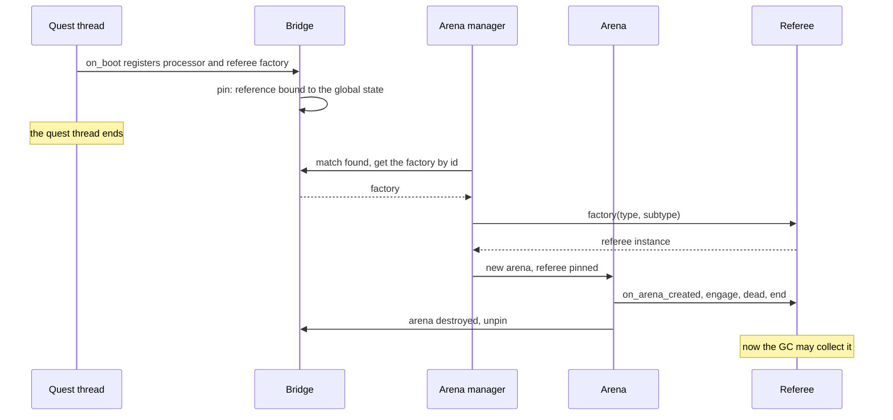
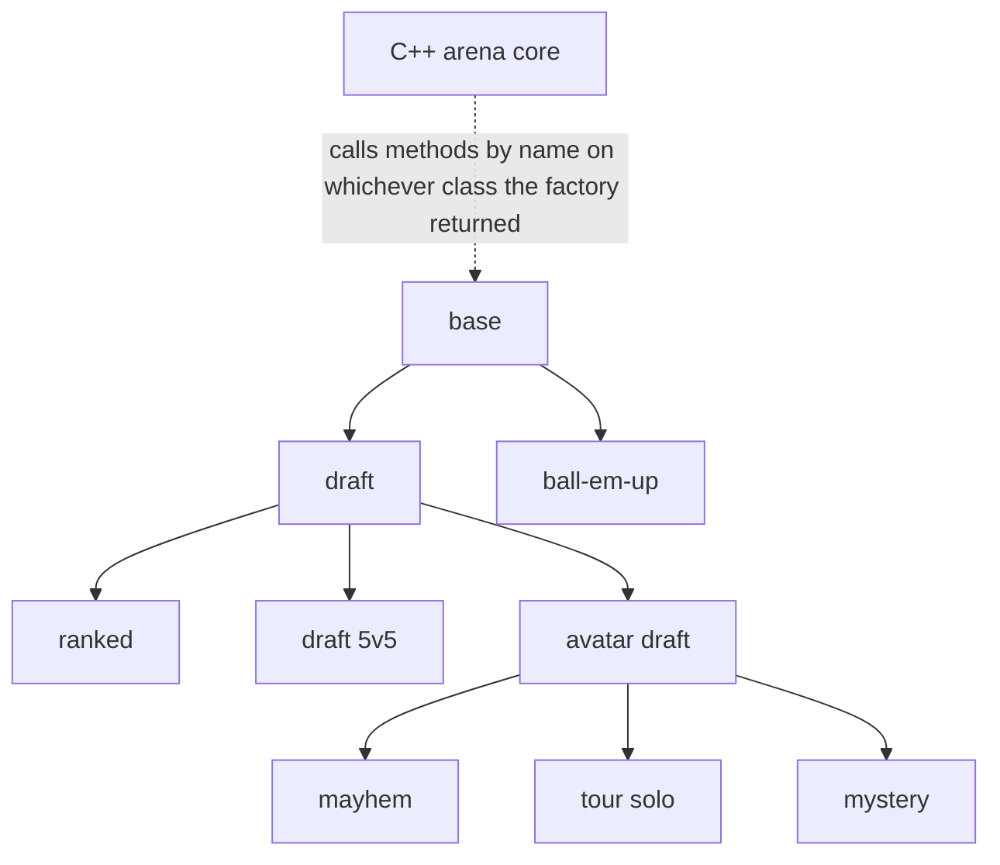

From June 2022 the arena join closed at 22:00 in the code, and the message told players it was open until 11PM. The message stayed in the source until May 2026, almost four years, and it is a fair summary of how the arena and lobby code behaved before Forge.

Arena and lobby were the most used legacy subsystem and the one giving the most problems. Adding a queue or changing a requirement was an engine job, and I was the only one who could do it. It was difficult to customize and very clunky. The code was fragile and a mess.

## One rule, two files, four years of drift

Vanilla Metin2 has no lobby and no matchmaking queue: its arena is a GM-started 1v1 duel. The lobby, the queue and the ranked arena were our own C++ additions, started in November 2017. By the day before the migration they were 12 files and 5,021 lines, plus about 270 lines of lobby handlers in the input code and the MMR manager beside them. The lobby types were a closed C++ enum, the team sizes were picked by a switch, the matchmaking level brackets were `if` chains, and one arena class served every mode by testing `IsRandom()` and `IsRanked()` flags. Lobby type and subtype went over the wire as single bytes, so a new type meant a new enum value on server and client.

I once got a request to make the join hour-based. The change took little time. What cost me was finding that somewhere in the input handling code there was already a hardcoded rule and a hardcoded error message deciding when the whole arena lobby was open or closed.

The rule itself lived in the lobby manager's enqueue path. A teammate had added it in August 2021 as "random arenas only between 18 and 23". The condition was then edited four times in C++ over the next ten months, and every edit meant a rebuild. This is its last C++ form, from June 2022:

```cpp
if(pkLobby->GetType() == LOBBY_TYPE_PVP_ARENA)
{
    std::time_t t = std::time(0);
    std::tm* now = std::localtime(&t);

    if(now->tm_hour < 18 || (now->tm_hour >= 22 && now->tm_min >= 0))
    {
        if(g_bIsTestServer)
        {
            pkLobby->SendChatPacketToMembers(CHAT_TYPE_INFO, "<Lobby> TEST SERVER OK! REAL SERVER: Random not open.");
        }
        else
        {
            return -2;
        }
    }
}
```

Returning `-2` meant "closed". The text the player saw was written in a second file, the packet handler that called the enqueue: `<Lobby> Remember it's open only from 6PM to 11PM.` When the closing hour moved from midnight to 22:00 in June 2022, the code changed and the message did not. Nobody had a reason to open the second file. Players read a promise the server did not keep.

The rule and its message were a pair that had to be edited together and compiled together, and nothing connected the two halves.

The lobby was the first existing system I ported to Lua. Rejoin dungeon and the roulette had gone to Lua the week before, but those were completely different systems, and I count them as new. The migration landed in two commits. On October 30, 2024 the lobby manager moved to string type and subtype and a generic Lua lobby processor replaced the C++ switch: 76 files, 5,073 lines added and 4,607 removed, with the old client lobby windows deleted and the packets rewritten to carry strings. On November 5, 2024 the arena followed: the arena class went from 1,400 to 1,062 lines and the arena manager from 698 to 336, and every specialization moved into Lua referees. C++ kept the core of an arena and stopped knowing what kind of arena it was.

Lobby properties now come from Lua:

```lua
forge.sys.game.lobby_manager.set_proto("ARENA_DRAFT", "1V1", {
    team_count = 2,
    member_per_team = 1,
    observer_team_count = 1,
    flag = forge.sys.game.lobby_manager.LOBBY_FLAG.ENQUEABLE | forge.sys.game.lobby_manager.LOBBY_FLAG.GLOBAL,
})
```

The C++ engine enforces whatever the processor declares. It no longer knows the difference between a ranked match and a custom one.

The opening hours moved too. First a cron in the queue script, added on November 6, 2024. Now an availability manager in Lua decides whether a queue is open from the event calendar, the ranked season and manual overrides, and a GM command can force a queue open or closed at runtime. Nobody rebuilds anything to change arena hours. The stale message line stayed in the packet handler long after the rule left C++ and was only commented out in May 2026. The migration moved the rule. It did not clean up the place where the rule had been duplicated.

## The arena that stopped without a crash

Moving state into Lua gave me a problem C++ never had: the engine holds objects it does not own. A lobby processor or a referee is a Lua table, and C++ keeps a handle to it. The Lua garbage collector decides when a table is dead, and it does not know the engine is still using it.

The garbage collector collected the processor and the referee. The system silently stopped. No crash, no error, no stack trace, only arenas that did not start. That is where the pin started.

It took me a month to find the cause. What showed it was a log in the destructor of the forge: the object was dying while the server was still running.



The cause was in the thread. The processors register themselves from `on_boot`, which runs in a quest thread with its own Lua state, not in the global one. The reference C++ kept was bound to that short-lived thread. When the thread was gone, the reference went with it, and the GC collected the table while the engine still held its handle. The fix, on January 1, 2025, makes the reference belong to the global state instead of the caller's thread, and the registered processors, the referee factory, event callbacks and their data all got it in the same change.

Today the arena manager checks the pinned object and logs instead of crashing: if the referee factory is not valid, creating an arena writes an error and returns nothing. That is the right behavior now, and it is also why the original failure looked like silence.

The pin grew with use. In April 2025 the references moved into a registry owned by the bridge, and C++ holds only an id:

```cpp
uint64_t PinObject(sol::object object) {
    auto id = ++pinned_object_cursor;
    map_pinned_references[id] = sol::make_reference(GlobalStateView().lua_state(), object);
    return id;
}
void UnpinObject(uint64_t id) { map_pinned_references.erase(id); };

template <typename T>
T GetPinnedObject(uint64_t id) {
    auto it = map_pinned_references.find(id);
    if (it == map_pinned_references.end()) {
        return T{};
    }
    return it->second.as<T>();
}
```

In July 2026 a handle type bundled the pin with the forge namespace, released when the handle dies, so every arena pins its own referee instance for exactly as long as the arena exists. 23 server files use the pin API today, well outside the arena: guild war, the battle arbiter, player virtualization, traits, land deployment, the REST server. A bug in the arena became the standard way C++ holds a Lua object.

What I take from it: when native code keeps a script object, it has to own a reference to it. A borrowed one works until the day the script side decides it is garbage, and it will not tell you.

## Release builds and the pcall that was not one

The second failure only showed in release builds, where the server crashed outright. I had compiled in release, and the binding library dropped the implicit `sol::protected_function` to a plain function. A Lua error that a `pcall` should have caught went through the default panic handler and aborted the process.

The calls that did it looked safe. The result was assigned to a `sol::protected_function_result`, but the call itself was an inline call on the table, and in a release build that inline call goes through `lua_call`, not `lua_pcall`. The fix on April 15, 2026 touched 15 files and extracts each method into a named protected function before calling it:

```cpp
sol::protected_function_result result = m_referee[m_methodMapping["on_arena_created"]](m_referee, this);
```

becomes

```cpp
sol::protected_function fn = m_referee[m_methodMapping["on_arena_created"]];
sol::protected_function_result result = fn(m_referee, this);
```

The named type forces `lua_pcall` in every build, and errors go through the error handler with a stack trace. Today the processor handle does this extraction in one place, so no call site can forget it.

## A mode is a child class

What surprised me in the migration was how much easier gameplay and subsystem authoring became.

The first mode I wrote as a forge was the base mode. Then came one without ranking and without MMR. I cannot give a time against the full C++ version, because at the time LLMs did not exist and the two jobs are not comparable. The speedup I felt came when I needed the draft version, which is an extension of the base. Writing it felt like writing a normal child class: no engine change, no new C++ at all, only the new rules and logic.

The base referee builds its state and handles the arena lifecycle. Draft takes the base as its `__index` and overrides what differs, calling up explicitly:

```lua
local base = require("arena.referees.base")

---@class draft_arena_referee : base_arena_referee
local draft_arena_referee = setmetatable({}, {__index = base})
draft_arena_referee.__index = draft_arena_referee

---@return draft_arena_referee
function draft_arena_referee:new()
    return setmetatable(base.new(self), self)
end

function draft_arena_referee:on_arena_engage(arena)
    base.on_arena_engage(self, arena)
    self:start_notice(arena)
end
```

Draft adds the guild points, the end-of-match notices, a three-day ban after three desertions, guild coins and battlepass progress. Ranked extends draft and adds MMR on match end. A 5v5 draft is 67 lines: the map positions, the duration, the potion rules and the guild coin payout. The avatar draft layers player virtualization on top, and mayhem, the solo tour and mystery extend that. Ball-Em-Up, the cooperative wave mode, extends the base with its own wave spawning and per-event rankings.



The engine at the top knows nothing about this tree. It calls methods by name on whatever the factory returned, and the interface is checked once, when the referee is created.

The factory is still a plain chain of branches over type and subtype, one more branch per mode. That is a central file I edit for every new mode, and I did not hide it. A mode is one new file, one branch and a `set_proto` call in the queue script. In October 2026 a teammate added the 5v5 draft, mystery and Ball-Em-Up as new files extending existing referees.

I finally had different lobby and arena logic for different modes, ranked, draft, avatar and mayhem, without changing anything of what existed. We went from needing to touch things that might break existing things, to not caring, because I was building beside what already existed without polluting it.

Matchmaking moved the same way. The Lua processor defines the level brackets and the ladder ranges, checks whether a player is banned, has the right arena affect or is stuck in a slow queue, and for a ranked match computes the average ladder of the lobby and compares each candidate against it. A custom match that allows any level difference simply skips the check. I did not measure the cost of this. It works the way the C++ did: it runs a rule against all the characters, level, state and whether they are already in a lobby. The item use policy went through the same migration, replacing scattered restrictions on potions and items with one extensible Lua policy.

On the Lua side the arena is now 23 files and 5,395 lines, about the size of the 5,021 lines of C++ it replaced. The difference is who can read it, who can change it, and what breaks when they do.
