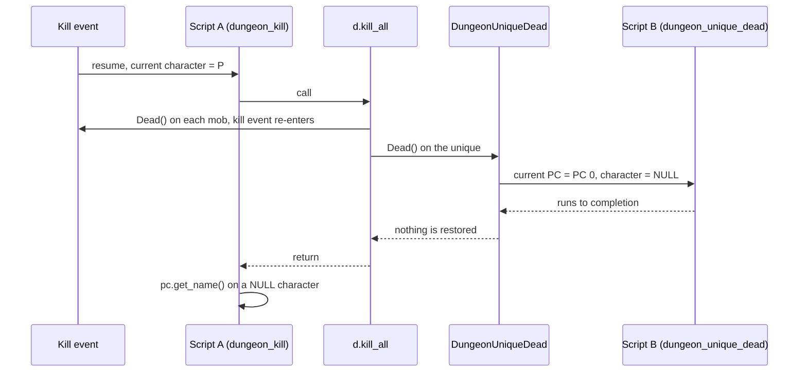
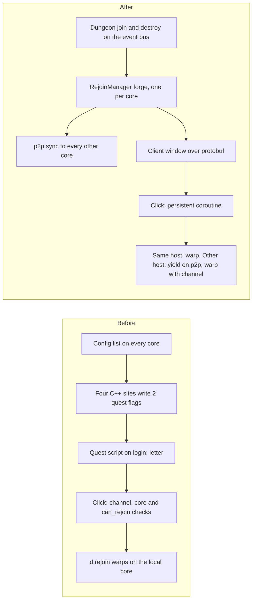

The most typical crash in the quest manager was one line of Lua: `d.kill_all()`. It killed every monster in a dungeon. If one of those monsters was registered as a unique with a `when dungeon_unique_dead` block, the kill started that block in the middle of the script that had called `d.kill_all`. Then the second script started a third, and the stack of `when` blocks that built up normally ended in a SIGSEGV.

Nothing in the script was wrong. The design of the manager was.

## One C stack, one set of globals

The quest manager keeps one set of "current" pointers: the current PC, the current character, the selected dungeon, the running state. Every event entry overwrites them. Scripts read them implicitly, so `pc.get_name()` does not take a player, it asks the manager who the current one is. For a linear script that is fine. A script runs, yields or ends, the next event starts.

Vanilla Metin2 has the same shape, and the same hole: a kill handler that kills more monsters re-enters the kill path, and every re-entry overwrites the context the outer script is still using. The guard it has is per player, and it only stops a second script on a PC that is already running one.

In my engine the hole was wider, because in 2019 I had added a `dungeon_unique_dead` event (vanilla only has a polling getter, `d.is_unique_dead`). Follow one kill through it:

1. A player kills mob 2845. The manager points the current PC and character at that player and resumes a short-lived coroutine for the `dungeon_kill` block. Call it script A.
2. Script A calls `d.kill_all()`. That is a C function, still inside A's resume. It walks the map and calls `Dead()` on every non-player.
3. A mob that players had hit goes through the reward path and fires another dungeon kill event for whoever did the most damage to it: the same player, or a party member. The pointers are set again, and a whole `dungeon_kill` block runs nested inside A.
4. A registered unique goes through the dungeon's death notification, which fires `DungeonUniqueDead`. That event runs on a shared fake PC with id 0, sets the current character to NULL, and runs the `when dungeon_unique_dead` block to completion. Script B, also nested inside A's C call.
5. Nothing restores the previous values. `d.kill_all` returns and script A continues with the current character NULL, the current PC set to PC 0 and the running state pointing at B.



The diagram reads top to bottom, and every arrow into a nested block is a synchronous call. The only thing that ever writes the global slots is the entry of a new event. Nothing writes them back on exit.

From there the crash has several doors. The next `pc.*` call dereferences the current character without a null check: `pc.get_name()` is one line of C++ that calls `GetName()` on whatever the manager points at.

If script A yields on a `select` or `wait`, the manager suspends it on whatever PC is current, which is PC 0. And back in the C++ that launched script A, the kill path read the current character after the script returned, then called `GetParty()` on it. That order existed from the first commit until May 2026.

## A flag that dropped events

My answer in September 2021 was to stop scripters from nesting events, because nesting was bad practice. A flag on the manager, `m_bPreventEvents`, set around `KillAll` and checked in the kill, dungeon kill, fire kill, die and unique-dead entries. With the flag on, those entries return at once.

The history of that flag is not a clean fix:

- 2021-09-20, 03:40. I added the flag and the five early returns. It did not compile: a `return;` in a function returning `bool`, and a line split in two in the middle of an identifier.
- 2021-09-20, 14:20. A teammate fixed both compile errors.
- 2021-09-20, 17:06. In an unrelated master hunt fix touching 10 files, I removed all five early returns. The flag was still set and reset around `KillAll`. Nothing read it. The record does not say why.
- 2021-09-24. A separate change took a full snapshot of the manager state whenever a script suspends and restored it on resume. The same class of problem, found from a different side.
- 2023-10-18, 19:19. Two years after the first attempt, I added the guards back and wrote the comment that describes the bug. Two follow-up commits fixed compile errors again, this time in the return type of the void functions.

For two years `d.kill_all` set a flag that nothing looked at, and the nested unique-dead event was live.

The comment I wrote in October 2023 is the most honest piece of the whole fix. It explains that a `d.kill_all` inside a kill handler triggers `DungeonUniqueDead`, which resets the current PC, and then says the flag is only a workaround: the correct fix is to stack the quest manager states and reset the top every time a nested event ends. That stack was never built in the quest manager, and the flag is still there. The function that sets it is the same one from 2021:

```cpp
int dungeon_kill_all(lua_State* L)
{
    CQuestManager& q = CQuestManager::instance();
    LPDUNGEON pDungeon = q.GetCurrentDungeon();

    if(pDungeon) {
        q.SetPreventEvents();
        pDungeon->KillAll();
        q.ResetPreventEvents();
    }

    return 0;
}
```

The workaround has a price. With the flag on, no mob killed by `d.kill_all` fires a `kill`, `dungeon_kill`, `die`, `eligible_mob_kill` or `dungeon_unique_dead` event, and the dungeon still forgets the unique when it dies. A `dungeon_unique_dead` handler for a boss killed that way never runs. The scripters pay the rest by discipline: 23 quest files call `d.kill_all`, 9 of them also use unique-dead, and one of them carries a comment I added in September 2026: nothing may touch pc or npc after `kill_all`.

The flag stopped the crash by deleting events. That is a policy, not a fix. And it protected the manager from its own scripters, which was never the real problem: the real problem was how many places in C++ called back into Lua and met a design that could not take it.

## The engine as a dumping ground

The quest manager was never enough, because its whole purpose was scripting simple quests. Anything more complex than "go there, kill this, drop that, take it" went into the C++ engine. Minigames, battle arenas, guild domains, the guild war: each one brought its own hooks and its own packet handling, and each hook was written in whatever style the developer had that week.

The bugs that came from it were rarely in the quest manager's code. New subsystems regressed old ones. There were SIGSEGVs, and design inconsistency everywhere. Many times I created a re-entry bug in the quest manager without touching a line of it, just by adding a C++ hook that called into Lua at the wrong moment.

I did try to stretch the boundary first. For the guild domain I exposed the open and close events to a quest script, so scripters could control the times instead of having them hardcoded. For dungeons I did the same. The result was a system with no clear boundary: some logic available to high-level scripters, some hidden in C++. Nobody could say how it really worked, and nobody had an overview of the behavior.

## Dungeon rejoin, followed to the end

Rejoin lets a player who left a dungeon, by disconnect or by dying out, come back to the same instance. It was the first feature I moved out of the quest manager, and it is the cleanest before and after I have.

**Before.** The rejoinable dungeons were a list in the core's config file, and the doc I wrote in 2019 says to add the base map index on every core that hosts the dungeon, so on every channel. When a player entered a rejoinable dungeon, four places in C++ wrote two quest flags on the player: `dungeon.map_index` and `dungeon.channel`. Those four were the member join, the two warp helpers and `d.new_jump`. Three exit paths cleared them. A 92-line quest script handled the rest: on login it sent a letter, and on click it checked the channel, checked that the core hosted the base map, asked `d.can_rejoin`, and warped.

`d.can_rejoin` looked the dungeon up on the local core only. A dungeon on another core was "not found", and that read as "battle done". So the script refused unless you were already on the right channel and on a core with the map. Rejoin did not work across cores, and a player could hold exactly one, because there was one `map_index` flag. Every exit path in the script had to reset the flags by hand, including two that belonged to a different quest:

```lua
if false == d.can_rejoin(map_index) then
    sys_log(0, "PG: "..pc.get_player_id().." | map_index: "..map_index.." | channel: "..pc.getf("dungeon", "channel").."")
    say(locale.dungeon_rejoin.battle_done)
    clear_letter()
    pc.setf("dungeon", "map_index", 0)
    pc.setf("dungeon", "channel", 0)
    pc.setf("ue_bighunt_2old_villages", "MapIndex", 0)
    pc.setf("ue_bighunt_dungeon", "MapIndex", 0)
    return
end
```

That four-flag reset appears five times in the script. The patch history says the rest: seven fixes between 2020 and 2022, among them a commit message about removing code "that was supposed to fix the kill event but breaks it even more", a rejoin that closed the letter on any map, and a "third party" rejoin. It was fragile, and it was fragile for a structural reason: the state lived in two quest flags that C++ wrote and a script read.

**After.** On 2024-10-21 I replaced it with a forge: one commit added it (21 files, +2749/-1367 including generated protobuf), and the same day another deleted the old quest, `d.rejoin` and `d.can_rejoin`, the flag writes and the config list (13 files, +182/-407). The forge today is 795 lines. A `RejoinManager` instance lives for the whole server process and holds every open rejoinable: id, map index, hostname, status, and the set of players, several per player. It subscribes to the C++ event bus for dungeon join and destroy, and keeps every core in sync over p2p messages.

The rejoin itself, in the forge from October 2024, is a persistent coroutine that may wait on another core. The excerpt is trimmed to the branch that matters: same host warps, other host yields on a p2p request and warps with the channel the owner returns.

```lua
if r.hostname == get_server_hostname() then
    local dungeon = forge.sys.game.dungeon_manager.find_by_map_index(r.map_index)
    if nil == dungeon then
        sys_err(string.format("PID [%d] requested to join a dungeon without dungeon map_index[%d]", pid, r.map_index))
        ch:popup("REJOIN_CANNOT_ERROR")
        return
    end

    local jump_pos = dungeon:get_last_jump_position()
    ch:warp_set(jump_pos.x, jump_pos.y, dungeon:get_map_index())
else
    local request = rejoin_messages.GGRejoinCoordsRequest()
    request.rejoin_id = rejoin_id

    local response, ok = forge_helper.sys.game.yield_p2p("request_rejoin_coords", request:SerializeToString())
    if false == ok then
        sys_err(string.format("PID [%d] p2p request died dungeon map_index[%d]", pid, r.map_index))
        ch:popup("REJOIN_CANNOT_ERROR")
        return
    end
end
```



What is left in the quest is a shell: `when boot` starts the manager, `when login` sends the letter if the player has a rejoinable dungeon, `when info or button` opens the client window. Before: a 92-line quest, four C++ write sites, two flags, per-core config, one core, one dungeon per player. After: one 795-line forge that holds its state in memory for the lifetime of the process, synced to every core, with rejoin across cores and channels by a coroutine that yields on a request.

It did not stay perfect. Fixes kept coming: protobuf field order and the ordering of a remove against the p2p sync in September 2025, the state broadcast to the client in October, rejoin enabled for the horse, dragon and spec dungeons, and in June 2026 a change to stop holding a character reference directly.

## What Luna cost

It cost 3 to 4 months of work, and it reached stability after 1 year of development and use.

The repository fits that. After a first prototype in February 2024 (the Lua 5.3 move, a first bridge and forge), the Luna work is concentrated between September and November 2024: 25 commits touching Luna paths in October alone. The bridge integrated with all input processors and the quest manager on October 7, in one commit of 93 files. Persistent coroutines, `bridge.coro`, landed two days later. Rejoin came on October 21, season and ranking on October 23, the roulette on October 25, and the lobby and arena on a new processor on November 5, 57 files. Master Hunt followed in February 2025 (60 files, +8097/-3230), the domain open and close events moved to a forge in May 2025, and the guild war logic went to Lua in June 2026. There are 48 forge files today, 28,632 lines.

The year after that was yields and lifetimes. Yields and coroutine continuation were the hardest part, and I broke the execution flow many times. The commit messages say what the breakage was: a `__gc` operating on a closed Lua state in November 2024, references to Lua tables and functions that needed pinning so the garbage collector would not take them from an ephemeral thread in January 2025, coroutines pinned for the same reason a few days later, the references centralized in the bridge in April, a disconnect that closed coroutines only after the player was erased in May. Adopting a coroutine that the bridge did not create was reimplemented in August 2025, ten months after `bridge.coro`. `AdoptCoroutine` is a leftover of that try and break era, and no script under the content folders calls it today.

The old problem came back once more, from the new side, which is the part I find most useful. In October 2024 a disconnect left the manager's current PC pointing at a player who was gone. In December 2025 Luna events fired while a quest script was running could still overwrite the global state, so I queued them: they run only when no script is running. In April 2026 I moved that queue into the main loop, because draining it at the end of a script was creating the same nested processing it was meant to prevent. The manager's comment says why: the application is single threaded, so an event fired from inside a running script corrupts the manager.

The queue is a bridge to the old manager, not a new design. The new design is below it:

```cpp
// Every resume of a tracked coroutine funnels here. Copies the ns
// and coroutine handle out of the map entry first: Lua can mutate
// coroutine_map (rehash) during the resume, invalidating references
// into it. OnCoroutineDead must run AFTER this returns.
template <typename... Args>
sol::protected_function_result CallCoroutine(CoroutineData& co,
                                             std::string_view detail,
                                             Args&&... args) {
    std::string ns = co.forge_ns;
    sol::coroutine coro = co.coroutine;
    dispatch::Scope scope(ns, dispatch::Kind::COROUTINE, detail);
    return coro(std::forward<Args>(args)...);
}
```

Each coroutine carries its own namespace, copied out before it resumes, and a scope that is closed when it returns. Nothing about the call depends on who ran before. An implicit current-instance global does not survive a reentrant event, and a flag that drops the event is not a way out of that. A resumable unit that owns its context is.
