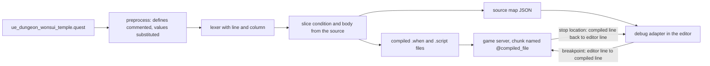

I debugged quests by commenting out one line at a time until the problem went away. The logging that vanilla Metin2 gives a quest script could not print a player or a mob, so there was nothing else to try.

## Logs that could not print the thing I needed

The quest log functions were there, but not reachable everywhere and unable to print complex structures like a `pc` or a mob. This is the vanilla error function, which is also what my tree had until September 2024:

```cpp
int32_t _syserr(lua_State* L)
{
    if (!lua_isstring(L, 1))
        return 0;

    PC* pc = CQuestManager::instance().GetCurrentPC();

    if (!pc)
        return 0;

    LPCHARACTER ch = CQuestManager::instance().GetCurrentCharacterPtr();

    if (!ch)
        return 0;

    sys_err("QUEST: quest: %s player: %s : %s", pc->GetCurrentQuestName().c_str(), ch->GetName(), lua_tostring(L, 1));
    ch->ChatPacket(CHAT_TYPE_INFO, "QUEST_SYSERR %s", lua_tostring(L, 1));
    return 0;
}
```

Read it as a list of ways to log nothing. `lua_isstring` is true for strings and numbers only, so a table, a nil or a boolean is dropped without a word. With no current player, or no current character, the function returns before it logs. That is any callback that runs without a selected player, a server timer for one. And the output is one string, so a script author could only print scalars fetched one at a time. `sys_log` is stricter: it wants a numeric level as its first argument, and without one it drops the call.

That last rule bit in September 2021. A teammate had added `sys_log` lines to the kill counter of the Scorpion Desert dungeon. I removed them four days later and added a log to the dungeon rejoin quest instead. The line went in without its level argument, so it printed nothing, and it was fixed half an hour later. Add a log, run the dungeon, look, remove it: in September 2024 that one rejoin line was the only `sys_log` or `sys_err` left in any `.quest` file.

Authoring dungeons was a mess. If a stage blocked or did not go as planned, we had to repeat the whole dungeon, placing `sys_err` prints on flat structures, and go by try. When prints told me nothing I commented single lines until the problem went away.

A failing script did not help either. The server reported the quest, the state and the event, not a line. The chunk was named after the quest, and its line numbers counted the compiled snippet, not the `.quest` file I edited.

## One extension, a debugger and a linter

The first devtool was the linter, and it was built together with the remote debugger. I started from existing extensions: a remote debugger for Lua and the sumneko language server. I experimented with the two separately, in the same work package, and then folded the linter inside the debugger for convenience. It ships as one VS Code extension. On activation it adds a plugin to the language server's settings, and the plugin rewrites the quest dialect into plain Lua the server can type-check. `quest name begin` becomes a local table, a `define` becomes a `local`, and `when <triggers> with <cond> begin` becomes `if <cond> then`. The triggers are blanked with spaces of the same length, so every line and column after them stays where it was.

The setup for a script author is one `launch.json` entry:

```json
{
  "version": "0.2.0",
  "configurations": [
    {
      "type": "uc-lrdb",
      "request": "attach",
      "name": "Metin2 Quest Debug",
      "host": "localhost",
      "port": 21110,
      "sourceRoot": "${workspaceFolder}",
      "sourceMapPaths": [],
      "pathMappings": [],
      "stopOnEntry": true
    }
  ]
}
```

That entry is the cheap part. Making the debugger understand the engine behind it took three rewrites: the quest compiler, the server's bookkeeping of files and lines, and the way the client loads Python modules. It cost me nothing I would call a price. It was 100% worth it, it was fun, and I learned a lot.

## The compiler was the hardest part

Of the three, the compiler hurt the most. It was the hardest for two reasons: edge cases that came out later, and source mapping.

The vanilla compiler does not translate quests, it re-prints them. It walks the token stream and writes every token back out separated by a space, so comments and blank lines vanish and the layout is gone. A line in the output has no arithmetic relation to a line in the source. On top of that my tree ran a Python front end in front of the compiler, which copied each quest into a working folder with the `define` constants substituted. Errors then named the copy, one more step away from the file I edited.

On 20 September 2024 I split the one big compiler file into a compiler, a quest model, a forge part and helpers. Five days later the source-map version landed, in one commit that touched 65 files. It did four things:

- The Lua lexer was patched to count columns, so every token carries a line and a position.
- A `when` body became a slice of the original source text instead of a re-print.
- Every object the compiler writes records a source map entry: the source file, the compiled file, the start and end line in the source, and the offset inside the compiled file. They are dumped per source file as JSON.
- A `define` line is commented out in place, never deleted, so the line count survives preprocessing. The old Python front end and its working copies were deleted.

The path from a breakpoint to a running script looks like this. The compiler writes the map next to its output, the debug adapter in the editor loads it, and the adapter translates in both directions:



The server never reads the map. The adapter does: it loads every map under `sourceMapPaths`, builds a forward and an inverse table, and does the arithmetic itself. One editor line can map to several compiled files, because a `when` body with several triggers is written once per trigger.

The edge cases were the long tail, and they kept coming for sixteen months.

On 23 September 2024 I fixed `or`-chained `when` triggers: the argument was registered before the compiler checked for the `or`, so the wrong objects came out. That commit also added the first test file for the compiler, 78 lines. Two days later the same test was rewritten so that the triggers and the `with` condition were split across lines, because a compiler that slices source text, unlike one that re-prints tokens, cares where a condition ends and a body starts. The test file now holds 16 `when` shapes.

On 22 October 2024 state names stopped being converted from a variable to a string, so `set_state(__COMPLETE__)` had to become `set_state("__COMPLETE__")` through a regex pass. The old compiler did this on the token; mine no longer re-prints tokens. On 8 November 2024 a quest with two blocks for the same event and no argument kept only the last one. The real case was two `take` blocks in the Devil Tower quest. The fix merged the blocks into one script, and the source map then needed an offset for where each block starts inside the merged file. On 30 January 2025 a conditioned block lost the `return` that vanilla closed it with.

Preprocessor substitution was the slowest to show. Defines can use other defines, as in the Wonsui Temple dungeon:

```lua
define DUNGEON_KEY 11
define D_EASY_MIN_LEVEL forge.game.ue_dungeon_info:get_min_level_access(DUNGEON_KEY)
```

I had kept the defines in an unordered map, so the order of substitution was arbitrary and a redefinition overwrote the first value. On 25 October 2025 they became an ordered list substituted last to first:

```cpp
// Perform the substitution in the entire content in reverse order
for (auto it = defines.rbegin(); it != defines.rend(); ++it) {
    const std::string& identifier = it->first;
    const std::string& value = it->second;
    std::regex identifier_regex("\\b" + identifier + "\\b");
    new_content = std::regex_replace(new_content, identifier_regex, value);
}
```

The last source-map bug I know of is from 23 January 2026. A function inlined into a quest carried an offset that was one line short, because the compiler appends `",\n"` after it. Sixteen months after the rewrite, a breakpoint in an inlined function could still land one line off.

## The server keeps a file name per script

The server half was small on paper. On 25 September 2024, the same day as the compiler, I attached LRDB to the quest Lua state behind two config keys, `server.lrdb.enabled` and `server.lrdb.port`. Both default to off. Then I made every loaded script remember the compiled file it came from, and passed that name through every call that executes a quest script. The chunk is now named `@` plus the file path, which is the Lua convention for a file: stack frames and errors carry the compiled file and line. The adapter strips the `@` and looks the file up in its inverse map. That is all the server knows about the whole source-map story.

A second pair of path mappings, for the `conf/` and `locale/` folders, lives in the `launch.json`, because the machine running the game and the machine running the editor do not share a root.

## The client had no file to open

The client was worse to see. Its Python never runs from files on disk: `sys.path` is empty and every import is answered by a custom importer that reads the module out of EterPack, the client's packed virtual file system. A debugger maps a frame to a file through `__file__`, and a module compiled out of a pack has no file a debugger can open. Vanilla Metin2 pasted the main script into a string and executed it, and its importer handled flat names only.

I rewrote how the client manages module loading in May 2024, four months before the Lua half. The launcher runs the main script as a real module, with `__file__` set. The importer maps dotted names to paths, supports packages, and compiles each pack module with its absolute path as the filename. The socket and ctypes libraries the debugger needs are linked statically. A build with the debugger compiled in attaches ptvsd on the first free local port from 3000 to 3049.

The importer was not finished then. Submodule access and parent linking were reworked in December 2024, with case-insensitive imports a few days later, so that the same module is not instantiated twice. In September 2026 a debugger build began to prefer a `.py` file beside the executable over the packed one and to re-read it when it changes, executing into the same module object as `reload` does. A shipped client never sets the flag.

## Stubs: the linter needed to know the engine

A debugger tells you what went wrong after you run the script. The linter has to tell you before, and it can only do that if it knows what the engine offers. Before 29 September 2024 it knew nothing. A binding was a C function plus a row in a registration table, and the Lua side had no stubs at all. A script author guessed the arguments or read the C++.

That day I put the documentation inline, above each binding, as EmmyLua annotations in Doxygen comments, and wrote a Python parser that walks the Doxygen XML and writes one stub file per namespace into the quest `meta` folder. The first run annotated 28 binding files and produced 37 stub files. Today there are 2,256 inline `@lua` markers across 93 server source files, and they produce 106 stub files with 15,384 lines. The client got the same treatment in October 2024: 24 `.pyi` stub files for its C++ Python modules, 27 today.

The annotation sits where the function is written:

```cpp
/**
 * @brief Retrieves the current level of the current character.
 *
 * \---\@luadoc pc
 *
 * \---**Requires CurrentCharacter**
 *
 * \---\@return number # The current level of the character.
 * \---\@lua pc.get_level = function() end
 */
```

and the generated stub is what the linter reads:

```lua
---**Requires CurrentCharacter**  
---@return number # The current level of the character. 
pc.get_level = function() end 
```

The source of truth stays in one place, so the binding and its documentation change in the same diff. The parser warns loudly when a bare Doxygen command appears inside a block instead of an escaped one. It re-emits the preamble for a second `@lua` marker with no new documentation, which is how an overload is written.

This part is very important. Giving proper support to Lua when you are encouraging people to use Lua is almost mandatory. A language you tell people to write in needs completion, signatures and type checks, not only a debugger for when it breaks.

## What it bought

A dungeon stage that does not go as planned no longer means replaying the whole dungeon with prints on flat structures. The breakpoint goes on the line of the `.quest` file and stops there, with the table open in the editor. The window code on the client is a file I can change while the client runs.
