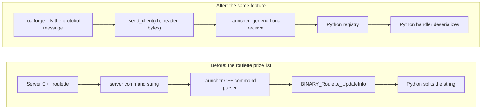
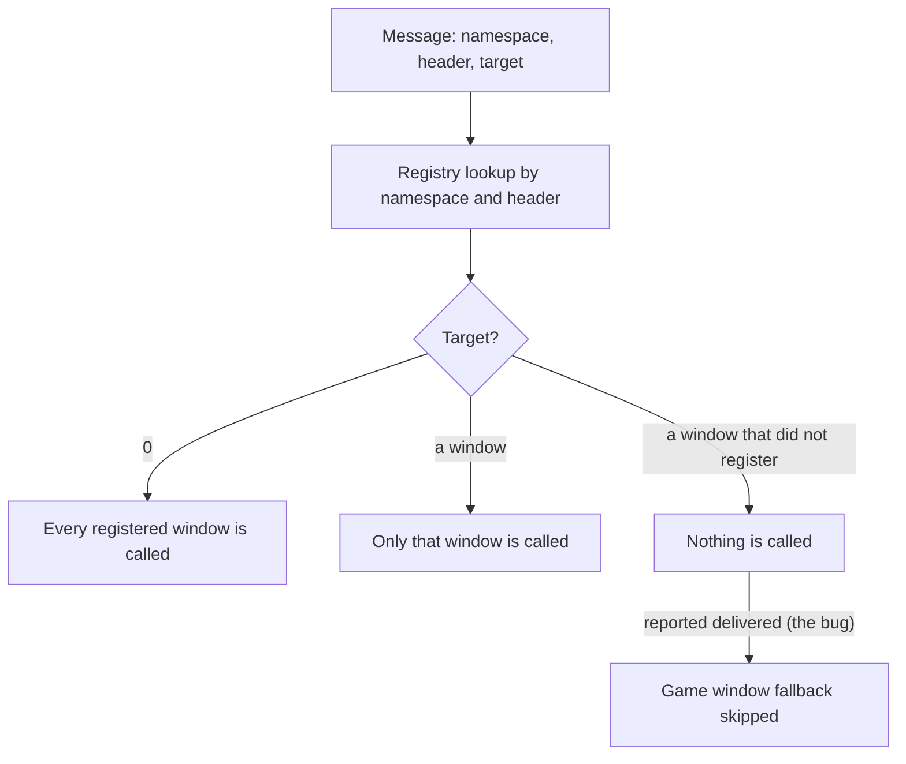

Sending one piece of data from the server to a window on the client meant four serialization and deserialization parsers, all written by hand, crossing three or four languages. The cost showed in the number of files touched. In autumn 2024 I replaced all of it with one protobuf transport, and a message stopped needing any C++ definition at all.

## What one message cost

Raid is the lean case. The packet is declared and encoded in C++ on the server, decoded in the C++ launcher, and pushed to Python. Counted by hand, one raid message touches 10 places: the shared header and structs, the server encode, the client size table, the dispatch switch, the receive function, its declaration, the constants exported to Python, the game window, the interface forwarder and the raid window itself. The request direction, from the player to the server, adds 6 more.

Pets are the heavy case. The client-side data lived in C++, so Python could not read it without a hand-written Python C API in front of it. A pet's experience value alone went through about 12 sites: the packet, the server send, the size table, the dispatch, the decode, a setter and getter on the player's pet store, a refresh flag, the C API getter and its method table entry, then three Python files. The `pet` module has 11 such getters. The launcher stored the data and Python pulled each field back out one call at a time.

Every one of those C++ sites meant a rebuild of the server, the launcher, or both. A new field on a window meant a rebuild.

## The roulette, before

The roulette is the feature I follow end to end. It was a C++ system on the server, with its own packet headers, a command in the chat command table, an input handler and a branch in the launcher's server command parser. The data crossed to the client as a string, and the launcher cut that string apart before Python cut it apart again.

This is the launcher side as it was in October 2024:

```cpp
else if ("item_info" == TokenVector[1])
{
    if (3 != TokenVector.size())
    {
        TraceError("CPythonNetworkStream::ServerCommand(c_szCommand=%s) - Strange Parameter Count : %s", c_szCommand);
        return;
    }

    PyCallClassMemberFunc(m_apoPhaseWnd[PHASE_WINDOW_GAME], "BINARY_Roulette_UpdateInfo", Py_BuildValue("(s)", TokenVector[2].c_str()));
}
```

Python then received `vnum,count|vnum,count` as a plain string and split it on the bars and the commas to fill the prize list.

## The roulette, after

On 25 October 2024 the roulette was rewritten as a forge, a Lua script that runs on the server. I count it as a new system in Lua, not a port: it was completely different from the C++ one. The commit touched 31 files and deleted 505 lines of C++ for the system itself, plus the launcher parser branch, the four `BINARY_Roulette_*` methods in the game window and the roulette packet header. What replaced it is a 35-line `.proto`, a 253-line `.forge` and the generated Python and Lua stubs.

The same message now takes this path.



On the old path the launcher parsed the content. On the new one it reads a namespace, a header and a size, and hands the rest through untouched. It does not know what a roulette is.

The server side is plain Lua. This is the code today, from another feature, because it shows the whole idea in a few lines:

```lua
local result = pb_loader.new(messages.GCActivateResult)
forge.sys.game.send_client(ch, "activate_result", result:SerializeToString())

local counters = pb_loader.new(messages.GCUpdateCounters)
pb_loader.load(counters, {
    stone_kills      = ch:get_quest_flag("casual_mode.stone_kills"),
    uid_active_count = uid_count + 1,
    affect_duration  = duration,
    claimed_objectives = claimed,
})
forge.sys.game.send_client(ch, "update_counters", counters:SerializeToString())
```

`ch` is the player's character. A message is a namespace, a header and a protobuf payload. The `.proto` compiles to Python and to Lua and never to C++, so nothing in the engine has to know the message exists. There is one Luna header per channel: client to game, game to client, game to game, game to database and database to game.

## What protobuf removed

The list is short. There are no GC, CG, DG or GD packets to declare for a feature. There are no hooks in the input handling. Everything travels from Lua to Python without recompiling anything.

For the roulette that is three authored files and none of them C++. A change to the prize list or the window no longer waits for a build of the server or the launcher. The proto compile is still a step, but it rebuilds neither binary.

## Why protobuf

JSON was too verbose for game traffic. FlatBuffers was not in my knowledge. I had already worked with protobuf, it is compact and fast, and it has a good tooling ecosystem. The same definition compiles for Lua on the server and Python on the client, which is the whole point.

## Making the launcher blind

Once the launcher stopped decoding, the hard part moved to the Python side: handler dispatching, with registration and unregistration.

The first registry was a little older than the transport. In July 2024 the guild war page subscribed to the same season and ranking data as another window, and the server had to stop duplicating observers for the same player, type and handler. The client registry changed in that commit too, from handing out the first free small id to being keyed by the window's own handle.

The Luna registry came on 21 October 2024. Before it, every Luna message went to the game window, which forwarded it by hand. After it, a window registers for a pair of namespace and header:



On the Python side a window registers in its constructor and unregisters in `__del__`, nothing else:

```python
def __init__(self):
    ui.ScriptWindow.__init__(self)
    self.__Initialize()
    self.__LoadWindow()
    luna.RegisterHandler(self.GetWindowHandle(), "ue_curse_manager", "curse_update", ui.__mem_func__(self.__OnCurseUpdate))

def __del__(self):
    luna.UnregisterHandler(self.GetWindowHandle())
    ui.ScriptWindow.__del__(self)
```

The handler receives the raw bytes and parses them with the generated class: `utils.Deserialize(curse_gem_pb2.GCCurseGemUpdate(), message)` returns the message, or `None` after logging the decode error.

A window rarely listens to one message. The achievements panel registers three of them in its constructor, before its UI script loads, so an early push from the server is never missed. The registry keeps two maps over the same entries. One goes from namespace and header to the list of handlers, for dispatch. The other goes from the window's identifier to everything it registered, so a window being destroyed removes all of its handlers in one call without remembering what it listened to. A third small map turns the window into a number the server can store, which is how a feature asks for its later messages to reach one window and no other.

## Delivered, when nothing ran

Dispatch has a fallback. If no registered handler took the message, the launcher passes it to the window named by the target, or to the game window when the target is 0, and that window routes by namespace and header in Python. Several features use that on purpose: a tower window that is created only when the server sends the first floor, for example, or the land data that is not a window at all.

The registry decided whether the fallback ran by what `Call` returned. In October 2024 it ended like this:

```cpp
bool CPythonLuna::Call(uint32_t handler_id, const std::string& ns, const std::string& header, PyObject* py_message, uint64_t receipt)
{
    // Find the namespace in m_handlers
    auto nsIt = m_handlers.find(ns);
    if (nsIt == m_handlers.end())
        return false;

    // Find the header in the namespace
    auto headerIt = nsIt->second.find(header);
    if (headerIt == nsIt->second.end())
        return false;

    auto& handlerVec = headerIt->second;

    // Call each handler in the vector
    for (const auto& lh : handlerVec)
    {
        if (handler_id && lh.handler_id != handler_id)
            continue;

        // Call the Python function and check for errors
        PyObject* result = PyObject_CallFunction(lh.callback, (char*)"OK", py_message, receipt);
        if (result == nullptr) {
            // If there's an error, print the error to stderr and clear the Python error indicator
            PyErr_Print();  // Prints the error to stderr
            PyErr_Clear();  // Clears the Python error indicator
        } else {
            // Decrement the reference count if the function call succeeds
            Py_DECREF(result);
        }
    }
    return handlerVec.size() != 0;
}
```

That says "delivered" whenever any handler is registered for the namespace and header, even when the target filter skipped every one of them. With two windows registered and a message aimed at neither, no callback ran, `Call` returned true, the launcher returned early and the fallback never ran either. Neither window received the data. Nothing was logged and nothing raised.

I do not remember which feature showed it. The symptom was always the same: two windows on one message, and neither got it. With a single registrant the bug was invisible, which is why it lived so long. It was there from October 2024 to August 2026, about 22 months. A teammate fixed it in August 2026: the loop now records whether a handler actually ran, and `Call` returns that.

The same change fixed a second bug of the same kind. When the client moved to 64 bits in December 2024, window handles became small ids so the server would no longer hold a memory pointer. The getter that translates a window to that id lacked its `return`, so every message the client sent with a window handle carried a zero. That too lasted until August 2026.

The roulette had its own version of the same pressure. In May 2026 a teammate added one manager that opens the right roulette by its UI type, and in June inline hosts began registering with that manager. One registrant per message, with the routing done in Python. It works around the problem instead of removing it.

## What it cost, what it bought

Rejoin dungeon and the roulette were the first features on protobuf, in the same week of October 2024 as the season and ranking managers, and both were new systems written for Lua. The first existing system I actually ported was the lobby, a few days later: its logic moved into Lua, while its packets stayed in C++, reshaped to carry strings. Match observer, master hunt, dungeon info, the battle pass and notifications followed through June 2025. When the legacy achievements system was retired in September 2026, seven C++ files went with their database loaders and packet headers, and the new panel talks to its forge directly. The launcher never learned that achievements exist. Today there are 42 protos, 48 forge files and 94 registration calls across 33 Python files.

It did not fit everything. In September 2026 the land topology went back to C++, into a client store, and the Luna topology messages were removed.

The cost is the other side of the same blindness. Nothing below Python knows what a message means, so nothing below Python can catch a mistake in using it. A forgotten registration is silent, a stale one swallows messages, and for 22 months the registry itself reported success it had not earned. The discipline moved into the window code: register in the constructor, unregister on destroy, by identifier.

Once the transport is generic, ownership becomes the protocol. A layer that does not know its payloads has to know exactly who is listening, and "delivered" has to mean that a handler ran.
