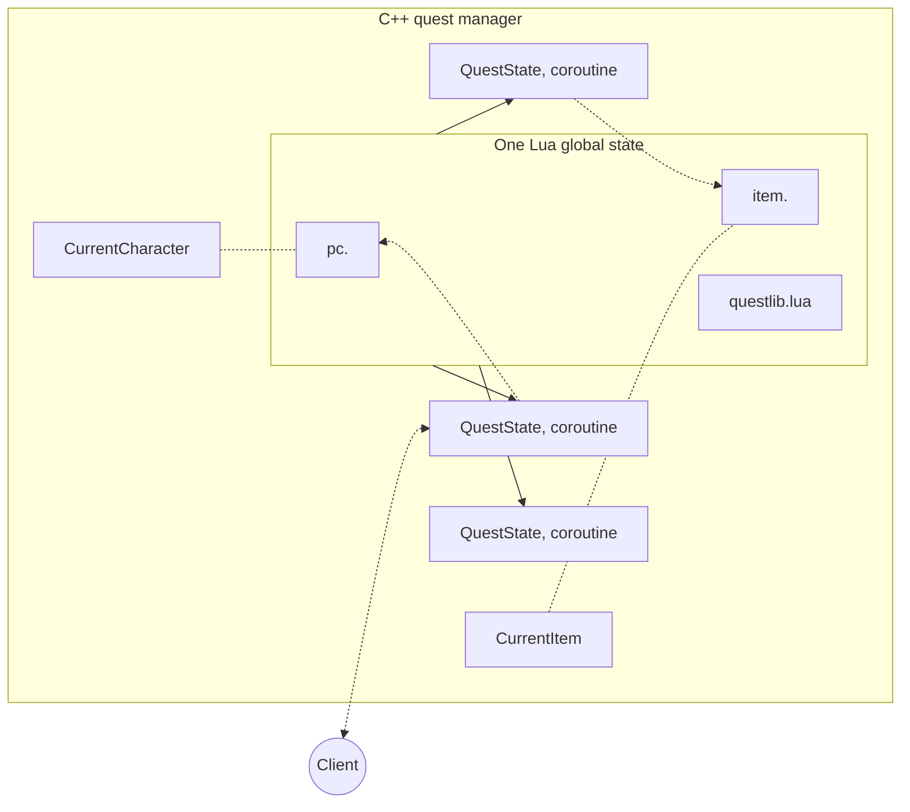
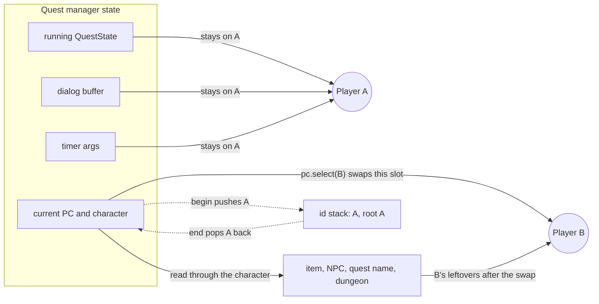
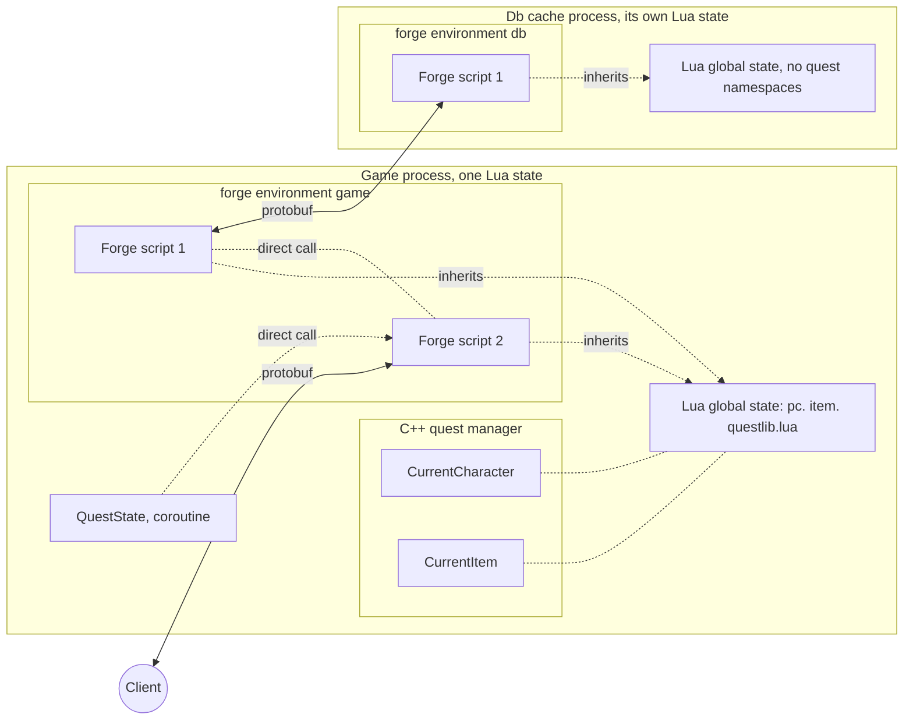

I started Forge because of two things the quest manager would not let me do. The first was to reach two player instances in one block and rely on it. The second was to bind a UI button to an action. The first one the manager could do, in a way so fragile that I stopped trusting it. The second one it could do only if the C++ had foreseen the button, and the price of one foreseen button was 18 files.

[Why quests were not enough](/blog/why-quests-were-not-enough) tells what broke. This post is the mechanism, and it hangs on one idea, the quest manager state: how the classic manager works, what it does well, where those two tasks hit its walls, and what the same tasks look like in Forge.

## What the quest manager does well

The manager is a Lua and C++ integration from the early 2000s, and vanilla Metin2 has run its scripting on it for two decades. I do not say that to be polite. It is a good design for what it was built for.

The quest compiler turns each `when` block into one file named after the event it answers. A script for the use of item 71055 lands in `object/71055/use/change_name.start`, a kill of mob 691 in `object/691/kill/...`, and an event with no target in `object/notarget/<event>/`. At boot the game core walks those folders and indexes the chunks by vnum and event. Finding the code for an event is a directory lookup.

When the event fires, the manager opens a new Lua thread on the single global state and runs the chunk top to bottom. The thread is short lived. Whatever the script needs to keep goes through the C API into quest flags, and the locals die with the coroutine. Two running scripts share no locals.

And yielding is invisible to the author. `q.select(...)` stops the coroutine, the manager sends the question to the client, and the answer resumes the script on the next line. A scripter writes a conversation as straight-line code.



Read the two slots on the left first: `CurrentCharacter` and `CurrentItem` are C++ pointers, and the `pc.` and `item.` namespaces are bound to them. Each event entry writes them, and every `pc.*` function reads them. The coroutines on the right are spawned from the one global state and call the namespaces. The dotted line to the client is the yield: the coroutine stops, the client answers, the coroutine resumes.

That binding has a name in the engine's own debug dump, "Quest Manager State", and it is the idea the rest of this post reads through. The quest manager state is the snapshot behind the exposed APIs: `pc.`, `npc.`, `item.`, `d.` and the others. It is set up for one player per event. Its members:

- the current PC, which holds the quest flags and the name of the running quest, and the current character;
- the current party member, set by party kill events, and in my engine a target NPC;
- the current item and the current NPC, which the manager reads through the current character;
- the selected dungeon, used by `d.` when there is no current character;
- the running `QuestState`, the coroutine being resumed, and the dialog buffer that `say` appends to;
- the timer and cron arguments.

Every exposed function reads these slots instead of taking an argument. This is the greatest limitation of the quest manager, and one of the reasons Luna was born. The state is built for one PC, and anything that needs a second one has to break it.

The binding has a second cost, in writing the API. Every function of every namespace is a C function written by hand, mapped argument by argument, which is slow and easy to get wrong. The engine has 826 such table rows (796 distinct functions) in 32 namespaces plus the globals, 211 of them under `pc` alone. Vanilla Metin2 has 649 in 35 namespaces. And since every `pc.*` function acts on the player the state was set up for, a script cannot work on several players, or several items, as equals.

## Two players in one state

The quest manager has two ways to reach a second player, and the author of a script sees them as almost the same thing.

`pc.select(vid)` makes another player the current one and returns the previous VID, so the script can switch back. It substitutes the PC in place and nothing else. The current PC and the current character move to player B. The running `QuestState`, the dialog buffer and the timer arguments stay set up for player A. `item.`, `npc.` and `d.` are read through the current character, so they move too, to whatever B last had: B's last item, the NPC B last talked to, B's dungeon. The state no longer describes one event. It describes a mix of A and B, and `pc.select` has no stack, no marker of who the root was and no guard.

Here is what that does:

- `pc.setqf("x", 1)` writes under the quest B last ran, not under the quest whose script is running. B's flag lands in the wrong quest and A's quest never gets it. `pc.setf(quest, flag, value)` takes the quest name and is immune.
- `q.setstate` takes A's running state and looks the state name up in B's last quest. A's state gets another quest's numbering, and B's status for that quest is overwritten. One call corrupts both players.
- When the script ends with B still selected, the cleanup runs on A's quest but takes the character from the manager. the NPC lock is checked against B, B's quest item is cleared, a pending quest-window update for A goes to B's client, and a state change in A's quest fires its leave, enter and letter events for B.
- Dialogue written before the switch and flushed after it goes to B.
- Any nested event, a level up from a script or a unique mob killed by `d.kill_all`, sets its own PC current and leaves it there. The script resumes with someone else selected, and `pc.select` cannot notice.

Vanilla Metin2 ships the pattern that never restores. In the Spider Dungeon 3 quest, the kill of the Spider King selects the leader to read the name for the notice, and the script ends there:

```lua
when "2092".kill begin
    if pc.get_map_index()>=2320000 and pc.get_map_index()<2330000 then
        game.drop_item_with_ownership(40072,1)
        local leader = party.getf("leader_vid")
        pc.select(leader)
        local leader_name = pc.get_name()
        notice_all("Il gruppo di "..leader_name.." ha sconfitto il Re dei Ragni")
        local map=pc.get_map_index()
        warp_all_to_village(map, 20)

        duty.work_on_duty_in_map(special.duty_type.DUTY_DUNGEON, special.duty_dungeon.SPIDER, pc.get_map_index())
    end
end
```

The killer's script ends with the leader current. If the leader is not on this core, `pc.select` does nothing and the notice names the killer instead. If the script had changed a quest state, the cleanup would fire it on the leader. This one changes none, so only the NPC and the item of the leader are touched, but the pattern is the hazard. The marriage quest uses the careful form: select the partner, copy the ring and gold checks into locals, select back. That is safe only while nothing between the two selects yields or fires an event, and the script has to know it. My engine did the same: the 2017 dungeon quests looped `pc.select` over every participant inside a `dungeon_kill` event without selecting back, and the 2023 thirty-minute dungeon set a cooldown flag with `pc.setqf` for each player in that loop.

I remember this one from the 2014 version. For a long time players there "exchanged" quest state, because a `pc.select` was used in the dungeon login event to check every participant's inventory and remove forbidden items.

Ymir's answer is `q.begin_other_pc_block(pid)` and `q.end_other_pc_block()`. I think of it as a stack of quest manager states, and it is the start of one. What the code stacks is only the player id. The begin remembers the first PC as the root, pushes the current PC's id on a vector of ids, and selects `pid`. The end pops the id and selects it again. So the PC and the character come back, after any depth of nesting, and nothing else is stacked: the running state, the dialog buffer and the timers were never touched, and inside the block the item, the NPC and the quest name are still B's leftovers. My engine's own comment next to the nested-event bug says it plainly: "The correct way to fix this should be to stack questmanager states."

The block adds one more rule. A yield inside it would show a dialogue to B while the coroutine belongs to A, so the manager forbids it. In vanilla the `select`, `wait`, `input` or `confirm` logs "FATAL ERROR! Yield occur in other_pc_block." and returns without yielding, and the script runs on as if the answer had been nothing.

The diagram shows the state as one set of slots. Look at the slot `pc.select` swaps, at what follows it to player B, at what stays on player A, then at the id stack the block adds beside it.



Vanilla Metin2 uses the block in 38 places, always as a party loop: one `for` over the member ids with a begin and an end around the body. Read one whole function. It resets a flag on every member of the party:

```lua
CryptOfCrownless.ResetPartyTimers = function()
    say_title(string.format("%s:[ENTER]", mob_name(npc.get_race())))

    for _, pid in ipairs(party_get_member_pids()) do
        q.begin_other_pc_block(pid);
        --
        pc.setf(CryptOfCrownless.GetData()["dungeon_name"]["quest"], "entrance_timer", 0);
        --
        q.end_other_pc_block();
    end -- for

    say("Il timer del tuo gruppo è stato reimpostato.[ENTER]")
end -- function
```

The flag's quest is named in the call, with `pc.setf` and not `pc.setqf`, so the leftover quest name never matters. The dialogue is written before and after the loop and never inside, and nothing in the 38 blocks calls `say`, `select`, `wait` or `setstate`. A script author who survived the state learned to keep the block to one flag write at a time. That is the block working as intended, and it is also the cost: you switch, do one explicit-name call, switch back, and repeat for the next field. To compare two players you copy every value into a local between switches. In my engine's history no `.quest` file ever calls the block directly, and the quests that touch a second player use `pc.select`.

The block was still fragile, and the fragility sat in what the manager did not check:

- If `pid` has no character on this core, the switch does nothing and the body runs against the previous player. The vanilla begin returns nothing, so the script cannot tell.
- A Lua error inside the block skips the `end`, and the stack stays pushed until the process dies.

I fixed these in the engine on 2026-08-10, in one commit with six entries: the depth is restored on every exit from a resume, the begin reports a failed switch so the caller can skip the body, a yield inside a block raises, and `d.foreach_participant_safe` wraps its body in `pcall`. All of it is bookkeeping to make a stack of ids behave like a scope. The model is still one state set up for one player, and the script has to remember whose it is.

## A button needs a foreseen yield

The second task was to bind a UI button to an action. In the classic manager a button has two homes.

The first is a yield that the C++ knows about. The quest calls `select_land()`, the manager sends a tag to the client, the client opens the land window, and the player's pick comes back as the return value. The button exists only as an answer to a question the script asked, so the player must first talk to an NPC and pass a `q.select`. And every such yield is written out through the whole stack. For `select_land` that meant a Lua wrapper, a suspend state, a branch in the resume dispatcher, a handler that resumes the coroutine, a packet header and its handler on the server, and on the client the event type, the network call, the header name, the interface hook and the window itself. 18 files, in Lua, server C++, the shared packet header, client C++ and Python. It was in the repository from the first commit in 2016, and I removed it on 2026-09-05 with the land forge. `select_item` was the same story on a smaller scale, and `questlib.lua` still carries a `select_alchemy` wrapper whose C++ half died with the alchemy system in 2019. A yield is only as good as its branch in C++.

The second home is a custom command. The blessing window, added in October 2022, is an example. Its Python sends `/blessing_activate` as a chat line, the C++ command table maps the name to a handler, and the handler checks the skill and calls the blessing manager. No yield, no quest, but a new row in a table of 289 commands and a C++ function for every button. The client's Python has 76 call sites that send a slash command as a chat line.

Both routes end in C++ you must write, compile and deploy for a button.

## The same two tasks in Forge

A Forge script is a Lua file with one or more `environment` sections, and each section runs in a named process: `game` for the game core, `db` for the database cache. qc writes one file per environment (`ue_event_boss_coins.game`, `ue_event_boss_coins.db`), every process loads only the files that carry its name, and whatever a section returns is stored in the global state under `forge.<environment>.<name>`. The section is a module, loaded once at boot and alive until shutdown. Its locals are its own, its `require` is isolated, and reads that miss fall back to the globals, so it still sees the quest namespaces, `forge` and the other forges.

The same file can carry a `state start begin` block, compiled as an ordinary quest under the same name. Quest chunks, which still run in their own coroutines, call into the forge directly through `forge.game.<name>`. The two scopes share the name and nothing else: the quest block cannot see the environment's locals.



The game and the db cache are two processes with two Lua states. Their forge sections never share memory: they talk by protobuf message over the connection the two already had. The client talks to a forge by protobuf too, and the quest manager's current-instance slots are still there, untouched, for the quests that use them.

The second change is what a forge receives. The C++ classes are bound straight into Lua: `CHARACTER`, `CItem`, `CDungeon`, `CGuild` and the rest, 49 usertypes in all, each with its methods. A handler is called with the character itself, not with a slot to read. So the first task, reaching many players, stops being a matter of switching. This is the real boss coins forge from October 2026, paying every player who did at least 10 percent of a boss's damage:

```lua
function EventBossCoins:pay_boss(contributors, boss_level)
    for pid, _ in pairs(contributors) do
        --- Offline contributors are skipped by design: with no character there is
        --- no level to gate on, and change_* would have nothing to write to.
        local ch = forge.sys.game.char_manager.find_by_pid(pid)
        if ch ~= nil and math.abs(ch:get_level() - boss_level) <= EventBossCoins.LEVEL_RANGE then
            local amount = coins_for_level(ch:get_level())

            if self:has_blessing(ch, "mh") then
                ch:change_mh_coin(amount)
                ch:chat_packet_v(forge.sys.game.CHAT_TYPE.INFO, locale.events.boss_coins_paid_mh, amount)
            end
            if self:has_blessing(ch, "guild") then
                ch:change_guild_coin(amount)
                ch:chat_packet_v(forge.sys.game.CHAT_TYPE.INFO, locale.events.boss_coins_paid_guild, amount)
            end
        end
    end
end
```

No `begin`, no `end`, no copy into locals. Each contributor is an object passed explicitly, and `ch:get_level()` and `ch:change_mh_coin(...)` act on that object whoever else is running. There is no snapshot to corrupt: nothing global changes when the loop moves from one player to the next, no quest name is inherited, and a nested event cannot leave someone else selected. The loop asks for as many players as it needs, and the number two has no special place in it. When a script needs a quest namespace on a chosen player, a forge wraps it in `ch:with_questmanager(fn)`, which is the old block with its scope guard.

The third change is the button. In Forge a button is a message with a header. The event window of the boss coins event has two HTML buttons, and each one calls a two-line Python function:

```python
def DonateBossCoinsMh(self):
    luna.Message("ue_event_boss_coins", "donate_mh", "")

def DonateBossCoinsGuild(self):
    luna.Message("ue_event_boss_coins", "donate_guild", "")
```

The forge registered a handler for each header when it was created, with `set_main_processor("donate_mh", ...)`. The payload is empty because the header already is the choice. There is no yield to foresee, no packet to declare and no row in the command table: the message goes from the Python window to the server's generic Luna input, which looks up the forge by name and the handler by header, and calls it with the character. The reply goes the other way with `send_client`, and the window that registered for that forge and header gets it. Registering a window as a handler means send everything about this feature to this window, and the data no longer passes through the C++ launcher.

A forge can also hold a conversation with the database without blocking anyone. The vote4buff window, added in June 2026, sends a redeem message. The handler starts a coroutine owned by the player, which yields on a request to the db cache with a 2 second timeout. The db section does the SQL, answers with the receipt, and the coroutine resumes, grants the buff and sends the result to the window. The quest manager could not do that either, since a quest yields only to the client. The dialogue yields, `select` and `input`, still belong to the quest state, but a forge runs persistent coroutines of its own that yield on the db and on other cores. The commit that added the feature has 21 files: a protobuf definition, the forge, the window, a SQL table and the web backend and frontend for the votes. No C++ change.

## The price is nil

Exposing the instances removes the current-instance globals, and the cost is that nothing guarantees an instance is still there. A player can disconnect between the message and the reply. A forge script must resolve the character by pid when it needs it, and check for nil. The `pay_boss` above does it with `find_by_pid`. The vote4buff coroutine resolves the character once, before the yield, and sends the result through that same reference after the resume, which is safe only because the coroutine is owned by the player: when the player disconnects, the manager closes every coroutine the player owns before it drops the player's state. A plain handler, or a reply from another core, has no such cover.

Caching a character in a field is the mistake. The rejoin forge did it, and in June 2026 I changed it to hold only the pid and resolve it at each use, with a comment saying why: `find_by_pid` returns nil for a destroyed player, so every send path heals itself across a disconnect or a channel warp.

The quest manager had a different shape of the same hazard. There, a script that forgot a null check read through a stale slot of the manager. Here it holds a stale object of its own.
