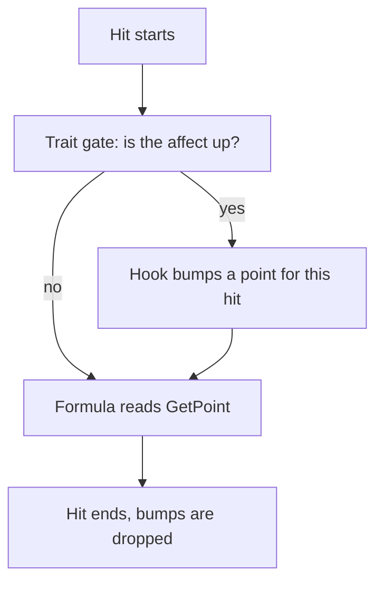

In vanilla Metin2 a bonus point is a number on a character, and it does nothing. The effect exists only because some function reads that number and does something with it. If the bonus has a condition, the condition is an `if` in that function, and the function is usually the damage code. When I started on this engine, every new conditional bonus meant another branch there.

This post follows that limit through four stages: the vanilla branch, the redesign that kept it, the point bump that removed the need for it, and a skills-only detour that traits superseded.

## Two lines in the damage function

This is stock code, from the vanilla damage function:

```cpp
if (IsAffectFlag(AFF_TERROR))
    dam = (int32_t) (dam * (95 - GetSkillPower(SKILL_TERROR) / 5) / 100);

if (IsAffectFlag(AFF_HOSIN))
    dam = dam * (100 - GetPoint(POINT_RESIST_NORMAL_DAMAGE)) / 100;
```

The point `POINT_RESIST_NORMAL_DAMAGE` is a stat. The buff `AFF_HOSIN` is a flag. The only thing that joins them is these two lines, and the join lives inside the function that resolves a hit. Block, dodge, reflect, HP steal and the mana shield are written the same way in the same file: a point, and a hand-written reader.

Vanilla has fewer than 150 of these points. We started the code base in 2016 with 192 slots. Today there are 324. Each one that is more than a plain stat needs its own reader somewhere in the server, and in the client when the player has to see the number.

## What a new bonus touched

A bonus is not only the branch. The point has to exist on the server and on the client, travel in a packet, show on a Python page, and be written into the item prototype tables. Counting the commits that added one:

- lifesteal percent, June 2020: 9 files;
- defence penetration, November 2019: 16 files, across server, client C++, Python and the proto tools;
- `def_penetration_pvp` with a reflect rewrite, March 2024: 15 files;
- skill damage against monsters, spec skill damage and a slow adder, June 2020: 23 files.

Two of those are mixed commits that carry other work, so "touched" is the honest word, not "needed". The range of 9 to 23 files is real all the same, and none of those commits gave a bonus a condition. They only added a number that a reader still had to find.

## The 2021 redesign kept the branch

In April 2021 we redesigned the damage calculation, in two commits on the 9th and the 13th. The first touched 28 files and the second 24, with penetration and pierce rewritten from the ground up. The four large server files alone carried over 2,000 changed lines.

The hosin branch went through it unchanged. The same two lines were in the same function after the redesign, and they were still there five years later. They left in July 2026.

The redesign changed how damage is computed. It did not change who gets to say what a point means. That stayed with whoever wrote the next `if`. Another 2021 commit that year added a conditional rule as a constant in the hit code (the part of a critical chance above 75% counted at half), and a table added in October 2021 to map skills to adder bonuses had a key that was a point instead of a skill, so it could never match. It sat there silently until it was retired in July 2026.

## Four copies of the damage pipeline

The branches had one more consequence. The defence half of the pipeline existed four times: in the melee hit, in two arms of the ranged shot, and in the skill damage function. Each copy had drifted. The skill path read one set of defence values and the autos read another; the PC bow arm applied the attack multiplier twice, squaring it into the shot. In July 2026 the four became one resolver, and the two real bugs (the doubled multiplier, and the magic shot that used a narrower integer) were fixed instead of carried over. That is getting ahead of the story, and it matters for one reason: while the branches lived inside four copies, nothing could move out of them.

## The bump point

The idea that held is small. A trait is a piece of behavior gated by an affect. While the affect is up, the trait gets hooks around a hit: before damage is dealt, before damage is taken, and so on. In a hook it can say "for this hit, this character has +15 of this point". The damage formula reads the point as it always did. When the hit ends, the bump is gone.



Nothing in the formula learns about the condition. It is in the hook, in Lua or in C++, next to the affect that owns it. The engine side is a few lines. `GetPoint` folds in the live bumps:

```cpp
// Fold in any live trait bump (transient; empty outside a damage frame).
if (!m_pointBump.empty()) {
    auto bit = m_pointBump.find(static_cast<uint16_t>(type));
    if (bit != m_pointBump.end()) val += bit->second;
}
```

The traits framework landed on 11 June 2026, 17 files, with about 3,100 lines added and 15 removed. Its first client was the mayhem augments, the conditional bonuses an arena mode wanted: more damage while your HP is low, stacks per kill, a bonus that depends on the target. Those are the cases where a point plus a number collapses, and they were what we had at hand. They were the first client. The limit was the one in the previous sections.

Before, an augment was a row in a pool: an apply, and a base value.

```lua
local POOL = {
    -- Damage (8)
    { apply = apply.PHYS_ATT_BONUS,           base = 60   },
    { apply = apply.MAGIC_ATT_BONUS,          base = 60   },
```

After, the same kind of augment is a definition with a gate and a hook. This one is the code today:

```lua
traits.define{
    id   = "cold_blood",
    gate = { affect = affect.name_map.AUGMENT_COLD_BLOOD },
    hooks = {
        ---@param ch LPCHARACTER
        ---@param victim LPCHARACTER
        ---@param ctx forge.sys.game.traits.CTX
        on_damage_dealt_pre = function(ch, victim, dam_type, ctx)
            if ch:get_hp_pct() < 80 then
                ctx.bump_point(point.ATTBONUS_HUMAN, 15)
                dbg(ch, "cold_blood +15 ATTBONUS_HUMAN (hp_pct=" .. ch:get_hp_pct() .. ")")
            end
        end,
    },
}
```

The first rewrite of the augments onto traits, on 11 June, touched 8 files and none of them was C++. The next day "all-in as traits" touched 7, again with no C++. The battle royale in October touched 72 files with no C++ either. A bonus with a condition stopped costing an engine change.

## What broke: nested damage

Nine days later the bump leaked. Nested damage on the same character (an area hit, a chain, a proc) wiped the pending bumps of the outer hit while the deltas stayed applied, and one augment's minus 20 compounded until the damage was near zero. The first version applied bumps to the points directly and reverted them afterwards, and a recompute of the points in the middle of a bump could not tell what to revert.

The fix on 20 June had three parts: a guard that can nest (mark and restore, not clear), a refusal for a bump with no damage guard open (it is logged and ignored), and an overlay. The bumps live in a transient map folded into `GetPoint`, which is what the excerpt above shows. A recompute in the middle of a bump can no longer desync it.

## A skills-only detour

On 20 July we added a second interface to the platform, a mechanic that skills could implement, with a lazy host on the character. It dispatched lifecycle, use-gate, cost, damage-dealt and point-cap hooks to named mechanics instead of affect-flag tests, and the first mechanic was a charge skill. On the 21st hosin, the mana shield, terror and stealth moved onto it, off their affect flags.

It was an exploration. Once I realized it was superseded by traits, I steered to them. On the 22nd the gate and the definition were split, a native C++ backend was added to traits, and the same four behaviors moved again, from the mechanic platform to traits. On the 24th the interface was retired: 643 lines in, 501 out, five days. Charge had been its last implementer, and what the platform carried ended up as a trait, a member of the skill class and two predicates.

## The resolver, and the erosion that left it

On 26 July the four copies of the pipeline became one resolver. The differences the copies had earned were kept as explicit policy fields; the two bugs were fixed. The change was 5 files, 433 lines added and 397 removed.

Once there was one resolver, the buff erosion could leave it. Resist against a buff's defence had been an inline `if` chain in each copy, and the resolver first folded it into one table of three entries: a flag, a monster resist column and a bonus point. The next day that table went too. Defence erosion became a trait that bumps the defence point in a damage-taken hook before the resolver reads it (19 files), and attack buff erosion and the weapon binding followed the same day (27 files). That also retired a double count, where the resist was stripped from the raw bonus and then the eroded defence multiplied again.

This is the point I would take to another engine. The bump needed one place where the formula reads a point. Until the four copies were one, the hook sites would have had to be added four times, and each copy would have grown its own idea of what the hook may do.

The vanilla branch, today, is a trait. It is native C++, the smallest one there is: it multiplies basic-attack damage by the same resist point as the two stock lines, now attached to whatever affect binds it. Traits are registered from C++ and from Lua, hosin on one side and cold blood on the other.

## What it did not change

Line count is not the gain. The damage file is longer than before traits, because the hook sites live there. The calls that test an affect flag by hand are 20 in the server today, down from 73 in June.

A Lua trait can sit at every position inside the damage formula; only the cap on a computed point is native-only, for call frequency. Block, dodge, reflect, HP and SP steal, and the on-hit and on-kill recovery bonuses are still read by hand in the damage code.
