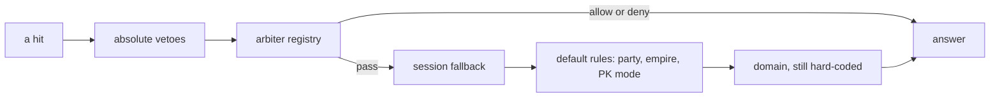

On the day before we cut it, the question "may this player hit that one?" was answered by eleven branches spread over three functions, plus the guild-war helper that all three of them call. Five of the eleven sat in the attack check, four in the damage handler and two in the buff check. Each had been added at whatever line was convenient, and the order between them was an accident of history.

That is a tolerable mess until an event has to live in it. The risk I saw was this: any event, Christmas for example, could break normal gameplay, because the attack code path was free for all. There was one shared predicate, every hit in the game ran through it on every map all year, and an event's rule had to be written into it.

## What the inherited code did with an event

The attack predicate we inherited already showed the habit. It asks what the attacker is riding, and the answer is a switch over mount ids: thirty-eight of them, three of which are event mounts for Ramadan, Halloween and Christmas. Every event that shipped a mount had to put its id into the player-versus-player rule. Whichever way the unlisted mounts fall, an event's attack behaviour hung on a hard-coded list inside a rule that has nothing to do with events.

Killer mode, the flag that marks a player as a murderer, was set from inside the same predicate, in six places. Asking "can A attack B" could flag A as a killer as a side effect.

Christmas reached further than the mount. The monster state machine has a branch for the Christmas tree: on one regular hunting map, if the `xmas_tree` event flag is set, aggressive monsters do not attack first. An event flag changed the behaviour of every aggressive monster on a map people play on all year, from inside the mob AI. That branch is unchanged from the inherited code and is still there today.

## 2016: nine branches, and a Christmas rule that never fires

When the 2016 code base was imported, the attack check had nine content branches: a star-attack affect, guild war, a war map, a guild map, the decorated arena, a Christmas monument, the rage dungeon, an anti-matter manager and a seventh-scorpion rule. This is the Christmas one as it stood then.

```cpp
if ((ch->GetEmpire() == 1 && victim->IsNoAttackShinsu()) ||
    (ch->GetEmpire() == 2 && victim->IsNoAttackChunjo()) ||
    (ch->GetEmpire() == 3 && victim->IsNoAttackJinno()))
    return false;

if (CMobVnumHelper::IsXmasRateMob(victim->GetRaceNum() && ch->GetEmpire() == victim->GetEmpire()))
    return false;
```

The intent reads as "you may not hit your own empire's Christmas monument". The closing parenthesis is in the wrong place, so the `&&` is evaluated inside the call and a boolean, zero or one, is passed as a monster id. The id range check is never true and the line never denies anything. It has been evaluated on every melee swing, skill cast and projectile contact since, on every map, for a seasonal event. The real guard for that event lives somewhere else: the event manager drops same-empire kills, and the monuments hook into the damage and death code. One event, four places, three of them in shared combat code.

This is a risk, not an incident. It is what "free for all" looks like: a line that is always false is harmless, and a line that is almost always false is a bet.

## 2020 to 2025: retiring an event meant cutting branches out of shared code

Removing systems taught the same lesson from the other side. In April 2020 we removed the decorated arena: 35 files, 2,268 lines deleted. In July of that year the rage dungeon, anti-matter, boss manager and others went, 46 files and 3,812 lines, including the lines they had left in the attack check. On 2025-04-12 the old three-way war, the castle event, the battle arena event and the rest of the old event logic followed: 52 files, 6,920 lines out.

None of those were clean deletions of a feature. Each had to reach into shared code, and the 2025 one went through the attack function, the damage function, the death function, the horse code and the death timer, looking for the pieces the events had left in them. I forgot pieces more than once.

Meanwhile the branches fought each other. In November 2023 the combat refactor needed a series of fixes in a week: the new damage handler checked the victim twice and never the attacker. One of those fixes put "party mates cannot hit each other" at the top of the attack check. Above the arena branch and the guild war branch, that meant party mates could not fight each other in an arena or a guild war. It stayed that way for 29 months, until the cut moved the rule below the arbiters. A branch's position was a rule, and nobody had chosen it.

## The cut: one list, first registered, first asked

On 2026-04-30 we replaced the branches with a registry. An arbiter is a name, a guard that says whether the arbiter owns this pair of characters, and a rule that answers allow, deny or pass. The registry walks its list in registration order. The first arbiter whose guard fires and whose rule does not pass has the answer. This is the walk as it is today.

```cpp
BattleVerdict CBattleArbiterRegistry::Resolve(LPCHARACTER att, LPCHARACTER vic) const
{
    for (const Arbiter& a : m_arbiters) {
        if (!a.guard(att, vic)) continue;

        BattleVerdict v = a.can_attack(att, vic);
        switch (v) {
            case BattleVerdict::Allow: return BattleVerdict::Allow;
            case BattleVerdict::Deny:  return BattleVerdict::Deny;
            case BattleVerdict::Pass:  continue;   // arbiter declined this call
        }
    }
    return BattleVerdict::Pass;
}
```

The change was 24 files, with 52 lines touched in the shared attack code. Look at where the registry sits in the diagram: after the absolute vetoes, before the default rules, so an arbiter can never be overruled by the party rule and never needs to know about it.



The arena registered first, from C++, and it was the first client of the registry, not the reason for it. The reason was the shape above: a third mode meant editing the shared function, a Lua event could not state its own rules without a C++ patch, and the position of every guard was implicit. The arena's registration was gone 36 days later, replaced by a team session that does the same job from the other side.

## What an event costs now

Guild war moved to Lua on 2026-06-02, and its referee registers one arbiter per war. Land deployment registers from C++, at boot, since September. Battle royale, on 2026-10-20, registers 17 lines of Lua that deny attacks until the game is playing and pass otherwise.

EvE classic is the clearest case, because it is an event in the Christmas sense: it exists for a while on one map. It registered its combat rule on 2026-05-29, a week after the event itself landed.

```lua
local VERDICT = forge.sys.game.battle_arbiter_registry.BATTLE_VERDICT
eve_classic.battle_handle = forge.sys.game.battle_arbiter_registry.register(
    "eve:" .. id,
    function(att, vic) return att:get_map_index() == map_index and vic:get_map_index() == map_index end,
    function(att, vic)
        if not forge.game.ue_eve_manager:is_engaged(id) then return VERDICT.Deny end
        if att:is_pc() and vic:is_pc() and att:get_empire() ~= vic:get_empire() then
            return VERDICT.Allow
        end
        return VERDICT.Deny
    end)
```

On that map only players of different empires may fight, and only once the fight is engaged, not while people are still gathering. At teardown the event calls `unregister` with the handle and the rule is gone. Compare that with the Christmas monument line: the rule exists between setup and teardown, only where its guard holds, and outside that it is not in the list at all. The shared attack code did not change for it.

Retiring is the same story reversed. Nothing is left in the attack, damage or death code to hunt for, because the event never wrote anything there. And the sibling breakage has no place to come from: a new arbiter cannot reorder the old ones, and the party rule has one position that everyone can read.

## What is still in the engine

The domain is the honest exception. It still has its own branch in both the attack check and the damage handler, on neither an arbiter nor a session. The Christmas monument line and the Christmas tree branch in the mob AI also remain: the registry did not move them, because they were never in the part it replaced.

Warp permission is still a hard-coded check in the character class. Item use sits on top of a policy of its own, with about twenty hard-coded branches in front of it, and it has its own history of silent breakage: when the lobby was rewritten in November 2024 the arena potion gates were commented out, and they stayed that way for 18 months until the item use policy restored them.

The default PvP rules stay in C++ on purpose. Party, empire and PK mode are the stock rule that the list falls through to. What changed is that the stock rule is now the end of a list that events can join and leave, instead of the place events had to be written into.
