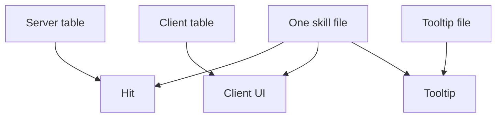

In the Metin2 mainline engine a skill is written down three times: a row in the server database, a line in a client table, and a line in the client tooltip file. Nobody checks that the three say the same thing. When we finally deleted two of the copies in July 2026, we found 25 skills that told the client they could target a buffable NPC and told the server nothing, and 281 tooltip formulas copied from the skill configs, 17 of which had drifted from the engine's.

This post is about those three copies, how long we kept them by hand, and what it took to get down to one.

## Three copies, already disagreeing

The server side is the table `skill_proto`, read by the database core at boot. The client side is two text files: a skill table with the formulas, and a tooltip file that carries its own copy of the tooltip formula. The inherited data is the only evidence I can show for the Metin2 mainline engine, and only between the two client files, because the server rows are not in the tree.

Take the first four warrior skills. Skill 3 agrees with its tooltip. The other three do not:

| skill | client table | tooltip file |
| --- | --- | --- |
| 1, three-way cut | `-(1.1*atk+(0.5*atk+1.5*str)*k)` | `(1.1*MinATK + (0.1*MinATK + 1.5*STR)*SkillPoint) * 3` |
| 2, sword whirlwind | `-(3*atk+(0.8*atk+str*5+dex*3+con)*k)` | `3*MinATK + (0.8*MinATK + STR*6 + DEX*2 + CON) * SkillPoint` |
| 4, sword aura | `(100+str+lv*3)*k` | `(100 + STR) * SkillPoint` |

Skill 1 uses 0.5 of the attack in one file and 0.1 in the other (the `* 3` is the three hits, not a disagreement). Skill 2 swaps strength 5 and dexterity 3 for 6 and 2. The tooltip for skill 4 drops the level term. These are the original game's own files, three skills out of four, before we touched anything.

## Seven years of copies by hand

We started the code base in 2016 and left skills alone until February 2019, when the first version of the composable skill system began: a skill became a tree of nodes, stored as JSON in a column of the database table. The format of the client files changed two weeks after that start, from text to JSON, and the number of copies stayed at three.

After that, every skill change was edited into each copy by hand. Counting the commits that touched a client copy between February 2019 and March 2026 gives 121. By year: 16 in 2019, 27 in 2020, 35 in 2021, 2 in 2022, 12 in 2023, 8 in 2024, 15 in 2025 and 6 in 2026 up to March.

The server copy was the worst of the three: before the YAML files, skill data was edited in the database table with no versioning. Git holds two SQL snapshots of `skill_proto`, from 2019, and nothing after. A balance change on the server left no diff, no review and no line a client edit could be checked against.

The cost showed whenever a change was big. In April 2021 the new damage calculation left a note in its own commit message: the work still to do was `skill_proto`, locale, client pack, apply client side. Four places for one idea.

Twice we tried to close the gap by hand. In November 2022 a commit, "skill desc reflects the server", rewrote the tooltip formulas. Skills 1 and 2 had been showing something different from the server until that day:

```diff
-           "poly": "0.5*TotalPhysicalAtk+((TotalPhysicalAtk/3)*k)*0.82"
+           "poly": "830*k+(TotalPhysicalAtk-AuraPhysicalAtk)*1.2"
```

How long that tooltip had been wrong is not knowable, because the server side was not in git. In September 2024 we moved the skill indices into the shared core so client and server could not disagree about a skill's number. That was the first real step to one copy, and it covered the vnums only.

## March 2026: the server copy enters git

On 6 March 2026 the skill proto started loading from configuration files instead of the database: 211 YAML files, one per skill, about 6,100 lines. A tool read the live database over a tunnel and wrote them out. For the first time the server copy was content in a repository, and since 5 March 70 commits have touched the skill configs, all of them reviewable.

It did not reduce the copies. The client still read its own two files, so there were still three, and now two of them could at least be diffed.

## One burn, two numbers

Skill 93 is the dragon's roar. It sets the target on fire, and the chance to do so is a per-mille value, so the server config said `successPctPoly: 50*k`: 5% at full skill. The client tooltip said 50%.

The tooltip had been changed in September 2025:

```diff
      - key: $firepct
-      poly: max(100,IQ*2*k)
+      poly: (500*k)/10
```

The versioned config said 5% from its first day, 6 March 2026, and the tooltip said 50% until we fixed it on 29 July. That is under five months of disagreement that git can show. Nothing shows what the database held before March, so the disagreement is not dated earlier.

## Deleting a copy to see what it hid

By July 2026 the plan was the obvious one: stop keeping three copies. The client would read the server's skill files, and the tooltip would take its numbers from them. A tooltip that quotes a number is a client-side view of a server value, so there is nothing to keep in sync.

The reason was the limit: three hand-kept copies meant every skill had three places to be wrong. The tooltips were the first client of one copy, not the motive for it.



Read it as two systems in one picture: the top three lines are what we had, three sources feeding three readers, and the bottom is what a skill is now, one file feeding the same three.

The work went in steps, each one found by trying it:

- 28 July: the engine's point names moved into the shared core, so the two sides read one table instead of two maps that had drifted. 167 files.
- 29 July: the tooltip stopped carrying its own polys. The commit message reads: the description file carried 281 polys copied from the skill configs, and seventeen had drifted. The client stopped reading its own table and read the server's configs. A reference that does not land is a boot error.
- 30 July: the cast range, declared once. `targetRange` and `client.castRange` were two authored numbers for one concept, and they disagreed on 7 of the 129 skills that declared both.
- 4 August: one flag vocabulary. The client flag block went away and both parsers read one list. It had been telling the two sides different things on 25 skills for the buffable-NPC flag alone.
- 5 August: the tooltips became one file per skill, and the client reads a policy.
- 6 August: the client skill table, 1,351 lines, was deleted.

None of this was found by reading. It was found by trying to have one copy: the audit lines above, and the rest, only showed once a copy that could have hidden them was gone. Deleting one of two copies is a check that review never gave us.

## What broke on the way

On 30 July we restored five client flag lists that had been lost to a folded YAML scalar. Four skills went inert. Without the flag that says a skill needs a target, the client sends a target id of 0 and the server refuses the cast because there is no victim. That is the cost of the move: moving a copy means the flag you forgot to move turns into a skill that does nothing.

The audit had other lines. Skill 19 declared the weapons it needs without the flag that made the client enforce them, so the only enforcer, the client, did not. The client added the bow-range point to every skill's reach while the server added it to none, so a melee skill grew because the player wore a bow-range item.

## One file, and what it costs

Skill 1 is now one server-owned file: `flags:` once, `range: 450` once, a `client:` block with presentation only (job, icon, motion index, grade count), and a description section that names the formula by reference. The tooltip is words and two variables, `$val` and `$targets`, with no formula in it. The client loads the server's skill folder, and the folder is staged into the client pak as one entry.

If a description names a reference that does not resolve, the server refuses it at boot, so a typo fails at startup instead of on whichever player first opens that tooltip.

The tooltip file went from 2,096 lines to 113 per-skill files of 873 lines in all, with no formula copies in them. The cost is real: the skill engine itself grew, from about 5,400 lines to 9,528, because the checks that keep one copy honest are code. The gain is in copies, not lines.
