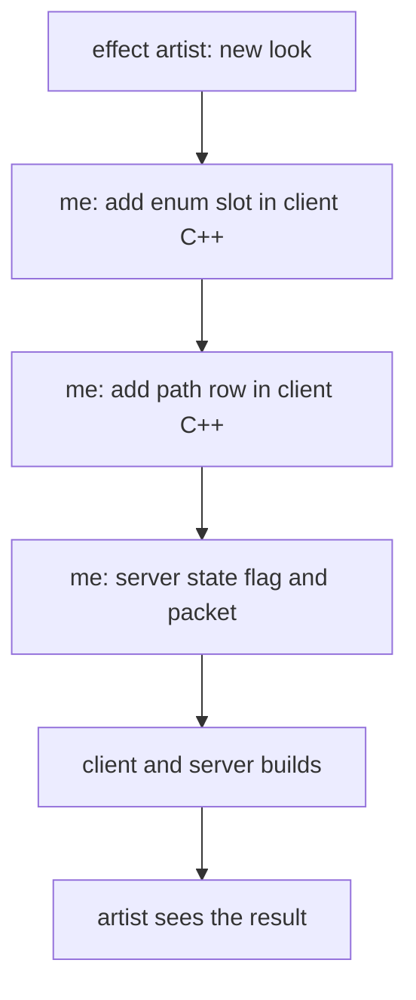

For years, putting a new look on a character meant a change to the engine source, and that change was mine. The effect artist could build the particles, the bones and the surfaces, and then the work stopped until I had edited server C++, client C++ and a Python table, built both sides and shipped them. They could not do their work without me.

The reason was a bitfield. This post is about the limits around it, and about rage, which is the largest feature I moved off it. Rage is the proof that the limits are gone. It is not why they went.

## Four bits left, and a field I had already enlarged

In the inherited code, the only thing a viewer learns about another character's affects is a set of bits. The full affect element goes to its owner. Everyone else gets the `AFF_` flags in the character update packet: a bitfield of two 32-bit words. The count of `AFF_` values was the first limit, so I enlarged the field from 2 dwords to 3.

That bought room, and the room ran out anyway. At the head of the current tree the highest `AFF_` value in use is 91, the field holds 96, and the guard in the flag test rejects everything outside 1 to 95. Four bits remain.

The cost of a bit was never only the bit. Adding `AFF_ASHURA` in December 2023 touched 5 files: the client instance header, the client player settings header, the shared length header, the server affect header and the server constants table. The client and the server each keep their own copy of the `AFF_` list, and they drifted. In November 2023 a commit message says it plainly (translated from Italian): the client AFF effects were realigned with the server ones, by hand.

## A seven-entry table for the debuffs the bitfield had no room for

The target window shows what is on the monster you selected. A bit in the flag word is not enough for that, so in April 2023 I added a fixed table that sent hand-picked effects through the target packet: five entries at first, seven by May. Poison, fire, stun, slow, bleeding, a skill and one buff, each a C++ enum value and a pair in an array.

One of those pairs holds a skill number and an `AFF_` number, and the two differ by one, because the server's `AFF_` values are shifted by one against the skill numbering. Nobody should have to remember that. The seventh entry, added in May 2023, touched 4 files: the Python target window, the client instance header, the server affect header and the server character code.

The cheater malus in April 2026 is the last visible affect I did the old way. It took 7 files in C++, Python and YAML, one of them the locale text.

## One affect type, shown to everyone who can see the character

The idea that held was to stop describing an effect with a bit and send the affect itself. In June 2026 a server affect can be marked broadcastable, and the full element is relayed to every viewer around the character. The client keeps those elements in a store keyed by the character, and a Python registration says which particle file plays for which affect type.

```cpp
// Broadcastable affects: relay the full element to everyone who can see the character.
static bool ShouldBroadcastAffect(LPCHARACTER ch, uint32_t dwType)
{
    return AffectManager::instance().IsBroadcastableAffect(dwType);
}
```

The commit that introduced it says what it routes around: it is now possible to bind a particle without an `AFF` extension. The affect type is a number the Lua side already owns. No bit, no enum slot, no `AFF_` table to keep in step on two sides.

The groundwork was older than the feature. The affect manager that took the save, clear-on-death and no-duration-decrease rules out of C++ macros and into a config file dates from June 2024. In late May and early June 2026 Lua gained the same doors, so a forge can add a name, mark an affect as not saved, or keep it through death. Traits arrived on 11 June, and broadcast the next day.

The first client was the mayhem augment looks, 20 trait affects in the first broadcastable list, plus the buff that used to be the seventh row of the target table. It was a client, not the motive. The motive was in the previous sections. The target table is gone, and nothing replaced its rows with new rows.

In July 2026 the good, bad and party classification of affects also left C++: 54 `case` lines went out of the character affect code into data. They had drifted from the dispel arrays they were meant to match, and they grew one skill at a time with no owner. That was a separate step, after broadcast, and I do not claim it came before.

## Rage, before: a state machine with its own wire

Rage is a good test because it is old and it touches everything. It is not new; it is in the first commit of the 2016 code base, with its own server module, its own dungeon and its own quest. The server module lived through 17 commits until October 2026.

Its state lived outside the affect system. It kept its own state object per character (points, remaining time, cool-down, an active flag, a sub-rage flag, a refresh event), turned the player into a polymorph per race, and told the client about it with two character state flags of its own. It needed:

- a server-to-server packet to trigger rage on all cores,
- three columns in the player table for the gauge, the cool-down and the saved state,
- a branch inside the affect-adding function that refused rage affects,
- four quest functions to read and fill the gauge, and a 133-line quest to fill it from an item,
- GM commands, and hooks in the kill, death and logout paths.

Its art was wired in the client as well. Each look was an enum slot and a row in a C++ table with a file path in it, and the motion files per race were registered in code.



## Rage, after: an affect and a forge

On 13 October 2026 one commit replaced all of that. Rage is now the affect `AFFECT_RAGE` (605), sub-rage is 617, and `rage.forge` owns the rest: start and stop (an affect with a duration), the skill grant, the `/rage` command router, the global trigger over the forge peer-to-peer channel, and a `rage_charge` trait that fills a charge stored in a quest flag from damage dealt, taken and healed. This is the registration, at the top of the file as it stands today.

```lua
affect.add_name_definition("RAGE_CHARGE", 618)
affect.add_broadcastable(affect.name_map.RAGE)
affect.add_broadcastable(affect.name_map.SUB_RAGE)
affect.add_no_save(affect.name_map.RAGE)
affect.add_no_save(affect.name_map.SUB_RAGE)
affect.add_no_clear_on_death(affect.name_map.RAGE_CHARGE)
```

The client no longer has a rage flag. It asks the broadcast store whether the character has the affect.

```cpp
bool CInstanceBase::IsInRage()
{
    return CPythonNetworkStream::Instance().GetNetworkActorManager().GetBroadcastAffectManager().HasAffectType(
        GetVirtualID(), UE_AFFECT_RAGE);
}
```

The numbers, counted from that commit. The whole commit touched 108 files. In the server, the shared core headers and the client interface, 48 files, all C++, it deleted 1,422 lines and added 110. The forge file is 237 lines, created in that commit and not changed since. The biggest removals were the rage module itself (452 lines, plus 76 in its header), the quest Lua functions (120), the GM commands (105) and the client player settings (80). The old rage module is gone, the database columns are dropped by a migration, and the polymorph, the attack variant and the final blow went with them.

Not everything in the commit was a deletion. The same change added some generic C++ the client needed for presentation, and I count it separately: all C and C++ in the commit is 945 lines added and 1,495 deleted. The 1,422 are lines deleted in the server, the core and the client interface; the 110 are what those same folders gained.

## What the artist owns now

The look is a text file the effect artist owns, an `.msattach` bundle: bones, surface materials, and an exit group that plays when the affect really ends. Rage ends in a vanish effect that way. The editor has a pane for it that previews the exit. Registering that file for an affect type is one line of Python in the client script pack.

```python
## Broadcastable-affect particles (anchor + server affect dwType)
playerLoad.RegisterEffect(playerLoad.EFFECT_BROADCAST_AFFECT + 150, "", "d:/ymir work/pc/assassin/ue_skill/stellar_sanctuary_aura.msattach")
playerLoad.RegisterEffect(playerLoad.EFFECT_BROADCAST_AFFECT + 605, "", "d:/universalelements work/rage/rage_active.msattach")
```

The effect artist does not need engine changes for a new look any more. That is the limit I wanted gone. It is not the same as working alone: the line above lives in the client script pack, so a new registration still needs a pack rebuild, and someone has to make the server side of the affect. What changed is that the C++ build left that path.

The Stellar Sanctuary aura in October 2026 went the same way, on top of the same affect type and a bundle. About 15 battle royale trait looks did too.

## What is still in the engine

I layered this on top. I did not replace the old channel. The `AFF_` bits still travel in the update packet, and nothing was removed from them; they run in parallel, and their last four bits are still free.

Rage itself keeps some C++. `AFFECT_RAGE` is still a constant in the affect header, as it was in 2016. The character class has two one-line functions that answer "is it in rage" by looking for the affect. Two damage bonuses keyed on rage stay in the battle code, and the quest function `pc.is_rage_mode` still exists. They read the affect now. They do not own a state.
