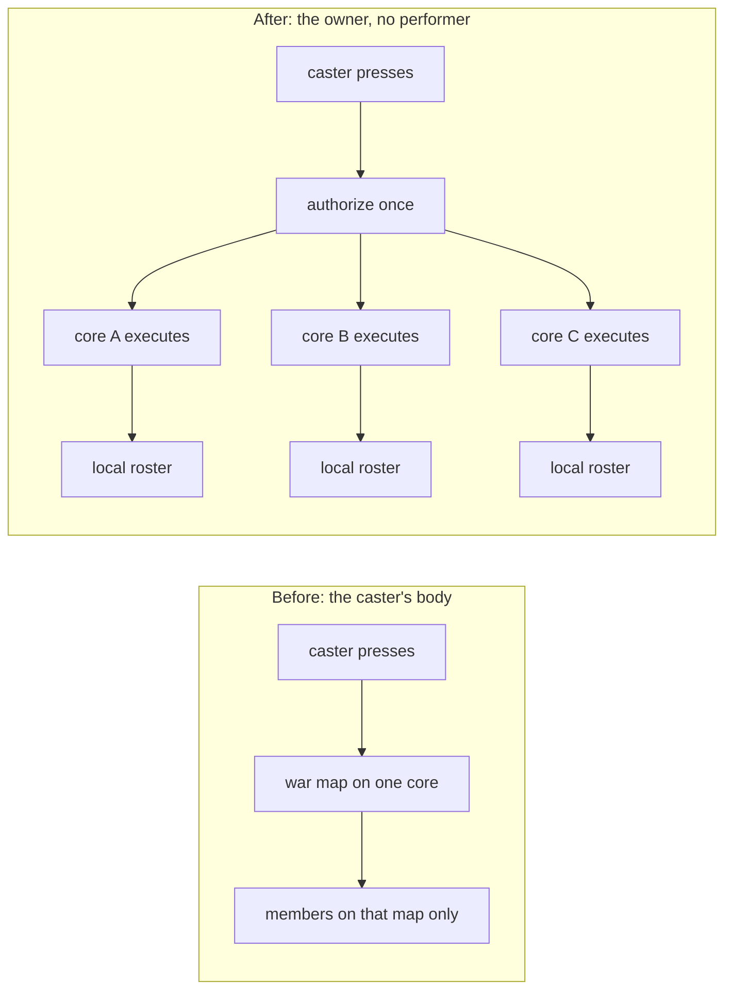

A guild is not on one core. Its members are logged in on every core of the mesh, and each core knows only its own players. In vanilla Metin2 a guild skill was computed by the caster's body, so the skill reached the guild's war members standing on the caster's war map and nobody else. A guild member on another core, or in another channel, was simply not part of it. For a guild-wide skill, that is the whole bug.

This post is about how long that limit lived in our code base, why the skills left in 2019, and what the second attempt in 2026 did differently. It ends with a gap I have not closed.

## Guild skills in the inherited code

The inherited code had guild skills only, in a fixed range of vnums from 151 up, and no empire skills of any kind. Each one was hardcoded by vnum. Using one was refused outside a guild war:

```cpp
if (!UnderAnyWar() || !ch->GetWarMap())
{
    ch->ChatPacket(CHAT_TYPE_INFO, LC_TEXT("<길드> 길드 스킬은 길드전 중에만 사용할 수 있습니다."));
    return;
}
```

Inside a war, the skill called the war map. The war map walked its own set of characters and ran the caster's `ComputeSkill` on each war member of one guild. Two skills, 156 and 157, ran it a second time against the opposing guild; the rest only on the caster's own:

```cpp
void CWarMap::ComputeSkill(LPCHARACTER pkCaster, uint32_t dwVnum, uint32_t dwLevel, uint32_t dwGuildID)
{
    FWarComputeSkill f(pkCaster, dwVnum, dwLevel, dwGuildID);
    std::for_each(m_set_pkChr.begin(), m_set_pkChr.end(), f);
}
```

That is the entire reach: one war map, hosted by one core, with the caster's body applying the skill to everyone on it. The level lived in a byte array on the guild, the cost came from a guild power pool, and the only moment you could use any of it was a war.

By the time our repository began in 2016 the war skills had become a loop over the guild's online members on the core, filtered by those standing on a war map, and a second family of guild skills had been added on top. It reached up to vnum 169, needed a guild level, paid from a second pool, was not war only, and applied to every online member on every core through a packet between cores. So the push to every core is older than our work. But each member computed the skill on himself, it was hardcoded per vnum, and it only did buffs on the guild's own members. Nothing in it could hit an enemy, and nothing in it could belong to an empire.

## Removed in April 2019

In February 2019 we wrote the first version of the composable skill system, where a skill became a tree of nodes. Guild skills did not fit it: they were war-only code keyed by vnum, and the nodes had no place for either.

So in April 2019 we removed them. About 1,200 lines went, among them the guild's use and cross-core handlers and the guild skill handlers of the client's guild window. We decided to keep guild skills out of gameplay and plan them for a later update. In August 2019 the old guild wars went as well, leaving only the skeleton. Some remains stayed in the engine: in 2023 the skill power for the whole guild range was set to return 0, and it still does.

## Back in March 2026, shaped like vanilla

In March 2026 guild skills came back. A guild kept a table of levels and cooldowns, a packet between cores carried the changes, and a `gskill` command and a guild skill page in the client arrived. Costs and cooldowns moved to the guild. Skill data had left the database table, where it had been edited with no versioning, for the YAML files, so a guild skill was now a file like any other.

It was vanilla-shaped. A guild skill went through the ordinary character path, and the code of that time said what was wrong with it in its own comment: the caster owns the skill instance, but the cooldown and the costs are owned by the guild. Every place that read a level, a cooldown or a cost had a branch on the guild skill type. The cast still ran in the caster's body, on the caster's core.

That was the second pass at the same limit, and it worked about as well as the first. A buff for every member of a guild still could not be computed anywhere, because no core holds every member.

## Owners, and a cast with nobody performing it

In August 2026, five months after the revival, we rebuilt it. One large change on 9 August split two things that had always been the same character: the owner of a cast and the performer of it.

The owner holds the skill: its level, its cooldown, its purse, the right to cast it, and who counts as ally and enemy. The performer is the character who pressed the button, and supplies the geometry, the weapon and the credit for a kill. For an ordinary skill both are one character and nothing changes. A guild skill is owned by the guild. An empire, which has no object of its own, became an owner too, with its state kept in server flags.

The second key is the one the title is about. A skill declares `intracore: true`, and the cast splits in two. The core where the button was pressed authorizes it: authority, cost, cooldown, all the checks. Then every core executes it, the pressing core included, through the same entry point, with no performer at all. This is the call site:

```cpp
// An intracore cast splits in two: AUTHORISE here, where the button was
// pressed (authority, cost, cooldown -- all done above), then EXECUTE on
// every core including this one, through the same entry point, with no
// performer. This core is not privileged: a cast that could read whoever
// pressed would give his core different numbers from every sibling.
if (pkSk->bIntracore)
{
    SIM_TRACE_PICK("intracore");
    pkSkillInstance->UseSkill();

    const uint32_t unLevel = pkSkillInstance->GetUseLevel();
    const uint32_t dwSubjectId = pkSkillInstance->GetSubject()
        ? pkSkillInstance->GetSubject()->Id() : 0;

    CSkillManager::instance().BroadcastIntracore(pkSk->bSubjectKind, dwSubjectId,
        pkSk->unVnum, unLevel);
    CSkillManager::instance().ExecuteIntracore(pkSk->bSubjectKind, dwSubjectId,
        pkSk->unVnum, unLevel);

    m_dwLastSkillTime = get_dword_time();
    return true;
}
```

The packet carries the owner kind and id, the skill, and the level. Nothing else crosses. Each core rebuilds the owner from the id and asks it who is on each side on this core. A guild lists its members who are online here, or the online members of the guild it is at war with. An empire lists its players here. The union over all cores is the whole guild or the whole empire, and nobody is hit twice, because a player is online on exactly one core.



Two details were learned the hard way, by reading what would happen if we got them wrong. The level travels in the packet, so a core whose copy of the guild row is a moment behind still applies the number the caster paid for. And only the authorizing core stamps the cooldown. For a guild that is a write to the guild row, for an empire a server flag, and both fan out to the database core and the whole mesh. If every receiver stamped it, one cast would multiply that fan-out by the number of cores.

Nothing declares a skill safe to replicate. A cast can be computed identically on a sibling core exactly when the owner's state is present there and its formulas read nothing else, so the skill loader checks it when it reads the file. A skill that mentions the caster anywhere does not load, and the game core says which node and which field.

There is a price, and it shows in damage. With no attacker, a hit applies only the victim's half: the victim's own defense stands, without penetration, and nothing is read off an attacker's sheet. A kill has no owner, so it gives no experience and no drops. The shipped intracore damage skills accept players only.

## Six skills the same night, and a pair

The limit we closed is that a cast never left its core. The first clients of the change were six guild and empire skills, written the same night as the owner model, from 152 to 157. Skill 158 joined later that day, an empire skill called Giudizio dell'Impero: a mark on every enemy player of the empire, wherever they are logged in, five seconds of warning, then a ray at the place where each mark was planted. Dying, warping or logging out between the mark and the ray does not cancel it. Running away does.

On 21 October 2026 came the skill that answers it, 150, Santuario Stellare. It is a sanctuary of 12 meters that heals, shields and cleanses every player of the empire inside it for 20 seconds, and it carries a trait that zeroes the hits of 158. It is deliberately not intracore. An intracore cast has no performer and so no center, and this skill is nothing but a center, so it lives on the one core where it was planted. The pair is the clearest way I know to show the two reaches: 158 is every core, 150 is one place on one core.

The map-wide ones are different again. 155, 156 and 157 are empire skills where one node sweeps every entity on the map, which is still one core. They are not intracore, because a fight happens on one map and a timed run reads the performer on every tick, so they keep the caster. 156 puts one affect on every enemy on the map and hangs the damage under it, so the damage keeps the critical roll, the attacker's bonuses and a real killer. 155 has a trap in its own header: a child sweep under a map-wide parent still starts from the performer's sector tree, so an ally on the far side of the map finds nobody.

## The war-only list still catches four of them

The rule that guild skills work only in a guild war survived all of this. It is now a use policy with a list of vnums, and the list still holds 151 to 157. For 151 to 153, the guild skills, that is the vanilla rule doing what it always did. For the empire skills 154 to 157 it is a bug. An empire has no war, so those four are refused outside a guild war with the message that the skill can be used only in war. 150 and 158 are not on the list, which is why the pair above works.

The list is a policy, not part of the owner model, so the owner code never sees it. I filed it as an issue and have not touched the list yet.

Other things are still in the engine too. The `GUILD_SKILL_*` constants, 151 to 159, are still defined and exported to the client scripts. A new kind of owner is C++ work in three places and has no Lua door. And the headless simulator cannot show everything: one process is one core, and guild gold never decreases there because the database answer never comes.
