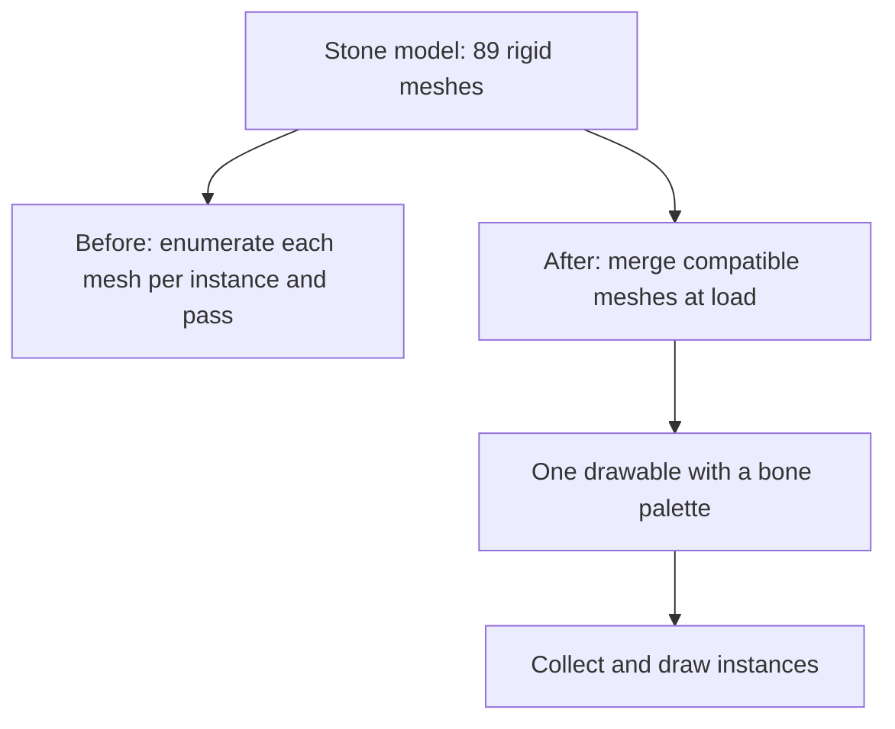

A frame with 5,000 stones took 245.0 ms in one RHI build and 45.0 ms in another. The client submitted 1,346,110 draw items before the changes and 10,238 after them. Draw calls fell from 402 to 130.

That comparison came from one machine, alternating two RHI binaries during the same run. It does not compare D3D9 with DirectX 11. The second optimized half of the run was discarded after the machine slowed down, so the result has a limit: it is useful evidence from one run, not a portable promise about another machine.

The scene was `grid 5000`: a grid of 5,000 characters spawned inside the client, using a stone model, with no server in the measurement. The spacing kept all 5,000 instances in view. That mattered because an empty or culled crowd can make a renderer look very fast.

## I left batching for later

The Metin2 mainline engine used Direct3D 8. In that engine, skinning ran on the CPU, and each particle had its own draw call. The D3D9 pipeline remained untouched until 2024. I migrated the renderer to an RHI over DirectX 11 at the end of 2025 and the start of 2026, in 279 migration commits.

Performance, quality, and extensibility increased through that work. I do not have a D3D9 versus DirectX 11 benchmark to put a number on the performance change.

The 2025 plan documents changed during development: timing, effort, approaches, and solutions all drifted. In January 2026, I moved the model renderer back to a per-instance draw call and left optimization and batching for later. The change touched 38 files. In August, more than seven months after that decision, I returned to the cost of submitting and drawing a crowd.

The full comparison was much larger than one change. Each optimization below was measured against its own neighboring build or setting, so the individual gains overlap and do not add up to the difference between 245.0 and 45.0 ms.

## The same stone had 89 rigid meshes

The stone model in the grid had 89 rigid meshes. Before consolidation, the renderer enumerated those meshes separately for each instance and each relevant pass. Instancing reduced the number of API draws, but the CPU still had to collect and process the draw items.

I merged compatible single-material rigid meshes when the model loaded. The merged geometry used the skinned vertex format, with one full-weight bone per vertex. Each member kept its own transform through the bone palette, so meshes did not need to share a bone to share a draw.

The grouping still had limits. Material, material type, and tangent validity had to agree. The merge accepted single-UV models and up to 256 members per draw; it did not turn every rigid mesh into one universal batch.

The path for the stone changed like this:

In the per-change `grid 5000` comparison, the frame went from 118.2 to 66.9 ms. Draw items fell from 897,454 to 10,238, and draws from 306 to 130. Those figures describe that change against its own predecessor, not the complete optimization wave.

The draw count alone had hidden much of the work. A frame can issue relatively few draws and still spend a great deal of time preparing them.

## I stopped uploading unchanged poses

The renderer also rebuilt and uploaded bone palettes for skeletons whose poses had not advanced. A standing crowd could send matrices that were already in GPU memory.

I gave each skeleton a resident palette at a fixed offset. A compute scatter rewrote it when the pose advanced. On `grid 5000`, the reported comparison went from 122.5 to 119.3 ms; 2.0 ms of that difference was attributed to skipping unchanged poses.

The palette had to live as long as its skeleton. Keeping data resident only helps if its owner and the condition for updating it are clear.

## Particle state stayed on the GPU

I moved particle simulation into a resident VRAM buffer updated by compute. The CPU retained birth, death, and texture-frame bookkeeping. Terrain-conformed particles retained CPU simulation.

The compute path had to preserve the behavior of the existing effects. For example, air resistance remained frame-rate dependent, and the order of rotation, scale, color, gravity, resistance, and position updates mattered to effects authored against those formulas.

On `omo 1000`, a scene with 1,000 stones and ground effects, the reported comparison went from 32.3 to 27.6 ms. That was another comparison between RHI builds.

I also consolidated overlay material effects. Instead of giving each enabled overlay its own geometry redraw, I expressed its per-pixel contribution and evaluated the enabled contributions in one additive redraw. Effects that needed their own vertex shader or rasterizer state kept a separate pass.

## The sweep caught an empty world

I added an unattended sweep that logged the client in, built a scene, held a fixed camera, measured a 240-frame window with vsync and frame pacing off, and wrote a CSV row before moving to the next instance count.

The client-side grid removed the server from that measurement. Server spawn commands put many mobs close to the player and left the server simulating them; at high counts, the server could fall over and leave the client with little to draw. The sweep recorded how many instances were actually spawned and drawn.

That count saved some wrong results. Three sweeps reported 4.1 ms frames for 5,000 instances. They had measured an empty world.

I alternated configurations within a run because the laptop's clock changed enough to overwhelm the gains being measured. The same binary recorded 35.95 ms in the morning and 69.07 ms in the afternoon with identical draw-item counts. Both numbers could be true for that machine, but comparing them would say more about its clock than the renderer.

The full 245.0 to 45.0 ms comparison alternated binaries, each with its own root pack. Shaders lived in the pack, so a binary needed the pack that matched it. During the second optimized half, the machine dropped to roughly a third of its speed while the draw-item count remained 10,238. I discarded that half.

## A correct picture needed its own test

A faster frame is not useful if an effect disappeared. I compared captures with a change off, off again, and then on, using the first pair to establish how much the scene changed on its own.

One visual gate still missed a regression. A terrain-conformed additive decal was drawn after effect meshes, so alpha-blended groups above it no longer attenuated it. The six-decal test scene had no such group above the decal. It could show whether the grid's geometry matched the ground, but it could not show the compositing error. The login screen's waterfall could.

A visual test has to contain the interaction a change can break. A scene that exercises the changed geometry may still be unable to expose a draw-order mistake.
