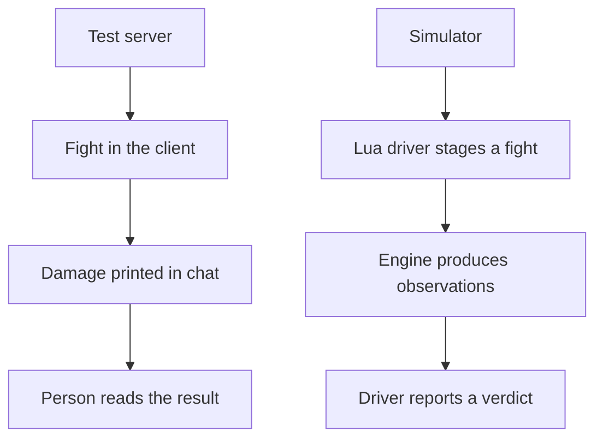

The Metin2 mainline engine had the test server flag in about 300 places across 68 source files. Some branches printed damage values in chat. Others added logs or changed behavior for testing. To check a number, someone had to enter the game and read it.

That was also how I worked with an agent at first. The agent wrote code, I tested it manually step by step, reported what happened, and the agent changed the code. I wanted it to be able to set mob difficulties from a requirement without a person making attempts and tuning the numbers by hand. The simulator started there. It became an entry point for an agent to test the server and create unit, integration, and regression tests.

Before that, I was shipping a subsystem or extension every 2 to 3 weeks. Testing was a nightmare and debugging was worse. I could not isolate and modularize things well, and when I retired a subsystem I sometimes forgot pieces of it. Authoring dungeons was a mess: if something blocked the run, we repeated the whole dungeon, placing `syserr` calls on flat structures and trying again.

## The test server was the test tool

The old engine did have tests. It shipped gtest unit tests for an object allocator and a stack trace helper, and a stdin console that booted managers without a network. The console never ran a fight. The gtest runner was removed in March 2020, and the test files were deleted that July.

Our own tooling grew around the test server. In January 2019, we added SQL to seed one. A GM control panel quest followed in February. Later, in-game commands rolled values and printed the results in chat. These were useful tools, but the verdict still depended on a person in the client.

I did not want to author the replacement as clunky, heavy C++ tests. I needed a way to stage a world, exercise the server, and give an agent a verdict it could read without me watching chat.

The difference is the path from the same damage rule to a decision:

`game_sim` runs game server sources through a headless entry point. A Lua driver stages actors and data, calls real engine entry points, and reads the resulting state. The machinery stands on Forge and the bridge, with package import management for writing and evaluating scenarios. It can reach the same processors that handle gameplay messages.

It has no client. Client behavior is still checked with the live client, and the test server remains: 260 uses of the test server flag in 69 engine files are still there.

## The first records compared two branches

The simulator arrived on 7 August 2026 in seven commits: a deterministic clock and seedable random generators, the simulator and a damage record, a probe workbench of 110 files, and documentation among them.

The skill rewrite was an early client. Its differential gates ran the live branch and the rewrite branch against the same probes. One adapters file was the only thing allowed to differ between the two runs. The records were compared against declared expectations in both directions: an unexpected change was a regression, and an expected change that did not appear meant the intended change had not landed.

This gave the damage check a form an agent could use. Instead of watching a number appear in chat, a driver could stage the fight, record the result, and say whether the change matched the expectation. The same approach could cover many actor and victim states without a person replaying each one.

The simulator grew beyond fights. On 9 August it staged guilds and wars headless. On 16 September the agent skills included a cube runner. Gameplay cubes moved out of the repository into local agent tooling on 18 September. On 22 September came wire capture, an in-process database, a headless database core, and two cores communicating over TCP.

A cube tests expected behavior with assertions and reports a verdict. A differential gate compares records. Both depend on the world they stage.

## A clean result from a broken world

Swapping the fixture protos once removed data that 97 probes depended on. They went from measuring a resistance curve to erroring at spawn, yet reported passes until liveness assertions caught the failure.

That is worse than having no harness. The engine can run real code over a world nobody plays and produce a clean number for it. The setup is part of the test: assert that the actor spawned, the intended action happened, and the observation can actually change before trusting the result.

Other failures were less quiet. A cached character pointer produced an HP reading of 1,525,191,456. Event-flag defaults disagreed between call sites: one used 3, another 1. On 14 August, after a golden gate measured a stale engine, the record script began refusing to run when source was newer than the binary.

The harness also carried a clock error. From 7 August, it drove the affect tick every pulse behind a modulo gate. The macro in that gate was missing outer parentheses, so the gate was always true. The engine also had its own once-per-second affect event. Together they produced 26 ticks per second: a buff starting at 1800 read 1748 after two seconds.

The result was measured and documented on 9 August, but the cause was not looked for then. A battle tower change removed the extra harness tick on 14 October. The documentation kept warning about the 26-times rate until it was filed as an issue on 26 October. The current code path ticks ordinary affect durations once per simulated second; that is a reading of the code, not a new measurement.

On 15 October, all 15 cubes segfaulted at boot because the runner passed no forge. It was fixed the same day. A runner, its binary, its fixtures, and its clock all need scrutiny before their verdict can be trusted.

## Battle royale, built against the gates

For battle royale, my brief told the agent to carry the work using the simulator and the cube pattern: “you are the owner e2e of all the work and tests.” The agent wrote a staged plan with a gate for each stage.

On 18 October, the mode policy cube recorded 51 checks. The augment and skill cube recorded 48, the event cube 129, and the end-of-match cube 105. On 19 October, the spectator cube ran faces F1 through F11 with 2,552 checks under the sanitizer. An end-to-end cube recorded 2,148 checks with 60 players entering through the real participate messages. The feature commit followed on 20 October.

Those gates let the agent work through a large server feature without waiting for me to inspect every step in a client. They did not prove every rule was right. The item allowlist did nothing: for an unlisted item the policy returned an empty table, and an empty verdict allowed it. The gates passed with that behavior in place. I filed it as an issue on 26 October.

Since 7 August, the main branch has had 439 non-merge commits. With agentic coding and testing, I now ship a system every 2 to 3 days.

The battle royale checks gave the agent a verdict it could read. The allowlist issue shows the remaining work: a passing verdict only answers the assertions that were made.
