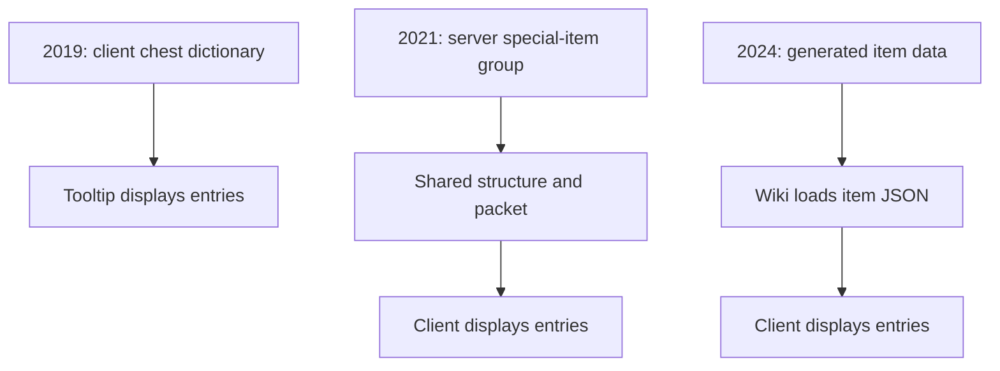
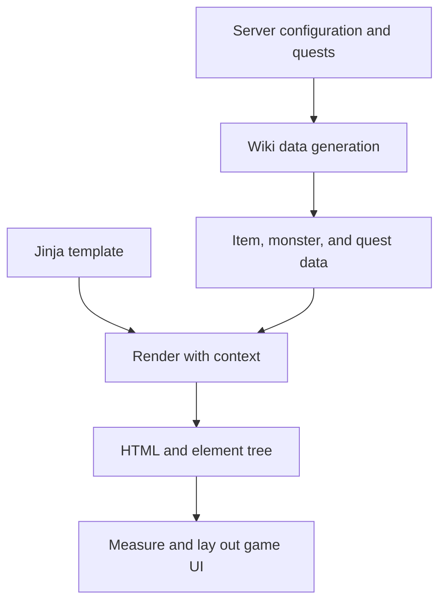

The first wiki in our repository kept chest contents in a Python dictionary in the client. If the game data changed, the wiki's copy had to change too. The tooltip looked up the chest ID in that dictionary. It displayed whatever it found there, true or stale.

That wiki was already present when the client was imported into the repository in January 2019. It is the first of four generations in this story, not a date for the wiki's invention. The problem running through all four was where the facts came from.

## From a client dictionary to server packets

A chest had one definition for the game and another for the wiki. The same was true of other information a player expected the encyclopedia to know. Each copy was another place that could disagree with the game, and nothing checked them against each other, so a changed chest could sit wrong in the wiki until someone noticed. That was the cost.

In July 2021, a teammate brought in the second in-game wiki and much of its renderer. We moved chest and monster-drop information toward the server's data. The server could look up a chest in its special-item groups and send entries using structures shared with the client. Monster drops were recorded as drop tables loaded.

That removed the client dictionary as the source for those examples, but the information still crossed the server and client boundary through C++ structures and packets. Adding facts meant carrying them through that path. The second wiki's commit touched 127 files, with 12,791 insertions and 683 deletions across the whole change.

For the same chest, the path changed like this:

## The wiki became a view of generated data

On December 16, 2024, I introduced a third wiki using an extended BBCode format. On the same day, the world-data work parsed server configuration and interpreted quests to produce a static representation of the server. The wiki loaded item and monster data from JSON.

For a chest, the important change was the source of the displayed facts: the client could read generated item data instead of keeping a hand-copied chest dictionary or requesting that information through the earlier wiki packet path. Generating a representation of the game gives the presentation a shared input, but the representation still has to be regenerated when its inputs change.

The current Wiki Manager continues that data work. Its quest interpreter uses a language model to analyze quest source, with Lua used to expand reward tables during preprocessing. The builder reads interpreted quest JSON and combines information from sources including refining, shops, crafting, items, and monsters. It writes item, monster, and quest data along with other outputs. Model interpretation is another step whose results need attention; it does not make every quest behavior certain.

The BBCode change touched 26 files, with 5,292 insertions and 4,048 deletions. The separate world-data change touched 33 files and included 317,940 insertions. Those are whole-change counts, including generated data.

The client Python importer also received a fix that day for dotted submodule imports and parent linking. It had not supported forms such as `import a from a.b.c` before. The fix and the BBCode wiki landed on the same day.

## BBCode lasted 84 days

The wiki was the first client of the BBCode renderer, with master hunt tasks as a second user on the same day. The tasks were written twice in 15 days. Presentation had already spread beyond the encyclopedia, so changing its language meant changing content elsewhere too.

BBCode gave me variable and function embedding and a basic grid layout, but it was too strict. Support was limited, there were no linters, and implementing the parser and conditionals was difficult. The format was acquiring programming-language work without the tools that make a programming language practical to author.

On March 10, 2025, 84 days after the BBCode wiki, I replaced it with HTML and Jinja. Jinja offered the function embedding and templating I needed.

The wiki and the master hunt tasks were both clients of UCHTML on its first day. A master hunt task that had expressed its available and running states with BBCode conditionals moved to a Jinja template with HTML-like tags for its monster and map links. The content changed as well: in the available state, the new version linked the monster where the earlier text had used a plain name. It was an edit, not a conversion.

The HTML rewrite touched 218 files, with 76,727 insertions and 25,316 deletions across the whole change. The master hunt conversion was a separate change touching 45 files, with 1,010 insertions and 961 deletions. Replacing a format costs every page already written in it.

## Templates became game UI

UCHTML renders a Jinja template with a context that includes world, item, monster, and quest data. It parses the resulting HTML, builds an element tree, then measures and lays out that tree as game UI. A template can therefore put a monster link or a conditional section in the page without hand-positioning every widget.

The data path and the presentation path meet at the template:

The fourth wiki also loaded item and monster extension files alongside the generated data. The rendering system continued beyond the wiki: master hunt descriptions use it, and later work added reactive templates and a dungeon state interface. Reactive zones allow variable-driven partial updates instead of requiring a full render for every change.

Hand-built windows remain the main path in the client. UCHTML gives content panels a way to describe their layout and use game data without making every page another hand-positioned window.

The client remains tied to Python 2.7; a Python 3.12 port left wiki search and HTML pages with problems and is not on the roadmap.
