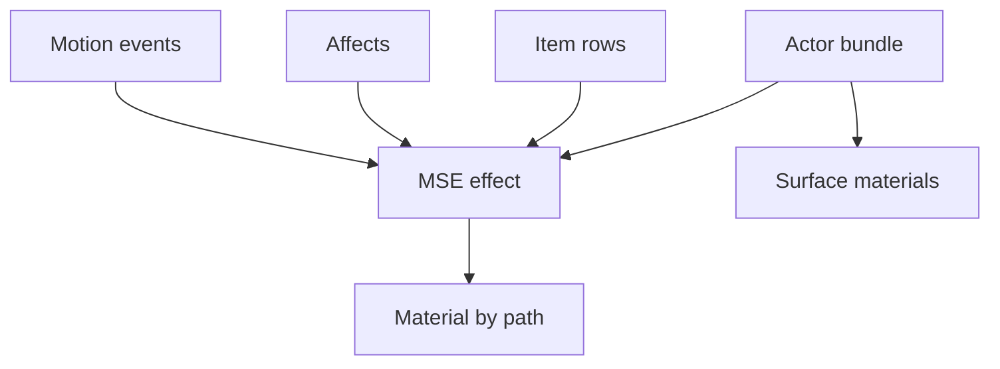

In the Metin2 mainline engine, a particle draws one texture at a time and has one color operation. Its color curves give it one color across the whole particle. I wanted to deliver visually appealing surface effects without hooking into the engine every time, and to make effects more expressive and higher quality.

The old vocabulary could tint a particle over its lifetime, but it could not give that particle a white hot core and a violet edge, burn it away through noise, or scroll layers across it. Actor surface looks had their own limit: gear quality colors came from hardcoded render configuration tables. A new look beyond those choices meant engine work.

Rage was the first client of the extension. The limit was the reason for it.

## Two days of YAML

On September 30, I started with surface materials as YAML profiles. An effect group named a material profile, and per actor layers resolved into an instance slot so the looks would not split batches.

By October 2, the YAML catalog was gone. It had lived for two days.

The catalog introduced a second language alongside the text language the engine already used for its visual formats. It also needed three registry files with hand assigned IDs, a name lookup that resolved against different registries depending on the element, and profiles that could not be parameterized where they were used. Model masks lived in a separate binding that the person editing the model could not see. The world editor dropped the new keys when it saved an effect.

The existing formats already had a simpler pattern: keep the settings in local text files and reference other resources by path. I brought materials into that language, along with parameterized materials, model masks, and attachment bundles. The loader also gained whole line comments and parameters.

The rule became: **MSE is extended, never wrapped.** Existing references still name an `.mse`. An effect can name a material by path, and the client puts each distinct material into its GPU tables when it is first referenced.

The diagram shows where the references go:



The effect owns behavior: when particles spawn, how long they live, how they move, and their texture, blend, and color curves. The material owns how their pixels are shaded. A model mask identifies regions of a model, and a bundle says what attaches to an actor together.

The lesson I took from the two days is that every site that already names an effect should keep naming it. A parallel registry gives each of those sites a second route to maintain.

A group without a material remains the old effect. Older clients ignore the new material keys, and they skip new group types while drawing the rest of the file. Keeping the existing reference as the entry point let the extension travel through paths that already worked.

How effect paths get registered is outside this post.

## One gradient on one particle

Before the extension, giving a particle a new color meant changing the color supplied by its curves. Every pixel of that particle received the same color. A texture could contain brightness differences, but the effect could not use those differences to put separate colors across the particle.

Afterward, I could give the particle a material that reads the texture brightness through a gradient. This material also gives the particle emission and glow:

```text
Group Effect
{
    Family               emissive_particle
    Emission             1.6
    Gradient             "d:/ymir work/special/cosmetics/ramps/rage.dds"
    GradientMode         replace
    GradientInput        brightness
    GradientGain         1.2
    GradientLifeShift    0.2
    Group Glow
    {
        Intensity         2.4
        Radius            1
        Color             1 0.667 0.267
        Core              2
        Streaks           6
    }
}
```

The particle group names that material with one line:

```text
MaterialFile             "d:/ymir work/special/cosmetics/material/effect/rage_flash.msfvx"
```

The existing effect still controls the particle's motion and lifetime. The material changes its pixels. There is no engine change or engine build for this gradient.

The input texture matters. A brightness gradient on a pure white texture produces one flat color, because every pixel supplies the same value. Using alpha as the input can flood a sprite when its alpha covers the whole quad. The [particle gradient tutorial](/tutorials/particle-gradient) builds the example step by step; the [effects and materials reference](/docs/building-blocks/effects-and-materials) covers the format.

## A day of families, and two things removed

October 1 brought ribbons on bones, afterimages, distortion, layered materials, a mesh kit, and an impact group with hitstop, impact frames, and radial blur. The layered material could scroll up to three layers, distort them with flow, and use ramps, masks, cutoff, and dissolve.

I also set a rule for accepting a family: it had to do something plain MSE and MDE could not, demonstrated by comparing it with the old effect.

Two additions did not survive the day. Selective glow used a half resolution blur; emissive bloom replaced it that same day. The replacement uses authored emission, builds a six level mip chain, and composites before the UI. It can produce a wide glow in LDR without depending on scene bloom.

A ground decal group and its registry arrived that morning and were retired the same day. Ground particles already did that job. A new effect family needs to earn its place against what the old format can actually do.

## The material made the old rage worse

I applied the rage gradient to the old smoke and ground ring. The smoke lost its mass. The vivid violet ring turned muddy dark crimson because most of the rage gradient is dark.

The improvement came from adding groups designed for materials: implosion embers, a core flash, and nova sparks alongside old groups left untouched. Before assigning a material to an existing group, compare it with the old look. If it is not clearly better, leave the group alone.

I also judge the effect in LDR first. HDR and bloom are off by default and off on many players' machines, so brightness above 1 only appears for players who have them enabled. HDR can add to the look, but the effect needs to read without it.

## What the crowd cost

The materials stood on earlier [RHI work](/blog/rhi-migration) and the renderer work described in [5,000 stones](/blog/5000-stones). On August 20, particle simulation moved to a GPU resident buffer updated by compute. Overlay effects also stopped drawing the geometry again for each overlay; their contributions went into one additive redraw.

On my bench, I measured a grid of player models on a guild map, using medians over 300 frames:

| Crowd | Base | Rage body surface on every actor | Four ribbons and an ember emitter per idle actor |
| --- | ---: | ---: | ---: |
| 40 actors | 0.91 ms | +0.09 ms | +0.13 ms |
| 200 actors | 1.23 ms | +0.12 ms | +0.33 ms |

Turning glow and distortion on or off stayed within noise. Each added term was below the roughly 1 ms noise floor, so these measurements do not establish a precise cost for the individual features.

## Rage became a bundle

On October 13, rage moved from its own polymorph state to broadcast affect 605, a forge file, and an attachment bundle. The bundle brings the actor effects and surfaces together. An exit group plays a vanish when the affect really ends. The [rage post](/blog/rage-in-a-forge) covers that move.

Bundles are now referenced by the sanctuary aura and rage broadcast affects, by gear quality, and by map objects. Item rows support them, although the item effect file has no bundle row yet. Everything else in the game still plays plain effects.

The layered and mesh families shipped as building blocks. Procedural sprites and noise did not reach the quality I wanted, and their generated example art remains below that bar. The examples wait for an artist.
