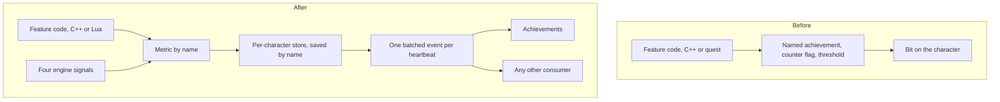

The first commit of our server, in May 2016, already carried an achievement module, and every achievement in it was written in C++. It stood behind 42 call lines in 14 server files, with 49 distinct `"achievement_*"` name literals compiled into the binary. A new achievement meant a new string, a new call, a rebuild and a core restart. Every new achievement meant touching C++.

This post is about what that cost for ten years, how it ended in one commit on 2026-09-01, and what that commit did not fix. The reason it happened is the limit, not the feature: counters were owned by whichever feature wanted them, and the engine had no place to keep a number about a player. Achievements were the first client of the place we built, not the reason for it.

## A bit per achievement, a counter per feature

That first module kept the state of a character as five 32-bit words on the character object. One bit per achievement, ids 1 to 159 at most. The catalog came from a database table in the boot packet, but the logic that decided when a bit flipped was in the sources.

The counters were quest flags, and the code that moved them lived next to the feature that produced the event. Killing enemy players is the clearest case. The kill path checked whether any of three tiers was still locked, added one to a flag, compared it against 100, 300 and 600 as bare numbers, and on a hit unlocked the tier and reset the flag to zero. Three tiers of one achievement were three string literals and three magic numbers in the same function. The thresholds were not data. The hardcoded item table that defined "the full PvP set" was not data either.

The 42 call lines were spread by content, not by design: 11 in the decorum code, 7 in the character code, 4 in the dungeon code, 3 each in the arena, the battle code and the item code, and a handful in places like fishing, the horse code and the OX event. Two of the 42 were only the loaders that read the table at boot. The other 40 were gameplay.

## Ten years of adding to it

We kept adding. In April and May 2020 we removed unused achievements, then added PvP kills, arena kills and arena participation to the achievement helper and the arena code, then completed the list in one 59-file commit whose message says it was untested. In September 2021 a quest achievement for marriage moved into C++, because that was where the event was. The marriage code ended up with two lines naming an achievement, one for each spouse.

Next to it, other features grew their own counters for their own reasons: a stats manager and a competition tracker in 2019, war map and raid statistics later that year, daily work in 2020, the battle pass in 2021, a ranking helper in 2024. None of them could read what another had counted. Each had learned the vocabulary of its feature, not of a measurement. At retirement the kill and damage paths called into the domain code, the raid code, the PvP arena, the war map, rage, master skills, quests and traits one after another.

When the module was retired it had shrunk only a little: 14 call sites in 8 files, plus 12 `achvmnt.*` calls spread over 6 quest files. The bitfield, the string literals and the per-tier flags were all still there.

## One commit that built the store and deleted the module

On 2026-09-01 I committed 82 files: +5,477 lines, −2,808. It did two things at once. It added a per-character store of named 64-bit numbers, which the engine fills from four signals (a kill, a hit, a skill cast, an item use) and which any code can push into by name. And it deleted the legacy system: seven server files, the database core loaders, the boot packet blocks, the bindings, the 12 quest calls, and the whole client panel and its packet surface. A database script rode in the same commit, dropping the old tables and adding the new ones, with a warning in its message that the database would not boot if the script did not deploy with it.

The engine learns measurements, never the word "achievement". A metric is a name, a source and a rule, declared in a YAML file. The same feature, end to end, shows the difference. The rotating melt quest counted attempts toward an achievement like this, in the quest script, in both its success and its failure branch:

```lua
if true == achvmnt.check_is_lock("achievement_melt_changer") then
    pc.setqf("achievement_melt_changer", pc.getqf("achievement_melt_changer") + 1)
    if pc.getqf("achievement_melt_changer") == 100 then
        achvmnt.unlock("achievement_melt_changer")
        pc.delqf("achievement_melt_changer")
    end
end
```

The code today pushes one measurement, once, above the branch:

```lua
-- Counted per ATTEMPT, success or failure, exactly as the legacy flag
-- did -- pushed once above the branch rather than twice inside it.
local __ch = forge.sys.game.char_manager.find_by_pid(pc.get_player_id())
if __ch then forge.sys.game.metrics.add(__ch, "melt.attempts", 1) end
```

The threshold left the script and went into the catalog:

```yaml
tasks: [{ metric: melt.attempts, count: 100, label: "achievement.tasks.melt_attempts" }]
```

The quest no longer knows an achievement exists. It says how many attempts a player made. Whether 100 attempts is worth a reward is a row in `achievements.yaml` that a content person edits. The same holds in C++: where the marriage code once named an achievement, it now adds one to `marriage.count` for each spouse, and no achievement name remains in the engine code.



## What broke the next day

It was not clean. The commit of 2026-09-01 had a store and nothing that read it: the achievement catalog and its consumer did not exist in the tree yet. They arrived on 2026-09-02, together with the first fixes to the substrate itself.

The worst one was that nothing loaded back. Every metric saved correctly to the database, and the answer to the load query reached no case in the database core's result dispatcher, so no character ever got a number back. The save path was tested and the load path was not wired. Next to it, the new query ids had been inserted in the middle of the enum instead of appended, which renumbered every later id by three and made their trailing comments lie. And the catalog loaded at forge-load time, before the engine had read the metrics file, so all 64 measured entries were refused against an empty registry. The fix was to load it at boot.

Later that day the achievement panel observer held a raw pointer to a character, and the flush wrote to it once a second. A cross-core warp frees that character on the source core before the logout hook is guaranteed to run, so the write landed in freed memory. A forced flush at the top of disconnect closed the rest of the gap. One more fix, a day later, raised a rarity load timeout.

The first design also had a latch aggregation: seventeen of the first fifty-five metrics were modelled as booleans. It was removed. The engine today folds a metric with five numeric aggregations, and "did it ever happen" is a count compared to 1.

## Eighteen days, 135 quests, no C++

On 2026-09-19 we shipped the Master Hunt codex: for each of 9 maps, the ordinal of every completed mission, shown as a page in the client. There are 135 mission quests, 9 maps with 15 each. The codex edits none of them. Completing a mission already awards map level in the Master Hunt forge, so the forge records its ordinal in the map's codex metric at the same place. Nine new metrics and ten new achievements, 15 files in the commit, and not one C++ file. It was a second consumer reading the same event, and it got its data through the same store.

It still shipped with a bug in the substrate. The same evening a fix went in a minute earlier: the database cache's player-load branch never queried the stat tables, so a re-login served from cache came back with an empty block, and every metric read 0 until the next cold load. The codex also resolved its metrics at forge init, before the engine had read the YAML, so the exported set was silently empty; it binds at boot now.

Removal is just as small. On 2026-09-30 the raid prism was taken out of the game, and its achievement went with a delete in the YAML file. The commit has no C++. It did leave a metric, `raid.prism.peak`, and a native push that nothing reads any more. A metric nobody reads is cheap, but it is a dead line in a place where the point is that you can find what you wrote.

## What it did not unify

The store replaced the achievement counters. It did not replace the others. The stats family and the ranking helper still count in their own files: more than 4,000 lines between them, at the head of the tree. The battle pass keeps 38 counter lines in 26 content files, because a pass is windowed and a metric is a career number. In the damage path a stats call and a ranking call sit on the lines next to the metric emit. A kill is still reported to several systems, and now one of them is general.

I left those alone on purpose. The ranking helper was considered as the transport and rejected, because its read path decided the matter. The battle pass has a lifetime of its own. The older counters are still feature-owned, which is the limit this whole post is about, closed for achievements and open for the rest.

What we can say is narrower. Of the 52 metrics declared today, 36 are custom, pushed rather than derived from a signal, and 7 of those names are pushed from C++ at 8 call lines. The engine knows 7 measurement names and no achievement names. Adding an achievement is a row in a catalog, adding a measurement is a line in another, and a new signal is the one thing that still takes a C++ change, on purpose. The list of signals is four and stays short.
