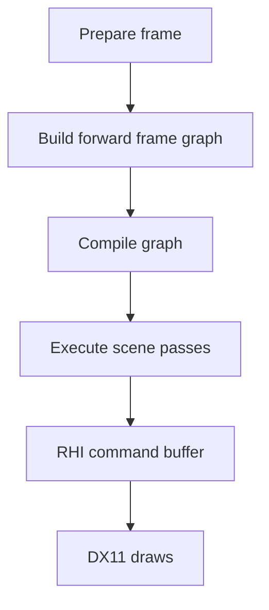

I threw away a D3D9 shader layer about 20 months after the port that introduced it. Cascaded shadows had landed on December 21, 2025. Two days later, I started the RHI migration.

The Metin2 mainline engine used Direct3D 8. Its state manager cached render states and avoided a device call when the requested value matched the cache. Rendering code could also call the device directly. Those two paths had to agree: a direct state change bypassed the cache, so a later request through the manager could be skipped even though the device held a different value.

In April 2024, I ported the pipeline to D3D9. The old pipeline had been untouched until then. The port brought the first shaders and GPU skinning: the model renderer supplied bone matrices to a vertex shader, which weighted the transformed position and normal by the vertex's bone indices and weights.

By December 2025, models were already using shaders. UI and effects still used fixed-function rendering. The Metin2 mainline engine had baked terrain shadows and a projected character shadow; the D3D9 renderer gained cascaded shadows on December 21. That shader layer had a short life.

## The plan and the triangle

The 2025 plan estimated 22 to 24 weeks. I changed the plan repeatedly while developing: timing, effort, approaches, and solutions all drifted. The dates here follow the work that landed, rather than treating the plan as a record of what happened.

My first migration commit was on December 23, 2025. It introduced the RHI and wrapped the existing device. I also put an ImGui panel in on day one. The wrapper gave me a way to introduce an interface while the old renderer still existed; the panel gave the work a place to expose its state from the start.

On December 26, I initialized DX11. On December 27, the fifth calendar day counting December 23 as day one, a triangle rendered through DX11. A triangle proved that the new path could issue a draw. It did not mean the game had migrated.

I wrote a DX9 backend too. On December 27, the same day as the triangle, I rolled back the forwarding of the old device's commands into the RHI, and on January 13 I deleted the whole DX9 backend, close to 3,000 lines. The idea of keeping toggles between backends was abandoned. Supporting two paths during a migration has a cost even when the end goal is one renderer.

## Bridges kept the game moving

I used bridges while pieces of the renderer crossed the boundary. A DX11-to-DX9 bridge appeared on December 29. On December 31, I added the render graph and wrapped the old render loop in it. On January 13, the RHI took ownership of the swapchain while D3D9 ran headless.

Model migration started twice: on December 31, I removed an earlier attempt and added new scaffolding. In January, I deliberately returned the model renderer to a draw per instance, with batching to follow. Getting a path across the boundary and optimizing it were separate jobs.

The transition had an endpoint. I removed the DX11-to-DX9 bridge on February 25 and the DX9-to-RHI bridge the next day. On February 28, day 68, I retired the old D3D9 device. Temporary compatibility code needs a way out, or it becomes another permanent rendering path.

## A frame through the RHI

The idea that held was to put resource creation and drawing behind an interface, then move rendering work through it a piece at a time.

The old model path sent bone matrices to a D3D9 shader. In the RHI renderer, the application prepares a frame, builds a render graph, and executes its passes through a command buffer. The model renderer submits work through that interface, and the DX11 backend issues the API draws. The default forward frame uses the graph too.

The graph compiler orders passes from their resource dependencies, removes passes whose outputs are unreferenced, and calculates resource lifetimes. The forward scene pass still contains an ordered sequence of scene work, including the map, actors, water, and effects. Moving to a graph did not make every part of the frame independent.

On March 21, I merged the branch. It contained 279 commits; the client changes covered 574 files, with 81,779 lines added and 74,532 removed. Performance, quality, and extensibility increased greatly through the work. I do not have a D3D9-versus-DX11 measurement to put a number on that comparison.

The renderer continued to change after the merge. In one later benchmark, `grid 5000` went from 245.0 ms to 45.0 ms, while draw items fell from 1,346,110 to 10,238. Those figures compare two RHI builds, not D3D9 against DX11.
