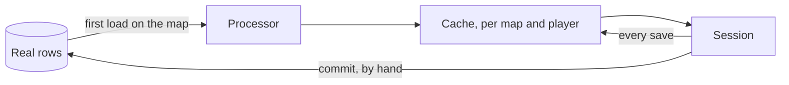

On 2026-04-28 I committed 2,812 lines that let a player load onto a map as someone else. The character was a copy, the session ran on the copy, and nothing it did reached the database. That commit was the easy part. The engine then needed 36 more places that knew a character could be a copy, and the first of the leaks that proved it showed up nearly three weeks later.

This post is about why there was no such thing before, how the primitive was built, what leaked, and why the only way back from a copy to the real character is a prize I write by hand.

## A character had one identity

In the Metin2 mainline engine a character is a set of database rows and a live object that writes itself back. Level, items, quest flags, affects, currencies. Whatever happens in a session ends up in those rows. There was no way to put a player in a temporary context where they were a level 120 with free gear today and their real selves tomorrow.

The engine did have GM commands that made a character something else. `all_skill_master` maxes every skill of the live character, and it is still in the engine. `full_set` and `attr_full_set` did the same for gear, until they were removed in October 2019. They changed the live object, so the normal save wrote the result to the real rows, and nothing reverted it.

The test tooling worked the same way. The GM control panel arrived in 2019 and grew to 1,267 lines before it was removed in April 2025. One branch of it gave forty artifacts at +5, and it refused to run outside the test server. Every build of a test character was a permanent change to that character's rows.

None of that was a bug, and it was not a search for equal gear. Asked whether I wanted equal-gear PvP before this and settled for something less, I answered: "no, we never thought about it". The limit was narrower. A mode that needed a character that was not the player's own had no place to put it.

## One commit, no predecessor

The idea is one rule: a map is virtual when a processor is registered for that exact map index. When a player loads onto such a map, the engine takes the real rows, runs them through the processor, and keeps the result in a cache in the game core. The session runs on the cache. A save writes to the cache, so the real rows stay as they were, and a re-entry reads the cache again. The commit message said it in one sentence: "progress are never saved to db, reentry gets the cache again".



27 files, 2,812 lines added and 68 removed. The largest parts were the Lua binding (808 lines), its generated stub (388), the Lua processor adapter (284), the database-reply code (253) and the processor interface (213). It also touched three forges, the battle pass, the titles and the master hunt, to give their own tables a load and a save wrapper. A search of the history for the name bottoms out at that commit. No earlier version existed.

Ten minutes later a second commit added test helpers: an example processor in C++, an example forge and three GM commands, 547 lines. Five hours after that came pets, logs and a column in the quest category file so a quest can be switched off in a virtual session. I deleted the examples on 2026-06-08. The C++ door is still supported and has no user.

## The first client came four days later

The first client was the arena's draft mode, on 2026-05-02. The draft referee gained one method, `should_virtualize()`, that returned `true`, and installed a processor on its arena map when it did. The ranked referee, which subclasses it, overrode the method to return `false`: ranked writes ratings and rankings to the real row, so it could not run on a copy. The first processor made every duelist a level 100 with stats of 90 and no skills.

I had not built the primitive for the arena. The limit was the one above, and the arena was the first place that used the way out. It lasted 26 days. On 2026-05-28 the draft went back to real gear, and a new mode took the virtualization one level down:

```lua
-- Inherits from draft (now a real-gear referee) and re-adds the player
-- virtualization that draft used to own: every duelist loads at level 120
-- with a clean, fully-kitted avatar (free gear, maxed skills, blessing)
-- and clean meta-state (titles / master-hunt stripped). Guild-coin awards
-- still apply, via the virtualized stash path.
```

Virtualization did not go away, it moved beside the real-gear draft. In my words, the draft felt like "a normal child class", and the change stopped being "need to touch things that might break existing things" and became "building beside what already existing without poluting it". The processor is what let me build beside.

Today 8 referees and flows run on the primitive, on 6 processor files of 355 lines in all. The avatar arenas, the guild war mode, the mannequin training room, Ball-Em-Up and the battle royale each install a processor on a private map, and five of the six subclass one base with a metatable. None of them passes real items through.

## Every subsystem that writes had to learn about copies

The primitive is opt-out per subsystem. A virtual character is a real live object whose saves are redirected, so every place in the engine that writes shared or real state has to ask whether the character is virtual and do something else. The day the first commit landed, 23 lines in 9 files tested for it. At the last count it was 59. Both counts include the declaration, the Lua binding and the simulator, and the growth is 36. Some redirections test the member directly and are not in it, so it is a proxy for how many places had to learn.

Seven fixes came out of the places that had not learned yet:

| Date | What the fix was about |
| --- | --- |
| 2026-05-17 | The skill tree persisted to the database for a virtual character. |
| 2026-05-21 | Affects accumulated in the cache on every save. |
| 2026-06-05 | Unique items persisted on destroy, because the virtual flag was cleared before the items. |
| 2026-06-12 | Broadcast affects were hidden for virtual characters, an over-gate. |
| 2026-06-18 | A commit wrote the cursor under the wrong key, a typo. |
| 2026-06-21 | A login in flight left a dangling cache entry. |
| 2026-08-30 | The tour wrote its completion flag to the cache, and the flag was discarded. |

Two of the seven were writes that reached the real database. The fix of 2026-06-05 is the clearest one. On destroy, the engine unequips every item, and an unequip with a timer saves that item at once. The virtual flag was cleared first, so that save went to the real rows and a virtual-session item was written into them. The fix moved one call after the item clear. The cost of the opt-out model is that a new subsystem that writes real state has to remember the gate, and nothing reminds it. Some subsystems are not gated but refused on a virtual map outright, among them the offline shop, the battle pass and the safebox, because their state is shared and a per-player cache cannot hold it.

The last row is the same lesson in one line. A tour step ran inside an arena session and wrote its completion with a plain flag set. In a virtual session that set goes to the cache and is thrown away with it. Until 2026-08-30:

```lua
ch:set_quest_flag(fk_completed(id), 1)
```

and the code today:

```lua
ch:commit_quest_flag(fk_completed(id), 1)
```

## Why the only road back is a commit

The cache holds a whole slice of the character. Writing a slice back when the session ends would write the transformed state, level 120 and free gear, over the real row, which is the thing the primitive exists to prevent. So the way back is narrow and explicit: one flag or one item, decided by the content at the moment it is earned. The engine delivers it on the next real load. It is never a merge.

There are three functions. A quest flag, an account flag and a staged item, which the engine consumes. A currency is an item: a guild coin reaches the player as an item of vnum 5 and is converted on delivery. The commit is fire and forget. One packet goes to the database core, nothing acknowledges it, and the running session is not updated, so a read of the same flag right after still gives the old value. A commit made just before a disconnect can be lost without an error on the game core side.

The design doc promised more: sequence-tagged commits and a drain at logout. Neither exists. I did not build them, and the shipped modes commit at a content event, a win or a tour step, never from the exit hook.

It bought one primitive that 8 referees and flows use. It cost a gate in every subsystem that writes, and 7 fixes to find the ones I had missed.
