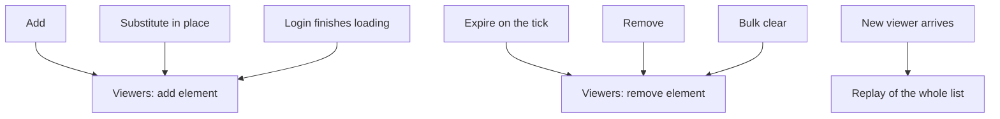

The first version of the affect broadcast went in on the morning of June 12, 2026. Before midnight it had two bugs: one dropped every effect on a virtual player, and one left the viewer holding the old copy of a substituted affect. Two months later a third, in the way a substitute is found, showed up on the server.

None of them was in the new packet. They were in the places where an affect changes, and in how the receiver identifies what changed. [Rage in a forge](/blog/rage-in-a-forge) covers the bits and the single broadcastable type. This post starts after that: what the channel carries, and what it takes to keep it true.

## A bit says that, an element says what

In the Metin2 mainline engine, a viewer learns about another character's affects from the `AFF_` bitfield in the character packets. A set bit says that a state holds. It has no duration, no value, no point and no source, and two affects that raise the same flag are one bit. A target window that wants to show how long a poison has left cannot be built from that, which is why in 2023 I added a fixed table to carry a few hand-picked entries through the target packet.

The broadcast sends the affect itself, with two packets keyed by the character's VID. The add carries the type, the point, the value, the source and an absolute end time, with 0 meaning infinite. The remove carries the type, the point and the source. The flag, the SP cost and the real-time marker are not sent, because a viewer has no use for them.

I weighed the usual alternatives. A bit per state is what the engine already had, and its ceiling was the reason to leave it. A delta against a periodic snapshot would repair a lost packet, at the price of a timer and a diff on every character. I sent whole elements on change, and nothing periodically, so the channel is a delta channel: a viewer who misses one packet holds the wrong state until a later change or a replay corrects it. The [foundation page](/foundations/affects) lays out the two channels side by side; what it does not say is how many places have to speak for that to hold.

## Every way the list changes has to speak

An affect on a character has four things that can happen to it: it is added, it is substituted in place, it expires, it is removed. The commit that introduced the channel touched 34 files, adding 816 lines and removing 253, and the server side of it is a call after each of those events.



Five server call sites send around the character: add (which also serves a substitute), expiry, removal, bulk clear and the end of login. A sixth path sends to a single viewer. The client keeps the result in a store per VID, keyed by type, point and source. It counts elements per type, so the first one attaches the type's particle and the last removal detaches it. Two affects of one type, from two sources, draw one effect and keep it until both are gone. The AFF bit has no such count: removing either affect that sets it clears it.

The sixth path exists because of login. When a player enters, the character is inserted into the view of others before its affect list is final, so the first packet to viewers carries an empty list. The affect manager queues the load and the finishing step then sends the whole broadcastable list to the viewers already looking. A viewer that arrives later gets the replay in the insert packet. Three paths, one rule: whoever sees the character must end up with the list the server holds.

The decision whether to send is one function. This was its first version, on June 12, 2026:

```cpp
// Broadcastable affects: relay the full element to everyone who can see the character.
static bool ShouldBroadcastAffect(LPCHARACTER ch, uint32_t dwType)
{
    return !ch->IsVirtual() && AffectManager::instance().IsBroadcastableAffect(dwType);
}
```

## A virtual player showed nothing

The first clause is `!ch->IsVirtual()`. A virtual player is a character that other people look at in a session, so the clause meant every add and every removal on it reached no one. The save path already diverts a virtual player's affects to its session cache, so the gate guarded a path that never touched the database.

I removed the clause at 18:05 the same day, in a 9-file commit that also moved the configured list from a macro to a section of its own. The replay path kept the check for longer. A viewer who was already looking saw a virtual player's affects arrive, and one who walked up later saw only the changes made after arrival: two spectators of the same arena could see different things on the same player. I removed that check too, so the live path and the replay now send the same list. The [behavior page](/docs/core/affects/behaviour) describes the replay, and the [virtualization foundation](/foundations/player-virtualization) covers what a virtual session does not share.

Persistence and visibility take the same character and ask different questions. A guard that belongs to one of them does not carry over to the other.

## A substitute reached the viewer as a new affect

Substituting an affect rewrites it in place: the engine finds the matching element, undoes its points and writes the new values over it. The owner is told of a removal and then of an add. A viewer is only sent the add, which is what the store expects: an add with the same key replaces what it holds.

The client's key was too short. In the first version the store upserted by type and source:

```cpp
// Upsert by (dwType, source): replace in place (duration/override change) else append.
for (auto& e : vec)
{
    if (e.dwType == el.dwType && e.unSourceVid == el.unSourceVid)
    {
        e = el;
        return false; // type already present -> not a 0->1 transition
    }
}
```

Two elements of one type on different points, with the same source, were the same element to the store, so the second add overwrote the first. At 23:27 the key gained the point. The same commit changed the target window, whose affect strip is a child of the owner's strip so both show the same thing: when the icon for an affect is already on screen, it now removes the old element from that icon and adds the new one.

The server side has the matching trap, and it is still a trap. A substitute that matches on type alone can land on a different point, and viewers never receive a removal for the old one. The default for `ch:add_affect` is exactly that. A broadcast type with several points must ask for an exact match, or remove first. The channel can carry the truth, but the sender decides what counts as the same affect.

## The substitute that found the wrong sibling

On August 14 the same step failed on the server. The override search had one spelling for two questions. A caller that wanted an exact point and a caller that wanted any point both passed `APPLY_NONE`, and the search read `APPLY_NONE` as any. A skill node that carried no point and asked for an exact match found the first affect of its type instead: a sibling the same skill had raised a moment before. It overwrote that one where it stood.

A probe in the simulator showed the effect. A skill declared four affects and raised three, and the one it lost was the attack speed its own description advertised. The fix gave the exact search a function that compares the point as a value. This is the search today:

```cpp
pkAff = bMatchApplyExactly
    ? FindSpecificAffect(dwType, bPoint, AFF_NONE, unSourceVID)
    : FindAffect(dwType, APPLY_NONE, unSourceVID);
```

The rename in the same commit says what the flag had been: the old parameter was named after the first caller that needed it, and not after the rule it selected. The commit touched 9 files, 233 lines added and 26 removed, most of them the probes.

No viewer had to be wrong for this one: the owner lost an affect on its own character. A channel of whole elements only moves what the list holds, so the list's identity rule decides everything it can send.

## Which types go on the channel

The first commit listed the broadcastable types in the configuration file, twenty ids of them. At 11:08 the same day I took them out. Traits and augments now register their types with `affect.add_broadcastable` in the script that defines them, and the configuration keeps a short list. The runtime registrations and the file merge when the manager loads, so neither overwrites the other.

That moved the decision to the author of the affect. A script that creates a type also says whether viewers see it. The cost is that the same state can now be registered in two places, and the engine does not check that a type with an AFF flag and a broadcast particle draws only once. The [client reference](/docs/core/affects/client) lists the registrations a broadcast type needs; the [registration page](/docs/core/affects/registration) covers the server side.

## What it cost

Every new way to change the list is a new place that has to speak. The channel has five senders and one replay, and a sixth way to add or remove an affect that skips them is a bug I would not notice from the server. The sender and the receiver each carry their own rule for what counts as the same affect, and the two had to be fixed separately: the client's on June 12, the server's on August 14.

The channel has no periodic resync. What it gives in return is one place to look: every visible state now sits in the same per-character store with the same key, and a wrong one differs from the right one by a single list on the server.
