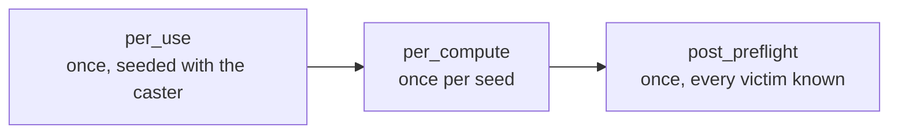

Three of the bugs I fixed in the skill system in August 2026 had the same cause. A cast that was fired a second time broke the timed effects of the first. A timed effect attached to a group of victims ran for only the first of them. A skill that fired from an event did nothing at all. In each, the code was right about what a skill does and wrong about when.

## A skill was one function

In the Metin2 mainline engine a cast on a victim is one function, `ComputeSkill`, about 490 lines long. It takes the skill and one victim. It sets the variables that the skill's formula reads, then decides from flags what to do with them: melee damage, magic damage, arrow damage, a point change, removal of a bad affect. Splash is one more flag, tested inline in several places, so finding more victims and hurting them happen in the same pass. An effect that is not one of the flagged ones is a branch for that skill.

That shape is cheap while a skill is a damage number and a point change. It stops being cheap when one skill needs to hit a group, then heal the caster for each one it hit, then leave a mark that pays out two seconds later. Each of those wants to be said about a different set of characters and at a different moment, and the flags only say what, not who and not when.

## Nodes since 2019

I started the node model on February 12, 2019, as a refactor of the skill code that deleted 530 lines and added 101. In the following week it grew a node for damage, a splash function, groups that could be chained without a limit, and a priority queue to collect targets. For seven years that model was a tree stored in the skill table of the database.

Between July 20 and August 9, 2026 I rebuilt it as a language in a YAML file per skill. The central change is that a node says three separate things. `collect` says what enters its list, `accept` which of those are allowed, and `resolve` who authors the list, the server or the client. Before, a node's population was spelled three ways at once: a splash block, a word in `flags`, and an implicit default, and which one won depended on the node type. The commit that split them touched 205 files, and I checked the migration by deriving the effective clause from both spellings across 346 nodes and requiring them to be equal, not by review.

A node therefore collects its recipients before it acts, and its children run once for each recipient of the parent. The [foundation page](/foundations/skills/nodes-and-phases) has the order of those steps, and the [collect and trigger reference](/docs/core/skills/collect-and-triggers) has the fields.

## The next cast broke the first

The skill object exists once per character and skill. Using the skill reset it in place: the node state, the counters of who had already been hit, the level, the power. A ticker, an auto-shooter or a chained attack that the first cast had queued then ran against the numbers of the second.

On August 4 I split the object. A cast became its own record, created on every use and never cleared, and every timed run holds a shared pointer to the cast that started it. The record lives exactly as long as the trees it started. The commit touched 22 files, 1,413 lines added and 959 removed. With that, a timed effect belongs to its cast and not to the caster's skill, and the timed behaviours that followed could be written at all.

## A timed node had one carrier

A timed node does not run its children in the traversal. It hands them to an event that fires later, once for each character the node collected. The dispatcher had this written as a `return` where it needed a `continue`, so only the first victim collected ever carried a timed node. The line now reads:

```cpp
// A timed node hands its children to the event, not to this traversal -- but
// `continue`, not `return`: every collected victim is a carrier of its own.
if(pkInfo->usNodeType == SKILL_EFFECT_AUTO_SHOOT ||
    pkInfo->usNodeType == SKILL_EFFECT_TICKER ||
    pkInfo->usNodeType == SKILL_EFFECT_CONCATENATED_ATTACK)
    continue;
```

A timed node can need two populations, the carriers that its own `collect` selects and the targets it searches for each time it fires, and the foundation page spells out the difference. The clocks have to agree too. A mark skill declared an affect with a deadline at 8 seconds next to a tick at 7.9. The two collapsed into one pulse, the affect was processed first, and the run died before it paid out. The affect became endless and a single tick at 10 seconds ends both, because an affect attached to a run is a second clock.

## Three phases, and the moment each one knows

On August 3 I wrote down when in a cast a node runs. `per_use` runs once per cast, seeded with the caster. `per_compute` runs once per seed: once for a cast the server resolves, once per arriving attack packet for a cast the client resolves. The earlier version had three dispatcher arms that redirected the whole tree at the caster, as `if/else if`, so a skill that was both a self buff and a hit got only the first. The `nodes:` block left the grammar and the 132 configs that used it. One id counter spans the phases, because a formula in one phase may name a node from another.



Three days later a skill wanted to heal its caster for each enemy caught. `per_use` is too early, since nothing has been collected. `per_compute` sees one victim at a time, and under client resolution it runs once per packet, so the node would overwrite itself and the last packet would win. `post_preflight` is seeded with the caster and runs exactly once, when the sweep is done.

When the sweep is done depends on who resolves the cast. A server-resolved cast finishes when its computation returns. A mob's finishes at its last scheduled splash. A client-resolved cast is finished when the client says the hit window of its animation closed, so I added a packet for it. The packet carries a victim count, which is only logged: the phase reads the server's own record, already capped by the packet bound, so a forged count changes no number. A second report changes nothing either, because the phase marks itself as run.

There is a gap and the docs state it: if that packet never arrives, nothing runs the final phase. There is no timeout. Anything the player paid for belongs in `per_use`.

## A phase is a computation, and a trigger forgot one

Each phase starts a fresh computation, which resets what every node remembers from the last traversal. Without that reset a node keeps the seed of the previous one, its collection short-circuits on it, and the node does nothing, silently. That is why each phase begins with a reset.

A trigger runs a skill when a game event happens instead of when a player presses a key. On August 24 I found that it ran only the compute list. Every passive whose payload had been moved into `per_use` did nothing when its threshold was crossed, and only one, which had kept its payload in `per_compute`, still worked. Running `per_use` first fixed it, and then it needed its own reset, because the phase that worked would have stopped working:

```cpp
RunPerUsePhase();
NewComputation(false);
ProcessSkill(pkSeed);
```

I added a probe to the headless simulator that drives real damage through the hit-point change that fires the trigger. Two of the passives carry both phases, so a run that shows only the compute-phase affect localises the fault to the phase.

A triggered cast runs `per_use` and one `per_compute` and never `post_preflight`, since no sweep ends. It does not take the ordinary press path, so it pays no cost and asks no use policy. The [node reference](/docs/core/skills/nodes) lists the node types, and the collect and trigger reference lists the events.

## What it made possible

A skill can now say who it reaches, when it acts, and what it does to each of them, in three separate sentences. A group heal, a mark that pays out later and a passive that fires from an event are the same tree with different clauses and no new branch in C++.

The cost is on whoever writes the tree. The phases have rules that look like details and are not: the seed that a search does not rescue, a bound that limits packets and not the search, a one-shot ticker that must still declare a delay, a cast that never ends if the client never reports. The foundation page lists them, and a phase is the place to look first when a node does nothing.
