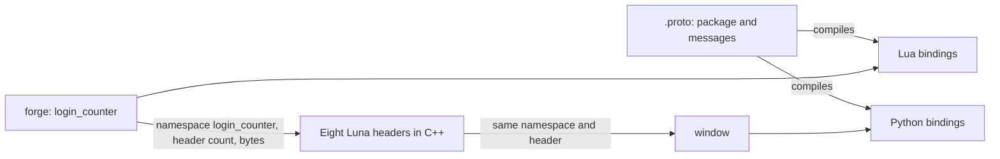

In the Metin2 mainline engine a feature that talks across the network is a packet: a header constant, a struct in the shared header, and a case in the switch that reads it on each side. [Hiding the transport layer](/blog/hiding-the-transport-layer) counts what that cost for one message and follows the roulette through the move to protobuf. This post is about the shape that replaced the packet: what the envelope holds, which names mean what, and the three places where it did not hold.

## The envelope

Every message a forge sends to a client, or a client to the server, travels in one packet type per direction. This is the server-to-client one:

```cpp
typedef struct SPacketGCLunaMessage {
    uint8_t header;
    uint16_t size;
    uint64_t receipt;
    uint32_t client_handler;
    uint16_t namespace_size;
    uint16_t header_size;
} TPacketGCLunaMessage;
```

After the struct come the namespace, the header and the payload as raw bytes. The namespace and the header are strings, and the payload is whatever the sender serialized. The engine never looks inside it. It selects a processor by channel, namespace and header, and the processor decodes.

The whole engine carries eight such packet headers: two from the client, one to it, two between game cores, one from a game core to the database and two coming back. A feature adds none of them. [How messages travel](/foundations/luna/transport) describes the channels; the point here is that the set is closed. The size is a `uint16_t`, which will matter below.

## Three files and four names

The tutorial [Send a message from the server to a client window](/tutorials/server-to-client-message) builds the smallest complete feature, and the homepage walks through the same three files. The first is the contract:

```protobuf
syntax = "proto2";
package LoginCounter;

message GCLoginCount {
    required int32 count = 1;
    required int32 online = 2;
}
```

The second is the forge, which fills the message and sends it:

```lua
local msg = pb_loader.new(messages.GCLoginCount)
pb_loader.load(msg, { count = count, online = online })
forge.sys.game.send_client(ch, "count", msg:SerializeToString())
```

The third is a window, which registers in its constructor for the namespace and header it wants. This line is from a shipped window; in the tutorial the two strings are `login_counter` and `count`:

```python
luna.RegisterHandler(self.GetWindowHandle(), "ue_curse_manager", "curse_update", ui.__mem_func__(self.__OnCurseUpdate))
```

No file is C++, and the `.proto` compiles to Lua and to Python only. Four names appear across the three, and they are not interchangeable. The forge is called `login_counter`, and `send_client` takes no namespace argument: the engine reads it from the environment the call is made in, so the namespace on the wire is the forge name. `count` is the header, chosen freely. `LoginCounter` is the proto package, and it travels nowhere. It names the message types. The folder the `.proto` sits in, `ue`, is the import path on both sides.



Getting them wrong is silent. A window registered under the package name, or under the file name, is a listener nobody sends to. The tutorial ends on that failure for this reason.

## What a package buys

The package arrived on 11 April 2025, six months after the first messages. Six protos gained one line each and the generated code was regenerated:

```diff
-GCROULETTEINFO_COST_TYPE_FIELD.full_name = ".GCRouletteInfo.Cost.type"
+GCROULETTEINFO_COST_TYPE_FIELD.full_name = ".Roulette.GCRouletteInfo.Cost.type"
```

Protobuf identifies a message by its full name. Without a package, every message in the tree sits in one root namespace, and two features that both want a `GCUpdate` or a `Prize` cannot coexist. With one, each feature owns its names. Every proto in the tree now declares a package, 44 of them. The package costs nothing at run time because the wire never carries it, and that is also why it cannot route.

## Typed at both ends, bytes in the middle

The helper that fills a message is `pb_loader`. `new` builds an empty message, `parse_string` builds one from received bytes, and `load` fills a message from a Lua table, recursing into nested messages and repeated fields. `load` assigns each key inside a protected call, so a key the message does not have is dropped and nothing is logged. The failure shows later: a required field left unset makes `SerializeToString` raise when the message is sent.

That is the trade-off of the design. The type lives in the generated bindings on the two ends, and the engine in between sees bytes. A message that arrives under the right namespace and header with the wrong layout is routed correctly and decoded wrongly, and field numbers are the contract. In return there is one extra serialization layer where a hand-written packet had a struct, and it is the same layer for every feature.

## The envelope cut messages short

The Python module that sends a client message parsed its arguments with explicit lengths and built length-correct strings from them:

```cpp
std::string ns_str(ns, ns_len);
std::string header_str(header, header_len);
std::string message_str(message, message_len);
```

The call that sent them passed the raw pointers instead:

```cpp
rns.SendLunaMessage(ns, header_str, message, handler);
```

A pointer converts to a string that ends at the first zero byte, and a protobuf payload contains zero bytes: a field set to 0 or `false` is its tag followed by a `0x00`. The packet size was computed from the shortened string, so the packet was well formed, only short. The server received a prefix of the message. A missing required field failed the parse and an optional one read as its default. It was fixed on 20 November 2024 in one line:

```cpp
rns.SendLunaMessage(ns_str, header_str, message_str, handler);
```

## The size field was 16 bits

`size` in the struct above is 16 bits. A message the server built longer than 65535 bytes wrapped the field, and the client then read the next bytes of the stream at the wrong offset. On 14 September 2026 the send was changed to refuse such a message and log an error. A message that is too long now fails loudly and is not sent, and a feature with a long list has to split it.

## The generated Lua has a ceiling too

The Lua generator emits one local variable per descriptor and per field, and Lua allows 200 locals in a function. A proto large enough to pass that cannot be loaded. On 28 September 2026 three surfaces of one feature's proto moved into files of their own for that reason, and on 20 October another feature's registry messages followed. The limit is invisible until a proto grows, and then it is a build-time surprise in a layer that otherwise needs no rebuild of the server.

## The switch that stayed

A window that is not built when the message arrives cannot have registered. For that case the launcher passes the message to the game window, which routes by namespace and header in Python. That function now has ten branches, one per namespace. The tax shrank rather than vanished: it is an `elif` in a script, with no new packet and no rebuild of the launcher, and only for features whose window does not exist yet or is not a window. The [client foundation](/foundations/luna/client) lists the rules for it.

## What it made possible

A feature ships as data. The tree holds 44 protos and 50 forge files, and none of them needed a new packet to send, receive or answer, because a request from a window is the same envelope in the other direction, handled by a processor the forge registers for a header. The proto, the forge and the window are the three files a feature owns, and the engine owns the eight headers and the routing key.
