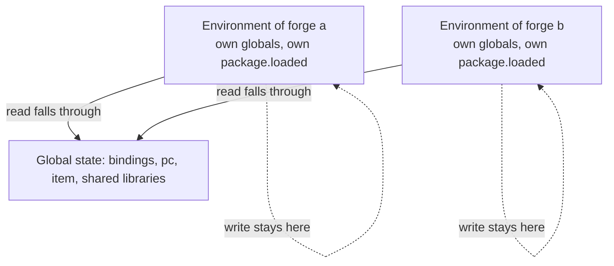

On October 1, 2024 the first forge loader went in, and it gave every forge its own Lua thread. Six days later the thread had given way to a table with a metatable, and on October 9 the code that wrapped every function a forge returned was commented out.

[Why quests were not enough](/blog/why-quests-were-not-enough) tells what broke, and [How the quest manager works, and what Forge changed](/blog/how-quest-manager-and-forge-work) tells the mechanism: the file, its two halves, the name `forge.game.<name>`. This post is about the part those two take for granted: what keeps one forge from stepping on another.

## One state, one set of globals

A quest is a chunk run on a short-lived thread of the one global state. Whatever it needs later goes through the C API into quest flags, because its locals die with the thread. A module is the opposite case: it holds a table across events, and it declares functions under names it chose. Lua gives a chunk no table of its own for globals. Unless something sets one, a global that a chunk writes lands in the table every chunk on that state reads, so two modules that both declare `function init()` are one function, decided by load order.

## First version: a thread per forge, and a wrapper on every function

The commit of October 1, 2024 moved the Luna core out of the game server into a shared library, so the db core could use it. It touched 17 files, adding 605 lines and removing 335. The loader in it created a Lua thread for each forge file, with a numeric id and the forge name in two keys on its environment. Its message says what the loader did to the result: it proxies all forge function calls to an environment augmented with the forge information.

A forge returns a table, or an instance of a class. The loader walked it and replaced every function with a wrapper:

```cpp
// Inject the environment before calling the original function
env.set_on(original_func);

sol::protected_function_result result = original_func(args);
```

If the call returned another instance, the wrapper walked that one too. A function was in its forge's environment only for as long as a call through the proxy lasted.

## Second version: an environment, and a require of its own

On October 7 the db cache got the same loader, and the thread gave way. Each forge file was now loaded into an environment created for it: an empty table whose metatable reads through to the global state.

```cpp
sol::table mt = state.create_table();
mt[sol::meta_function::index] = state.globals(); // Allow read access to globals
```

A read that finds nothing in the forge falls through to the globals, so the native bindings and `pc.` or `item.` are all still there. A write lands in the forge's table. The `function example()` that a forge declares at the top level is no longer a global; a quest cannot call it and another forge cannot overwrite it.



The loader writes three keys on the environment before the code runs: the forge name, an id, and the file path. The name is the forge's identity, and everything that has to know which forge is calling reads it from the calling function's environment. That is how registration works. A processor is stored under the forge name and the header, and a second registration of the same pair is refused and logged:

```cpp
if (HasInputHandler(inputType, ns, header)) {
    sys_err("Forge::SetInputHandler trying to double set input handler ns[{}] header[{}]", ns.c_str(), header.c_str());
    return false;
}
```

Two forges can use the same header, because the forge name is part of the key. The same forge cannot take it twice.

## A require that shared one module for everyone

The module cache was the second place two forges met. `package.loaded` is one table, so a helper required by one forge is the table every other forge gets back. The comment I left in the code when I saw it reads:

```cpp
// !! ------ Using package.loaded leads to have only one require for all env, probably because package.loaded is a property
// !! ------ inherited from GS and therefore shared across envs
```

The fix is a `package` table per forge with its own empty `loaded`, and a `require` that finds the module through the usual searchers and runs its chunk with the forge's environment set as its `_ENV`. Two forges that require the same module now get two tables, and a global the module declares lands in the forge that asked.

The cache is not empty, though. It is seeded with a copy of whatever the global `package.loaded` held when the forge loaded. The modules the main state loaded before the forges, such as the Penlight libraries, are therefore the same table everywhere. That is deliberate for a library with no state of its own, and it is a trap for a module whose functions need to know which forge they run in. The [environments page](/docs/core/luna-forge/environments) lists it among the rules, and `_G` is the way to share a table on purpose: the lookup of `_G` reaches the real global table, so a table anchored there is one table for every forge.

## The wrapper had nothing left to do

With the code of a forge loaded inside its environment, every function it defines has that environment as its upvalue. A method keeps it when a quest, a processor or a coroutine calls it later, so the wrapper that sets it before each call was putting something back that was already there. On October 9 the two calls to the wrapper were commented out, in a commit whose subject is about coroutines. What I left beside them:

```cpp
/// ! It seems that wrapping requires and executing the forge script in an environment is enough to
/// propagate the environment to all functions and classes
```

It is still commented out. The function that does the wrapping is still in the file, and the docs state the consequence as a rule: a forge method keeps the environment where it was defined and runs on its caller's thread.

## What the isolation costs

The calling context is now a property of the code, so a call that arrives without one is not a call from a forge. A quest hook has no forge environment. A `forge.sys.game.send_*` reads the forge name from the function that calls it, finds none, and fails, which is why a hook calls a method of the forge that sends. The method was defined in the environment, so it carries one. The [foundation page](/foundations/luna/forge) keeps the table of these traps and the reason behind each.

The other cost is on the load. The environments load in the order the file system lists the compiled files, which is not sorted. A forge that reads `forge.game.<other>` while its own body runs depends on that order. The body can only define; calls into another forge belong in a method that runs later, or in `when boot`.

## One loader on two cores

The loader that went into the shared library on October 1 is the one the db core runs. The db core builds its forge with its own bridge and the environment name `db`, and loads only the files that end in `.db`. A forge file compiles into one output per environment, so the two halves of one forge share a name and nothing else, not a state and not a table. The game core and the db cache are two processes, each with its own Lua state.

The commit of October 7 that integrated the db cache touched 93 files, adding 2,296 lines and removing 791, and, in its message, integrated the forge with all input processors. The server's locale holds 50 forge files today, 12 of them with a db half.

## The state was closed before the last subscriber let go

A forge lives as long as the process, and there is no hook that tears one down. That left shutdown order. On December 16, 2024 a fix moved the destruction of the event bus before the destruction of the quest manager, because bus events tried to release Lua variables on a closed state. The change moved one call in the server's main function.

What C++ keeps of a forge, and for how long, is told in [From messy C++ subsystems to Forge](/blog/messy-cpp-to-forge) and [A script that waits on the server](/blog/script-waits-on-the-server).
