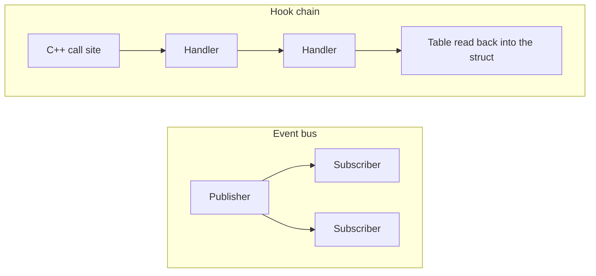

On August 13, 2026 I removed the hook chain: a class in the shared Lua library, its game-side subclass, its bindings and the `bridge.hook` surface in Lua. The commit message gives the reason in one sentence: `ON_DAMAGE` was dead and `CHECK_LOCKED_IN_ACTIVITY` had no consumer. The third hook was the only one anybody used, and it left in the same commit, replaced by something native.

The hook chain had been added two weeks after the event bus, as its sibling. The bus is still there.

## A guild was created and nobody could say so

In the Metin2 mainline engine, a native subsystem that has to react to another one is reached through a path written for that pair. Nothing lets a script learn that a guild was created, and nothing lets a second C++ subsystem listen to the first without the first calling it by name. [Why quests were not enough](/blog/why-quests-were-not-enough) is about what that cost once Lua owned whole systems: each C++ hook was one more place where a call into Lua could land at the wrong moment.

On October 10, 2024 I added the event bus: 30 files, 880 lines added and 5 removed, of which the bus itself is a 205-line header and a 94-line source file. It had four events, all about guilds: created, disbanded, member added, member removed.

The shape is small. An event is a string. A subscriber gets an id, and the bus keeps subscribers per name in id order. A publisher raises the name with either a C++ struct or a Lua table, and each side receives the form it understands. The bus counts how many subscribers need Lua, so an event with none builds no table at all. The check sits at the top of the publish:

```cpp
auto needs_lua = EventNeedsLua(event_name);
sol::table args;

if (needs_lua && !lua_table) {
    args = event_data_to_table(event_info->serialize());
}
```

There is one bus per process: the game server has its own and the database server has its own. Today the game side declares 25 events and the database side 6, and the Lua and forge files outside the type stubs call `bridge.e.subscribe` 39 times in 23 files. The [event bus foundation](/foundations/luna/event-bus) covers delivery order and what a subscription holds on to; the [events guide](/docs/core/luna-forge/events) covers the quest-side events.

## The first payload path was wrong

A bus that carries a C++ struct to Lua has to turn the struct into a table, and a table raised from Lua has to become the struct. The first version did it through a string-keyed map of `std::any`. On October 24 I rewrote the path: the commit message says the table-to-struct step was not working properly, and that deserializing straight from the table into the struct is faster and gets the right type in one go. The serialization macros moved out of the bus into a shared base in the same commit, which added 163 lines to the bridge header.

The reason they moved is the other thing in that commit.

## A sibling that could answer

An event is one-way. A publisher raises it and carries on, and a subscriber has nothing to return. I wanted Lua to be able to change what C++ was about to do: read a value, modify it, and have C++ use the result. The same commit added the hook chain.

It was the bus with one difference. Handlers were registered under a name and run in id order, as on the bus, but they received a table, and after the last one ran C++ rebuilt its struct from that table and used it:

```cpp
sol::table args = hook_data_to_table(hook_info->serialize());
uint32_t applied_hooks = 0;

auto it = hooks.find(hook_name);
if (it != hooks.end()) {
    for (const auto& [id, hook] : it->second) {
        if (hook(args)) {
            applied_hooks++;
        }
    }
}
hook_info = table_to_hook_data(hook_name, args);
```



It had three names: `ON_DAMAGE`, `CHECK_LOCKED_IN_ACTIVITY` and `ON_CMD`.

## Two hooks that never ran

`ON_DAMAGE` was meant to change how damage is calculated. The call in the damage function was commented out in the commit that added it, with a note that it worked but that the performance cost of a hook in a place like that had still to be analyzed. It stayed commented out for the next 22 months.

`CHECK_LOCKED_IN_ACTIVITY` came on November 6, 2024. `IsLockedInActivity` asked it whether a character was held in a war or an arena, so that Lua could add a reason to the ones C++ already knew. On the day I deleted the chain, the only `bridge.hook.add` in the Lua tree was the one for commands, and the only name anything subscribed to was `ON_CMD`. No script had ever registered for this hook.

For a hook with no handler, the chain returns before it builds a table, and the struct it hands back is the one it was given, with `locked_in_activity` false. It did allocate that struct on every call to find out. So deleting the call site cannot change a result: the function returns `false` where it used to return the chain's default, which was `false`. That is the whole proof, and I made it by reading, not by a test.

## The hook that had users

`ON_CMD` was not dead, and it did not start as a hook. Until April 13, 2025 a typed command was an event on the bus. That day I turned it into a hook so that commands could be logged and given priority over the engine's own. The commit touched 18 files, 227 lines added and 150 removed, and moved every forge's command registration to it.

A forge registered a tree of sub-commands under a root name, and the registration was a hook with a guard that compared the name:

```lua
bridge.hook.add(bridge.hook.names.game.ON_CMD,
    function (cmd_hook)
        recursive_traverse(cmd_hook, router)
    end,
    function(cmd_hook) return cmd_hook.cmd == cmd end
)
```

A typed command was a table handed to Lua and a guard called for each registered root, until one matched. On a bus or a chain the name is a filter, not an address.

Nor is there an owner. A chain runs every handler, so two forges that claimed the same root name both registered and both ran, and the commit message states exactly that. Nothing in the model could say that a name must have one.

## Native, with one owner

The same commit that deleted the chain made the command router native. Builders, tree traversal, argument parsing and GM-level checks moved into C++, routes became opaque userdata, and the Lua file that built them, 230 lines, was deleted. The 20 forge call sites did not change. A root name that is already taken is now refused and logged:

```cpp
sys_err("cmd.register_router : [{}] already registered; keeping the first", cmd.c_str());
```

Two other things came in with it. The GM command log dereferenced a character's descriptor without checking it, so a character with none crashed on any staff-level command; a mock player in the headless simulator has none. And the simulator gained a way to enter commands through the real command entry point and to force a GM level, with a 191-line test over the router: builders, validation, dispatch, parsing, GM gating, nesting and fall-through.

With `ON_CMD` served by the router, no hook had a registration left. The commit touched 26 files, 733 lines added and 657 removed once whitespace is ignored, and the Lua surface that used to be called `bridge.hook` no longer exists.

## What a consumer costs

In March 2025 the C++ owner of a per-character permission started publishing when it was granted and when it was taken away. That took two events, each a struct with a character and a type, and four call sites, 11 lines in the file that owns the state. A forge subscribes to the removal. That is the price of a consumer on the bus: a struct, a name, one line where the state changes, and the owner does not know who listens.

The costs the bus moved are real and the docs list them. A subscriber's lifetime and its order become the bus's problem: the player-save event is published before logout quest actions run, and a listener that is never removed keeps its callback and its captured values alive and keeps forcing a table on every publish.

## What it made possible

The event bus is how game, database and Lua talk about something that already happened, and a subsystem can gain a listener without a change to the code that publishes. What the bus cannot do is answer: C++ gets nothing back. The one place that needed an answer, command dispatch, ended as a native router that has an owner for each name and a return value, and the hook chain, which lived 22 months, had no use left.
