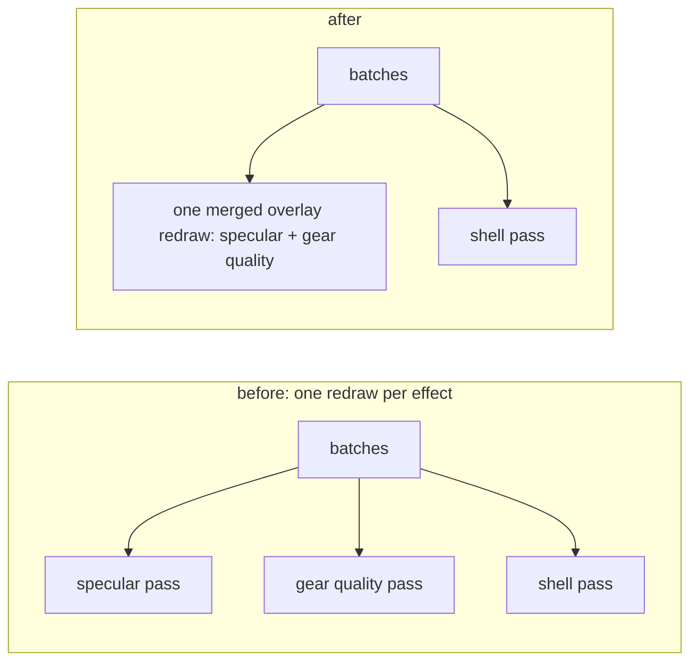

Everything I added on top of a lit model (a sphere-map shimmer, a rim glow on good gear, later a whole surface material) had to draw that model again. This post is about what that cost grew with, and the commit of August 20, 2026 that changed it.

[Extended, never wrapped](/blog/mse-extended) tells what the materials look like and [5,000 stones](/blog/5000-stones) tells the batching that surrounds this change. This is the shape of the extra draw itself.

## One effect, one redraw

The material effects went in on January 20, 2026, with the forward path of the hybrid renderer: 14 files, 1,415 added lines. The interface asked every effect to own a draw:

```cpp
virtual bool ShouldRenderInstance(const ModelInstanceData& instance) const = 0;
virtual void BeginPass(RHI::CommandBuffer* cmd) = 0;
virtual RHI::PipelineHandle GetOrCreatePipeline(const ModelBatchKey& key) = 0;
virtual void BindResources(RHI::CommandBuffer* cmd) = 0;
```

The manager walked the effects by priority. For each one it went through every draw call of the frame, copied the instances the effect accepted into a vector, uploaded that vector to a pooled buffer and drew the batch with the effect's own pipeline. The effect picked the vertex shader, the pixel shader and the blend, depth and raster state.

With one effect that is fine, and it was one effect: the sphere-map specular. The gear-quality glow and an inverted-hull shell arrived on May 24 as two more passes of the same shape. Each added a full walk over the batches, a filter, an upload and a draw per participating batch. The cost of the overlays together was the number of enabled effects times the number of batches they touched, and every new look made the multiplier larger.

## What an overlay actually is

The two shimmer effects have nothing that needs a draw of their own. They draw the same triangles through the same vertex shader and the same additive state, and differ only in the colour a pixel gets. The commit named the split in its header comment:

```cpp
//   Overlay    - a per-pixel contribution over the SAME geometry with the SAME pipeline
//                as every other overlay. All enabled overlays are evaluated in ONE
//                re-draw, so effect count costs shader instructions, never draw calls.
//
//   Standalone - needs its own vertex shader or rasterizer state, so it cannot share a
//                draw and pays for its own geometry pass.
```

So the base interface split in two. An overlay effect owns no pipeline and no geometry. It supplies a bit, a predicate and the resources it binds. A standalone effect keeps the old interface.



The enabled overlays OR their bits into a 16-byte constant buffer, and one pixel shader tests each bit and adds the result of the matching function:

```hlsl
float3 c = float3(0.0, 0.0, 0.0);

if (g_EffectEnableMask & OVERLAY_EFFECT_SPECULAR)
    c += Effect_Specular(surf, inst);

if (g_EffectEnableMask & OVERLAY_EFFECT_GEAR_QUALITY)
    c += Effect_SurfaceMaterial(surf, inst);

if (dot(c, c) <= 0.0)
    discard;
```

Every function takes the same two arguments: the interpolated surface (normal, tangent, world position, UV, fog factor) and the per-instance data. Because they share the surface, they do not care whether the vertex format carried one UV set or two. The shader fills the surface struct from either output, and the effects never branch on vertex layout.

The manager draws from the batch manager's shared instance buffer, so the per-effect copy and upload went away with the per-effect pass. The standalone effects still run after it, in priority order.

## The cost moved to the pixel

The merged draw is not free of a trade. Before, an effect filtered instances on the CPU, so a model that did not take part was not drawn at all. In the merged draw the CPU can only decide for a whole batch: if any instance in the batch is wanted by any enabled overlay, the batch is drawn with all its instances, and the shader returns zero for the ones that are not.

```cpp
// Batch-level gate only: a non-participating instance inside a participating draw
// costs a branch in the pixel shader, not a separate draw.
```

That gives a rule that took the commit message a whole sentence: the shader has to repeat the CPU predicate exactly. The old gear-quality filter rejected profile 0 as neutral ids past the table as having no profile, and profiles with no technique on. The shader now carries the same checks before it reads the table:

```hlsl
uint profileId = ModelInstanceData_GetGearProfile(inst.Flags);
if (profileId == 0 || profileId >= GEAR_PROFILE_COUNT)
    return float3(0.0, 0.0, 0.0);
```

If the two disagree, the CPU gate lets a batch through and the shader paints an instance that the effect would have refused, or the reverse. The predicate now lives in two languages, and neither compiler sees the other.

A second rule is about texture slots. The old gear-quality shader read its noise texture at t4. The shared model header owns t4 to t6, so the noise moved to t7, and a new overlay that needs a texture goes there or past it, never into those three.

## Adding one

The header ends with the recipe, and it is the claim of the post: adding an overlay is a contribution function in the material-effects shader folder, one call in the merged pixel shader, a small class, and one `RegisterPass` line.

The class is small because it owns neither pipeline nor geometry. The gear-quality one is a name, a priority, a bit, an enabled switch, the predicate and the bind of its noise texture. The gear-quality pass file went from 141 removed lines to 17 added, and the specular one from 178 to 8, while the manager took the merged path.

The commit touched 15 files. The C++ went from 435 removed lines to 359 added, a net of 76 fewer. The shaders went from two files of 155 and 245 lines to four of 74, 68, 64 and 109: 400 lines became 315, and the pieces that were copied into both (the pixel input structs, the resource declarations) now exist once. I have no draw count before and after: the repository has no capture of this change, so the saving is stated as the structure and not as a figure.

## What it made possible

The same file went on to carry more than two effects. The gear-quality contribution was replaced by a surface material of up to three layers resolved per frame into a slot byte in the instance, so a look never splits a batch, and the function that evaluates a layer is shared. The selective glow writes its colour from entry points of the same shader file, `mainGlow` and its multisampled and two-texture variants, through the same surface function. Those are still their own draws, because they write a different target at half resolution, so they are redraws of a different kind and I kept them out of the merged one.

Afterimages, which redraw an actor's recent poses, go through the surface overlay only. A look that draws the model again is now a function, and a pass is what you write only when the geometry itself has to change. The [render pipeline](/foundations/rhi) shows where these draws sit in a frame, and [effects and materials](/docs/building-blocks/effects-and-materials) is the authoring side.
