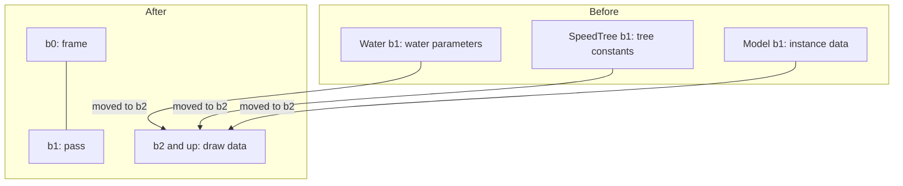

In the Metin2 mainline engine, `b1` meant water parameters in one shader, tree constants in another, and model instance data in a third. Each renderer owned its constant layout and slot numbers, and each shader re-declared its own frame data. I needed a frame and a pass to mean the same thing across renderers before their draws could share a contract.

[The RHI migration post](/blog/rhi-migration) covered the plan and the first triangle. The work here happened after that first draw, when the renderers still disagreed about what their slots contained.

## Water gave up b1

Water had frame constants at `b0`, water parameters at `b1`, fog at `b2`, and lighting at `b3`. Model rendering used `b1` for instance data and `b2` for skinning. A slot number alone did not tell me what a shader expected.

The diagram follows those meanings across the change. Renderer-specific data moved out of the first two slots, leaving them with the same owners for every renderer.



On January 9, 2026, I moved water to the new contract. Its water-specific buffer became `WaterDrawCB` at `b2`; `b0` held the frame context and `b1` held the pass context. The same day I moved SpeedTree, effects, and sky. Terrain, model, and primitive rendering followed the next day. Seven renderers crossed in two days, one at a time.

The frame context is uploaded once per frame. It carries camera matrices, lights, fog, cascaded shadow matrices and split distances, time, and other frame data. The pass context is uploaded once per pass: its view and projection can belong to the camera for the main pass or to the light for a shadow pass. Draw data starts at `b2`.

```hlsl
cbuffer PassContext : register(b1)
{
    float4x4 g_PassViewMatrix;
    float4x4 g_PassProjMatrix;
    float4x4 g_PassViewProjMatrix;
    float4x4 g_PassInvViewMatrix;

    uint     g_PassType;      // main colour, CSM shadow, point or spot shadow, deferred lighting, UI...
    uint     g_CascadeIndex;  // which cascade, for shadow passes
    float    g_NearPlane;
    float    g_FarPlane;
    uint     g_DirLightIndex; // background or character light
    // ...padding
};
```

A shader that needs to know whether it is writing a shadow or colour no longer asks its renderer for a special constant. It reads the pass type from the buffer every shader already includes.

## A pass has an owner

`BaseRenderer` owns the pass buffer. Its `BeginPass` uploads and binds `b1`, then calls the derived renderer's `OnBeginPass` hook. `EndPass` calls `OnEndPass`. The frame context manager handles `b0`; each derived renderer handles `b2` onward and its own resources.

That boundary gave water the same frame and pass inputs as the other renderers while keeping water parameters with the draw. A shared slot only helps if ownership of the upload and binding is shared too. Otherwise every renderer can still make a different promise about it.

The model renderer was the large one. Before it, model shaders had a frame buffer at `b0`, instance data at `b1`, skinning at `b2`, shadow data at `b3` and specular data at `b4`, and the renderer kept a frame-context header, a render-parameters header and a builder in the game layer to feed them. The commit that moved it touched 38 files, added 2,272 lines and removed 3,394, so the model path ended 1,122 lines smaller. Its old API used begin, bind, and indexed batch calls with render-batch state. I changed it to `Draw(const ModelDrawCall&)`: the caller built a draw call, and the renderer built model draw data at `b2` and skinning data at `b3`. I deliberately went back to one draw per instance, with batching to follow. Instanced shadow and GPU rendering returned on January 16, followed by proper instancing and a model batch collector on January 17. [5,000 stones](/blog/5000-stones) covers the batching that came back.

## Shadow maps found a fixed range

Terrain had used `t2` to `t4` for cascaded shadow maps; the model renderer used `t4` to `t6`. I standardized the maps at `t4` to `t6` and gave `BaseRenderer` the operations to set and bind them. A renderer still owns its resources, but the shadow maps have one place to bind.

I also changed the shadow filter. It had used 12 manual Poisson samples with a plain sampler and a manual depth test. The replacement used five rotated samples through a comparison sampler and `SampleCmpLevelZero`. The filter continued to evolve afterward; the frame buffer now carries a variable sample count and penumbra parameters.

Once every renderer read the same `b0` and `b1`, a new pass mostly had to bring its own draw data. The deferred G-buffer work started a week after the contract. In March, shadow casters began to be culled against the camera frustum extended toward the light.

## Removing a clear moved the responsibility

The DX11 command buffer had implicitly called `ClearAllBindings()` when beginning a render pass and setting render targets, to prevent shader resource and render target conflicts. On January 10, I removed those implicit clears and made renderers manage their own resources. Binding an invalid texture handle became an explicit null bind. `ClearAllBindings()` remained available as an explicit operation.

That decision left work at the boundaries. Primitives could interrupt renderers from anywhere, so on January 18 I made them rebind the previous pipeline after drawing. Later, the binding cache needed a fix: the D3D11 runtime could unbind a conflicting shader input when a render target was bound, but the RHI cache could still believe the slot was populated. In October I made output bindings unbind inputs that view the same resource, and made a slot cache reset empty the device slots too. A cache of device state has to account for changes the runtime makes on its own.

`ForceRebindFrameAndPassBuffers` is still there as a temporary migration workaround, with seven callers. The shared contract did not make every binding transition disappear.

## A bridge stayed after its last caller

The DX11-to-DX9 bridge had let DX11 subsystems render into an internal target, copy it through the CPU to a DX9 texture, and composite it onto the DX9 backbuffer. I removed its use in February, but kept it behind a build macro for reference during future backend migrations.

In August I deleted it: 578 lines with no caller. A bridge kept for reference still has to be carried until someone removes it.

## What I would reuse

Fix the meaning of the first two slots before moving any renderer, and give one object the job of binding them. Let a pass declare what it is in data the shaders can read. If you remove a safety net such as an implicit clear, expect it to come back as a bug in some other layer, and look first at any cache that mirrors device state. And when a compatibility bridge loses its last caller, delete it then, not six months later.
