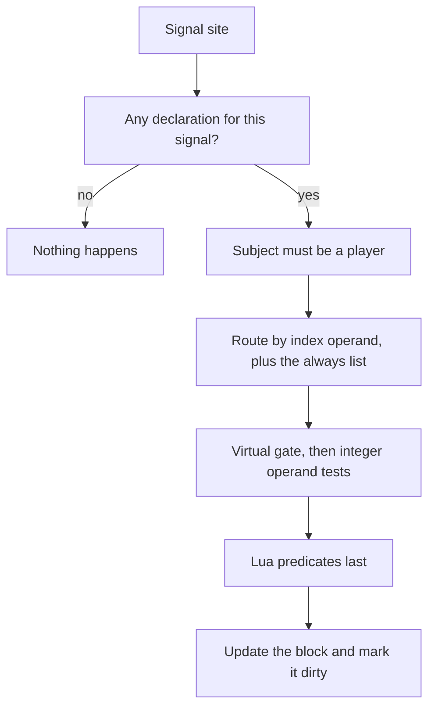

When I started, a death in the server called into the PvP manager, the arena, the guild war manager, a zone mode, a ranking helper, a stats manager, a seasonal event and the achievement helper, one after another, from the same function. Each of them kept its own counter and had learned the vocabulary of its feature. None could read what another had counted, and a number nobody had thought of in advance did not exist for any of them. In the Metin2 mainline engine the only place to keep a lifetime number about a character is a quest flag, and a quest flag is owned by the quest that sets it.

A new achievement meant C++ because of that, but achievements were only the first client. The limit was that the engine had no place to keep a measurement about a player and let anyone else use it.

On September 1 and 2, 2026 I added that place. This post is about the framework: what a declaration holds, how a number gets into it, and why the choices that mattered all protect the same thing, which is that a wrong count cannot be taken back.

## A declaration holds a source and a rule, nothing else

A metric is a name with a source and an aggregation, declared in one YAML file that the engine reads and validates at boot:

```yaml
metrics:
  kill.stone: { from: kill, where: { type: [STONE] }, agg: count }
  region.visited: { from: custom, agg: distinct, domain: { kind: map, max_keys: 256 } }
```

There is no threshold, no reward, no display name and no category in a declaration. Those belong to whoever reads the number. The declaration fixes only what the name means, so `kill.stone` means the same thing to every reader that ever asks for it, and a consumer cannot give it a second meaning by counting for itself.

Two decisions sit under that file. The engine reads it itself, rather than a forge reading it and calling `declare` for each entry. A generic facility that belonged to whichever forge happened to load it would have forced the next consumer to reach into the first one's code to get a metric declared. And the YAML path and the Lua `declare` call end in the same validator: the engine converts each YAML entry into a Lua table and hands it to the function the binding calls. A commit message of that week says why `from:` is mandatory. A misspelled key leaves it absent, and the metric is refused at boot instead of being declared and never written, which would read 0 for the life of the release and look exactly like a player who had not earned it. A refused entry stops the core from starting.

## Where a number comes from

A metric has one of two sources. A signal is a fixed C++ site that already has typed operands in scope, and a declaration filters it. There are four: a kill, a hit, a skill use and an item use. A `custom` metric is pushed by whoever already knows the fact, with one line:

```cpp
metrics::Metrics::Add(ch, "fish.catch", 1);
metrics::Metrics::Add(ch, "fish.size.max", nLength);
```

or the same call from Lua. Both end in the same function, with the same checks, and there is deliberately no flag for native or script. The language a call site is written in is a property of that site, not of the metric, so moving a producer from C++ into a quest changes nothing in the catalog. To find where a metric is written, I grep its name.

The list of signals is short on purpose. A new signal is a change to C++; a new metric over an existing signal is a line of YAML. I did not add one for point changes, the function that every gold and stat change goes through, because it is one of the hottest in the server. The three currency peaks are pushed from the lines inside it instead, as custom metrics.

Of the 52 metrics declared today, 16 come from a signal and 36 are pushed.

## The hot path never enters Lua

A signal fires at kills and hits, so the first requirement was that a signal nobody declared costs nothing. The call site tests one global bit word first, and the bit is set only if a declaration uses that signal. Past it, the subject has to be a player, which stops a mob dealing damage before anything else runs. The declarations that filter on the signal's index operand, the monster or skill number, sit in a hash bucket, so a metric over fourteen monster numbers costs one hash lookup per kill. Then integer operand tests, and only after them the Lua predicates a declaration may name. The author writes `where` flat and in any order; at declaration time the engine splits it and always runs the cheap tests first.

My first design forbade a Lua predicate on the damage path, on cost grounds, without a number behind it. The objection that held was memory safety: the damage function is re-entrant, and a predicate that destroyed a character would leave the rest of the function running on freed memory. So the same commit that allowed predicates put a pending-destroy guard around the whole function, and a predicate there reads and returns. A predicate that raises an error is a non-match, and after 16 errors it is disabled for the process. That is a deliberate trade: a metric that stops counting can be recovered, a metric that counts everything cannot.



## Every aggregation moves one way

The five aggregations are count, sum, max, min and distinct, and none of them can be reset. That makes a threshold mean a lifetime total, and it also means a wrong write is permanent: an inflated maximum or a stray key cannot be walked back without editing the database. Most of the design is arranged around that.

Count and sum are the same operation on every signal except damage, the only one that carries a measured quantity. The catalog keeps a comment on `damage.critical` for that reason: it is a count, because summing damage instead puts a threshold written for 100,000 critical hits at about thirty of them.

The same rule decided the virtual-session default. A [virtual session](/docs/core/player-virtualization/overview) grants a character that is exaggerated on purpose, at level 120 with endgame gear. A signal fires on whatever the character currently is, so a kill or a hit inside one would be written into a lifetime statistic. A metric therefore refuses pushes from a virtual session unless it declares `allow_virtual`, a signal-derived metric cannot declare it at all. A default whose failure mode is irreversible has to fail closed, and an opt-out default would have asked every author of a push to remember a guard at the call site. Four metrics of the catalog opt in, all pushed by the code that owns the episode.

The damage signal has one more exclusion that came from the same worry. Training dummies stand on a public map with 9,999,999 hit points and one of them has the boss rank. The metric emit sits above the guard in the damage function that already excluded them, so that hits on a raid boss count, and without a test of its own every damage total, crit count and damage-to-boss figure could be farmed in town. The commit that added the signal carries that test.

## The sweep: a queue of players and a clear before the publish

A change marks the character's block dirty and queues its player id once. Every heartbeat takes up to a configured number of characters off the front, 100 by default, and publishes one `ON_METRICS_CHANGED` event on the bus for the whole batch, with three flat lists: players, how many names each, and the names. One publish per sweep, not one per character, is what makes a general-purpose bus affordable here. The queue holds ids, not pointers, because a pointer dangles the moment a queued character logs out. Characters that did not change are never touched, so the cost of a pass does not grow with the number of players online, and under load the latency stretches instead of the work.

The sweep clears the dirty bits before it publishes, never after. The publish is synchronous and a consumer may push a metric on the same character, for instance by granting an item for a milestone. Clearing afterwards would erase that new bit while the queued flag still blocked a second entry, and the character would sit dirty and unqueued until something unrelated moved it. The simulator suite found it, and it was the one substantive defect it found in the machinery.

The per-character blocks live in the manager, keyed by player id, not on the character object. That takes 8 bytes off every mob in the world, which had carried a back pointer used for a single log line, and it means nothing frees a block automatically: destroying the character has to release it.

## What a declaration cannot do

It counts forward from the day it exists. The catalog states it in its header: a metric added in a later release starts at zero for the whole population. Persistence keys a row by the metric's name, so renaming a metric orphans its rows, and a row whose name is no longer declared is logged and skipped at load. There is no backfill; seeding a history is a SQL insert by hand from a source you trust. The header draws the conclusion itself: under-declaring is the unrecoverable mistake and an unused array slot is the cheap one, so a few metrics are declared with no consumer yet.

A value read from a name that is not declared is zero with no log, so a consumer that validates its own configuration has to ask `declared`. The dirty queue holds 8,192 entries and drops a character with a log line when it fills. The blocks live on one game core, and the database row is the only shared state. Those costs are in the [Foundations page](/foundations/player-metrics) and in the [docs](/docs/core/player-metrics/overview), next to the traps they cause.

## The second reader

The engine knows no consumer, only that a value changed. The first reader was the achievement system. The second was a client window that shows which missions of a map a player ever completed. It did not get a protocol of its own: that feature's channel to the client gained a generic name, value and keys transport, sent whole at login and patched off the sweep, and nothing on the wire names a mission. The feature's script records a completed mission's ordinal in the map's metric, from one central place, so none of the 135 mission quests changed.

The same catalog gave a virtual match a place to count. The code that referees it pushes `arena.win` and three more metrics with `allow_virtual`, because for those the virtual session is the thing being measured.

Reading is where a bad count shows up first, so the simulator got a driver of its own with the substrate: 43 tests and 221 checks on the first day, 58 tests and 275 checks the next, with each mechanism deliberately broken to see that a test notices. The queue purge, the block release, the mandatory `from:` and the map key normalisation are among those. An implementor can read and move any value in the live server with `/metric get`, `add`, `add_key`, `list` and `pending`.

What it made possible is narrower than a general stats system. A content person adds a measurement by writing a line of YAML, a script pushes one number from wherever it already knows the fact, and any number of readers can subscribe to the same event, and none of them can change what a name means.
