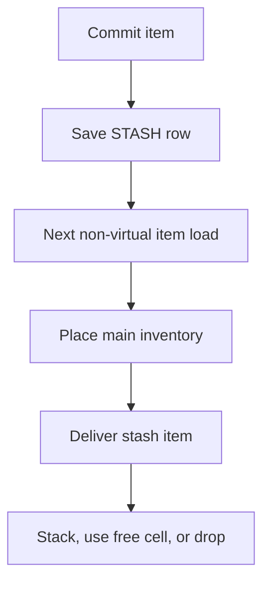

A virtual player's processor could not see a pet. The pet manager loads its row on summon, in a query of its own, and the bulk player load never carries it, so no hook ever saw it. I needed to isolate that state too, then give the session a way to award something to the real player without saving the copy over it.

## A pet arrived after the processor

On April 28, 2026, I added pet virtualization about five hours after the initial player virtualization change. A virtual summon looks for the pet by vnum in the cache. On a hit it uses the cached record. On a miss it runs the real query, passes the result through `transform_pet_load`, and caches it. A failed query still fails the summon and reports the failure in chat.

The hook can keep a pet's identity and name while resetting its level, experience, bonuses, and skills. This example constructs that replacement record:

```lua example
function processor:transform_pet_load(ch, pet)
    local result = TPetPlayerTable.new(pet.pid, pet.pet_vnum)
    result.id = pet.id
    result.name = pet.name
    result.level = 1
    return result
end
```

Saves go to the cache. The database save is dropped. If the load hook errors, the error is logged and the original record is used. That fallback keeps the summon working, but it also lets real pet data into the virtual session.

A forge subsystem had the same boundary in another form: it owned a table and loaded through its own request, outside the bulk load. I gave it load and save wrappers. On a virtual cache miss the load wrapper decodes the response, calls `transform_forge_load` with a key, and caches the result. The save wrapper puts the decoded state in that cache instead of calling the real save. Unregistered keys pass through; an error in the transform is logged and the input passes through too.

A draft mode used the key to empty owned and selected titles and badges in a title subsystem. It returned an empty table for a progression subsystem and passed other keys through. The [custom transformer documentation](/docs/core/player-virtualization/custom-transformers) covers the registration and wrapper contract.

There is no save transform. The load filter runs on a cache miss, then saves carry the live state into the cache. A relog that hits the entry skips the hook. Changing the hook does not change an existing entry until the core restarts. Each subsystem must wrap both paths itself. A forgotten save wrapper can still write to the real database, even when the load side appears to isolate the subsystem correctly.

Wrapping was not the only choice. Battle pass first used the cache wrappers, with a key per pass. On May 17 I removed those wrappers and made its login and save paths skip virtual characters. That is the opt-out form: the subsystem does not exist in the session at all, and nothing about it is cached.

## The broad scope stayed unbound

Saving the transformed slice at exit would overwrite real state with the copy. The initial design considered another route: `with_real_scope(pid, function() ... end)` would make a player read as non-virtual inside the scope, so forge wrappers would reach the real database. The underlying scope operations exist, but nothing calls them and there is no Lua binding.

I shipped narrow commits instead. The first reward interface had two: `commit_quest_flag` and `commit_account_flag`. A flag is a signal that real code can act on later. The [player virtualization foundation](/foundations/player-virtualization) describes the boundary around the session; the [prize commit documentation](/docs/core/player-virtualization/prize-commit) describes the calls that cross it.

## A pending flag sets a value

A flag commit sends a single quest row directly to the database core, bypassing the running character's quest data. It sets a value. No acknowledgement follows. The call does not add to the value or update what the virtual session reads. It appears on the next real load. The key is split at the first dot into a name and state, each under 63 characters; an invalid key is logged and dropped. An account flag also needs a descriptor.

On May 17 I used a pending quest flag for a virtual duelist's battle pass progress. The referee committed `1`; at the next real login, battle pass read the flag, applied that many units of work, and cleared it. This excerpt shows the virtual side of the decision:

```lua example
if duelist.ch:is_virtual() then
    duelist.ch:commit_quest_flag("battlepass.pending_arena", 1)
else
    forge.game.ue_battlepass:work_on_quest(
        duelist.ch:get_player_id(), forge.game.ue_battlepass.QUEST_IDS["ARENA"], 1
    )
end
```

Two wins before the next real login still leave the value at one. The reader treats the value as a count, but the writer sets it rather than accumulating it. A pending flag works for a signal; a counter needs a different design.

## An item waited outside the inventory

Three days after the initial change, I added `commit_stash_item`. The real player might not be on the committing core, and even if present, the real inventory could contain items in cells the virtual session cannot see. Choosing a cell from the copy could collide with one of them.

The caller creates an item and can set its sockets, attributes, values, and flags before committing it. The engine snapshots it under the real player id with the `STASH` window and sends the usual item save packet. The row stays in the database. It never belongs to an in-memory character and never appears in the client inventory. The engine destroys the temporary in-memory item with saving skipped, so destruction does not remove the row. The caller must let it go.

The path waits for a real item load before placing the reward:



Delivery is deferred until the main inventory is placed. Inline delivery could put a reward in cell 0 before the real item for that cell was loaded, overwriting it. Delivery stacks the item, takes a free cell, or drops it on the ground. Its id stays the same and the normal save moves the row out of `STASH`. A virtual load strips stash rows before its processor sees them, so another virtual session cannot deliver them.

The delivery primitive also converts currency items into point changes and destroys the carrier. A zone mode awards a currency by stashing an item of vnum 5, because a direct balance change would only touch the virtual balance. The original design had left currency commits out of scope, but the item delivery path handles those carriers.

The stash change touched 17 files, adding 581 lines and removing 15. It has no size cap: a player who never reaches a non-virtual map can accumulate rows. The `STASH_COMMIT` log entry is the only way to watch that accumulation. A client notification waits for the game phase, but its polling event lives only in memory and is lost on a crash. The item is safe in the database.

## A commit still needs a character

`commit_stash_item` refuses a null character or item, an item without an id, or an item that already has an owner. It returns zero on refusal. A committer also needs a live character on its core. A battle mode keeps pending rewards in forge memory when the character is gone or a commit fails, then retries at the next login. A core restart loses that pending table.

A reward claim in another subsystem chose a third option: refuse while virtual. The right to the reward was already stored, so the player loses nothing by claiming once out, and a commit would have added a second route for a reward to reach an inventory.

The cost of a narrow road is that every writer declares itself. To save each script from branching, I wrapped the choice once:

```lua
function LPCHARACTER:commit_quest_flag(key, value)
    if self:is_virtual() then
        forge.sys.game.player_virtual.commit_quest_flag(self, key, value)
    else
        self:set_quest_flag(key, value)
    end
end
```

A script that calls `set_quest_flag` in a virtual session still writes to the cache and is discarded with it, and nothing warns. The [hooks documentation](/docs/core/player-virtualization/hooks) covers the session hooks around that boundary.
