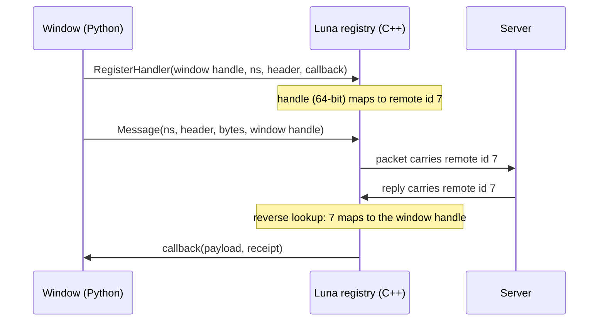

In the client, the Python handle of a window was its C++ address cast to an int. A window that wanted server messages registered under that integer, and the integer travelled to the server as the window's id. On December 30, 2024 I moved the client to 64 bit, and an address no longer fit in the int that carried it.

This post is about what an id may be when it crosses a process, and who owns a window when C++ holds a callback to it. [Hiding the transport layer](/blog/hiding-the-transport-layer) tells the message that travels between them; this is the identifier on its envelope and the lifetime of the object at the other end.

## An address that looked like a number

Every window Python builds registers itself with the window manager and keeps what comes back:

```python
self.hWnd = wndMgr.Register(self, layer)
```

What came back was `Py_BuildValue("i", pWindow)`: the pointer to the C++ window, as a Python int. Every later call, from `SetParent` to `Show`, passed that int back and the module cast it to a pointer again. On a 32-bit process an address and an int are the same width, so nothing ever looked odd.

The same integer was the window's identity towards the server. The Luna client module registers a callback under a handler, a namespace and a header; the packet that asks the server something carries that handler, and the server writes it back on the answer so the client knows which window to wake. The window handle was the natural handler, and the [client foundation](/foundations/luna/client) still says a window handle can serve as the ID. The registries held it as `uint32_t`, the Python argument parser read it with `"i"`, and the packet field was a 32-bit integer.

So there were two jobs on one number. Inside the client it was a pointer that had to survive a trip through Python. Outside, it was a key that a server stored and echoed, which also meant the server received an address from a process it does not control.

## What the port had to touch

The port was one commit: 820 files, 2,720 added lines and 260,299 removed, of which 243,861 were the vendored encryption library leaving the tree for the package manager. The handler work is a small part of it.

Inside the client, the window handle stopped being an int. The 21 constructors that returned `Py_BuildValue("i", pWindow)` now return `PyLong_FromVoidPtr(pWindow)`, and a new reader, `PyTuple_GetHandler`, takes the Python object back to a `uintptr_t`. The registries are keyed by `uintptr_t`. Image and model handles that Python held the same way moved with them.

Towards the server I did not widen the packet. The commit message states the decision: every handler registered and sent to the server is mapped to a `uint32_t` identifier, so the server receives an int32 id and never a client memory address. The mapping is made at registration:

```cpp
auto it = m_remoteLookupMap.find(handler_id);
if (it == m_remoteLookupMap.end()) {
    m_remoteLookupMap[handler_id] = ++m_remoteHandlerId;
}
```



The counter starts at one, so a remote id means nothing outside the session: it is the order in which windows registered. Unregistering a window's handlers erases its entry, and clearing all handlers clears the table. Zero stays reserved for "no particular window", which on arrival means every callback registered under that namespace and header.

The same mapping exists a second time. The older per-feature packets (lobbies, rankings, seasons) go through a registry in the network stream with its own counter; Luna has its own, in its own module. Both are `uintptr_t` to `uint32_t`, and neither knows about the other.

The reverse direction is a scan. On a reply the client looks for the entry whose value equals the remote id, walking the map, so finding the window costs as many steps as there are registered handlers.

## The first version answered to nobody

The first version of the lookup, the one in the port commit, read:

```cpp
uint32_t CPythonLuna::GetRemoteHandler(uintptr_t handler_id) {
    auto it = m_remoteLookupMap.find(handler_id);
    if (it != m_remoteLookupMap.end()) {
        it->second;
    }
    return 0;
}
```

The expression does nothing, and the function returns zero for every window. A message the client sent with its window handle therefore reached the server with the handler for "any window". The answer came back with zero, and delivery with zero skips the filter and runs every callback registered under the key.

It was fixed on August 23, 2026, in a commit about something next to it. `Call` returned whether the key had any registered handler, not whether one had run. When the filter skipped all of them, the client still reported the message handled and never reached the fallback that hands it to the game window. The fix added a flag that is set only when a callback is called, and the one-word `return` in the lookup went in with it.

## A callback that owns a window

Registering a handler stores the Python callable in the C++ registry and takes a reference to it. A bound method holds its object, so the window cannot be collected while the registration exists. The C++ window is destroyed from the Python object:

```python
def __del__(self):
    wndMgr.Destroy(self.hWnd)
```

A registry that keeps the object therefore keeps the C++ window too, and the cleanup that unregisters the handler lives in the same `__del__`, which cannot run while the registry holds the object.

Buttons failed the same way through a different route. A lambda such as `lambda: self.SetActive(True)` closes over the window, the window's event table holds the lambda, and that is a cycle through an object that defines `__del__`; Python 2 does not collect such a cycle. The history is a list of windows that stayed:

- the minimap, September 24, 2023, "kept alive by a lambda";
- the login window, April 16, 2024, kept by its button lambdas;
- the safebox, May 14, 2024;
- the title-barred board, November 13, 2025, whose close event was set without the wrapper, so the board was never destroyed;
- the switchbot window, November 20, 2025.

The wrapper is `ui.__mem_func__`. It takes a method and keeps weak proxies of the object and of the function, so the event holds the window by name and not by reference. If the window is already dead when the event fires, the call catches the `ReferenceError` and returns `False`.

The switchbot window set its buttons like this until November 20, 2025:

```python
self.startButton.SetEvent(lambda arg = True : self.SetActive(arg))
self.stopButton.SetEvent(lambda arg = False : self.SetActive(arg))
```

and like this after:

```python
self.startButton.SetEvent(ui.__mem_func__(self.SetActive, True))
self.stopButton.SetEvent(ui.__mem_func__(self.SetActive, False))
```

The wrapper has one exception: handed a lambda, it stores the lambda as it is, because there is no object in it to proxy. Wrapping a lambda therefore changes nothing. The cure is to give the wrapper a method and the arguments the lambda carried, as in the pair above.

The wrapper itself took two corrections, on December 16, 2024. Wrapping a wrapper copied the inner call and dropped the new arguments, and wrapping an object that was already a proxy built a proxy of a proxy. The constructor now keeps a proxy when it is given one and rebuilds the call with the arguments joined. A parent set through `SetParentProxy` got the same check.

The Luna registration uses the wrapper too, and registers once the window has a handle:

```python
luna.RegisterHandler(self.GetWindowHandle(), _LUNA_NS, "update_counters", ui.__mem_func__(self.__OnUpdateCounters))
```

With a weak callback the registry no longer keeps the window, `__del__` runs, and the window unregisters its handler on the way out. The [client foundation](/foundations/luna/client) lists the teardown order and says to unregister at `Destroy` as well, because a callback must not reach a window whose children are already cleared.

## The same commit

The port commit carried more than the handlers, and a few of its other lines concern memory.

The shader constant cache allocated a `bool` for a boolean constant and then copied the value through `BOOL` pointers. `BOOL` is a four-byte int on Windows, so a one-byte allocation was written with four bytes, and the source was read with four. The fix is one line, `bool` on both sides. It sits in the commit that adds CMake modules for the address, thread, undefined-behaviour and memory sanitizers, and presets that build the launcher with the address one; a how-to for running the client under it came with them.

The audio library's codecs moved into the root pack and load from memory, so the client no longer needs a separate codec folder beside the executable. Logging went through one library: a main log, a rotating error log, a console sink and a system-error file in the main folder.

## What it made possible

The client builds as 64 bit, and a handler that crosses to the server is a small id the server can store, echo and route on without trusting the client to hand it a valid address. In the Lua API that is the `client_handler` the server receives with a client message and passes back to `send_client`, and the [transport foundation](/foundations/luna/transport) keeps it apart from the receipt, which belongs to a waiting server script.

The lifetime rule is the other gain, for the people writing windows. A window that registers for messages and sets its events through the wrapper is collected when its last owner lets go. The loose-module workflow in [Debug client Python](/docs/core/debug-client-python) and the import rules in [Client Python imports](/docs/core/client-python-imports) apply to those windows unchanged.
