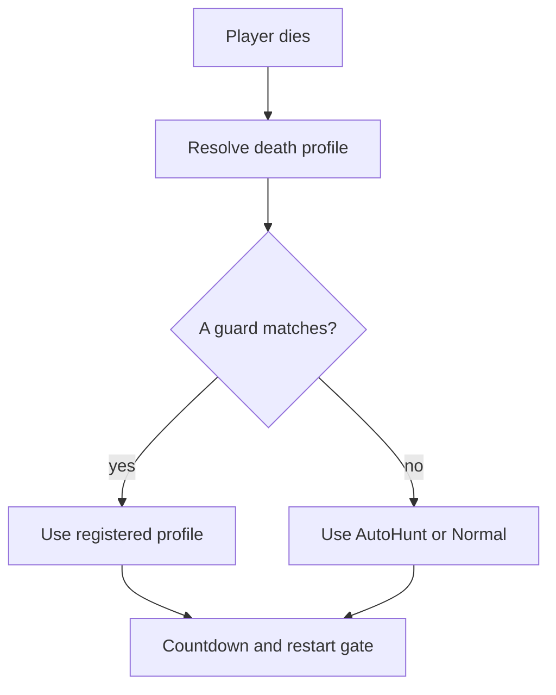

The Metin2 mainline engine keeps two copies of the restart timer: the countdown a dead player sees, and the gate that decides when restart works. Every mode added since put its own branch into both, and they disagreed. One display branch could never run, the arena was keyed two different ways, and the display and gate tested different zone types. The restart command was 208 lines; it is 38 now. Following that timer led to a design for decisions that several parts of the engine had been making independently.

## The countdown and the gate disagreed

Before April 14, 2026, these display branches returned before the arena branch could run:

```cpp
if (IsHack(false)) {
    return iTimeToDead - (180 - g_nPortalLimitTime);
}
if (IsHack(false) && CPVPArenaManager::instance().IsArenaMap(GetMapIndex())) {
    return iTimeToDead - 150;
}
```

The first test returns whenever `IsHack(false)` is true. The restart gate instead checked `ch->GetPVPArena()`, along with observer mode and the restart command. For one zone mode, the display and the gate tested different zone types, both against `iTimeToDead > 270`. A countdown and a gate can each look plausible while telling the player different things.

On April 14, 2026, I moved the decision into death profiles counted from the moment of death. The window and the gate could then use one source. The change touched 9 files, with 536 lines added and 316 removed. The first `ResolveBaseProfile` was an if-chain: war map, PvP arena, raid, zone mode, then Normal.

## Four decisions became questions

Death was one of four decisions with the same shape. Item use, spectator exit, and party join also read flags or map tests in many places. Each new mode added a branch at a position nobody chose explicitly. The spectator exit command had an if-chain per subsystem; the mainline engine set observer mode from several sites. Party admission had stock limits including 8 members and a level window of 30, with 15 and 10 in two locales.

A flag on an entity says that something is true. It never says what to do. Asking a registry instead lets the owner of a rule supply the answer, but moves invariants to that owner: a policy may be asked more than once, and a handler that errors still needs cleanup.

The [battle arbiter](/blog/eleven-branches-one-list) uses a list for event policies. These are decision policies: the engine asks what to do at a particular decision point. The common design is described in [policies](/foundations/policies).

## The profile moved into an ordered list

On April 30, 2026, I moved profile ownership to subsystems that registered their own profiles and added Lua bindings. That change touched 16 files, adding 1,632 lines and removing 157. The zone mode, raid, and the war map registered from C++; the war map profile moved to Lua on June 2, after 33 days as a native registration.

A registration has a name, a guard, and a payload. Each registry walks one list in registration order, with no priority field. For death, spectator exit, and party join, the first matching guard answers; if none matches, the call site supplies its fallback. Item use instead takes the first deny, and potion amounts chain. C++ and Lua register into the same list.

For one death, the path now runs from the registry to the same profile for the countdown and the gate:



This is the code today: the fallback is visible at the call site after the registry has had its chance.

```cpp
DeathProfile ResolveBaseProfile(CHARACTER* ch)
{
    if (auto profile = CDeathManager::instance().Resolve(ch))
        return *profile;

    if (ch->FindAffect(AFFECT_AUTO_HUNT_ACTIVE))
        return GetProfile_AutoHunt();

    return GetProfile_Normal();
}
```

The [death manager](/docs/building-blocks/death-manager) describes the profile. The same registration shape now appears in 8 registries. Item use adopted it on May 14, 2026, in a change across 16 files with 1,746 lines added and 180 removed. Party join and spectator followed on October 20 in a 94-file change that also carried death callbacks, the activity lock, and simulation bindings: 4,060 lines added and 272 removed.

## A leave handler could leave the body behind

The spectator manager has one entry point now, but a matching policy owns its exit. This is the code today:

```cpp
ACMD(do_observer_exit)
{
    if(!CSpectatorManager::instance().IsSpectating(ch))
        return;
    CSpectatorManager::instance().Leave(ch, false);
    if(!CSpectatorPolicy::instance().OnLeave(ch))
        ch->ExitToSavedLocation();
}
```

`Leave(ch, false)` erases the viewer state while keeping the body hidden and immune. When a matching policy has an `on_leave`, `OnLeave` runs it and returns true, so the fallback warp does not run. If the Lua handler errors, the error is logged and the viewer stays where they stood, invisible and immune. The policy author must finish with a warp or `leave(viewer, true)` and return nothing. The [spectator behavior](/docs/building-blocks/spectator/behaviour) describes that contract.

## One potion asked the policy several times

An instant potion can have up to 4 recovery values: absolute and percent values for HP and SP. Each present value asks the potion policy separately when the character is not full. A counter decremented on every call therefore counts components, not drinks. The fix for a policy author is to key the counter by resource, HP or SP, as the [item use examples](/docs/building-blocks/item-use-policy/examples) do, and the [behaviour page](/docs/building-blocks/item-use-policy/behaviour) lists the other traps.

A refusal also needs a reason if the use should report failure. When every component is refused with a reason, nothing is consumed and the use fails; with an empty reason, the engine reports the use as done even though nothing recovered. Until August 13, 2026, even the first case reported a fully denied potion as used, though nothing recovered and nothing was consumed; the fix made both potion branches return false.

## A party verdict stopped at admission

A party policy can bind a party to a map. That makes it core-local: database create, delete, and update packets are skipped, members outside the bound map cannot see it, and the party is deleted with the private map. The [party join policy](/docs/building-blocks/party-join-policy) resolves at 5 admission call sites.

The party finder asks the policy only when the owner is on the same core, and reads only `same_empire` and `level_window`. The member cap, map binding, and guild flag are resolved per admission and are not stored for other paths. A policy author must account for the consumers that cannot see those fields: admission and the rest of the engine can disagree. The details are in [party join behavior](/docs/building-blocks/party-join-policy/behaviour).

## One Lua projection exposed the common failures

On August 13, 2026, I unified six policy bindings through a shared 111-line header over new Bridge pin calls. The change touched 27 files, adding 1,436 lines and removing 947. The registries stayed free of Lua. The shared binding refuses a non-callable, pins the guard as a predicate that fails closed, pins the payload, and exposes the same unregister operation. The Lua table, arguments, verdict type, and payload failure direction vary by axis.

The failure direction comes from the verdict default: battle passes, item use allows, party join falls back to stock rules, and spectator refuses. Unifying the bindings exposed a registration check that accepted non-callable values, and a simulation reset that left registrations behind to answer for the next probe. It also brought a 347-line unit script that pairs every deny with a control arm.

The list still has no overlap detection. Correctness rests on disjoint guards because registration order across forges is not guaranteed. Hard-coded checks also remain in front of item use, party join, and skill use; a policy cannot lift those refusals.
