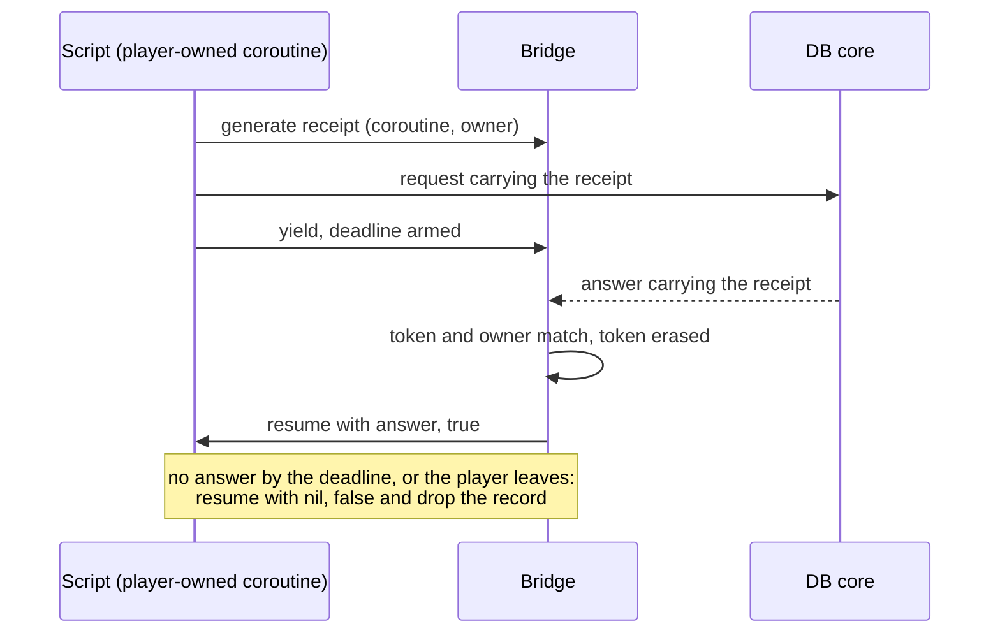

A quest script can wait for exactly one thing: a player answering a question the C++ asked on its behalf. `q.select` stops the coroutine, the manager sends the choices to the client, and the next packet from that client resumes the script on the following line. There is no way to write "ask the database and continue when it answers", and no way to write "ask the other core where this dungeon lives".

The commit that added it, on 2024-10-09, touched 34 files and added 1,538 lines. The bridge source alone changed by about 500 lines, and a new 299-line header tracks who owns which coroutine. A bug in that header was still being found on 2026-04-08. In between sit a coroutine that restarted from the top, references the garbage collector could take from under the C++, a yield that did not belong in C++, and a disconnect that resumed scripts on a character that was already gone. This post is that mechanism and the three bugs that shaped it.

[Why quests were not enough](/blog/why-quests-were-not-enough) told why the short-lived quest coroutine was the biggest flaw, and [How the quest manager works, and what Forge changed](/blog/how-quest-manager-and-forge-work) showed the one global state it runs in. Neither showed what replaced the yield. The quest manager still exists and still runs in parallel with Luna; this is about the coroutine Luna runs next to it.

## A yield the C++ must foresee

The quest yield is a closed set. The C++ knows when a script is about to yield, because the yielding functions are the ones that send a dialogue: `select`, `wait`, `input`, `confirm`. The manager stores the suspended coroutine on the player's quest state, and the client's answer is routed to that player. A new kind of answer needs a new packet, a new switch case and a new yielding function, written in C++.

The limit is not a speed. It is a shape: a script cannot wait for anything the engine did not foresee. A subsystem that needed a database answer therefore did the same thing in C++: send a packet with a header, register a handler for the answer header, and carry the state between the two halves by hand in a table.

## Three ways to wait

The realistic ways to give a script a wait are three.

A per-request callback: the script passes a function, the engine calls it when the answer comes. It works for one wait. It stops working when a feature needs three waits in a row, because the code now nests three functions deep, an error in the second has no way back to the first, and the local variables of the first have to be captured by hand.

An explicit state machine: the feature stores a state in a table, and a handler per answer header advances it. This is what the C++ handlers already were. Every feature carries its own table, its own cleanup and its own "what if the player left" branch.

Yielding calls: the script is written straight-line, and the wait is a call that does not return until the answer arrives. A quest conversation already reads this way. The first bridge commit says so in its own message: yielding versions of the database and main-core sends exist "to allow the script to wait the answer instead of having to setup another handler".

I took the third because the control flow stays in one function, but it moves the problem. A callback is owned by whoever registered it, and the engine forgets it after the call. A suspended coroutine is a piece of script state that the engine holds for an unknown time. Something has to say who can wake it, who can kill it and when it dies if nobody answers.

## A receipt, an owner and a deadline

The bridge keeps a table of coroutine records keyed by an id. A script creates a coroutine with `bridge.coro.create_with_player_owner`, which runs it immediately up to its first yield. If it ends before yielding, no record survives. If it yields, the record stays.

Three things decide how it wakes.

A receipt token. A wait asks the bridge for a token that packs the coroutine id, an owner type and an owner id, and sends the token inside the request. The other side answers with the token echoed back. The bridge looks the token up and compares the owner it was issued to with the owner on the answer. A wrong owner finds nothing.

An owner. A coroutine can belong to a player or a peer, and one owner can hold many coroutines. When the owner goes away, the bridge closes every coroutine it holds, resuming each one with `nil, false`.

A deadline. A wait can carry a timeout. The bridge keeps the deadlines in a priority queue and cancels lazily: a deadline that has already been answered is marked dead and skipped when it surfaces.

The script side is two helpers. This is the code today, from the helper that waits on the database:

```lua
helper.sys.game.yield_db = function(header, message, desc_handler, ...)
    local coro_id = bridge.coro.get_current_id()
    if not coro_id then 
        error("yield_db outside a coroutine")
    end
    -- db is the peer 0
    local receipt = bridge.coro.generate_receipt_token(coro_id, bridge.coro.COROUTINE_OWNER.PEER, 0)
    forge.sys.game.send_db(header, message, desc_handler, receipt)
    return coroutine.yield(...)
end
```

The token is made, the packet goes out with it, and the coroutine yields. The game loop is single-threaded, so the answer cannot overtake the yield: it is processed later, on the same loop, after the script is suspended. The database side answers with the same token.

One feature end to end shows the shape. The vote buff window sends a redeem message from the client. The handler validates it, then starts a coroutine owned by that player and returns at once. The coroutine claims the vote in the database with a 2 second timeout:

```lua
local res, ok = forge_helper.coro.with_timeout(2000,
    forge_helper.sys.game.yield_db, "claim", req:SerializeToString())
if not ok then
    send_result(ch, false, 0, nil)
    return
end

local parsed = pb_loader.parse_string(messages.DGVote4BuffClaim, res)
if not parsed.claimed then
    send_result(ch, false, 0, nil)
    return
end
```

The same function then grants the buff and reports to the client. The database half is a handler that runs SQL and answers with the receipt it was given. There is no registered answer handler on the game side, no table of pending requests and no cleanup branch for a player who left: the owner takes care of that, and `ok` is false on both a timeout and a close.



Read it from the top. The two exits at the bottom are the reason the bridge exists. A wait can end three ways, and the script sees only two shapes of result.

Two details keep the picture honest. The token is erased before the script resumes, so a duplicate answer finds nothing and is dropped. And after a failed wait the record is removed even if the script yields again, so a script cannot keep waiting after its owner is gone.

## The coroutine that restarted from the top

The first version kept the thread and the coroutine handle in the record and nothing else. They were references only C++ held, and the Lua garbage collector does not see a C++ map. A coroutine suspended for a few seconds on a database answer could be collected while the answer was on its way.

On 2025-01-20 I tried the obvious pin: put the coroutine and its thread on the global state and use the pinned references in their place. It broke differently. A pinned reference is rebuilt on the global state, so the coroutine handle forgot the thread it came from, and the next resume ran the entry function from its first line instead of continuing. I left a note in the source saying exactly that and fixed it two days later, on 2025-01-22, in a change of 8 added lines.

The root cause was not the pin. There were two lifetimes, the C++ record and the Lua garbage collector, and nothing owned the link between them. A pin is how you make the collector respect the record, and the real question is what to pin. The fix pinned the thread and the coroutine, and the pins lived inside the record, so they died with it. After the later cleanup the shape is this: the thread and the entry function are pinned, and the coroutine handle is kept as it is. The code says why:

```cpp
// store the coroutine as it is because if we pin it to global state the coroutine gets basically reconstructed in the
// global state losing new_thread's state and therefore we won't be able to get the coro id using the corourine.
// This should be safe since we keep the reference in the coda and we are sure the underlying state (new_thread's) won't be collected (it is pinned)
```

The pins are released in one place, where a coroutine dies, whichever way it dies: answered, timed out, closed by its owner or failed. That is the part I would copy into another engine. The pin and the record are one object with one exit.

## Everything C++ holds across a call

The same bug had a wider form, and I found it from a different side. On 2025-01-01 a commit pinned every long-lived Lua reference that C++ stores: processors, callbacks, guarded calls. A boot-time quest registered the lobby processors from the state the quest manager opens for its scripts. That state is ephemeral, and a reference built on it is eventually collected. When it was, the lobby stopped: no error and no log line, just a lobby that stayed stuck, and every system that went through it stuck with it. "Eventually" is the whole difficulty: the failure depends on when the collector runs, not on what the script did, so no test written around the script reproduces it.

Three months later I centralised it. All references and pins live in the bridge, the game asks for them by id, and the bridge cleans up before the global state is killed. An earlier mistake of the same family was a destructor hook on the forge that operated on a Lua state that was already closed and crashed; on 2024-11-20 I commented and documented it. The rule these share is simple: a reference C++ keeps is C++'s to release, and the release has to happen before the state it points into is gone.

## Yielding from C++

The first yielding sends were C++ functions that sent the packet and called `lua_yield` themselves. I replaced them on 2025-01-20, the same day as the failed pin. The symptom was a coroutine that started at once, yielded, and could not be resumed by the engine; it finished in a dead state instead of waiting for its answer. The new shape is what is above: token, send and `coroutine.yield` are three lines of Lua in one visible place, and a script author can read where the script stops. The bridge no longer has a yield function at all.

The lesson I take from it is not about Lua. A suspension point should be visible to the code that suspends. When the function that sends also suspends, the call looks like a send and behaves like a goto.

## A disconnect that resumed into a missing character

A player-owned wait ends when the player leaves, and ending it means running the script. The close resumes each coroutine with `nil, false`, and the script runs its failure branch: it logs, it may look up the character, it may roll back. That runs inside the disconnect path.

The first order was to erase the player's quest state and then close their coroutines. A failure branch that looked the player up through the quest manager could find nothing. On 2025-05-17 I swapped the two, so the close happens while the character and its state are still there. A continuation never touches a freed character; the character is erased after.

The second bug was in the owner table itself. The table is a multimap, because one owner may hold several coroutines, and the close looked up the owner's key with a single find. It closed the first coroutine and left the rest. The header was written on 2024-10-09 and fixed on 2026-04-08: for about eighteen months, a player who left with two waits open had the first one closed. The second stayed suspended with its ownership erased, until its answer or its timeout came. Nobody noticed it in those eighteen months, which is the point: a leaked wait has no symptom until its answer arrives for an owner who is gone. The fix is the range lookup the container needed from the start.

Both are the same class, and it is the one the design invites: a missed cleanup is a leak that keeps a script alive, and a late cleanup is a script that wakes in a world that moved on.

## What it costs

Every wait is a heap record, two pins, entries in the owner table and the token table, and a timeout object when it has a deadline. That is small next to a request to a database, and it is paid on every wait.

The costs that matter are the invariants for the next author.

- Every wait needs an owner or a timeout. Without either, a suspended coroutine stays in the table until the process ends.
- Code after a wait has two result shapes. A script that reads the answer without checking the flag treats a closed owner as an answer.
- A failed wait removes the record, so a script cannot wait again after one. It has to return.
- Closing runs script code during a disconnect, so the order of cleanup in the engine is now part of the script contract. The disconnect fix above exists because of it.
- Erasing the tokens of a coroutine scans the table of live tokens. It is linear in outstanding waits on every resume and death. It has not mattered at the scale of one server, and a server with far more outstanding waits would index tokens by coroutine.

The old quest coroutine had none of these because it could not wait for anything the C++ had not foreseen.

## What it made possible

A script can ask any other part of the system and continue when it answers. Rejoin asks another core where a dungeon lives and warps to the answer: the wait resumes on the first reply from the peers. The vote window asks the database and gives the player a buff. Login hands authentication to a background worker and yields until the result comes back, so the game loop does not wait for it. A script can also open a wait that collects replies from several owners for a fixed time and resumes once with all of them.

None of these needed a new packet type in the engine, a switch case or a registered answer handler on the game side. A feature is a protobuf message, a forge and a handler on the other end.

What a reader can reuse is short:

- Hand out a receipt that names who may wake the wait, and erase it on the first use.
- Give every suspension an owner and a deadline, and make failure a different shape of result, not a different call.
- Pin in the same place you keep the record, and release in the one place the record dies.
- Make the yield a line of script, not a side effect of a send.
