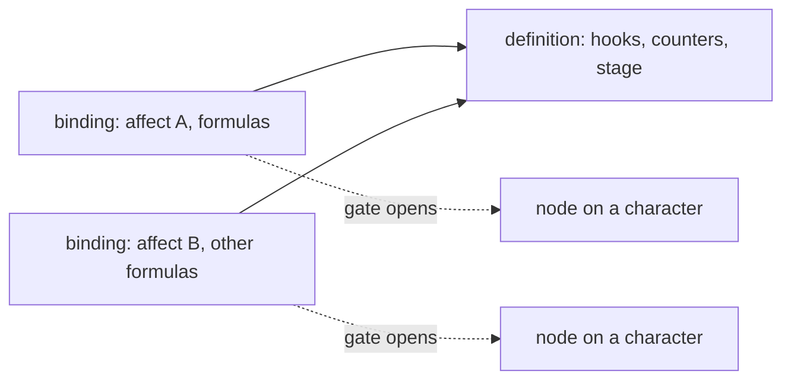

[A point used to be a branch in the damage code](/blog/a-point-was-a-branch) tells why traits exist: a conditional bonus was one more `if` in the damage function, and a trait moved the condition into a hook gated by an affect. This post is about the shape the trait itself took after that, and about the one commit that changed it.

## The gate sat inside the definition

The traits framework of June 11, 2026 was 17 files and 3,108 added lines, and a trait was one record. The definition carried its hooks, its counters and its gate:

```cpp
struct TraitGate
{
    uint16_t affect_type = 0;   // 0 = no affect gate (invalid in v1)
    // uint16_t point_type   = 0;  reserved for v2
    // int32_t  point_min    = 0;  reserved for v2
};
```

A trait was written as `traits.define{ id = ..., gate = { affect = ... }, hooks = ... }`, and the engine kept a reverse index from an affect type to the definitions gated on it. That is the right shape for one trait on one buff, and the wrong one for everything after it. A definition named exactly one affect, so the same behaviour on a second affect was a second definition. A definition also carried no numbers: the framework had no formulas or constants, so a value was a literal in the hook.

## Split: a def has no gate and no numbers

On July 22 the commit that split them said it in two sentences: a def is the behaviour, a binding is the gate plus its numbers, so one def can be gated by several affects. It touched 7 files, adding 1,864 lines and removing 319. The record that holds the gate is now its own type:

```cpp
struct TraitBinding
{
    uint16_t                       id = 0;
    uint16_t                       defId = 0;
    uint16_t                       affect_type = 0;   // the gate
    std::map<std::string, CPoly>   formulas;          // node-stable; never copy a populated CPoly
    // Formulas already reported as under-supplied. The condition is deterministic
    // per (binding, formula) — the call sites are fixed — so it would otherwise
    // repeat on every hit.
    std::unordered_set<std::string> warned;
};
```

The definition keeps what the trait does when it runs: hooks, counters, stage, whether state survives the gate closing. The binding says which affect opens it and what the numbers are. The reverse index now maps an affect type to bindings, and a call that raises an affect still costs one hash miss when nothing is gated on it.



The node a character holds follows the binding, not the definition. The comment in the Lua API puts it as: two skills gating the same trait give a character two independent contexts, with their own counters, cooldowns, state and numbers. One consequence is a rule in `AddBinding`: the pair of trait and affect type is one binding, and declaring it again replaces the formulas instead of stacking a second copy. Two skills that raise the same affect and name the same trait share one.

## Two doors, one function

Something has to create a binding, and there are two doors. A skill node that raises an affect lists its traits, and the loader binds each one to the node's affect, or to the skill number when the node names none. The Lua call `bind` does the same from a forge, and `define` with a `gate` is shorthand for define then bind. Both end in `BindTrait`, which looks a trait up in the native registry first and the Lua definitions second.

This is the skill-side shape. One node can carry several traits, and each carries its own parameters:

```yaml
traits:
- id: hosin_ward
- id: buff_def_erosion
  params:
    phys_resist_column:      BENEDICTION_PHYS_DEF
    phys_contribution_point: BENEDICTION_PHYS_DEF_BONUS
    magic_resist_column:      BENEDICTION_MAGIC_DEF
    magic_contribution_point: BENEDICTION_MAGIC_DEF_BONUS
point: PHYSICAL_RESISTANCE
affect: HOSIN
```

The affect is one, the bindings are two, and the numbers and column names live in the binding. That is what made the buff erosion of July 27 possible as traits: the resolver stopped knowing which buff erodes through which column, and the skill file states it beside the buff (19 files for the defence side, 27 for the attack side and the weapon binding). The first post tells that cut.

## Constants and variables, once the numbers had a home

A binding holds formulas, and a formula needs a vocabulary. The same July 22 work drew the line in three sources. A constant is resolved by whoever gates the trait, in their own vocabulary, and frozen when the affect lands: a caster's skill power, for instance. The `amount` is the gating affect's own value. A variable is whatever the hook passes at the call, as in `ctx.Formula("mult", 1.0, { { "hp_pct", ctx.pkOwner->GetHPPct() } })`.

The rule the header states is that anything the trait can read right now is a variable, not a constant, or a frozen value is used forever. Every variable is zeroed before it is written, so a name a call does not supply evaluates to 0 rather than to the previous caller's value.

Freezing has a price that follows from where it sits. A constant belongs to the node on a character, and a character that logs in with a restored affect has no applier to resolve it again. The persistent gate has no constants after a login; the fallback answers. The affect's own value persists, so a trait that needs one scaled number takes it from `gate_value()`. The [traits page](/foundations/traits) lists the trap with the others.

## A second backend

The same commit added the native backend: a 372-line header and a 47-line registry. A native trait is a class with an id and one macro per hook. The smallest one is the buff the previous post ends on:

```cpp
class HosinWardTrait : public INativeTrait
{
public:
    TRAIT_ID("hosin_ward")
    TRAIT_STAGE(0)  // ahead of mana_shield (10)

    TRAIT_ON_DAMAGE_TAKEN_FINAL
    {
        switch (ctx.iDamageType)
        {
            case DAMAGE_TYPE_NORMAL:
            case DAMAGE_TYPE_NORMAL_RANGE:
            case DAMAGE_TYPE_NORMAL_MAGIC:
                break;
            default:
                return;
        }

        const int iResist = ctx.pkOwner->GetPoint(POINT_RESIST_NORMAL_DAMAGE);
        if (iResist != 0)
            ctx.iDamage = ctx.iDamage * (100 - iResist) / 100;
    }
};

REGISTER_NATIVE_TRAIT(HosinWardTrait);
```

Three decisions are in that header. First, every hook is `const` and the class is a singleton shared by every binding that names it. A native trait therefore cannot keep state in itself, and the compiler holds it to that; per-character state stays in the node. Second, each macro defines the override and its trigger bit together, because a hook declared without its bit would compile and never be dispatched. A registration that subscribes to nothing is logged. Third, a native trait reaches every hook a Lua trait does, including the formula positions. The header says why: native is the cheap backend, so there is never a reason to withhold a trigger from it.

Native and Lua traits interleave. Each formula position walks the active nodes by ascending stage, whichever backend they use, so a native stage 0 can be followed by a Lua stage 30 and each transform sees the number the last one left. Ten traits are native today, and the registry refuses a duplicate id so that the winner never depends on link order.

One thing stayed native only. The cap on a computed point is asked on every capped point read, which is too often for a script call, so it has no Lua form. Counters are the other place the split shows. A skill's counter spec reaches its native ledger trait as formulas, because a binding's formulas are the only per-binding channel a native trait has.

## What it costs

Two backends are two sets of code to keep equal, and the macros are the guard that keeps the native one from drifting from the dispatch. A binding is keyed by trait and affect type for the whole process, so sources that raise the same affect cannot carry different formulas for the same trait. And closing the gate is one path for removal, expiry and the bulk clear at death, which the commit had to add: affects unlinked directly, without going through the removal call, now flush their gates after the walk, not during it, because a deactivate hook can touch the list being walked.

What it made possible is in the files. The two stock hosin lines are a short native trait, and a tooltip can name a trait formula and read the expression the trait evaluates. Registration from C++ and from Lua, and the staging, are in [Traits](/foundations/traits) and the [native traits](/docs/core/traits/native) and [binding](/docs/core/traits/binding) references.
