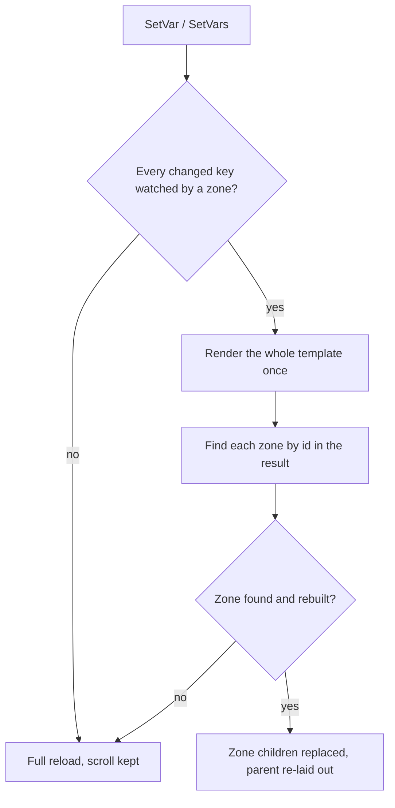

A mission window showed a progress bar and a count, and the server pushed a new count on every kill. Each push changed one number. In the first UCHTML version it also rebuilt the whole page: render the template, parse the result, create the elements, measure, lay out, finalize. On November 2, 2025, I added reactive zones so that a variable change would rebuild only the part of the page that reads it.

The commit that introduced them came in at 19:27 and added 1,126 lines. By 22:17 the same evening I had converted 136 templates to use them, and in between I had fixed the two things that broke.

## A window that cannot change one number

In the Metin2 mainline engine, a window is a layout, client logic and a data interface, and an update reaches the screen by calling a setter on a widget the window built by hand. A UCHTML page has no such handles. The page is the output of a template, and the loader's only way to show a new value was to render the template again and build the whole tree again, keeping the scroll position. [UCHTML](/foundations/uchtml) explains the pipeline; the point here is that its unit of change was the page.

For a description that is read, that is fine. For a counter that moves while the player fights, it rebuilds every element on the page to repaint a digit.

## A zone is a `div` that names its variables

The answer was to let the template say what depends on what. A `div` with an `id` and a `reactive` attribute is a zone, and the attribute lists the variable names it watches:

```html
<div id="progress-zone" reactive="step_done,step_need">
    
    
    <txt>Progress: {{ step_done }}/{{ step_need }}</txt>
</div>
```

The host calls `SetVar` or `SetVars`. If every changed key is watched by some zone, the loader renders the template, finds each affected zone by its `id` in the new result, destroys that zone's children and builds new ones in place. Anything else falls back to the full reload. The [reactive zones reference](/docs/uchtml/reactive-zones) has the rules; this post is about how they came to be these rules.



## The diff I did not ship

I started with a stronger plan. The first commit carries a small virtual tree and a tree differ, and its notes describe patching text and attributes in place. What the update path does is the simpler thing: destroy the zone's children and build new ones from the re-rendered markup. The differ is never asked for patches. The loader still builds a fresh virtual tree for the zone after every update, for a diff that does not happen.

So an update costs the Jinja render of the whole template plus the layout and construction of the zone. It does not scale with how much changed, and it does not scale with the rest of the page. The saving is real, but it is the saving of not touching the rest of the tree, not the saving of a diff. I have no measurement of either.

The rebuild is also what makes zones simple to write. Inside a zone every Jinja feature works, because the zone is just the output of the template again. A patch format would have had to represent a loop that gained a row.

## One macro made 136 templates reactive

The mission window's task pages each had a progress bar fed by two variables read at the top of the template. A zone has to read its variables inside itself, so the conversion could not be a flag on an existing div. I wrapped it in a macro that opens the zone, names the variables and hands them back to a `call` block:

```jinja

    {{ p.progress("Orchi eliminati al centro: " ~ done ~ "/" ~ need, done, need) }}

```

The macro builds the zone id from the variable names and the `reactive` list from the same two, so a page author writes the variables once. The commit touched 136 template files, 981 lines added and 893 removed. The window code changed in the other commit: it stopped reloading on every counter and called `SetVars`.

## Two things broke the same evening

The first break was in tables. A table row and a cell each add themselves to their parent when they finalize. A rebuild could finalize a row or cell into a parent that already held it. Each of the three now asks the parent whether it has already taken this element and skips the add if so.

The second was a partial update. The first version of the bulk path updated the zones it found and ignored the rest. A batch that changed one watched key and one unwatched key refreshed the zone and left the unwatched value stale on screen. The rule became all or nothing: if any changed key is unwatched, the whole batch goes to the full reload. A zone failing to rebuild, including when its `id` is missing from the new render, falls back the same way.

Months later, on March 12, 2026, a third gap showed up in the zone builder: text sitting directly in a zone, not inside a text tag, was skipped, because the zone builder had only handled elements. It now builds inline text the way the page builder does.

## Counters arrive in bursts

Zones make one update cheap. The server still sends many of them. `SetVar` on a watched key renders the whole template immediately, so ten counters arriving in one frame cost ten renders. `SetVars` takes a dictionary and renders once for all affected zones. Windows that receive counters therefore buffer them and apply the batch.

There are two debounces and they do different jobs. The loader's full reload is deferred by a zero-second debounce, so several `SetVar` calls that end in a reload on the same frame share one. The windows that receive counters add their own, 0.3 seconds of quiet with a hard limit of 1 second since the first change: a steady stream of kills becomes at most one `SetVars` a second. The debounce runs on the engine's tick, on the main thread, so a callback never races a render.

## A callback that does not fire

A window sometimes sizes itself to the page. The loader has a load callback, called after every full load, and one window uses it to read the document's occupied space and set its own height. A zone update does not call it. If a zone's content changes the page's height, such a window keeps its old size until the next full load. The callback tells the host that the document was built; it does not tell it that a part of the document changed.

The `SetVars` path knows which zones changed and that the parent was told, so a second callback after a zone update would be cheap. Until then, a zone is for content whose size is stable, such as counters, bars and status text, and the docs say so.

## A trap in the comparison

`SetVars` skips keys whose value has not changed. The loader stores a variable after normalizing it, and a string containing a comma becomes a list. The comparison is then list against the raw string, which is never equal. A comma-separated value therefore counts as changed on every call and rebuilds its zone each time. It stays correct and costs an extra render.

## What it made possible

The page is still the unit of authoring and the zone is now the unit of change. A template can mix text that is read once with a few elements that move, and the host does not need to know which is which: it sets variables and the loader picks the route. What a template cannot do is stay cheap when a zone is large. One zone around a whole page rebuilds the whole page, plus the virtual tree nobody reads.
