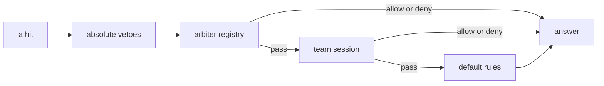

[Eleven branches, three functions, one list](/blog/eleven-branches-one-list) tells how the server's answer to "may this player hit that one?" became an ordered list that modes join and leave. The client has its own question, and this post is about that one: who does it draw as an enemy, who as a friend, and who does it let you click on. The server answers with a packet per pair of characters, and until 2026 every mode that wanted it had to build that picture itself.

## One packet per pair

The Metin2 mainline engine has a duel packet. It carries the virtual id of the other character and a status: 0 clears the pair, 1 marks it as "cannot attack" (drawn as an ally, no attack cursor, ally buffs targetable) and 2 marks it as an enemy (attack cursor, PvP name color). The client keeps one key per pair and draws from it. The server never sends a verdict, it sends pair keys, so a mode that wants a picture has to send one per ordered pair, to the right people, at the right moment.

By April 2026 two places built that picture. The arena looped over its teams and, for every pair, called a character method that sent allies or enemies. A zone mode had its own pair of builders for enter and leave, with their own copy of the packet. Both builders carry a `recursive` flag so that one call also sends the mirror packet to the other character. A third place sent a character a "cannot attack" key about itself, so the client would not see other characters as enemies.

Next to this, since 30 August 2025, there was a second manager. It kept teams for chat and for a team list the client could show: a team id, a category string such as `ARENA`, a list of player ids, GM commands and a Lua binding. It did not know about attacks. So when the arena set up a match it created a team in that manager and, once the new session manager existed, a session in this one. Two objects answered "who is on which team" for the same match.

## The first cut: a session that owns the picture

The commit of 30 April 2026 added `CPvPTeamManager` in 24 files. A session has teams, each team has members and a set of allied teams, and alliance is symmetric: if X lists Y, Y lists X, and the mutators keep it so. A session also has an attack switch that starts off. While it is off the picture is drawn but the answer to "may I attack" is no, which is what a match needs between the moment everyone is on the map and the moment it starts.

The manager owns three things the modes used to own: the packet broadcasts, the late-arrival sync when a player connects, and a verdict for the pair. The Lua binding is the same API as the C++ one, so a script opens a session, adds teams and members, and flips the switch. The arena's own loop was replaced by two calls.

```cpp
if (m_session_id != 0) {
    CPvPTeamManager::instance().SetAttacksEnabled(m_session_id, true);
    CPvPTeamManager::instance().BroadcastSession(m_session_id);
}
```

The header of that first version says something I later reversed: the manager is consulted by arbiters as a building block, and "is NOT itself an arbiter". Each mode registered an arbiter, and the arbiter asked the manager. 
## The recursion that never ran

The first caller of the mirror send was in that commit, and it found something that had been in the old sender all along. This is the character method before it.

```cpp
void CHARACTER::SendDuelPacket(LPCHARACTER opp, uint16_t state, bool recursive) {
    TPacketGCDuel duelStart;
    duelStart.header = HEADER_GC_DUEL;
    duelStart.oppVID = opp->GetVID();
    duelStart.status = state;

    GetDesc()->Packet(&duelStart, sizeof(duelStart));
    if (recursive) {
        opp->SendDuelPacket(this, state, recursive);
    }
}
```

The forward passes its own flag on. A call with `true` sends to the character, asks the opponent to send back, and the opponent asks the character again, until the stack ends. It had never run because every caller in the tree passed `false`. The manager's alliance sends are the first callers that want both directions, and the same commit changes the forward to `false`. A bug that cannot trigger is still a bug in the next API someone writes.

## The guard that was not there

The method also dereferences `GetDesc()` without a check and sends in whatever phase the receiver is in. The manager sends on login, on warp, on alliance changes and on `add_member`, and a member can be still loading or not connected at all, since `add_member` works for offline players.

The fix is a guard of three lines, in the commit of 5 June 2026, whose message calls it a receiver-phase guard so that the duel packet does not reach clients still in the loading phase.

```cpp
void CHARACTER::SendDuelPacket(LPCHARACTER opp, uint16_t state, bool recursive) {
    // receiver still loading; OnPlayerConnect at EnterGame resyncs
    if (!GetDesc() || !GetDesc()->IsPhase(PHASE_GAME))
        return;
    TPacketGCDuel duelStart;
    duelStart.header = HEADER_GC_DUEL;
    duelStart.oppVID = opp->GetVID();
    duelStart.status = state;

    GetDesc()->Packet(&duelStart, sizeof(duelStart));
    if (recursive) {
        opp->SendDuelPacket(this, state, false);
    }
}
```

The comment holds the reason it is safe to drop the packet. Nothing is lost, because the connect hook runs when the player enters the game and sends the whole picture in both directions. The guard also returns before the mirror send, so a send that starts at a loading character skips the other character too. That is on purpose and the [behaviour page](/docs/building-blocks/team-manager/behaviour) lists it: a loading character's own sync supplies both sides.

The same commit carries a client fix. The client stored the key with an insert into its map, and an insert does not replace an existing entry, so a pair that was "cannot attack" never became "enemy". It now overwrites.

## Folding the second list in

The commit of 5 June 2026 removed the chat team manager and moved what it did into the session manager: 27 files, 232 lines added and 1,386 removed. The old manager, its Lua binding and its GM commands account for most of the removed lines.

Two decisions came out of folding.

A session is bound to a map. `create_session(map_index, kind)` takes both, and `kind` is required. Broadcasts and alliance checks skip a member who is not on the bound map, and the kind goes into the team membership packet as the category string, which the client turns into a label with a `TEAM_CATEGORY_<KIND>` key. It is 31 characters at most, and it names the mode: the arena, a guild war and battle royale each pass their own. When the locale has no key for it, the client shows the raw kind.

Team chat is resolved on the server. The old path read a team id from the client's chat packet and checked that the sender was in that team. The new one looks the sender up by player id and returns the teammates who are online on the bound map.



The other half of the commit changed where the session sits. It is no longer something an arbiter consults. It is a stage of its own between the arbiter chain and the default rules, and it answers `Pass` for any pair that is not two players, so monsters on a session map fall through to the stock rules. The arena lost its attack and buff methods, its arbiter registration and the two Lua hooks that fed them. The check for buffing no longer has an arena-map shortcut. After the guild-war check it asks whether the pair is allied, then whether either is a session member, then the attack rule and the empire.

A round-based arena mode that had kept an `intermission` flag and a hook that refused attacks while it was set lost both. It now calls `arena:set_attacks_enabled(false)` when a round ends and `arena:set_attacks_enabled(true)` when the next one begins, and the manager re-sends the picture each time. That call is one bookend instead of a flag, a hook and a filter.

## What it costs

A session is a core-local group in memory. Another core cannot see it and a restart clears it.

Membership survives logout and leaving the map, and a member who attacks an outsider is denied on every map of that core. A player who left a match for good and was never removed keeps being denied against everyone outside it. The [behaviour page](/docs/building-blocks/team-manager/behaviour) has the pitfall.

The picture and the verdict can disagree. The switch and alliance changes re-send keys, while an arbiter's answer or a PK mode change does not, so an arbiter that says `Allow` can override a closed switch and the cursor still shows the old state. The fix is in the registered rule, which has to pass session pairs, and the docs say so.

A player can belong to only one session per core, and a second `add_member` fails with a line in the error log. A zone mode still builds its own duel packets and is not routed through the manager.

The [team manager reference](/docs/building-blocks/team-manager), the [battle arbiter reference](/docs/building-blocks/battle-arbiter) and the [policies foundation](/foundations/policies) describe how the two stages and the defaults fit together.
