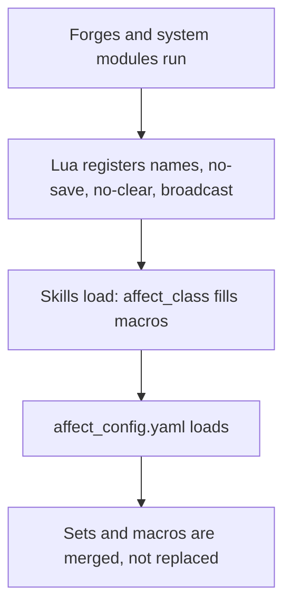
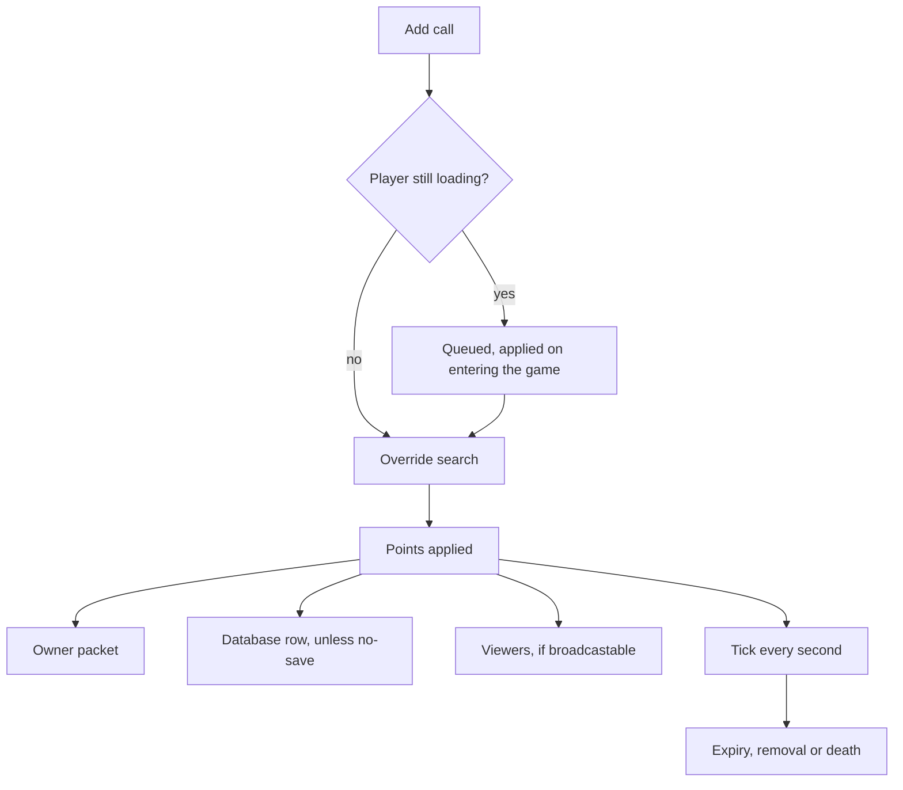

# Affects reference

An affect is a timed record on a character: a type, a point it changes, a value, a duration, optional flags and a cost. It is how buffs, debuffs, item blends, premium bonuses and every state a script wants to time and show are stored. You reach for it when something must expire by itself, survive (or not survive) a relog and a death, stack or replace, and optionally be drawn on the character for everyone who looks.

Three places shape one affect. Lua adds and removes it, and registers its name and its rules. `affect_config.yaml` classifies types into sets (saved or not, cleared on death or not, shown to viewers or not) and into named groups called macros. The client decides whether the type has a particle and an icon.

The sibling policies are the [battle arbiter](/docs/building-blocks/battle-arbiter) and the [death manager](/docs/building-blocks/death-manager). The forge file layout is in the [Forge API reference](/docs/core/luna-forge).

## Quick start

This module, loaded by a forge, gives a player a 10 minute movement speed bonus when a quest or another script calls `grant_speed`, and registers the type so it is not written to the database.

```lua
affect.add_name_definition("EXAMPLE_SPEED", 3600)
affect.add_no_save(affect.name_map.EXAMPLE_SPEED)

local function grant_speed(ch, amount)
    ch:add_affect(affect.name_map.EXAMPLE_SPEED, point.MOV_SPEED, amount, 0, 600, 0, true)
end

local function has_speed(ch)
    return ch:has_affect(affect.name_map.EXAMPLE_SPEED)
end

local function revoke_speed(ch)
    ch:remove_affect(affect.name_map.EXAMPLE_SPEED)
end
```

The registrations at the top run once, at the top level of a forge `environment game` block or of a module the forge loads. After `grant_speed(ch, 20)` the character's movement speed point rises by 20, `has_speed(ch)` is true, and ten minutes later the engine removes the affect and undoes the 20. Pick an id nobody else uses; the ranges the shipped content uses are listed under [Type ids](#type-ids).

## Files and setup

| What | Where | Notes |
| --- | --- | --- |
| Lua API | `affect.*` and the `ch:` methods | `affect.*` is registered on the quest manager and works at the top level of a forge `environment game` block, in modules a forge loads, and in quests. `ch:` methods work wherever the script holds a character. |
| Type registration | Lua, top level | `add_name_definition`, `add_no_save`, `add_no_clear_on_death`, `add_broadcastable` need no character. |
| `affect_config.yaml` | the locale base folder | Loaded once at boot, after the forges and the skills. |
| `items_affect.yaml` | the locale base folder | Loaded with the game tables. |
| `affect_class` | the skill files in the skill config folder | One list per `AFFECT` node. |
| Client registration | `introloading.py` in the client pack | `playerLoad.RegisterEffect`. |
| Target icon | `uiaffectshower.py` in the client pack | `AFFECT_DATA_DICT`. |

Every `affect.*` function that touches a character and has no `vid` or `map_index` argument acts on the current character: the player whose quest event is running, or the one a quest selected. The registration functions and `is_in_macro` touch no character. Calling one of them with no current character is not supported. The functions that dereference the current character without a check are `add`, `remove`, `remove_bad`, `remove_good`, `add_collect`, `add_specialization`, `add_collect_point`, `add_specialization_point` and `get_apply_on`. The others check and return nothing.

Forges are not reloaded and `affect_config.yaml` is not reloaded: after a change, restart the game cores.

### Point versus apply

Two id spaces meet in this API, and `apply.*` and `point.*` are both Lua globals.

- `affect.add`, `add_collect`, `add_specialization`, `remove_collect` and `remove_specialization` take an **apply** id and convert it to a point.
- Everything else takes a **point** id and stores it as is: `add_specify*`, `has_specify*`, `remove_specify*`, `find*`, `add_collect_point`, `add_specialization_point`, `ch:add_affect` and `ch:has_affect`.

The identity of an affect is its type together with its point. The field that holds it is called `apply_on` in the data tables, and it always holds a point.

## API

Wrong-typed arguments are not Lua errors. Each function below logs the line in its last column and returns nothing, except the three `find` functions, which raise a Lua error. A function that returns nothing gives `nil` to Lua.

### Adding and removing on the current character

| Function | Signature | Returns | What it does | Log line on bad arguments |
| --- | --- | --- | --- | --- |
| `affect.add` | `add(apply_on, value, duration)` | nothing | Adds an affect of type `AFFECT_QUEST_START_IDX` plus the current quest index on the point of the apply, never overriding. Rejects an apply below 1 or at the apply limit with `apply is out of range : {}`. Its guard against doubles does not work, see [Pitfalls](#pitfalls). | `affect_add wrong argument: int applyOn, int value, int duration` |
| `affect.remove` | `remove(affect_type?)` | nothing | Removes every affect of the type. No argument, or `0`, means the type of the current quest. | none |
| `affect.remove_bad` | `remove_bad()` | nothing | Removes poison, fire and the members of `IS_CLEANSABLE_AFFECT`. As shipped, bleeding is not a member and stays. | none |
| `affect.remove_good` | `remove_good()` | nothing | Removes the members of `IS_DISPELLABLE_AFFECT`. This is the dispellable set, not the good set. | none |
| `affect.get_apply_on` | `get_apply_on(affect_type)` | `number?` | The point of the first affect of the type, or `nil`. | `get_apply_on wrong argument: uint32_t affectType` |
| `affect.has_specify` | `has_specify(type, point_on?)` | `boolean` | True when an affect of the type exists. Without a point, any point matches. | `has_specify wrong argument: uint32_t type, [int pointOn]` |
| `affect.remove_specify` | `remove_specify(type, point_on)` | nothing | Removes the first affect with exactly this type and point. The point is required. | `remove_specify wrong argument: uint32_t type, int pointOn` |
| `affect.add_specify` | `add_specify(type, point, value, flag, duration, cost, override, is_real_time)` | nothing | Adds an affect. Only `type` is required. See [Override and point identity](#override-and-point-identity). | `add_specify wrong argument: uint32_t type, [int point, int value, int flag, int duration, int cost, bool override, bool is_real_time]` |

Defaults of `add_specify` and `add_specify_vid`: `point = POINT_NONE`, `value = 0`, `flag = AFF_NONE`, `duration = affect.INFINITE_AFFECT_DURATION`, `cost = 0`, `override = true`, `is_real_time = false`.

### Collect and specialization

Two types, `AFFECT_COLLECT` (515) and `AFFECT_SPECIALIZATION` (537), carry the bonuses of the collection and specialization systems. Their helpers differ in what happens when an affect of the type is already on the same point.

| Function | Signature | What it does | Log line on bad arguments |
| --- | --- | --- | --- |
| `affect.add_collect` | `add_collect(apply_on, value, duration)` | Sums the value into an existing collect affect on that point, removes the old one and adds a new one with the new duration. Rejects an apply out of range. | `add_collect wrong argument: int applyOn, int value, int duration` |
| `affect.add_specialization` | `add_specialization(apply_on, value, duration)` | The same for specialization. | `add_specialization wrong argument: int applyOn, int value, int duration` |
| `affect.add_collect_point` | `add_collect_point(point_on, value, duration)` | Adds a collect affect on a point without summing: every call stacks a new element. Rejects a point out of range with `point is out of range : {}`. | `add_collect_point wrong argument: int pointOn, int value, int duration` |
| `affect.add_specialization_point` | `add_specialization_point(point_on, value, duration)` | The same for specialization. | `add_specialization_point wrong argument: int pointOn, int value, int duration` |
| `affect.remove_collect` | `remove_collect(apply_on, value)` | Removes the first collect affect with that point and exactly that value. | `remove_collect wrong argument: int applyOn, int value` |
| `affect.remove_specialization` | `remove_specialization(apply_on, value)` | The same for specialization. | `remove_specialization wrong argument: int applyOn, int value` |
| `affect.remove_all_collect` | `remove_all_collect()` | Removes every collect affect. | none |
| `affect.remove_all_specialization` | `remove_all_specialization()` | Removes every specialization affect. | none |

### Any character by VID, and a whole map

| Function | Signature | Returns | What it does | Log line on bad arguments |
| --- | --- | --- | --- | --- |
| `affect.has_specify_vid` | `has_specify_vid(vid, type, point?)` | `boolean` | Like `has_specify` for any character, player or monster. | `specify_vid wrong argument: uint32_t vid, int type, [int point]`, or `{} is not a valid VID (specify_vid)` |
| `affect.remove_specify_vid` | `remove_specify_vid(vid, type, point?)` | nothing | With a point, removes the first exact match. With no point, or `0`, removes every affect of the type. | `remove_specify_vid wrong argument: uint32_t vid, int type, [int point]`, or `{} is not a valid VID (remove_specify_vid)` |
| `affect.add_specify_vid` | `add_specify_vid(vid, type, point, value, flag, duration, cost, override, is_real_time)` | nothing | Like `add_specify` for any character. A point at or above the point limit returns silently. | `add_specify_vid wrong argument: int vid, int type, [int point, int value, int flag, int duration, int cost, bool override, bool is_real]`, or `{} is not a valid VID (affect_add_specify_vid)` |
| `affect.add_specify_map` | `add_specify_map(map_index, type, point, value, flag, duration, override, is_real_time)` | nothing | Adds the affect to every player on that map index on this core. There is no `cost` argument, and the override matches the exact point. | `affect_add_specify_map wrong argument: int map_index, int type, [int point, int value, int flag, int duration, bool override, bool is_real_time]` |

### Finding

| Function | Signature | Returns | What it does |
| --- | --- | --- | --- |
| `affect.find` | `find(type, apply_on?, source_vid?)` | `affect.affect_data` or `nil` | The first affect of the type on the current character. A missing point means any point, a source of `0` means any source. |
| `affect.find_specific` | `find_specific(type, apply_on?, flag?, source_vid?)` | `affect.affect_data` or `nil` | The point is matched exactly: a missing point means `POINT_NONE`, not any. The flag is compared with the reserved high bits masked off. |
| `affect.find_all` | `find_all(type, apply_on?, flag?, source_vid?)` | array of `affect.affect_data` | Every match. A missing point means any point. The array may be empty. |

A wrong first argument raises `affect.find: expected number as first argument`, and the same text with `affect.find_specific` or `affect.find_all` in front of it.

`affect.affect_data` has the fields `type`, `apply_on` (the point), `value`, `flag`, `duration` (the remaining seconds, or `affect.INFINITE_AFFECT_DURATION` when it never ends), `sp_cost`, `source_vid` and `is_real_time` (a boolean).

### Registration and macros

These need no current character and only grow what the engine knows. Nothing removes an entry.

| Function | Signature | Returns | What it does | Log line on bad arguments |
| --- | --- | --- | --- | --- |
| `affect.add_name_definition` | `add_name_definition(name, value)` | nothing | Defines a name for a type id, in the engine and in `affect.name_map`. | `affect_add_affect_name_definition wrong argument: string name, int value` |
| `affect.add_no_save` | `add_no_save(type)` | nothing | The type is never written to the database. | `affect_add_no_save wrong argument: int type` |
| `affect.add_no_clear_on_death` | `add_no_clear_on_death(type)` | nothing | The type survives the clearing of a death. | `affect_add_no_clear_on_death wrong argument: int type` |
| `affect.add_broadcastable` | `add_broadcastable(type)` | nothing | The type is sent to every player who sees the character. | `affect_add_broadcastable wrong argument: int type` |
| `affect.is_in_macro` | `is_in_macro(macro_name, value)` | `boolean` | True when the type is in the macro right now. An unknown macro gives `false`. | `affect_is_in_macro wrong argument: string macro_name, int value` |
| `affect.add_to_macro` | `add_to_macro(macro_name, type)` | nothing | Adds the type to the macro, creating the macro when it does not exist. | `affect_add_to_macro wrong argument: string macro_name, int type` |

### Tables and constants

- `affect.name_map` maps the names of the engine's own types to their ids, plus every name added with `add_name_definition`. Use it instead of a literal id. `affect.name_map.WEDDING` is `nil`: that type exists in the engine and is not in the table.
- `affect.bit_map` maps the legacy `AFF_` bit names to their bit numbers. The value is the `flag` argument for an affect that must set a bit, for example `affect.bit_map.PHOENIX`. The highest bit is 91.
- `affect.INFINITE_AFFECT_DURATION` is `60 * 365 * 24 * 60 * 60` seconds. It is a Lua constant defined in the shared quest library, so it exists wherever that library is loaded.
- The content defines four range names at boot that `affect_config.yaml` uses: `SKILL_START` (1), `SKILL_END` (400), `GUILD_SKILL_START` (151) and `GUILD_SKILL_END` (160).

### Type ids

The ids below 400 are skill ids: a skill affect uses the skill vnum as its type. 400 and up are the engine's own types, with named blocks: `MOV_SPEED` 400 to `BLEEDING` 429, chat blocks from 440, the premium range from 500, the mob skill effects, the land bonuses from 550, damage amplifiers from 600, the blends, the fishing bonuses from 635. Items use 671 to 691 (`IS_ITEM_AFFECT`). Quests use `AFFECT_QUEST_START_IDX` plus the quest index. Types of 10000 and above (`AFFECT_PRIV_BASE` plus a privilege id) belong to the privilege system and are never saved and never cleared on death. Content affects in the shipped game use the 3000s and the collection bonuses the 4000s.

### Character methods

| Method | Signature | Returns | What it does |
| --- | --- | --- | --- |
| `ch:add_affect` | `add_affect(type, point, value, flag?, duration?, sp_cost?, override?, match_exact?, source_vid?, is_real_time?)` | nothing | `type`, `point` and `value` are required. Defaults: `flag = 0`, `duration = affect.INFINITE_AFFECT_DURATION`, `sp_cost = 0`, `override = true`, `match_exact = false`, `source_vid = 0`, `is_real_time = false`. |
| `ch:remove_affect` | `remove_affect(type)` | nothing | Removes every affect of the type, whatever the point. |
| `ch:remove_damage_over_time` | `remove_damage_over_time(affect_type)` | `boolean` | Only for poison, fire and bleeding: removes it and cancels its tick event, then returns `true`. Any other type returns `false`. |
| `ch:remove_bad_affect` | `remove_bad_affect(remove_dispel?)` | number removed | Poison, fire and the cleansable set. With `false`, members of `IS_DISPEL_CURSE_AFFECT` are kept. The default is `true`. |
| `ch:remove_good_affect` | `remove_good_affect()` | number removed | The dispellable set, like `affect.remove_good`. |
| `ch:has_affect` | `has_affect(type, point?, source_vid?)` | `boolean` | True when an affect of the type exists. A missing point means any, a source of `0` means any source. |
| `ch:get_affect_value` | `get_affect_value(name)` | `number` | The value of the first affect of the type named `name`, or `0`. |
| `ch:has_affect_flag` | `has_affect_flag(name)` | `boolean` | Tests an `AFF_` bit by its name. It is not an affect type test. |

The eighth parameter of `ch:add_affect` is the exact-point switch of the [override](#override-and-point-identity) rule. It is the only way to request that rule for a player or monster from Lua besides `affect.add_specify_map`.

`party.member_has_affect(affect, apply)` asks the same question of a party member and is documented with the party functions.

## affect_config.yaml

The file has four top-level keys. Each is optional.

| Key | What its members get |
| --- | --- |
| `NO_SAVE_AFFECTS` | They are never written to the database. A relog drops them. |
| `NO_CLEAR_ON_DEATH_AFFECTS` | They survive the clearing that runs when the character dies. |
| `BROADCASTABLE_AFFECTS` | They are sent in full to every viewer, not just the owner. |
| `macros` | Named sets of types. Lists and other macros refer to them by name, and the engine reads some of them by name. |

A list entry takes one of four forms.

- Plain digits: an id, such as `296`.
- A name from `affect.name_map`: `RAGE`, `SKILL_START`, or a name added by Lua before the config loads.
- A macro name: in a list section, a macro of the YAML; inside a macro, another macro of the YAML.
- A range: `range:` with `from` and exactly one of `to_inclusive` or `to_exclusive`. The bounds can be names.

A scalar is tried as a name first, then as a macro. `NONE` is a name whose value is 0, and a lookup that finds nothing also yields 0, so `NONE` is not accepted: it falls through to the macro lookup and fails.

```yaml
NO_CLEAR_ON_DEATH_AFFECTS:
# Already inside the 500-600 range below, but stated outright: the bonus tracks the
# shop, not the life, and must not depend on the affect id staying in that range.
- IKASHOP_OWNER
```

### Errors

Any of these makes the load fail. A failed load logs `cannot load Affect Configuration: <file>` and shuts the game core down at boot.

| Log line | Cause |
| --- | --- |
| `AffectManagerLoader:: Error loading affect_config ({}) file: {}` | YAML syntax or structure error. |
| `AffectManagerLoader::ResolveMacro Circular dependency detected in macros: {} -> {}` | Macros include each other in a loop. |
| `AffectManagerLoader::ResolveMacro Undefined identifier in macro: {} -> {}` | A macro entry is neither a name, nor an id, nor a macro. |
| `AffectManagerLoader::ResolveMacro Invalid 'from'[{}] value in range of macro: {}` | A range bound is unknown. The `to_inclusive` and `to_exclusive` variants say the same for their bound. |
| `AffectManagerLoader::ResolveMacro Range in macro {} must have either 'to_inclusive' or 'to_exclusive'` | A range has no upper bound. |
| `AffectManagerLoader::ResolveMacro Invalid item in macro: {}` | A macro entry is neither a scalar nor a range. |
| `AffectManagerLoader::ProcessAffects Undefined identifier in {}: {}` | A list entry is neither a name, nor an id, nor a macro. |
| `AffectManagerLoader::ProcessAffects Invalid 'from'[{}] value in range of list: {}` | The same as above for a range in a list, with the same variants. A range in a list with no upper bound prints the `ResolveMacro Range in macro {} must have either ...` line above, with the list name in the braces. |
| `AffectManagerLoader::ProcessAffects Invalid item in affects list {}` | A list entry is neither a scalar nor a range. |

### The macros

The engine reads these macros by name. A wrong name matches nothing and says nothing.

| Macro | Content in the file | What the engine does with it |
| --- | --- | --- |
| `IS_SPECIAL_BLOCK_CHAT_AFFECT` | the arena chat blocks, the bounty chat block | The duration of a member does not tick down. The game needs this macro. |
| `IS_BLOCK_CHAT_AFFECT` | `BLOCK_CHAT` and the macro above | Adding one with a duration above 1 tells the player their chat is blocked. Adding one with duration 0 removes it. |
| `IS_ITEM_AFFECT` | 671 to 691 | Only used by the lists, to keep item affects out of the database. |
| `IS_LAND_AFFECT` | the land bonus range | Only used by the lists. |
| `IS_SKILL_AFFECT` | `SKILL_START` up to `SKILL_END` | Only used by the lists. |
| `IS_MAP_CURSE` | 11000 to 11010 | Only used by the lists. |
| `IS_GOOD_AFFECT` | movement and attack speed, the four stats, the firework buff, plus skills | Counts as a buff when a skill applies it: assist credit, the buff announcement and the buff immunity read it. A Lua add never consults it. |
| `IS_BAD_AFFECT` | stun, slow, paralyze, poison, fire, bleeding, the damage amplifiers, plus skills | Counts as a debuff when a skill applies it: assist credit and the debuff announcement read it. A Lua add never consults it. |
| `IS_UNTARGETABLE_AFFECT` | invisibility, revive invisibility, plus skills | The holder is hidden from target acquisition and cannot attack. |
| `IS_DISPELLABLE_AFFECT` | the same seven as the good set, plus skills | What `remove_good` removes. A script buff is dispellable only when its id is added here. |
| `IS_CLEANSABLE_AFFECT` | stun, slow, paralyze, plus skills | What `remove_bad` removes besides poison and fire. A script debuff is lifted by it only when its id is added here. |
| `IS_PARTY_BUFF_AFFECT` | none, filled by skills | A label for party buffs. No engine code reads it today. |
| `IS_DISPEL_CURSE_AFFECT` | none, filled by skills | The members `remove_bad_affect(false)` keeps. |

The file itself explains the name of the last one: it is called CURSE rather than DISPEL so it cannot be read as, or mistyped for, `IS_DISPELLABLE_AFFECT`.

The good and the dispellable sets differ on purpose. A skill can be a buff and survive a dispel, and a skill can be dispellable without counting as a buff for the party.

## affect_class

A skill file declares which macros the skill's affect belongs to, on the `AFFECT` node:

```yaml
per_use:
- type: AFFECT
  id: buff_atkspeed
  affect_class:
  - IS_GOOD_AFFECT
  - IS_DISPELLABLE_AFFECT
  - IS_PARTY_BUFF_AFFECT
  point: ATT_SPEED
  amountPoly: 2+14.5*skill_k
  durationPoly: '1800'
  collect:
    source: caster
```

The affect type that joins the macros is the node's `affectVnum`, or the skill vnum when the node has none. Any string is accepted: an unknown macro name creates a new macro, which is how a typo goes unnoticed. The skills load at boot, before `affect_config.yaml`, and again when the server receives a skill refresh. A reload adds the declared memberships again and never takes one away.

## items_affect.yaml

Items of the affect type map to the affect they switch on. Each entry has a label as its key, which the loader does not read, and these fields:

| Field | Required | Meaning |
| --- | --- | --- |
| `vnum` | yes | The item vnum. |
| `affect` | yes | The affect type, as a number. |
| `bonuses` | no | A list of `type` (an apply name such as `MAX_HP`) and `value`. May be absent or null. |
| `duration` | key required | Seconds. The key must be present and may be null. |
| `stackable` | no | Default `false`. |

```yaml
RED_BLEND:
 vnum: 50821
 affect: 671
 bonuses:
 - type: MAX_HP
   value: 3000
 duration: 600
```

At creation, the duration goes into socket 2 of the item (not for the permanent subtype) and the affect type into socket 0. A socket 2 of 0 means infinite. Using the item toggles it:

1. The item's own affects are removed.
2. If the item was on (socket 5 is 1), it is switched off and nothing else happens.
3. Without `stackable`, any other active item with the same affect type is switched off.
4. One affect per bonus is added, with the item id as the flag and no override.

At login, every item that is on adds back its affects if they are missing. That is why `IS_ITEM_AFFECT` sits in `NO_SAVE_AFFECTS`: the item restores the affect, the database does not.

An entry without `bonuses` adds no affect at all. The wedding items are such entries, and the wedding bonus is added by the marriage code. A YAML syntax error or a missing `duration` key is not logged by the loader: it surfaces as an exception during the load of the game tables.

## C++ registration

Everything the Lua registration functions do goes through the affect manager singleton, and the C++ door exists for each of them. Almost nothing ships through it.

| Registration | Lua | C++ | What ships natively |
| --- | --- | --- | --- |
| Do not save a type | `affect.add_no_save` | `AddNoSaveAffect(int)` | |
| Keep a type through death | `affect.add_no_clear_on_death` | `AddNoClearOnDeathAffect(int)` | |
| Show a type to viewers | `affect.add_broadcastable` | `AddBroadcastableAffect(int)` | |
| Name a type | `affect.add_name_definition` | `AddAffectStringDefinitions(name, value)` | |
| Put a type in a macro | `affect.add_to_macro` | `AddToMacro(name, int)` | The skill loader, for every `affect_class` entry. |
| Load the config | none | `Load(file)` | Once at boot. |
| Ask a set | `affect.is_in_macro` for macros only | `IsNoSaveAffect`, `IsNoClearOnDeathAffect`, `IsBroadcastableAffect`, `IsInMacro`, `GetMacroSet`, `FromString` | The engine, in the save, death, broadcast and dispel paths. |

The built-in names of `affect.name_map` come from the table the manager starts with, not from calls to `AddAffectStringDefinitions`. The pending-affect queue (`AddPendingAffect`, `GetPendingAffects`, `ClearPendingAffects`) is internal to the login flow.

## Client calls

A broadcastable type needs a client half before a viewer sees anything. The client calls live in the Python pack.

| Call | What it does |
| --- | --- |
| `playerLoad.RegisterEffect(effect_type, bone, path)` | Registers the particle of a type. Raises a Python exception for argument types, returns `None`. |
| `playerLoad.EFFECT_BROADCAST_AFFECT` | The anchor for broadcast types. The key is the anchor plus the server type. It is 1000000. |
| `playerLoad.EFFECT_AFFECT` | The anchor for the legacy path. |
| `net.GetBroadcastAffectsByVID(vid)` | A list of `(dwType, bApplyOn, lApplyValue, endTime)` for that character. `endTime` is an absolute server time, 0 for infinite. Empty for an unknown VID. |
| `chrmgr.HasAffectByVID(vid, index)` | The legacy `AFF_` bit test. |
| `BINARY_OnBroadcastAffectAdd(vid, dwType, point, value, endTime)` | Game window event when a broadcast affect arrives. |
| `BINARY_OnBroadcastAffectRemove(vid, dwType, point)` | Game window event when one ends. |
| `BINARY_OnBroadcastAffectPurgeVID(vid)` | Game window event when all of a character's affects are dropped. |
| `BINARY_OnVidAffectFlag(vid, affectIndex, isSet)` | Game window event for a legacy `AFF_` bit. |

`.mse` against `.msattach` decides what the path means:

- A `.mse` file is one particle. It attaches to `bone`, and the empty string means the origin of the character.
- A `.msattach` file is a bundle. The bone argument is ignored, because each entry of the bundle names its own bone. When the affect ends, the exit effects of the bundle play.

The first successful registration of a key wins. A second call for the same key changes nothing. A path that cannot be loaded logs an error in the client log and registers nothing, so a corrected call afterwards still takes effect.

```python
playerLoad.RegisterEffect(playerLoad.EFFECT_BROADCAST_AFFECT + 3052, "", "d:/ymir work/effect/battle_royale/white_flag_aura.mse")
playerLoad.RegisterEffect(playerLoad.EFFECT_BROADCAST_AFFECT + 3059, "Bip01", "d:/ymir work/effect/universal_elements/water_healing_spell.mse")
```

The icon and the text of the owner's affect bar and of the target board come from `AFFECT_DATA_DICT`, a dictionary from type to `(title, icon, resize, description, can_be_removed_manually)` with an optional sixth element. A type without an entry has no icon. Keep the last field `False` for a script type: the server honours the manual cancel only for a skill whose affect is a good one. The remaining time on the board is the end time minus the client's current server time, floored at 0.

## Behaviour

### Where the YAML meets the registrations



1. The forges initialise first. Their top-level code and the modules they load register names and sets.
2. The skills load and declare their macro memberships.
3. At the end of the database boot, `affect_config.yaml` loads. It is loaded after the quest system is up because Lua may define affect names, and a name must exist before the YAML mentions it.

The load merges: what Lua and the skills registered stays, and the YAML adds to it. Sets only grow. There is no remove call, and the config has no runtime reload.

A macro merges in one direction. The loader resolves the YAML macros against the YAML only. When a list or a macro names another macro, it copies that macro's YAML members. Members added at run time, by `affect_class` or `affect.add_to_macro`, join the live macro and are seen by `is_in_macro`. They are not in the lists that were flattened from it, and not in another macro that includes it by name.

### The life of one affect

An affect goes through the same outputs on every change: the points of the character, the owner's client, the database, and the viewers.



Adding, in order:

1. A player whose affects are not finalised yet gets the affect queued, and the add returns nothing. The elements loaded from the database take the same road, so the queue holds them first and the script adds after them, and it is applied in that order.
2. A duration of `0` is an error for every type except the chat blocks. It logs `Character::AddAffect lDuration == 0 type {}` (the placeholder prints the duration) and becomes 1 second. A duration of 0 on a chat block removes the block.
3. The override search runs, see below. A match is rewritten in place, after its points are undone and the owner is told it was removed. No match appends a new element.
4. An infinite duration forces `is_real_time` off.
5. The points are applied. The character update goes out if a flag or a speed changed.
6. A broadcastable type is sent to the viewers.
7. The owner gets the add packet and, unless the type is no-save, privileged, or the character is not a loaded player, the database gets a row.

Each second the engine charges the cost, then decrements the duration, and the affect ends when the duration reaches 0. An affect with a `cost` above 0 charges SP each second, or HP when the flag `1 << 31` is set, and ends when the character cannot pay. An infinite duration and the members of `IS_SPECIAL_BLOCK_CHAT_AFFECT` do not tick down. The premium types take their remaining time from the premium table. Types below 400 are skills: when one ends, the skill's toggle goes off.

Ending an affect undoes its points, tells the owner, deletes the database row, tells the viewers and updates the trait gates. `remove_affect(type)` loops until no affect of the type is left.

**Real time.** With `is_real_time` the duration keeps running while the player is offline: at login it is reduced by the time since the last logout. Online, both kinds tick once per second. An affect that expired while offline is still added: a negative remainder ends on its first tick, and a remainder of exactly 0 takes the duration-0 error above and lives 1 second.

**Death.** Death keeps the no-clear types, the skill tree affects and the privileged types, and removes everything else with the owner and database deletions. The shipped config lists only the type `AFFECT_QUEST_START_IDX` itself, so a quest affect survives death only when its own id is listed. Leaving the game clears the affects of the character in memory without touching the database, so saved rows survive.

**Saving.** The database holds type, point, value, flag, duration, cost and the real-time flag. An affect with a source VID is not saved when the character is saved, and the table has no column for the source. In the table created by the repository's SQL script the key is the player, type, point and value, and a save replaces the row: stacked elements that agree on all four are one row and come back as one.

### Login

The affects of a player arrive from the database before the player is in the game. Anything a script adds in that window is queued, and `has_specify` or `ch:has_affect` right after the add answers `false`. When the player enters the game the queue is applied in order, the item affects are restored, good and bad affects are stripped on a PvP arena map, the tick starts, health and SP are refilled for a living player, and every broadcastable affect is sent to the viewers already looking.

A player who comes into view later gets each broadcastable affect of the character in the character-add data, with an end time of the current time plus the remaining duration, or 0 for infinite. A virtual (avatar) character is skipped in that data, see [Pitfalls](#pitfalls).

### Override and point identity

The point is part of what identifies an affect, together with the type and, when it is not 0, the source. `override` and `match_exact` give three behaviours.

| `override` | `match_exact` | Result |
| --- | --- | --- |
| `false` | any | A new element, always. Same-type affects stack. |
| `true` | `false` | Replaces the first affect of the type on any point, and with source 0 from any source. This is the default of `affect.add_specify`, `affect.add_specify_vid` and `ch:add_affect`. |
| `true` | `true` | Replaces only the element with this exact point (and source, when not 0). `ch:add_affect` can ask for it with its eighth argument, and `affect.add_specify_map` always does. |

`affect.add_specify` and `affect.add_specify_vid` cannot ask for the exact match.

### Broadcast

A broadcastable type sends every add and every removal to the viewers and the owner. It works for monsters as well as players. The packet carries the character, the type, the point, the value, the source and the absolute end time. The flag, the cost and the real-time marker are not sent. Nothing is resent periodically; the client holds the state.

The client store is keyed by the type, the point and the source. There is one particle per type: it attaches when the first element of the type arrives and detaches when the last one is gone. An affect packet that reaches the client before its character is kept and attached when the character appears.

The legacy `AFF_` bitfield travels in the character packets and is independent of all this. It drives its own particles and `chrmgr.HasAffectByVID`.

## Examples

### Register a content affect from Lua

The registration block of a mode with its own types: names, no-save for all, no-clear for those that belong to the player for the whole match, broadcast for the ones that show. Run it at the top level, before the config loads.

```lua
local AFFECTS = {
    EXAMPLE_AUGMENT = 3601,
    EXAMPLE_FLAG = 3602,
    EXAMPLE_BEACON = 3603,
}

for name, id in pairs(AFFECTS) do
    affect.add_name_definition(name, id)
    affect.add_no_save(affect.name_map[name])
end

affect.add_no_clear_on_death(affect.name_map.EXAMPLE_AUGMENT)

for _, name in ipairs({ "EXAMPLE_FLAG", "EXAMPLE_BEACON" }) do
    affect.add_broadcastable(affect.name_map[name])
end
```

The client half is one `RegisterEffect` line per broadcast type, and an `AFFECT_DATA_DICT` entry for the icon.

### A timed state started and stopped from a forge

Start, refresh and stop of a visible state on a player. The start needs no removal first: with the defaults a second add replaces the first in place, on the same point, so viewers see an update and no gap.

```lua
local EXAMPLE_STATE = 3604
affect.add_name_definition("EXAMPLE_STATE", EXAMPLE_STATE)
affect.add_broadcastable(EXAMPLE_STATE)
affect.add_no_save(EXAMPLE_STATE)

local function start_state(ch, seconds)
    if seconds <= 0 then
        ch:remove_affect(EXAMPLE_STATE)
        return
    end
    ch:add_affect(EXAMPLE_STATE, point.NONE, 0, 0, seconds, 0, true)
end

local function stop_state(ch)
    ch:remove_affect(EXAMPLE_STATE)
end
```

### Two points on one type

`ch:add_affect` with `match_exact` keeps two bonuses of the same type side by side, one per point. This also adds them only when missing, so a once-per-second pass can call it without stacking.

```lua
local EXAMPLE_FRENZY = 3605
affect.add_name_definition("EXAMPLE_FRENZY", EXAMPLE_FRENZY)

local function enforce_frenzy(ch, move_bonus, attack_bonus)
    if ch:is_dead() or ch:has_affect(EXAMPLE_FRENZY) then
        return
    end
    ch:add_affect(EXAMPLE_FRENZY, point.MOV_SPEED, move_bonus, 0, affect.INFINITE_AFFECT_DURATION, 0, true, true)
    ch:add_affect(EXAMPLE_FRENZY, point.ATT_SPEED, attack_bonus, 0, affect.INFINITE_AFFECT_DURATION, 0, true, true)
end
```

### A timed buff everyone sees

A buff that lasts a minute and a half, is drawn on the character for every viewer, and is replaced, not stacked, when it is cast again. It survives a relog with the time it had left, because the type is saved.

```lua
local EXAMPLE_GLOW = 3610
affect.add_name_definition("EXAMPLE_GLOW", EXAMPLE_GLOW)
affect.add_broadcastable(EXAMPLE_GLOW)

local function give_glow(ch, attack_speed)
    ch:add_affect(EXAMPLE_GLOW, point.ATT_SPEED, attack_speed, 0, 90, 0, true)
end
```

Flag 0 keeps the legacy bit out of it, so the particle is drawn once. The client half is two edits in the pack for the type 3610: a `RegisterEffect` line for the particle and an `AFFECT_DATA_DICT` entry for the icon. They have the shape of these two lines for the type 3010, with 3610 and your own files in their place. Without them the buff works and nothing is drawn.

```python
playerLoad.RegisterEffect(playerLoad.EFFECT_BROADCAST_AFFECT + 3010, "Bip01", "d:/ymir work/effect/affect/traits/cold_blood.mse")
```

```python
3010 : (localeInfo.TOOLTIP_AFFECT_TRAIT_COLD_BLOOD_NAME, "d:/ymir work/ui/skill/common/traits/cold_blood.sub", False, localeInfo.TOOLTIP_AFFECT_TRAIT_COLD_BLOOD_DESC, False),
```

### A debuff a quest lifts

A slow that has no timer and ends when the player meets a condition in a quest. The type keeps through death, so dying does not lift it.

```lua
local EXAMPLE_CURSE = 3611
affect.add_name_definition("EXAMPLE_CURSE", EXAMPLE_CURSE)
affect.add_no_clear_on_death(EXAMPLE_CURSE)

local function curse(ch)
    ch:add_affect(EXAMPLE_CURSE, point.MOV_SPEED, -30)
end

local function lift_curse(ch)
    if not ch:has_affect(EXAMPLE_CURSE) then
        return false
    end
    ch:remove_affect(EXAMPLE_CURSE)
    return true
end
```

Without a duration the affect is infinite and the database keeps it, so it comes back after a relog. The undo of the 30 happens when it is removed. A quest that holds the player calls `affect.remove(affect.name_map.EXAMPLE_CURSE)` instead of `lift_curse`. `remove_bad` does not lift this type unless `affect.add_to_macro("IS_CLEANSABLE_AFFECT", EXAMPLE_CURSE)` ran at the top level.

### Read and change another character

By VID for the slow, and the remaining time of the current character read from `find`.

```lua
local function slow_target(vid, seconds)
    if affect.has_specify_vid(vid, affect.name_map.SLOW) then
        return
    end
    affect.add_specify_vid(vid, affect.name_map.SLOW, point.MOV_SPEED, -30, 0, seconds)
end

local function seconds_left(type)
    local data = affect.find(type)
    if data == nil then
        return 0
    end
    return data.duration
end
```

## Pitfalls

**`affect.add` stacks every call.** The guard in front of the add looks for the type `AFFECT_QUEST_START_IDX` itself with a raw apply id, and the add itself uses the type plus the quest index and a point. The guard can match only a quest with index 0, so each call appends another affect, against the promise in its annotation that an applied affect is not added again. The stack lives in memory: after a relog identical elements come back as one row (see Saving). Use your own type with `add_specify` (override defaults to true), or `ch:add_affect`.

**The config names a type and the core does not start.** A name in `affect_config.yaml` must be known when the file loads, after the forge top level and before any event runs. A name defined inside a handler is unknown, the loader reads it as a macro, logs `AffectManagerLoader::ProcessAffects Undefined identifier in NO_CLEAR_ON_DEATH_AFFECTS: <name>`, and the game core shuts down. Define the name at the top level of the forge, or write the raw id in the YAML.

**A skill's `affect_class` does not make its affect no-save.** Members added at run time join the macro and not the lists flattened from it. `affect_class: [IS_ITEM_AFFECT]`, or `affect.add_to_macro("IS_SKILL_AFFECT", id)`, changes what `is_in_macro` answers and nothing the save does. Register the behaviour directly with `add_no_save`, `add_no_clear_on_death` or `add_broadcastable`, or list the id in the YAML.

**Removing an `affect_class` does not take effect.** Memberships only grow, and a skill reload adds again without removing. Restart the core.

**A mistyped macro name matches nothing and says nothing.** `is_in_macro` returns `false` for a macro that does not exist, and `affect_class` and `add_to_macro` create any name they are given. Copy the names from the macro table above.

**`remove_good` leaves a buff behind.** It walks `IS_DISPELLABLE_AFFECT`, not `IS_GOOD_AFFECT`. A buff that is good but not dispellable stays, and a buff your script adds is in neither set until `affect.add_to_macro("IS_DISPELLABLE_AFFECT", id)` puts it in the dispellable one. `remove_bad` lifts poison, fire and the cleansable set, and as shipped not bleeding: use `ch:remove_damage_over_time` with the bleeding type for that.

**Two points of one type leave one affect.** With the defaults, `override = true` replaces the first affect of the type on any point, so adding the type on `point_a` and then on `point_b` leaves only the second. Pass `match_exact = true` through `ch:add_affect`, as the third example does. The in-place replacement also sends no remove to the viewers for the old point. When a broadcast type is replaced on a different point, a viewer keeps the old element, and because the client counts elements per type, removing the new one does not detach the particle; it stays until that viewer stops seeing the character, because the server holds no element for the old point and never sends its removal. The target board keeps the old entry in the same way.

**The affect is not there right after login.** Before the player enters the game, an add is queued and the character is not changed yet. A read-back in the same login step returns `false`. Do not rely on reading it back there.

**An affect with a source VID is not refreshed in the database.** It is written once when added and skipped when the character is saved. The row has no source column. Such an affect still on a player at logout can come back with the duration it had when it was added and no source. Make source-carrying types no-save.

**A broadcast type that also sets an `AFF_` bit is drawn twice.** The broadcast particle and the legacy bit particle are independent paths with no check between them. Broadcast the type with flag 0, or keep it out of the broadcast set.

**A broadcast type shows nothing.** Without a `RegisterEffect` line the type has no particle, and without an `AFFECT_DATA_DICT` entry it has no icon. A client-only affect with no registered effect attaches nothing. Registering a key twice is ignored, so fix the first line instead of adding a second.

**A viewer does not see a broadcast affect that was added to an avatar before they arrived.** Live adds reach the viewers, but the data sent to a viewer who arrives later skips virtual characters. They see nothing until the next add.

**A duration of 0 is not "remove".** It logs an error and becomes 1 second for every type except the chat blocks. Use `remove_specify` or `ch:remove_affect`.

**`ch:get_affect_value` cannot tell a missing name from a zero.** It resolves the name through the name map. An unknown name, or `NONE`, gives 0, the same as an affect whose value is 0. `ch:has_affect_flag` takes an `AFF_` flag name, not an affect type name.

## See also

- [Battle arbiter reference](/docs/building-blocks/battle-arbiter): the sibling policy that decides who may hit whom.
- [Death manager reference](/docs/building-blocks/death-manager): how a death is timed and restarted, which runs the clearing of affects described above.
- [Forge API reference](/docs/core/luna-forge): file layout, environments and load order.
