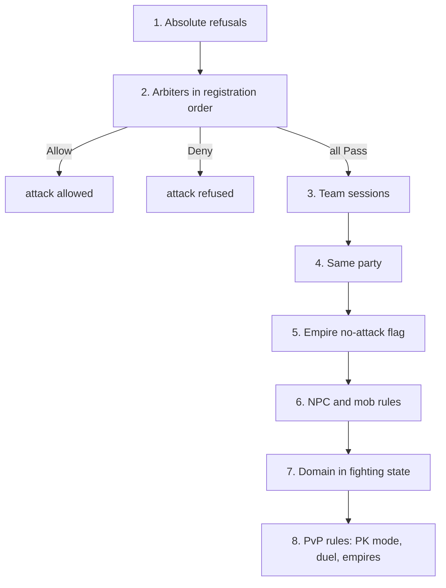

# Battle arbiter reference

A battle arbiter is a rule you register from Lua that answers one question: may this attacker hit this victim? It is a guard that says which attacks the rule cares about, and a verdict that says `Allow`, `Deny` or `Pass`. You reach for it when a map, an event or a war needs its own PvP rules without touching the ordinary ones. To build one step by step, follow [Write a battle arbiter rule](/tutorials/battle-arbiter-rule). The forge file layout is in the [Forge API reference](/docs/core/luna-forge). How the server talks to the client around it is in [the bridge](/foundations/luna/bridge).

## Quick start

`no_pvp_map.forge` makes one map a peace zone for players. Mobs and everything on other maps are left to the ordinary rules.

```forge
forge no_pvp_map begin
    environment game begin
        local registry = forge.sys.game.battle_arbiter_registry
        local VERDICT = registry.BATTLE_VERDICT
        local PEACE_MAP = 1

        local handle = registry.register(
            "no_pvp_map",
            function(att, vic)
                return vic:get_map_index() == PEACE_MAP
            end,
            function(att, vic)
                if att:is_pc() and vic:is_pc() then
                    return VERDICT.Deny
                end
                return VERDICT.Pass
            end)

        forge.sys.log(0, "registered, handle " .. handle)
        return { handle = handle }
    end
end
```

Add the file to the compiler list, compile, restart the game cores. The syslog shows `[OK] CBattleArbiterRegistry::Register : [no_pvp_map] handle=<n>`, and from then on no player on map 1 can hurt another player. `<n>` depends on how many arbiters registered before this one.

## Files and setup

An arbiter has no file of its own and no config key. It lives in whatever forge or quest registers it, and it exists only in the Lua state of a game core.

- `forge.sys.game.battle_arbiter_registry` exists on game cores only. Forge environment code and quests reach it. Other cores are untouched by a registration: a rule registered on the core that hosts one map does not apply to a map hosted elsewhere.
- Compile and register the file as for any forge, see [Forge API reference](/docs/core/luna-forge). Forges are not reloaded: after a change, restart the game cores.
- The registry is not saved. After a restart only the arbiters that register again exist.
- A registration lands in one of three places: the forge environment body at load (a rule that holds for the whole life of the core), a quest function or referee method the engine calls at the start and the end of an event or war, or a command callback (a GM switch).

The arbiters in the shipped content show each place:

| Arbiter | Registered | Unregistered |
| --- | --- | --- |
| EvE classic event | when the event is set up | when the event is torn down |
| Guild war referee, every war mode | when a war is created | when the war is destroyed |
| Battle royale | in the forge environment body, at load | never; its guard limits it to its own matches |

Three Lua arbiters ship: the EvE classic event, the guild war referee and battle royale. One more arbiter is registered by the engine itself: `land_deployment`. It registers on first use: when the land deployment manager is created and, if the registry did not exist yet, again at the next entry point of the land deployment system. So it usually comes after the arbiters registered at forge load. Its guard claims every pair in which either side is a guild presence, and its verdict never answers `Pass`. A Lua arbiter earlier in the list whose guard also matches a guild presence answers first for that pair.

## API

### `forge.sys.game.battle_arbiter_registry`

| Name | Signature | Returns | Context | What it does |
| --- | --- | --- | --- | --- |
| `register` | `register(name, guard, can_attack)` | `number` handle, greater than 0 | game core, outside any guard or verdict | Appends an arbiter to the end of the list. |
| `unregister` | `unregister(handle)` | `boolean` | game core, outside any guard or verdict | Removes the arbiter. `true` when found, `false` for an unknown handle. |
| `BATTLE_VERDICT` | table with `Allow`, `Deny`, `Pass` | | any | The three answers a verdict may return. |

`register` parameters:

| Parameter | Type | Meaning |
| --- | --- | --- |
| `name` | `string` | Shown in every log line and error of this arbiter. Never compared: duplicates are allowed and they are two arbiters. |
| `guard` | `fun(att, vic): boolean` | "Is this pair mine?" Called for every check that reaches this arbiter. |
| `can_attack` | `fun(att, vic): number` | "What do I say?" Called only when `guard` returned `true`. Returns a `BATTLE_VERDICT` value. |

Handles start at 1 and grow by one per registration on that core. They are never reused, so a stale handle can never remove somebody else's arbiter. There is no priority parameter and no replace-by-name. A `guard` or `can_attack` that is not a function stops the call with `battle_arbiter_registry.register: guard is not callable` or `battle_arbiter_registry.register: can_attack is not callable`. Inside a forge environment body that error fails the forge load and the core does not start. `register` never returns 0.

Both callables stay alive until `unregister`, so closures and upvalues work. All the shipped arbiters capture a map index or a war in locals.

### The C++ registration

Engine code registers on the same list through the registry singleton. The guard and the verdict are plain
functions of the attacker and the victim, and the handle is kept for `Unregister` in the owner's teardown.

| Call | Signature | Returns |
| --- | --- | --- |
| `Register` | `Register(std::string name, GuardFn guard, CanAttackFn can_attack)` | `handle_t` (`uint64_t`) |
| `Unregister` | `Unregister(handle_t)` | `bool`, `false` for an unknown handle |

`GuardFn` is `std::function<bool(LPCHARACTER att, LPCHARACTER vic)>` and `CanAttackFn` is
`std::function<BattleVerdict(LPCHARACTER att, LPCHARACTER vic)>`. The one native arbiter that ships is the land
deployment one:

```cpp
m_hArbiter = CBattleArbiterRegistry::instance().Register("land_deployment",
    [](LPCHARACTER pkAtt, LPCHARACTER pkVic) -> bool {
        return (pkAtt && pkAtt->IsGuildPresence()) ||
            (pkVic && pkVic->IsGuildPresence());
    },
    [](LPCHARACTER pkAtt, LPCHARACTER pkVic) -> BattleVerdict {
        return CDeploymentManager::instance().ResolveAttack(pkAtt, pkVic);
    });
```

A C++ guard and verdict return their value directly. The rules in "The callbacks" for a wrong return type or
a Lua error apply to Lua callbacks only.

### Verdicts

| Verdict | Number | Meaning |
| --- | --- | --- |
| `Allow` | 0 | The attack is allowed; no later arbiter is asked. |
| `Deny` | 1 | The attack is refused; no later arbiter is asked. |
| `Pass` | 2 | No opinion: the next arbiter is asked, and after the last one the rest of the chain. |

Always write the names. `return 0` is `Allow`, not "no". The numbers are what crosses from Lua to the engine, and a number outside 0 to 2 acts as `Pass` without a log line.

### The callbacks

- Arguments are `att` (the attacker) first and `vic` (the victim) second, both character objects. Any pair reaches an arbiter: players, mobs, NPCs, guards, guild presences, buildings. No skill, weapon or damage type is passed.
- They run synchronously on the core's main thread, in the middle of a combat check. Return at once. Do not yield.
- `guard` must return a Lua boolean. Anything else (nil, a number, a userdata, nothing) or a Lua error counts as `false`: the arbiter does not vote on that call.
- `can_attack` must return a Lua number. Anything else, nothing, or a Lua error counts as `Pass`.
- Every failing call logs to syserr, so a broken arbiter floods the log.

```text
Bridge::ValidateProcessorInvocation lua error: <Lua error message>
Bridge::ValidateProcessorInvocation wrong return: expected [number], got [boolean]
Bridge::ValidateProcessorInvocation wrong return: expected [boolean], got nothing
[battle_arbiter_registry <name> can_attack] lua callback error
[battle_arbiter_registry <name> guard] lua callback error
```

Registration and removal are logged to syslog; an unknown handle goes to syserr:

```text
[OK] CBattleArbiterRegistry::Register : [<name>] handle=<n>
[OK] CBattleArbiterRegistry::Unregister : [<name>] handle=<n>
CBattleArbiterRegistry::Unregister : unknown handle=<n>
```

## Behaviour

### What you see in the game

- Players still see the target as attackable. The client is never told that a target is off-limits: it decides on its own, and a player of another empire is always a target. The attack cursor and the swing stay, the server refuses, and no damage appears. An arbiter sends nothing to the client.
- Buffs follow the same-empire rule. `Deny` means "not attackable", not "allied". Two players of different empires under a `Deny` still cannot buff each other. See the buff check below.
- Damage itself never asks the arbiter. The arbiter is asked by the checks that come before damage (the next section); the damage function refuses only in a safe zone, with the after-death shield or with an immune-to-all-damage affect.

### The dispatch order

Every "may A attack B" question walks the same eight steps, in this order. Steps 1 and 2 are the only ones an arbiter takes part in; from step 3 on, whatever an arbiter answers has already overruled them.



1. **Absolute refusals.** No arbiter can override them. The victim is dead or in observer mode. The victim is a mount (it has a rider) or a pet. The attacker or the victim stands in a no-PvP safe zone. The attacker is stunned, dead or in observer mode.
2. **The arbiters, in registration order.** For each one: the guard, and if it returned `true`, the verdict. The first `Allow` allows, the first `Deny` refuses, `Pass` moves to the next arbiter. If every arbiter passes, or no guard returned `true`, or none is registered, the check goes to step 3. There is no default deny.
3. **Team sessions.** Player pairs only. Non-player pairs, two players in no session, and a pair where either session member is off the session's map are passed on. A pair is refused when exactly one side is in a session, when they are in different sessions, when their teams are allied (a team is allied with itself), and while the session's attacks are disabled. Otherwise it is allowed.
4. **Same party.** Refused.
5. **The no-attack flag.** The victim's flag for the attacker's empire (empire ids are 1, 2 and 3). Refused.
6. **NPC and mob rules.** Skill-flag requirements of NPCs, the mob-against-mob rule (at least one must be an attack mob), a summoned attack NPC that may hit only its summon target, NPCs of the same empire that do not fight each other, guard NPCs that may hit monsters and bosses.
7. **Domain.** When both characters are in the same domain in fighting state, the domain's own rule decides.
8. **PvP rules.** Warps and portals are never attackable. A victim of the NPC type is refused unless the attacker is an attack NPC summoned for that victim. A rider on a grade-1 horse with a level above 0 cannot attack. Any other pair with an NPC or mob on either side is allowed. A player in PK mode Protect is refused on the own empire's map and on a start map. Different empires are allowed. A victim in killer mode is allowed. An attacker in PK mode Free is allowed. Guild mode is allowed unless both are in the same guild. Peace mode is allowed only in an active duel.

Consequences:

- An arbiter cannot allow an attack on a dead target, a pet, a mount, or inside a safe zone.
- An arbiter overrides steps 3 to 8. `Deny` beats a duel and every PK mode. `Allow` beats party membership, the empire flag and the NPC rules.
- Two players of different empires, with no arbiter and no session, can attack each other on any map, unless one of them is in Protect mode on the own empire's map or on a start map.

### The 11 hook points

These are the checks that ask the question. By what a refusal does:

| Check | What a refusal does |
| --- | --- |
| A character's attack, players and mobs | The attack does not happen. |
| Melee hit resolution, after the attack check | No hit lands. |
| Validation of a ranged or arrow blow the client claims, against a character target | The blow is dropped. |
| Skill target check for enemy-only skills | The cast is refused. On a test server the caster gets the chat line `<skill name>: this skill cannot be cast on that target`. |
| Skill target check for ally-only skills, through the buff check | The cast is refused. |
| Skill target classification: enemy, ally or neutral | Asks "attackable?" first, then "buffable?". |
| Buff eligibility | An attackable player pair is never buffable. |
| Each tick of poison, fire and bleeding | The effect ends on that tick, with no damage. Only while the attacker is still online. |
| Quest area damage and SP drain: `damage_in_map`, `damage_in_map_radius`, `damage_in_map_pct`, `damage_in_map_pct_radius`, `drain_sp_in_map`, `drain_sp_in_map_radius`, `drain_sp_in_map_pct`, `drain_sp_in_map_pct_radius` | That entity is skipped. |
| Quest `damage_to_vid` and `damage_to_vid_pct` | The call does nothing and returns 0. |
| A guild presence from a land deployment engaging a character | The presence does not engage. |

The guard runs for every pair on the core, on every map, not only for pairs on your map. A walk stops at the first arbiter that answers `Allow` or `Deny`, so your guard sees only the checks that every earlier arbiter passed on. One melee hit by a melee-type character asks at least twice, once for the attack and once for the hit resolution. Keep the guard cheap.

### The buff check

`Deny` does not make two players allies. For a caster and a target:

- a caster that is not a player can buff only a target that is not a player;
- a target that is not a player cannot be buffed by a player;
- two players whose teams are allied in a session can buff each other;
- if either is in a session otherwise, they cannot;
- an attackable pair cannot;
- anyone else can only when they are of the same empire.

So a cross-empire `Deny` leaves the two empires unable to buff each other. `Allow` has the same side effect: an allowed player pair is not buffable.

### Killer mode has its own order

After a damage that passed the safe-zone, after-death-shield and immunity checks, the engine decides whether the attacker becomes a killer (gets the PK flag). The registry is asked here too, but with a different question and a different order:

1. Not both players: no flag.
2. Different empires: no flag. The registry is not asked.
3. Arbiters: only `Allow` matters. `Allow` means no flag. `Deny` and `Pass` go on.
4. A team session that allows the attack: no flag.
5. The same domain in fighting state, and the domain allows it: no flag.
6. An active duel between the two: no flag.
7. The victim is already a killer, or has negative alignment: no flag.
8. Otherwise the attacker is flagged as a killer.

So an arbiter touches killer mode only for same-empire player pairs. `Allow` marks that fight as sanctioned. `Deny` never changes killer mode.

### Order and lifetime

- The arbiters registered at forge load, in forge load order. That order is not guaranteed.
- Then every later registration, in the order it happens: runtime registrations from Lua, and `land_deployment`, which registers on first use and so usually lands here.

There is no priority field. Engine code and Lua share one list, and the first arbiter whose guard matches answers.

An arbiter lives until `unregister` or until the core process stops. A forge has no unload hook, so nothing unregisters for you. Tie `unregister` to the end of the thing the arbiter judges: an event teardown, a war end, a GM switch.

Eight registries use this same pattern of `register(name, guard, ...)` and `unregister(handle)` with a fail-closed guard: the battle arbiter, `death_manager`, `item_use_policy`, `spectator`, `skill_use_policy`, `skill_loadout`, `skill_policy` and `party_join_policy`.

## Examples

### Deny between two empires on one map, with a switch

A GM command turns the rule on and off. Mobs, NPCs and the third empire answer `Pass`. This is the module the tutorial builds, with the steps explained there: [Write a battle arbiter rule](/tutorials/battle-arbiter-rule).

```forge
forge friendly_empires begin
    environment game begin
        local registry = forge.sys.game.battle_arbiter_registry
        local VERDICT = registry.BATTLE_VERDICT

        local Friendly = {}
        Friendly.__index = Friendly

        function Friendly:new()
            return setmetatable({ handle = nil, map_index = 0 }, Friendly)
        end

        function Friendly:enable(map_index, empire_a, empire_b)
            if self.handle ~= nil then
                return false
            end
            self.handle = registry.register(
                "friendly:" .. map_index,
                function(att, vic)
                    return att:get_map_index() == map_index and vic:get_map_index() == map_index
                end,
                function(att, vic)
                    if not (att:is_pc() and vic:is_pc()) then
                        return VERDICT.Pass
                    end
                    local a, b = att:get_empire(), vic:get_empire()
                    if (a == empire_a and b == empire_b) or (a == empire_b and b == empire_a) then
                        return VERDICT.Deny
                    end
                    return VERDICT.Pass
                end)
            self.map_index = map_index
            forge.sys.log(0, "on for map " .. map_index .. ", handle " .. self.handle)
            return true
        end

        function Friendly:disable()
            if self.handle == nil then
                return false
            end
            local removed = registry.unregister(self.handle)
            if removed then
                forge.sys.log(0, "off for map " .. self.map_index .. ", handle " .. self.handle)
            end
            self.handle = nil
            self.map_index = 0
            return removed
        end

        local friendly = Friendly:new()

        local cmd = forge.sys.game.cmd
        cmd.register_router("friendly", cmd.new_router(nil, {
            on = cmd.new_implementor_route("/friendly on <empire> <empire>", { "number", "number" },
                function(ch, empire_a, empire_b)
                    if friendly:enable(ch:get_map_index(), empire_a, empire_b) then
                        ch:chat_packet(forge.sys.game.CHAT_TYPE.INFO, "Empires " .. empire_a .. " and " .. empire_b .. " are friendly on this map")
                    else
                        ch:chat_packet(forge.sys.game.CHAT_TYPE.INFO, "Already on for map " .. friendly.map_index .. ", use /friendly off first")
                    end
                end),
            off = cmd.new_implementor_route("/friendly off", {},
                function(ch)
                    if friendly:disable() then
                        ch:chat_packet(forge.sys.game.CHAT_TYPE.INFO, "Empires fight again")
                    else
                        ch:chat_packet(forge.sys.game.CHAT_TYPE.INFO, "Nothing to turn off")
                    end
                end),
        }))

        forge.sys.log(0, "loaded")
        return friendly
    end
end
```

### An event map that opens PvP only when the event is engaged

The EvE classic event registers in its setup and drops the arbiter in its teardown. On its map only PvP between players of different empires is allowed, and only once the fight is engaged. Everything else is denied, mobs included, on purpose.

```lua
local VERDICT = forge.sys.game.battle_arbiter_registry.BATTLE_VERDICT
eve_classic.battle_handle = forge.sys.game.battle_arbiter_registry.register(
    "eve:" .. id,
    function(att, vic) return att:get_map_index() == map_index and vic:get_map_index() == map_index end,
    function(att, vic)
        if not forge.game.ue_eve_manager:is_engaged(id) then return VERDICT.Deny end
        if att:is_pc() and vic:is_pc() and att:get_empire() ~= vic:get_empire() then
            return VERDICT.Allow
        end
        return VERDICT.Deny
    end)
```

Teardown:

```lua
if eve_classic.battle_handle ~= nil then
    forge.sys.game.battle_arbiter_registry.unregister(eve_classic.battle_handle)
    eve_classic.battle_handle = nil
end
```

### One arbiter per war, built from closures

The guild war referee builds a guard and a verdict per war, so each war carries its own map and its own teams. A pair is allowed only when both are players of two different teams of that war.

```lua
function base_war_referee:_battle_guard(war)
    local map_index = war:get_map_index()
    return function(att, vic)
        return att:get_map_index() == map_index and vic:get_map_index() == map_index
    end
end

function base_war_referee:_battle_policy(war)
    local VERDICT = forge.sys.game.battle_arbiter_registry.BATTLE_VERDICT
    local ref = self
    return function(att, vic)
        if not (att:is_pc() and vic:is_pc()) then return VERDICT.Deny end
        local at = ref:_team_index_of(war, att)
        local vt = ref:_team_index_of(war, vic)
        if at < 0 or vt < 0 or at == vt then return VERDICT.Deny end
        return VERDICT.Allow
    end
end
```

The referee stores the handle in `self.battle_handle` when the war is created. Its `on_war_destroyed` calls `unregister` with that handle and sets the field to `nil`.

## Pitfalls

**The rule does nothing and syserr fills with `wrong return: expected [number], got [boolean]`.** The verdict returned `true` or `false`. The call counts as `Pass` and the pair falls to the ordinary rules. Return `VERDICT.Allow`, `VERDICT.Deny` or `VERDICT.Pass`.

**A verdict that ends without a return is `Pass`, not `Deny`.** The log says `expected [number], got nothing`. End every verdict with an explicit return.

**The arbiter never applies and the log says `expected [boolean], got [userdata]` or `got [nil]`.** A guard such as `return att:get_guild() and ...` returns an object or nil, and anything that is not a boolean counts as `false`. Compare explicitly with `~=` or `==`.

**A broken arbiter opens combat to the ordinary rules, it does not close it.** A guard error is `false` and a verdict error is `Pass`. An event map whose safety rests on a `Deny` turns into normal PvP. Test with syserr open and look for the context line carrying your arbiter name.

**Monsters stop fighting on the map.** The guard sees every pair on the core: mobs, NPCs, guards, buildings. A map-only guard also owns mob against player there, and a verdict that ends in `Deny` stops the monsters too. Decide non-player pairs explicitly with `is_pc()` and return `Pass` for what is not yours.

**Players of two empires still cannot buff each other after a `Deny`.** `Deny` is not an alliance (see the buff check). Only a team session with allied teams changes that.

**The attack cursor is still there.** The client is not told. If the game should hide the cursor, a team session does that and an arbiter does not.

**A second `register` adds a second arbiter.** Names are not compared. If you overwrite the stored handle, the first arbiter is lost for good and only a core restart removes it. Refuse to register while you hold a handle.

**Calling `register` or `unregister` from inside a guard or a verdict.** The registry walks its list while it calls them, and nothing protects that walk. Do it from an event, a command or a load.

**Flipping a verdict mid-fight cuts running poison, fire and bleeding.** They ask again on every tick and end when refused. A `Deny` turned on later ends them at the next tick.

**Guard guild presences out unless you mean to judge them.** `land_deployment` usually registers after your arbiter, so a guard that matches a guild presence answers for it first. Keep guards scoped to your own map or match.

**A rule registered on one core does not hold on another.** Registrations are per core process.

**You expect to reload a forge and keep the arbiters in sync.** Forges are not reloaded. Restart the game cores.

## See also

- [Write a battle arbiter rule](/tutorials/battle-arbiter-rule): the friendly empires module, built and broken on purpose.
- [Forge API reference](/docs/core/luna-forge): file layout, environments and load order.
- [The bridge](/foundations/luna/bridge): how Lua callbacks cross into the engine, and why a wrong return type is logged and falls to a safe default.
