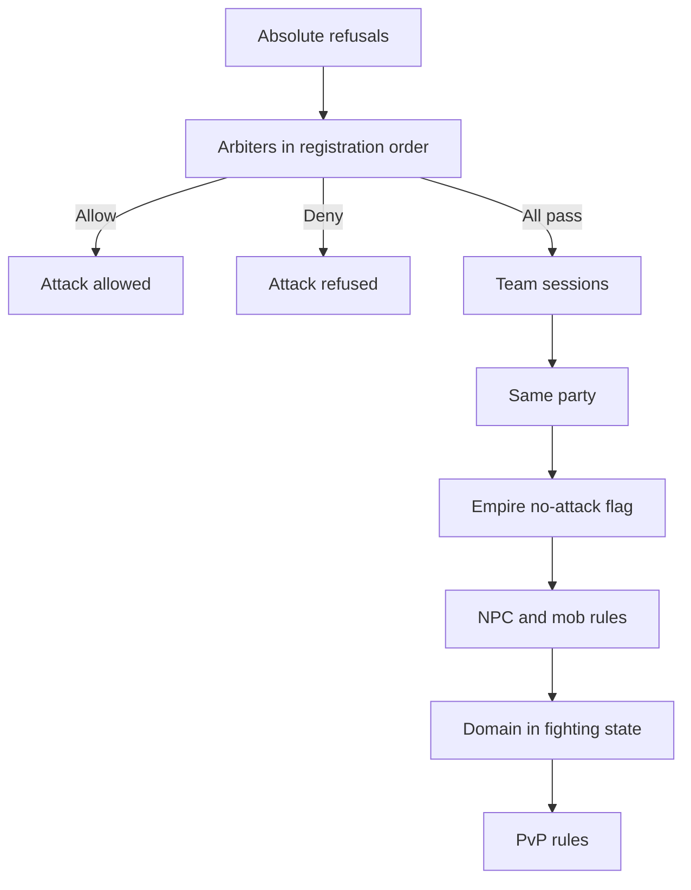

# Battle arbiter: behaviour

The [battle arbiter registry](/docs/building-blocks/battle-arbiter) answers combat checks on each game core. A session is a team manager's group of participants; PK mode controls player combat. See the [policies glossary](/docs/building-blocks#policies-glossary) for these terms, duel, and killer.

## Dispatch order

The first `Allow` or `Deny` ends the arbiter walk. If all guards are false or all verdicts pass, combat continues through the remaining checks. Registration order is local to one core; across forges it follows forge load order, which is not guaranteed.

The path below shows where a verdict can override later checks.

| Stage | Decision |
| --- | --- |
| Absolute refusals | Refuse a dead or observing victim, a mount with a rider, a pet, either character in a no-PvP safe zone, or a stunned, dead, or observing attacker. An arbiter cannot override these. |
| Team sessions | For player pairs, refuse if exactly one is in a session, they are in different sessions, their teams are allied, or attacks are disabled. Allow otherwise. Pass non-player pairs, pairs without a session, and same-session pairs with either player off the session map. |
| Same party | Refuse. |
| Empire no-attack flag | Refuse when the victim's flag for the attacker's empire is set. Empire IDs are 1, 2, and 3. |
| NPC and mob rules | Apply NPC skill flags, mob-versus-mob attack-mob requirements, summon target, same-empire NPC, and guard rules. |
| Domain | The domain decides when both characters share one in fighting state. |
| PvP rules | Refuse warps and portals, and NPC victims except their summoned attack NPC. A rider on a grade-1 horse above level 0 cannot attack. Other NPC or mob pairs are allowed. Protect mode refuses on the player's own empire map and start maps; different empires, killer victims, and Free mode are allowed. Guild mode allows unless both share a guild; Peace mode allows only an active duel. |

An arbiter's `Allow` overrides later party, session, empire, and NPC checks; `Deny` overrides duels and PK modes. A [PvP team manager](/docs/building-blocks/team-manager) controls client targeting separately.

## Combat hooks

| Check | Effect of refusal |
| --- | --- |
| Character attack and melee hit resolution | Attack or hit is stopped. |
| Claimed ranged or arrow blow against a character | Blow is dropped. |
| Enemy-only skill target | Cast is refused; a test server reports `<skill name>: this skill cannot be cast on that target`. |
| Ally-only skill and target classification | Buff eligibility is checked; classification asks attackability first, then buff eligibility. |
| Buff eligibility | An attackable player pair cannot buff each other. |
| Poison, fire, and bleeding ticks | Effect ends without damage on a refused tick, while the attacker is online. |
| `damage_in_map`, `damage_in_map_radius`, `damage_in_map_pct`, `damage_in_map_pct_radius`, `drain_sp_in_map`, `drain_sp_in_map_radius`, `drain_sp_in_map_pct`, `drain_sp_in_map_pct_radius` | The quest operation skips the entity. |
| `damage_to_vid`, `damage_to_vid_pct` | The quest call does nothing and returns 0. |

Damage itself does not ask the arbiter. Safe zones, the after-death shield, and an immune-to-all-damage affect can still refuse damage. Guards can run more than once per hit and see pairs on every map on the core, subject to earlier verdicts; keep them cheap.

## Buffs and killer mode

`Deny` does not make players allies. Non-player casters can buff only non-players; player casters cannot buff non-players. Allied teams in the same session can buff on the session map; otherwise a session participant cannot buff the other player. Outside that case, attackable players cannot buff each other, and remaining player pairs must share an empire.

A killer is a player with the PK flag. After damage passes the safe-zone, shield, and immunity checks, the killer decision uses this order:

1. If either character is not a player or the empires differ, do not flag the attacker.
2. Ask arbiters; `Allow` prevents the flag, while `Deny` and `Pass` continue.
3. An allowing team session or shared fighting domain, an active duel, or a victim who is a killer or has negative alignment prevents the flag.
4. Otherwise flag the attacker.

## Failure direction and lifetime

| Condition | Result |
| --- | --- |
| Guard errors or returns anything other than a boolean | Treat as `false`. |
| Verdict errors or returns anything other than a number | Treat as `Pass`. |
| Invalid numeric verdict | Treat as `Pass` without a log. |
| Unknown handle passed to `unregister` | Return `false` and log to syserr, the server error log. |

The [bridge](/foundations/luna/bridge) invokes Lua callbacks and logs type errors and callback errors to syserr. Registration and successful removal go to syslog. A rule lives until explicitly unregistered or the core stops; keep the handle and remove it at event teardown. Each core has its own registry.

## Pitfalls

**The rule does nothing and syserr reports a wrong return type.** Guards must return booleans and verdicts must return named verdict constants. Compare objects explicitly and return a verdict on every path.

**A callback error opens combat to ordinary rules.** Guard errors act as false and verdict errors as `Pass`. Watch syserr and test the failure path when safety depends on a denial.

**Monsters stop fighting on the map.** A map guard also sees non-player pairs. Check `is_pc()` and pass pairs outside the rule's scope.

**The cursor remains or cross-empire buffs fail.** An arbiter changes the server decision, not client targeting or alliance. Use the team manager when those behaviors are required.

**A rule persists after its event ends.** Duplicate names create separate registrations, and overwriting a handle loses the ability to remove that entry. Store the handle, refuse duplicate registration, and unregister during teardown.

**A rule works on only one core.** Registrations are per core. Register on every core that hosts the affected combat.

**A new denial ends a running effect.** Poison, fire, and bleeding check again on each tick. Account for that when changing a verdict during combat.

Next: [Battle arbiter examples](/docs/building-blocks/battle-arbiter/examples).
