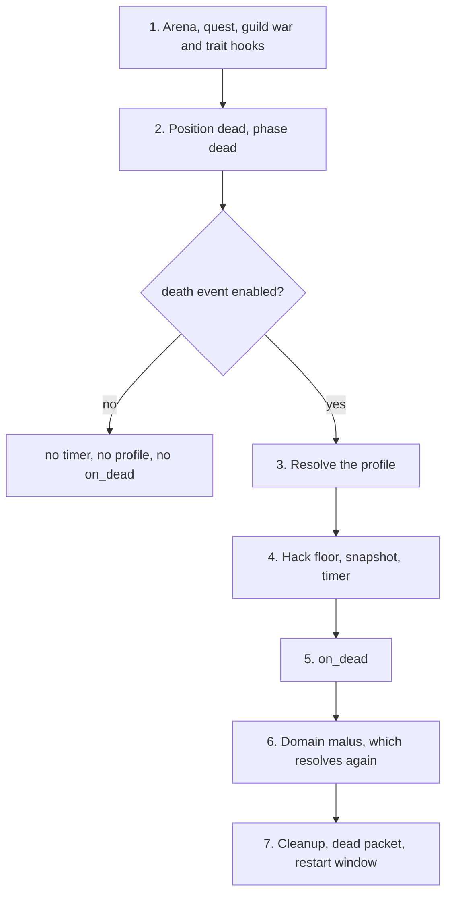

# Death manager reference

A death profile is a rule you register from Lua that answers one question: when this player dies here, how long does the death last and what happens when they restart? It is a guard that says which deaths the rule owns, and a profile that holds the timers and the callbacks. You reach for it when a map, an event, an arena or a war settles deaths on its own terms, with a short respawn at the spot, a warp to a start position, or no stock restart screen at all. Only players consult it. Monsters keep their own fixed timers.

The sibling policy for who may hit whom is the [battle arbiter](/docs/building-blocks/battle-arbiter). The forge file layout is in the [Forge API reference](/docs/core/luna-forge). How a wrong return type from a Lua callback is logged and falls back is explained in [the bridge](/foundations/luna/bridge).

## Quick start

`peace_room.forge` makes map 1 a place where a dead player stands up on the spot after 3 seconds of waiting, with full health, instead of walking back from the empire town. Every other map is left to the defaults.

```forge
forge peace_room begin
    environment game begin
        local PEACE_MAP = 1

        local function stand_up(ch)
            ch:restart_at_same_pos()
            ch:revive_invisible(5)
            ch:point_change(point.HP, ch:get_max_hp() - ch:get_hp())
        end

        local handle = forge.sys.game.death_manager.register(
            "peace_room",
            function(ch) return ch:get_map_index() == PEACE_MAP end,
            {
                name = "peace_room",
                total_duration = 60,
                restart_here_available_at = 3,
                restart_town_available_at = 3,
                on_restart_here = stand_up,
                on_restart_town = stand_up,
                on_auto_town = stand_up,
            })

        forge.sys.log(0, "registered, handle " .. handle)
        return { handle = handle }
    end
end
```

Add the file to the compiler list, compile, restart the game cores. The syslog shows `[OK] CDeathManager::Register : [peace_room] handle=<n>`. A player who dies on map 1 sees the restart screen, can press "restart here" after 3 seconds and is back on their feet where they fell. If they do nothing, the same callback runs when the 60 second timer ends.

## Files and setup

A death profile has no file of its own and no config key. It lives in whatever forge, Lua module or quest registers it, and it exists only in the Lua state of one game core.

- `forge.sys.game.death_manager` exists on game cores only. Forge environment code, modules required by forges and quests reach it. A profile registered on the core that hosts one map does not apply to a map hosted elsewhere.
- Compile and register the file as for any forge, see [Forge API reference](/docs/core/luna-forge). Forges are not reloaded: after a change, restart the game cores.
- The registry is not saved. After a restart only the profiles that register again exist.
- A registration lands in one of three places: the forge environment body at load (a rule for the whole life of the core), a quest function or referee method the engine calls at the start and the end of an event, an arena or a war, or a command callback.

The shipped content shows each place:

| Profile | Registered | Unregistered |
| --- | --- | --- |
| Battle royale | in the forge environment body, at load | never; its guard limits it to its own match maps |
| EvE classic event | when the event is set up | when the event is torn down |
| Arena referees | before the arena engages | when the arena is destroyed |
| Guild war referee | when a war is created | when the war is destroyed |

The engine registers three more profiles itself, from C++: two for domains and one for raids. They are listed in [C++ registration](#c-registration).

## API

### `forge.sys.game.death_manager`

| Name | Signature | Returns | Context | What it does |
| --- | --- | --- | --- | --- |
| `register` | `register(name, guard, profile)` | `number` handle, greater than 0 | game core, outside any guard or callback | Appends a profile to the end of the list. |
| `unregister` | `unregister(handle)` | `boolean` | game core, outside any guard or callback | Removes the profile. `true` when found, `false` for an unknown handle. |

`register` parameters:

| Parameter | Type | Meaning |
| --- | --- | --- |
| `name` | `string` | Labels the guard in the log and the registration line. Never compared: duplicates are allowed and they are two profiles. |
| `guard` | `fun(ch: LPCHARACTER): boolean` | "Is this death mine?" Called with the character that just died. Must return a boolean. |
| `profile` | `table` | The profile fields below. |

Handles start at 1 and grow by one per registration on that core. They are never reused. There is no priority parameter and no replace-by-name. `register` either returns a handle or raises an error, so the `0` the stub documents for a failed registration does not occur from Lua.

### Profile fields

The profile is strict: seven fields are required and a missing one stops `register` at once, not at the first death.

| Field | Type | Required | Meaning |
| --- | --- | --- | --- |
| `name` | `string` | yes | Labels the revive callbacks and `on_dead` in the log, and appears in the `DEAD_EVENT_CREATE` line with `profile=<name>`. Shipped content passes the same string as the register `name`. |
| `total_duration` | `number` | yes | Seconds from the death until the master timer fires `on_auto_town`. |
| `restart_here_available_at` | `number` | yes | Seconds after the death before `/restart_here` is accepted. |
| `restart_town_available_at` | `number` | yes | Seconds after the death before `/restart_town` is accepted. |
| `on_restart_here` | `fun(ch)` | yes | Runs on `/restart_here`. |
| `on_restart_town` | `fun(ch)` | yes | Runs on `/restart_town`. |
| `on_auto_town` | `fun(ch)` | yes | Runs when the master timer expires. |
| `restart_window` | `boolean` | no, default `true` | `false` closes the stock restart screen right after the death. Only `false` turns it off. |
| `on_dead` | `fun(ch, killer)` | no | Runs once after the death sequence is created. `killer` is `nil` when there is none. |

Errors raised by `register`:

```text
death_manager.register: guard is not callable
death_manager.register: profile [<name>] missing field [<key>]
death_manager.register: on_dead is not callable
```

`<name>` in the second line is the register `name`, not `profile.name`. The three revive callbacks are fetched without a callable check: a value that is not a function registers fine and fails at the first restart (see the pitfalls).

### The callbacks

| Slot | Called when | Return | On a Lua error or a returned value |
| --- | --- | --- | --- |
| `guard(ch)` | the player dies, synchronously inside the death | boolean | logged, counts as `false`: the profile does not apply |
| `on_dead(ch, killer)` | at the end of the death sequence, before the dead packet | nothing | logged only |
| `on_restart_here(ch)` | the player sends `/restart_here` and the cooldown passed | nothing | logged, then the stock restart-here runs |
| `on_restart_town(ch)` | the player sends `/restart_town` and the cooldown passed | nothing | logged, then the stock restart-town runs |
| `on_auto_town(ch)` | the master timer reaches `total_duration` | nothing | logged, then the stock restart-town runs |

- They run synchronously on the core's main thread. Return at once. Do not yield: defer a delayed action with `forge.sys.game.event.create` and look the character up again by player id when it fires.
- The three revive callbacks and `on_dead` must return nothing. A returned value of any kind counts as an error: it is logged, and the stock callback runs after yours already ran.
- `guard` must return a Lua boolean. Anything else, nothing, or a Lua error counts as `false`.

Failures go to syserr, so a broken profile floods the log:

```text
Bridge::ValidateProcessorInvocation lua error: <Lua error message>
Bridge::ValidateProcessorInvocation wrong return: expected [boolean], got nothing
Bridge::ValidateProcessorInvocation wrong return: expected [<type>], got [<type>]
[death_manager <name> guard] lua callback error
[death_manager <profile.name> on_restart_here] lua callback error
```

Registration and removal are logged to syslog; an unknown handle goes to syserr:

```text
[OK] CDeathManager::Register : [<name>] handle=<n>
[OK] CDeathManager::Unregister : [<name>] handle=<n>
CDeathManager::Unregister : unknown handle=<n>
```

### C++ registration

Engine code registers on the same list through the death manager singleton. The Lua `register` is a thin wrapper around the first overload: it validates the table, pins the Lua functions and calls it.

| Call | Signature | Returns | Notes |
| --- | --- | --- | --- |
| `Register` | `Register(std::string name, GuardFn guard, DeathProfile profile)` | `handle_t` (`uint64_t`) | The profile is a fixed value, copied onto each dead player. |
| `Register` | `Register(std::string name, GuardFn guard, ProfileFn dynamic_profile)` | `handle_t` | No caller anywhere in the engine. Lua cannot reach it. |
| `Unregister` | `Unregister(handle_t)` | `bool` | `false` for an unknown handle. |

`GuardFn` is `std::function<bool(CHARACTER*)>` and `ProfileFn` is `std::function<DeathProfile(CHARACTER*)>`. `DeathProfile` carries the same fields as the Lua table, `name`, `totalDuration`, `restartHereAvailableAt`, `restartTownAvailableAt`, `restartWindow` (default `true`), `onDead`, `onRestartHere`, `onRestartTown` and `onAutoTown`, all as `std::function`. `INVALID_HANDLE` is 0 and is returned only for a null guard or a null profile function.

The static overload wraps its profile in a `ProfileFn` that returns a copy. The header says the dynamic one "builds the profile per-revive"; in fact the engine calls it once per death while resolving the profile, and a second time for a player in a fighting domain (see the order of a death). Nothing ships through it, so treat it as an unused door.

Three profiles are registered natively:

| Name | Registered by | When | Guard | Profile (total, here, town in seconds) |
| --- | --- | --- | --- | --- |
| `domain_exp_zone` | the domain manager constructor | process start, before any forge loads | the character stands in an experience-zone domain in fighting state | 300, 30, 30, stock callbacks |
| `domain_boss_zone` | the domain manager constructor | process start, before any forge loads | the character stands in a boss-zone domain in fighting state | 300, 15, 30, stock callbacks |
| `raid` | the raid manager, at initialization | when the database boot data arrives, after the forges loaded; registered once, a second initialization does not add another | the character is on a raid map | 180, 10, 7, full health and SP |

```cpp
m_death_handle = CDeathManager::instance().Register(
        "domain_exp_zone",
        [](CHARACTER* ch) {
            return CDomainManager::instance().GetDomainByCoords(
                ch, DOMAIN_TYPE_EXP_ZONE, DOMAIN_STATUS_FIGHTING) != nullptr;
        },
        GetProfile_DomainExpZone());
```

Both domain profiles are unregistered when the domain manager is destroyed and the raid profile when the raid manager is destroyed. The registration order has a consequence for your Lua profile:

- The two domain profiles come first in the list and win any overlap with a Lua profile.
- A profile registered at forge load, such as battle royale, comes before `raid`, so a forge-load guard that also matches a raid map wins over `raid`.
- Per-instance profiles (arena, guild war, EvE) are registered later still and come after all three.

No shipped guard overlaps another: they test domain coordinates, raid maps, or one map or instance each.

### The revive functions

Three functions outside the namespace belong to this system. None calls a profile callback.

| Name | Signature | What it does |
| --- | --- | --- |
| `pc.revive` | `pc.revive()` | Revives the current quest character in place. Shield is always 5 seconds. Requires a current character. |
| `LPCHARACTER:revive` | `ch:revive(shield_time?)` | The same for any character. `shield_time` defaults to 5 and `0` skips the shield. |
| `pc.enable_revive_event` | `pc.enable_revive_event(enable)` | Switches the whole death sequence on or off for the current quest character. Default `true`. |

Both revive functions close the restart window, stand the character up, apply the optional shield, clear the attackers, count a dungeon revive, cancel the death timer and drop the profile snapshot. Then they set health to a quarter of the maximum and give 5 seconds of invisibility, whatever `shield_time` says. Content that wants more health sets it afterwards. Neither checks that the character is dead.

`pc.enable_revive_event(false)` makes the death skip the whole sequence: no profile is resolved, no timer starts, `on_dead` does not run, and `/restart_here` and `/restart_town` return without a message. A non-boolean argument logs `QUEST enable_revive_event call error : wrong argument: bool enable`. No shipped content calls it.

`LPCHARACTER:restart_at_same_pos()` is not a revive: it refreshes the view and does not move a dead character out of the dead state. Inside `on_restart_*` the character is already standing, which is why shipped callbacks use `restart_at_same_pos`, `revive_invisible` and `point_change` there.

## Behaviour

### The order of a death

Read the diagram from the top. The guard is asked in step 3, after the arena and quest hooks of step 1, and with the character already dead.



1. Early hooks: the arena death hook (which calls the referee's `on_arena_dead`), the quest `Kill` and `Die` events, the guild war kill, traits and metrics. A revive done here is overwritten by the rest of the death.
2. The character is set to the dead position, affects that do not survive death are removed, and a player is set to the dead phase. A guard cannot test for an affect death removes, such as a buff.
3. If the death event is enabled, the profile is resolved (next section).
4. The hack floor is applied, the profile is copied onto the character with the time of death, and the timer is scheduled for `total_duration` seconds. The `DEAD_EVENT_CREATE` line is logged.
5. `on_dead(ch, killer)` runs.
6. The domain experience malus resolves the profile a second time for any player in a fighting domain, so your guard can run twice for one death.
7. Exchange, skills, poison, fire, bleeding, cube, shop and safebox are cleaned up. The dead packet goes out with the three countdowns (restart here, restart town, auto-town). Then, when `restart_window` is `false`, `CloseRestartWindow` is sent.

### Which profile applies

Three tiers, from the top:

1. The registry list. Guards are asked in registration order and the first `true` wins. Guards after it are not called. Engine code and Lua share one list and there is no priority field.
2. The auto-hunt profile, when no registration matched and the character has the active auto-hunt affect: 3 seconds, restart here and town available at once. Restart here and auto-town revive in place at full health; restart town is the stock town warp.
3. The stock profile: 180 seconds total, restart here after 10 seconds, restart town after 7 seconds. Restart here revives in place with a quarter of the maximum health and 5 seconds of invisibility. Restart town and auto-town send the player to the empire recall position of the current map, or the empire start, with 50 health.

A matching registration beats auto-hunt: an auto-hunting player who dies in your zone gets your profile, not the 3 second revive. No Lua accessor exists for the stock or the auto-hunt callbacks, so a Lua profile cannot call them.

The engine also holds raid and domain profiles that are registered natively (see the C++ table).

### Restart, auto-town and the gates

`/restart_here` and `/restart_town` are ignored without a message while the player cannot warp (within 10 seconds of the warehouse, a trade, their own shop or a refine, or with those windows open) and when there is no death timer. A player who is not dead gets the restart window closed and a recovery event started, nothing more.

The cooldown is counted in whole seconds from the death. Before it passes the player gets `No new start possible.(<n> seconds left)` for restart here, or `Still no new start possible in the city. (<n> seconds left)` for restart town. When the gate opens, three things happen in order before your callback:

1. The restart window closes, the phase is set to game, the character is set standing, a shield affect starts (5 seconds), the recovery event starts, attackers are cleared and a dungeon revive is counted. Health and SP are not touched.
2. The death timer is cancelled and the profile snapshot is dropped.
3. Your `on_restart_here` or `on_restart_town` runs.

So in a restart callback the character is already standing, shielded and without a profile. You must set health yourself.

Auto-town is shorter. If the character has no connection, the snapshot is dropped and no callback runs. Otherwise the phase is set to game, the character stands, the snapshot is dropped, `on_auto_town` runs, the recovery event starts and the restart window closes. There is no shield, no attacker clear and no dungeon revive count.

The client countdowns are clamped to 255 seconds (the wire field is one byte), so a profile with 10000 shows 255 on the restart screen while the server still refuses.

### The hack floor

When the dying player is flagged by the hack check, both restart cooldowns are raised to at least 10 seconds, whichever profile won, Lua ones included. `total_duration` is untouched. The flag is on within 10 seconds of opening the warehouse, trading, using your own shop or refining, while a trade, shop, warehouse or NPC dialog is open, and during a delayed warp. Guild war maps are exempt. A profile with restart here at 3 seconds gives 10 seconds to a duelist who traded in the last 10 seconds.

### `restart_window = false`

It sends `CloseRestartWindow` right after the dead packet, so the stock screen vanishes at once. It does not stop the commands: `/restart_here` and `/restart_town` still pass the gates above. A zone that settles deaths itself also sets all three times out of reach (the shipped value is 10000) and gives the three callbacks empty bodies. Do not try to close the screen from `on_dead`: the dead packet goes out after it and undoes it.

### Lifetime

- A registration lives until `unregister` or until the core process stops. A forge has no unload hook, so nothing unregisters for you. Tie `unregister` to the end of the thing the profile belongs to: an event teardown, an arena end, a war end.
- The profile is copied by value onto the dead player. The snapshot lives from the death until a restart, the auto-town, a `revive`, a new death (which cancels the old timer) or a disconnect at auto-town time.
- `unregister` erases the list entry only. A player already dead keeps the snapshot, and its callbacks run later, even after the owner is gone. The Lua functions stay alive for that. What they close over may not.
- A test server skips both restart gates and sends countdowns of 0. Timers on a test server prove nothing about cooldowns.

Eight registries use the same pattern of `register(name, guard, ...)` and `unregister(handle)` with a fail-closed guard: the death manager, `battle_arbiter_registry`, `item_use_policy`, `spectator`, `skill_use_policy`, `skill_loadout`, `skill_policy` and `party_join_policy`.

## Examples

### The zone settles deaths itself

Battle royale registers once at forge load. A death is settled by a revive, an elimination or the end of the match, never by the stock restart, so the screen is closed and every timer is out of reach.

```lua
local DEATH_UNREACHABLE = 10000
```

```lua
instance.death_profile_handle = forge.sys.game.death_manager.register(
    "battle_royale",
    function(ch) return instance.match_by_map[ch:get_map_index()] ~= nil end,
    {
        name = "battle_royale",
        -- a death is settled by a revive, an elimination or the match end, never by the stock restart
        restart_window = false,
        total_duration = DEATH_UNREACHABLE,
        restart_here_available_at = DEATH_UNREACHABLE,
        restart_town_available_at = DEATH_UNREACHABLE,
        on_dead = function(ch, killer)
            local match = instance.match_by_map[ch:get_map_index()]
            if match ~= nil then match:on_dead(ch, killer) end
        end,
        on_restart_here = function(_) end,
        on_restart_town = function(_) end,
        on_auto_town = function(_) end,
    })
assert(instance.death_profile_handle > 0, "battle_royale: death profile registration failed")
```

The `on_dead` wrapper discards what `match:on_dead` returns, so the slot returns nothing. The guard ends in `~= nil` so it returns a boolean.

### A quest registers per event and drops the profile at teardown

The EvE classic event registers when it is set up, with a 10 second death and one callback for all three slots, and unregisters when it is torn down.

```lua
-- death policy for the EvE map.
local map_index = cfg.map_index

eve_classic.death_handle = forge.sys.game.death_manager.register(
    "eve:" .. id,
    function(ch) return ch:get_map_index() == map_index end,
    {
        name                      = "eve:" .. id,
        total_duration            = 10,
        restart_here_available_at = 5,
        restart_town_available_at = 5,
        on_restart_here = eve_classic.restart_here,
        on_restart_town = eve_classic.restart_here,
        on_auto_town    = eve_classic.restart_here,
    })
```

```lua
if eve_classic.death_handle ~= nil then
    forge.sys.game.death_manager.unregister(eve_classic.death_handle)
    eve_classic.death_handle = nil
end
```

### A per-instance profile whose callbacks tolerate a vanished arena

The arena referee builds the profile for one arena and registers it before the match engages, so no player of that arena falls to the stock profile and its warp. The town callbacks fetch the arena from the character again and check it, because a player who died may restart long after the arena was torn down.

```lua
-- Returns the death profile this referee wants registered for its
-- arena.
---@param arena LPARENA
---@return forge.sys.game.death_manager.PROFILE
function base_arena_referee:_build_death_profile(arena)
    return {
        name                       = string.format("arena:%d", arena:get_id()),
        total_duration             = 10,
        restart_here_available_at  = 3,
        restart_town_available_at  = 1,
        on_restart_here = function(ch)
            ch:restart_at_same_pos()
            ch:revive_invisible(5)

            ch:point_change(point.HP, ch:get_max_hp() - ch:get_hp())
            ch:point_change(point.SP, ch:get_max_sp() - ch:get_sp())
            ch:reset_skill_cooltime()
        end,
        on_restart_town = function(ch)
            local pvp_arena = ch:get_pvp_arena()
            if pvp_arena ~= nil then
                pvp_arena:warp_to_start_position(ch)
            end
            ch:point_change(point.HP, ch:get_max_hp() - ch:get_hp())
            ch:point_change(point.SP, ch:get_max_sp() - ch:get_sp())
            ch:reset_skill_cooltime()
        end,
        on_auto_town = function(ch)
            local pvp_arena = ch:get_pvp_arena()
            if pvp_arena ~= nil then
                pvp_arena:warp_to_start_position(ch)
            end
            ch:point_change(point.HP, ch:get_max_hp() - ch:get_hp())
            ch:point_change(point.SP, ch:get_max_sp() - ch:get_sp())
            ch:reset_skill_cooltime()
        end,
    }
end
```

```lua
local arena_death_handles = {}

local function register_arena_death(arena)
    arena_death_handles[arena] = forge.sys.game.death_manager.register(
        "arena",
        function(ch) return ch:get_pvp_arena() == arena end,
        {
            name = "arena",
            total_duration = 10,
            restart_here_available_at = 3,
            restart_town_available_at = 1,
            on_restart_here = function(ch) ch:point_change(point.HP, ch:get_max_hp() - ch:get_hp()) end,
            on_restart_town = function(ch) ch:point_change(point.HP, ch:get_max_hp() - ch:get_hp()) end,
            on_auto_town = function(ch) ch:point_change(point.HP, ch:get_max_hp() - ch:get_hp()) end,
        })
end

local function unregister_arena_death(arena)
    local handle = arena_death_handles[arena]
    if handle ~= nil then
        forge.sys.game.death_manager.unregister(handle)
        arena_death_handles[arena] = nil
    end
end
```

The referee registers this before the engage hook and unregisters it when the arena is destroyed. The shipped referee builds the profile with the callbacks above in a `_build_death_profile` method and keeps the handle in `self.death_handle`; the comparison `ch:get_pvp_arena() == arena` is its guard. A player who died keeps these callbacks after `unregister_arena_death` runs, which is why the shipped town callbacks check the arena again.

```lua
if self.death_handle ~= nil then
    forge.sys.game.death_manager.unregister(self.death_handle)
    self.death_handle = nil
end
```

### Revive later, out of the death path

The Mayhem arena makes the restart buttons unreachable and revives a player with a phoenix augment itself. It cannot revive inside the arena death hook, because the rest of the death would overwrite the revive. It schedules the revive 0.1 seconds later and finds the player again by id, since the character may be gone by then.

```lua
local UNREACHABLE             = 10000
```

```lua
---@param arena LPARENA
---@return forge.sys.game.death_manager.PROFILE
function avatar_mayhem_arena_referee:_build_death_profile(arena)
    return {
        name                       = string.format("arena:%d", arena:get_id()),
        total_duration             = UNREACHABLE,
        restart_here_available_at  = UNREACHABLE,
        restart_town_available_at  = UNREACHABLE,
        on_restart_here = function(_) end,
        on_restart_town = function(_) end,
        on_auto_town    = function(_) end,
    }
end
```

```lua
function avatar_mayhem_arena_referee:_try_phoenix(arena, victim)
    if affect.name_map.AUGMENT_PHOENIX == nil
       or not victim:has_affect(affect.name_map.AUGMENT_PHOENIX)
    then
        return false
    end
    local vpid = victim:get_player_id()
    victim:remove_affect(affect.name_map.AUGMENT_PHOENIX)
    arena:notice(string.format(
        locale.ue_pvp_arena.avatar.mayhem.pheonix, victim:get_name()))
    forge.sys.game.event.create(function()
        local ch = forge.sys.game.char_manager.find_by_pid(vpid)
        if ch ~= nil then
            ch:revive(5)
            local target_hp = math.floor(ch:get_max_hp() * 0.3)
            ch:point_change(point.HP, target_hp - ch:get_hp(),
                            false, true, true, true)
        end
        return 0
    end, {}, 0.1)
    return true
end
```

## Pitfalls

**A player keeps your callbacks after you unregister.** The profile is copied onto the character at death, and `unregister` only removes the list entry. A player who died under an arena, war or event keeps its callbacks until a restart, the auto-town or a revive, even after the owner is torn down. In every revive callback fetch what you need from `ch` again and handle `nil`, as the arena callbacks do. Never trust an upvalue to still be live.

**Two profiles overlap and one never runs.** The first registered guard that returns `true` wins and the rest are never asked. The domain profiles beat every Lua profile, and a forge-load profile beats `raid`. Keep guards disjoint: a map index, an instance identity.

**The profile never applies and the log says `expected [boolean], got [nil]`.** A guard such as `return ch:get_pvp_arena() and ...` returns an object or nil. Anything that is not a boolean counts as `false`, and the death falls to the next registration or the default. End the guard with a comparison, `~= nil` or `== map_index`.

**A guard with side effects runs twice.** A player in a fighting domain resolves the profile a second time for the experience malus. Keep guards pure.

**Your restart runs and then the player is also sent to town.** A revive callback, or `on_dead`, returned a value. Any non-nil return is an error: it is logged and the stock callback runs after yours (town with 50 health, or a quarter of the health in place). Return nothing. Wrap a call that returns something, as battle royale does for `on_dead`.

**A restart fails at the first press and not at register time.** The three revive fields are required, so a missing name is caught as "missing field". A value that exists but is not a function is not checked. It registers, and the first restart fails with a Lua call error and the stock callback runs. Pass functions, and test a restart.

**`restart_window = false` and the player still restarts.** It hides the screen and nothing else. Also set the three times beyond reach and give the callbacks empty bodies. Anything you send about the restart window from `on_dead` is undone by the dead packet.

**A revive on a living character still resets it.** Neither `pc.revive` nor `ch:revive` tests for death. On a living character they set health to a quarter of the maximum, clear attackers, add a shield and count a dungeon revive. Check `ch:is_dead()` first.

**The dead player is stood up but the timer keeps running.** Only `pc.revive`, `ch:revive`, the two restarts and the auto-town clear the death timer. Other ways of standing a dead player up, such as warping them to an arena start position, leave it running, and `on_auto_town` fires later on a living character. Revive with `ch:revive()`, or make `on_auto_town` safe on a living character.

**A reachable `on_restart_here` leaves the player at the health they died with.** The common restart step stands the character up and does not restore health or SP. Set both in every callback a player can reach.

**Auto-town is not a restart.** It skips the shield, the attacker clear and the dungeon revive count, and a disconnected player gets no callback at all. Do that work in `on_auto_town` if you need it, and do not use it for bookkeeping about players who left.

**A short cooldown is longer than you wrote.** A player who traded or opened the warehouse in the last 10 seconds waits at least 10 seconds, except on guild war maps.

**Auto-hunters lose their quick revive in your zone.** Any matching profile beats the auto-hunt default.

**The cooldowns look broken on the test server.** Both restart gates are skipped there and the countdowns read 0.

**A player who died stays dead with no buttons.** `pc.enable_revive_event(false)` disables the whole sequence, `on_dead` included, and nothing restarts the player until a `revive`.

**You expect a callback to wait.** Callbacks cannot yield. Schedule the delayed part with `forge.sys.game.event.create` and look the character up by player id again.

## See also

- [Battle arbiter reference](/docs/building-blocks/battle-arbiter): the sibling policy that decides who may hit whom, with the same register and unregister pattern.
- [Forge API reference](/docs/core/luna-forge): file layout, environments and load order.
- [The bridge](/foundations/luna/bridge): how Lua callbacks cross into the engine, and why a wrong return type is logged and falls to a safe default.
