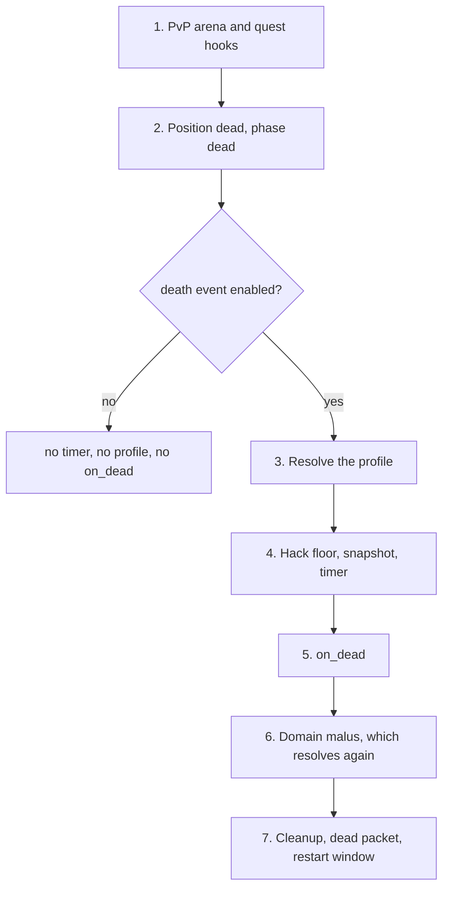

# Death manager: behaviour

The [death manager reference](/docs/building-blocks/death-manager) lists the API. A killer is the character responsible for a death, or `nil` when there is none; see the [Policies glossary](/docs/building-blocks#policies-glossary).

## Behaviour

### The order of a death

Read the diagram from the top. The guard is asked in step 3, after the arena and quest hooks of step 1, and with the character already dead.

1. Early hooks: the native death hook for the PvP arena (the native arena object, rebuilt from the mainline arena manager), and the quest `Kill` and `Die` events. A revive done here is overwritten by the rest of the death.
2. The character is set to the dead position, affects that do not survive death are removed, and a player is set to the dead phase. A guard cannot test for an affect death removes, such as a buff.
3. If the death event is enabled, the profile is resolved (next section).
4. The hack floor is applied, the profile is copied onto the character with the time of death, and the timer is scheduled for `total_duration` seconds. The `DEAD_EVENT_CREATE` line is logged.
5. `on_dead(ch, killer)` runs.
6. The domain experience malus resolves the profile a second time for any player in a fighting domain, so your guard can run twice for one death.
7. Exchange, skills, poison, fire, bleeding, cube, shop and safebox are cleaned up. The dead packet goes out with the three countdowns (restart here, restart town, auto-town). Then, when `restart_window` is `false`, `CloseRestartWindow` is sent.

### Which profile applies

Three tiers, from the top:

1. The registry list. Guards are asked in registration order within a core; across forges this follows forge load order, which is not guaranteed. Guards are asked in that order and the first `true` wins. Guards after it are not called. Engine code and Lua share one list and there is no priority field.
2. The auto-hunt profile, when no registration matched and the character has the active auto-hunt affect: 3 seconds, restart here and town available at once. Restart here and auto-town revive in place at full health; restart town is the stock town warp.
3. The stock profile: 180 seconds total, restart here after 10 seconds, restart town after 7 seconds. Restart here revives in place with a quarter of the maximum health and 5 seconds of revive invisibility. Restart town and auto-town send the player to the empire recall position of the current map, or the empire start, with 50 health.

A matching registration beats auto-hunt: an auto-hunting player who dies in your zone gets your profile, not the 3 second revive. No Lua accessor exists for the stock or the auto-hunt callbacks, so a Lua profile cannot call them.

The engine also registers raid and domain profiles natively.

### Restart, auto-town and the gates

`/restart_here` and `/restart_town` are ignored without a message while the player cannot warp (within 10 seconds of the warehouse, a trade, their own shop or a refine, or with those windows open) and when there is no death timer. A player who is not dead gets the restart window closed and a recovery event started, nothing more.

The cooldown is counted in whole seconds from the death. Before it passes the player gets `No new start possible.(<n> seconds left)` for restart here, or `Still no new start possible in the city. (<n> seconds left)` for restart town. When the gate opens, three things happen in order before your callback:

1. The restart window closes, the phase is set to game, the character is set standing, a shield affect starts (5 seconds), the recovery event starts, attackers are cleared and a dungeon revive is counted. Health and SP are not touched.
2. The death timer is cancelled and the profile snapshot is dropped.
3. Your `on_restart_here` or `on_restart_town` runs.

So in a restart callback the character is already standing, shielded and without a profile. You must set health yourself.

Auto-town is shorter. If the character has no connection, the snapshot is dropped and no callback runs. Otherwise the phase is set to game, the character stands, the snapshot is dropped, `on_auto_town` runs, the recovery event starts and the restart window closes. There is no shield, no attacker clear and no dungeon revive count.

The client countdowns are clamped to 255 seconds (the wire field is one byte), so a profile with 10000 shows 255 on the restart screen while the server still refuses.

### The hack floor

When the dying player is flagged by the hack check, both restart cooldowns are raised to at least 10 seconds, whichever profile won, Lua ones included. `total_duration` is untouched. The flag is on within 10 seconds of opening the warehouse, trading, using your own shop or refining, while a trade, shop, warehouse or NPC dialog is open, and during a delayed warp. Some maps are exempt. A profile with restart here at 3 seconds gives 10 seconds to a duelist who traded in the last 10 seconds.

### `restart_window = false`

It sends `CloseRestartWindow` right after the dead packet, so the stock screen vanishes at once. It does not stop the commands: `/restart_here` and `/restart_town` still pass the gates above. A zone that settles deaths itself also sets all three times out of reach (the shipped value is 10000) and gives the three callbacks empty bodies. Do not try to close the screen from `on_dead`: the dead packet goes out after it and undoes it.

### Lifetime

- A registration lives until `unregister` or until the core process stops. A forge has no unload hook, so nothing unregisters for you. Tie `unregister` to the end of the thing the profile belongs to: event teardown.
- The profile is copied by value onto the dead player. The snapshot lives from the death until a restart, the auto-town, a `revive`, a new death (which cancels the old timer) or a disconnect at auto-town time.
- `unregister` erases the list entry only. A player already dead keeps the snapshot, and its callbacks run later, even after the owner is gone. The Lua functions stay alive for that. What they close over may not.
- A test server skips both restart gates and sends countdowns of 0. Timers on a test server prove nothing about cooldowns.

## Pitfalls

**A player keeps your callbacks after you unregister.** The profile is copied onto the character at death, and `unregister` only removes the list entry. A player who died under an event keeps its callbacks until a restart, the auto-town or a revive, even after the owner is torn down. In every revive callback fetch what you need from `ch` again and handle `nil`, when the event has ended. Never trust an upvalue to still be live.

**Two profiles overlap and one never runs.** The first registered guard that returns `true` wins and the rest are never asked. Native registrations and forge load order affect precedence. Keep guards disjoint: a map index, an instance identity.

**The profile never applies and the log says `expected [boolean], got [nil]`.** A guard such as `return ch:get_pvp_arena() and ...` returns an object or nil. Anything that is not a boolean counts as `false`, and the death falls to the next registration or the default. End the guard with a comparison, `~= nil` or `== map_index`.

**A guard with side effects runs twice.** A player in a fighting domain resolves the profile a second time for the experience malus. Keep guards pure.

**Your restart runs and then the player is also sent to town.** A restart callback returned a value. Any non-nil return is an error, so the stock callback runs after yours. Return nothing; `on_dead` must also return nothing, but its failure is logged only.

**A restart fails at the first press and not at register time.** The three revive fields are required, so a missing name is caught as "missing field". A value that exists but is not a function is not checked. It registers, and the first restart fails with a Lua call error and the stock callback runs. Pass functions, and test a restart.

**`restart_window = false` and the player still restarts.** It hides the screen and nothing else. Also set the three times beyond reach and give the callbacks empty bodies. Anything you send about the restart window from `on_dead` is undone by the dead packet.

**A revive on a living character still resets it.** Neither `pc.revive` nor `ch:revive` tests for death. On a living character they set health to a quarter of the maximum, clear attackers, add a shield and count a dungeon revive. Check `ch:is_dead()` first.

**The dead player is stood up but the timer keeps running.** Only `pc.revive`, `ch:revive`, the two restarts and the auto-town clear the death timer. Other ways of standing a dead player up, such as moving them to a start position, leave it running, and `on_auto_town` fires later on a living character. Revive with `ch:revive()`, or make `on_auto_town` safe on a living character.

**A reachable `on_restart_here` leaves the player at the health they died with.** The common restart step stands the character up and does not restore health or SP. Set both in every callback a player can reach.

**Auto-town is not a restart.** It skips the shield, the attacker clear and the dungeon revive count, and a disconnected player gets no callback at all. Do that work in `on_auto_town` if you need it, and do not use it for bookkeeping about players who left.

**A short cooldown is longer than you wrote.** A player who traded or opened the warehouse in the last 10 seconds waits at least 10 seconds, where the hack floor applies.

**Auto-hunters lose their quick revive in your zone.** Any matching profile beats the auto-hunt default.

**The cooldowns look broken on the test server.** Both restart gates are skipped there and the countdowns read 0.

**A player who died stays dead with no buttons.** `pc.enable_revive_event(false)` disables the whole sequence, `on_dead` included, and nothing restarts the player until a `revive`.

**You expect a callback to wait.** Callbacks cannot yield. Schedule the delayed part with `forge.sys.game.event.create` and look the character up by player id again.

Next: [Death manager examples](/docs/building-blocks/death-manager/examples).
