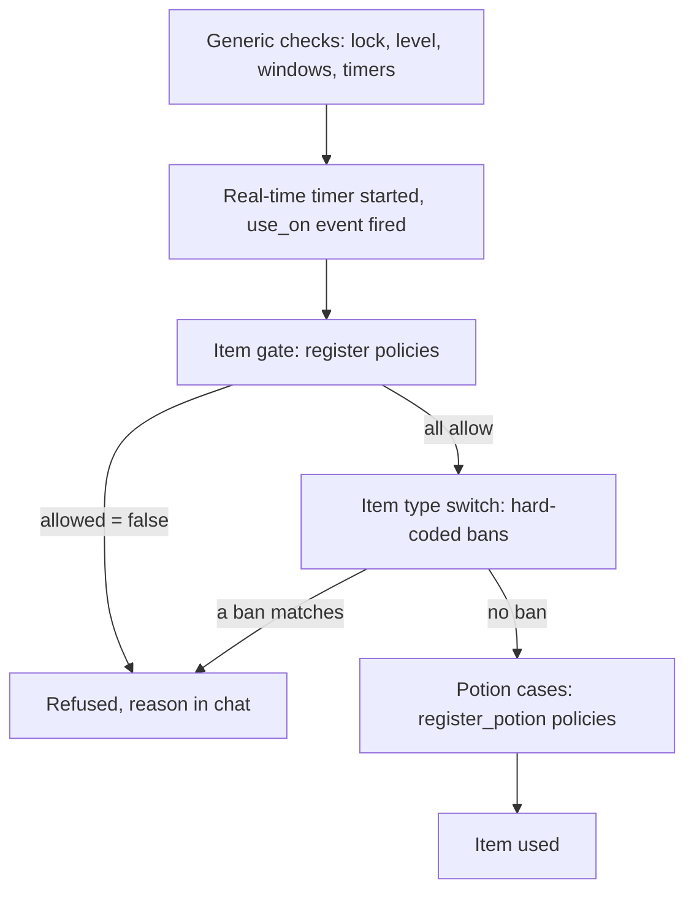

# Item use policy reference

An item use policy is a rule you register from Lua that can refuse an item. It is a guard that says which characters the rule is about, and a policy function that returns a verdict table. There are two kinds: `register` gates any item before it is used, and `register_potion` gates HP and SP recovery and can scale the amount. You reach for it when a map, an arena or an event needs its own item rules.

A policy only adds refusals. It runs next to the bans already written in the engine and cannot lift any of them, see [What stays in the engine](#what-stays-in-the-engine).

## Quick start

`trial_map_items.forge` forbids two item vnums on one map, the firecracker 50100 and the cape of courage 70038, and tells the player why. Every other item and every other map is left alone.

```forge
forge trial_map_items begin
    environment game begin
        local TRIAL_MAP = 1
        local BLOCKED = { [50100] = true, [70038] = true }

        local handle = forge.sys.game.item_use_policy.register(
            "trial_map_items",
            function(ch)
                return ch:get_map_index() == TRIAL_MAP
            end,
            function(ch, item)
                if BLOCKED[item:get_vnum()] then
                    return { allowed = false, reason = "Not on this map." }
                end
                return { allowed = true }
            end)

        forge.sys.log(0, "registered, handle " .. handle)
        return { handle = handle }
    end
end
```

Add the file to the compiler list, compile, restart the game cores. The syslog shows `[OK] CItemUsePolicy::RegisterItemUse : [trial_map_items] handle=<n>`. A player on map 1 who uses one of the two vnums gets `Not on this map.` in the chat and the item stays in the inventory. `<n>` depends on how many policies registered before this one, of both kinds.

## Files and setup

A policy has no file of its own and no config key. It lives in whatever forge, quest or referee registers it, and it exists only in the Lua state of a game core.

- `forge.sys.game.item_use_policy` exists on game cores only. A rule registered on the core that hosts one map does not apply to a map hosted elsewhere.
- Compile and register the file as for any forge, see [Forge API reference](/docs/core/luna-forge). Forges are not reloaded: after a change, restart the game cores.
- Registrations are not saved. After a restart only the policies that register again exist.
- Item use policies and potion policies are two lists. A handle from either one is accepted by `unregister`, and handles come from one counter, so they never collide.
- A registration lands in one of two places: the forge environment body at load (a rule that holds for the whole life of the core), or a function the engine calls at the start and the end of something, such as an arena referee method that registers when a match is prepared and unregisters when it is destroyed.

The shipped content uses both places:

| Policy | Kind | Registered | Unregistered |
| --- | --- | --- | --- |
| Battle royale item allowlist | `register` | in `BattleRoyale:new()`, at forge load | never; its guard reads the live match table |
| Arena referee potion budget | `register_potion` | when the arena is prepared for the match | when the arena is destroyed |
| Ballemup and mayhem arena potion rules | `register_potion` | through the arena referee base, like the budget | when the arena is destroyed |

## API

### `forge.sys.game.item_use_policy`

| Name | Signature | Returns | Context | What it does |
| --- | --- | --- | --- | --- |
| `register` | `register(name, guard, policy)` | `number` handle, greater than 0 | game core, outside any guard or policy | Appends an item gate to the end of the item list. |
| `register_potion` | `register_potion(name, guard, policy)` | `number` handle, greater than 0 | game core, outside any guard or policy | Appends a potion gate to the end of the potion list. |
| `unregister` | `unregister(handle)` | `boolean` | game core, outside any guard or policy | Removes the policy. `true` when found, `false` for an unknown handle. |

Parameters of `register` and `register_potion`:

| Parameter | Type | Meaning |
| --- | --- | --- |
| `name` | `string` | Shown in the log lines of this policy. Never compared: duplicates are allowed and they are two policies. |
| `guard` | `fun(ch): boolean` | "Does this policy apply to this character?" Called for every check of its kind, before `policy`. |
| `policy` | `fun(ch, item): table` for `register`, `fun(ch, item, point, amount): table` for `register_potion` | Called only when `guard` returned `true`. Returns a verdict table. |

Scope is the guard and nothing else. A map rule guards on `ch:get_map_index()`, a rule for one character on `ch:get_player_id()`, a rule for everyone returns `true`. There is no priority parameter and no replace-by-name. A `guard` or `policy` that is not a function stops the call with `item_use_policy.register: guard is not callable` or `item_use_policy.register: policy is not callable`; `register_potion` raises the same text. Inside a forge environment body that error fails the forge load, and then the game core does not start. From Lua, `register` never returns 0.

Both callables stay alive until `unregister`, so closures and upvalues work.

### Item verdict

Returned by the `register` policy.

| Field | Type | Meaning |
| --- | --- | --- |
| `allowed` | `boolean` | `false` refuses the use. Anything else, including a missing field, allows it. |
| `reason` | `string` | Chatted to the player on a refusal. Missing or empty gives `You can't use this item.` |

### Potion verdict

Returned by the `register_potion` policy. The policy receives `point`, the `point` constant being restored, and `amount`, the recovery already scaled by the policies before it.

| Field | Type | Meaning |
| --- | --- | --- |
| `allowed` | `boolean` | `false` refuses the recovery. Anything else allows it. |
| `amount` | `number` | The recovery to apply. Missing leaves the `amount` you received unchanged. Return a whole number. |
| `reason` | `string` | Chatted to the player on a refusal. Missing or empty means a silent refusal. Never shown on an allowed verdict. |
| `stop` | `boolean` | On a refused auto-potion tick: `true` switches the auto-potion off, `false` only skips this tick. Missing means `true`. Ignored on manual drinking and on arming. |

The `point` values a policy sees:

| `point` | When |
| --- | --- |
| `point.HP`, `point.SP` | instant potions |
| `point.HP_RECOVERY`, `point.SP_RECOVERY` | over-time potions, arming an auto-potion, and every auto-potion tick |

### C++ registration

Engine code registers on the same two lists through the singleton `CItemUsePolicy`. The guard and the policy are plain functions of the character and the item, and the verdict is a struct, not a table.

| Call | Signature | Returns | Native registrants |
| --- | --- | --- | --- |
| `RegisterItemUse` | `RegisterItemUse(std::string name, GuardFn guard, ItemUseFn policy)` | `handle_t` (`uint64_t`), `0` for a null function | none |
| `RegisterPotion` | `RegisterPotion(std::string name, GuardFn guard, PotionFn policy)` | `handle_t` (`uint64_t`), `0` for a null function | none |
| `Unregister` | `Unregister(handle_t)` | `bool`, `false` for an unknown handle | not applicable |

Both doors are open and nothing ships through them: every shipped item and potion rule is Lua, and the other item rules are the hard-coded branches in the next section. The types a native registrant uses:

```cpp
using GuardFn   = std::function<bool(CHARACTER*)>;
using ItemUseFn = std::function<ItemUseVerdict(CHARACTER*, LPITEM)>;
// point: the POINT_* being restored. amount: the recovery amount, fed
// in already-chained from prior policies.
using PotionFn  = std::function<PotionVerdict(CHARACTER*, LPITEM, int point, int amount)>;
using handle_t  = uint64_t;
```

```cpp
struct ItemUseVerdict
{
    bool        allowed = true;
    std::string reason;            // chatted to the player on deny ("" => generic text)
};

struct PotionVerdict
{
    bool        allowed = true;
    int         amount  = 0;       // possibly-scaled recovery amount (valid when allowed)
    std::string reason;
    bool        stop    = true;    // on auto-tick deny: tear down vs deny-only
};
```

A C++ policy returns its struct directly. The decoding rules below apply to Lua verdicts only. In particular the Lua side seeds `amount` from the input, and a C++ potion policy gets no such help: a `PotionVerdict` with `amount` left at 0 recovers nothing, so copy the incoming `amount` into it. Native and Lua registrations share one vector per kind, and the registration order is the resolution order.

## Behaviour

### Resolution

For each kind, the engine walks the list in registration order. For every policy it calls the guard; when the guard returns `true` it calls the policy. The first verdict with `allowed = false` ends the walk and the item or the recovery is refused. Policies after it are not called. If no guard matched, the engine behaves as if the list were empty. A policy can never answer "yes, over the others": there is no allow that beats a deny.

Potion policies add one rule. Each policy receives the `amount` the previous one returned, and the final `amount` is what the engine recovers. A global policy that halves and a map policy that halves give a quarter. A refusal drops the amount and stops the chain.

### What the verdict reads

A Lua verdict is decoded field by field, and a field that is missing or has the wrong type keeps its default: `allowed` true, `reason` empty, `stop` true, `amount` the one you received. So these all allow: `{}`, `{ allowed = nil }`, `{ allowed = 0 }`, `{ allowed = "no" }`. Only the boolean `false` refuses.

What goes wrong in your own code fails in a fixed direction, and the direction depends on where it goes wrong:

| What fails | Result |
| --- | --- |
| The guard raises an error or returns anything but a boolean | The policy is skipped for that call. Its refusal never applies. |
| The policy raises an error | Allowed. For a potion the amount is unchanged. |
| The policy returns anything but a table, or nothing | Allowed, as above. |

A bug never refuses. Every failing call logs to syserr:

```text
Bridge::ValidateProcessorInvocation lua error: <Lua error message>
Bridge::ValidateProcessorInvocation wrong return: expected [table], got [nil]
Bridge::ValidateProcessorInvocation wrong return: expected [boolean], got nothing
[item_use_policy <name>] lua callback error
[item_use_policy <name> guard] lua callback error
```

Registration and removal are logged to syslog; an unknown handle goes to syserr:

```text
[OK] CItemUsePolicy::RegisterItemUse : [<name>] handle=<n>
[OK] CItemUsePolicy::RegisterPotion : [<name>] handle=<n>
[OK] CItemUsePolicy::Unregister : [<name>] handle=<n>
CItemUsePolicy::Unregister : unknown handle=<n>
```

The `reason` is chatted as written, so pass a locale string, not a key. Only the empty-reason fallback `You can't use this item.` is translated by the engine.

### Where the engine asks

The guard and the policy run synchronously on the core's main thread, inside the item use. Return at once and do not yield.

An item use goes through its generic checks first: handling rights, the use delay, trading windows, inventory lock, level limits, class and sex limits. Then it starts the real-time timer of the item if it has one, fires the `use_on` quest event when the item was dropped onto another item, and only then asks the item gate. Every item type passes the gate, quest items and equipment included, so a refusal also stops the quest `use` event of that item, and a policy that refuses every item also stops the player wearing or taking off gear by using it (dragging it to a slot is not an item use). Only the use path is gated: an item consumed by a quest or by engine code never reaches it. After the gate the item type switch runs and with it the situational bans of the next section.



The potion policies are asked at these places:

| Place | `point` | Notes |
| --- | --- | --- |
| Instant potion, each recovery component | `HP` or `SP` | An HP absolute, an HP percent, an SP absolute and an SP percent value are four separate asks. A component is asked only when the item has it and the character is not full. The `amount` includes the potion bonus for the two absolute values and not for the two percent values. |
| Over-time potion, SP component then HP component | `SP_RECOVERY`, `HP_RECOVERY` | Asked after the full-recovery check, so a character who is already full never reaches the policy. The `amount` includes the potion bonus. |
| Arming an auto-potion | `HP_RECOVERY` or `SP_RECOVERY` | `amount` is 0, a probe: a refusal here stops the elixir from arming, instead of letting it disable itself on the first tick. `stop` is not read. The probe runs on every use of an elixir, so a refusal also stops the player from switching an armed elixir off by using it again. |
| Auto-potion tick | `HP_RECOVERY` or `SP_RECOVERY` | Once per second for each armed auto type, and once when the auto-potion is armed. `amount` is the gap to full and can be 0 or negative; the engine recovers only a positive amount. |

### What the player sees

| Path | Refusal with `reason` | Refusal without `reason` | Item consumed |
| --- | --- | --- | --- |
| Item gate | the reason in chat | `You can't use this item.` | no |
| Instant potion, every component refused | the reason in chat, the use is reported as failed | nothing in chat, and the use is reported as done | no |
| Instant potion, some components refused | nothing | nothing | yes, one potion for the components that went through |
| Over-time potion, every component refused | the reason in chat | nothing | no |
| Arming an auto-potion | the reason in chat | `You can't use this item.` | no |
| Auto-potion tick, `stop` true or missing | the reason, and the auto-potion switches off | the auto-potion switches off silently | the elixir stays, unlocked |
| Auto-potion tick, `stop = false` | the reason, every second | nothing, this tick recovers nothing | no |

A switched-off auto-potion has to be armed again by the player. Use `stop = false` for a temporary refusal (a budget, a phase of a match) and leave it out for a ban.

### What stays in the engine

The policy is additive. These refusals are written in the item use code and run whatever you register. A policy that answers `{ allowed = true }` for one of them changes nothing; to allow them, the engine branch has to go.

| Condition | Applies to | Player text |
| --- | --- | --- |
| Arena map | fish | You can't use this item. |
| Arena map | the China firework 50107 and the spin top 50108 | You can't use this item. |
| Arena map | return scrolls and return memories | You can't use this item. |
| Map 200 or map 113 | return scrolls and return memories | You can not use it here. |
| In a duel, and the event flag `no_duel_potion` is above 0 or the vnum is 27863 to 27883 | potions, all three kinds | You cannot do this in a duel. |
| In a duel | auto-potions | You cannot do this in a duel. |
| Either spouse on an arena map, on a war map, or in a dungeon | marriage rings | You can't use this item. |
| Map 113 (the OX event) | Christmas flies 100759 to 100764, firecrackers 50100 to 50106, firecracker 71013 (silent) | You can not use it here. |
| Map 113 or a war map | invisibility | You can not use it here. |
| In a dungeon | return memory, when it is used to mark a position | `%s cannot be used in a dungeon.` |

Before the gate, the generic checks include the summon-zone rule: summon items are refused where the map does not allow summoning.

## Examples

### An allowlist: everything else is refused

The battle royale item rule is written as an allowlist, and its fallthrough returns `{}`, which allows. The corrected shape refuses explicitly. Only the listed vnums are usable on the map, and gear cannot be put on or taken off there by using it: add the equipment you want to allow.

```forge
forge item_allowlist begin
    environment game begin
        local MATCH_MAP = 1
        local ALLOWED = { [100008] = true, [100009] = true, [100010] = true }

        local handle = forge.sys.game.item_use_policy.register(
            "item_allowlist",
            function(ch)
                return ch:get_map_index() == MATCH_MAP
            end,
            function(ch, item)
                if ALLOWED[item:get_vnum()] then
                    return { allowed = true }
                end
                return { allowed = false, reason = "You can't use that here." }
            end)

        return { handle = handle }
    end
end
```

### Only one potion heals

A potion policy that refuses every potion but one and gives the reason. The reason matters: without it an instant potion refusal is silent and still counts as a use (see the pitfalls).

```forge
forge one_potion begin
    environment game begin
        local ONLY_POTION = 27002
        local MATCH_MAP = 1

        local handle = forge.sys.game.item_use_policy.register_potion(
            "one_potion",
            function(ch)
                return ch:get_map_index() == MATCH_MAP
            end,
            function(ch, item, point_type, amount)
                if item ~= nil and item:get_vnum() == ONLY_POTION then
                    return { allowed = true, amount = amount }
                end
                return { allowed = false, reason = "Only the red potion heals here." }
            end)

        return { handle = handle }
    end
end
```

### A recovery budget per player

A budget in total HP and SP recovered, shared by instant and over-time potions, with the last drink clamped so the total lands on the cap. The refusal sets `stop = false`, so an armed auto-potion survives and only skips ticks. The policy leaves non-positive amounts alone, because the tick asks with the gap to full and that gap can be 0 or negative.

```forge
forge potion_budget begin
    environment game begin
        local MATCH_MAP = 1
        local CAP = 10000
        local spent = {}

        local handle = forge.sys.game.item_use_policy.register_potion(
            "potion_budget",
            function(ch)
                return ch:get_map_index() == MATCH_MAP
            end,
            function(ch, item, point_type, amount)
                if amount <= 0 then
                    return { amount = amount }
                end

                local is_hp = (point_type == point.HP or point_type == point.HP_RECOVERY)
                local key = ch:get_player_id() .. (is_hp and ":hp" or ":sp")
                local used = spent[key] or 0
                local remaining = CAP - used

                if remaining <= 0 then
                    return { allowed = false, stop = false }
                end

                local granted = math.min(amount, remaining)
                spent[key] = used + granted
                return { allowed = true, amount = granted }
            end)

        return { handle = handle }
    end
end
```

### A rule tied to a match

Register when the match is set up and unregister when it ends. Keep the handle and refuse to register while you hold one.

```forge
forge match_items begin
    environment game begin
        local Match = {}
        Match.__index = Match

        function Match:new(map_index)
            return setmetatable({ map_index = map_index, handle = nil }, Match)
        end

        function Match:start()
            if self.handle ~= nil then
                return false
            end
            local map_index = self.map_index
            self.handle = forge.sys.game.item_use_policy.register(
                "match:" .. map_index,
                function(ch)
                    return ch:get_map_index() == map_index
                end,
                function(ch, item)
                    return { allowed = false, reason = "No items during the match." }
                end)
            return true
        end

        function Match:finish()
            if self.handle == nil then
                return false
            end
            local removed = forge.sys.game.item_use_policy.unregister(self.handle)
            self.handle = nil
            return removed
        end

        return { Match = Match }
    end
end
```

## Pitfalls

**The allowlist restricts nothing.** A policy that returns `{ allowed = true }` for the listed items and `{}` for the rest allows everything, because `{}` allows. Only the boolean `false` refuses. End the fallthrough with `{ allowed = false, reason = ... }`.

**A broken policy permits, a broken guard disables its own rule.** A policy that raises or returns a non-table allows. A guard that raises or returns a non-boolean (a vnum, `1`, an object) is skipped on every call. Both log per call, so a typo shows up in syserr as a flood with your policy name in it. Test with syserr open.

**You cannot allow what the engine bans.** Duel potions, the OX map, arenas, war maps and dungeons are refused before your verdict could matter. `{ allowed = true }` is the default, not an override.

**A silent refusal of an instant potion counts as a use.** When every component is refused and the reason is empty, nothing recovers and nothing is consumed, but the engine reports the use as done: the use metric and the use delay run, and so does the item log for an item flagged for it. Always give the refusal of an instant potion a `reason`. Over-time potions report a failure either way.

**The budget goes wrong because the policy runs once per component.** An instant potion with an HP and an SP value asks twice, once with each `point`. A counter that decrements in the policy counts per component, not per drink. Key the counter by resource, as the budget example does.

**The auto-potion drains, or a budget refunds.** The tick asks every second, even when the character is full, with an `amount` that can be 0 or negative. A policy that returns a fixed `amount` instead of scaling the one it received recovers on every tick and spends the elixir. A budget that adds `amount` without a guard on `amount <= 0` can go down on a negative gap.

**The player has to arm the auto-potion again.** A refusal on a tick without `stop` switches it off, because `stop` defaults to `true`. Say `stop = false` when the refusal is meant to pass.

**The reason is chatted every second.** With `stop = false` and a `reason`, a refused auto-potion tick sends the reason on every tick while the refusal lasts. Leave the reason out there.

**A refused item still started its timer.** The real-time clock of an item with a first-use timer starts, and its `use_on` quest event fires, before the gate. A refused first use still costs the item that.

**Every guard runs on every use.** Every item use, every potion component and every auto-potion tick calls the guard of every registration. Keep guards to a table lookup or a compare, as the shipped ones do.

**A second `register` adds a second policy.** Names are not compared. If you overwrite the stored handle, the first policy is lost for good and only a core restart removes it.

**Calling `register` or `unregister` from inside a guard or a policy.** The lists are walked while they call them, and nothing protects that walk. Register from a load, an event or a command.

**A per-match rule that is never unregistered keeps matching.** A guard that captures a match stays on the list, with its closure, until the core stops. Unregister it with the thing it judges, as the arena referee does when the arena is destroyed.

**A rule registered on one core does not hold on another.** Registrations are per core process. Restart the game cores to pick up a changed forge.

**Returning fractions.** `amount` is read as a whole number. Return `math.floor(amount * 0.5)` or `amount // 2`, never a bare fraction.

## See also

- [Battle arbiter reference](/docs/building-blocks/battle-arbiter): the same guard and registry pattern for attacks.
- [Forge API reference](/docs/core/luna-forge): file layout, environments and load order.
- [The bridge](/foundations/luna/bridge): how Lua callbacks cross into the engine and why a wrong return falls to a safe default.
