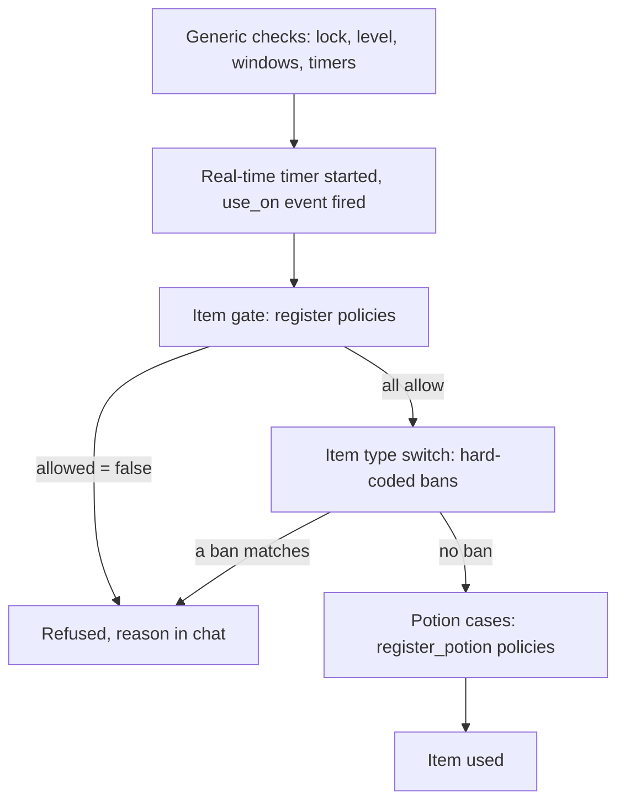

# Item use policy: behaviour

Item and potion gates run on the game core that registered them. See the [API reference](/docs/building-blocks/item-use-policy) and [Policies glossary](/docs/building-blocks#policies-glossary).

### Resolution

For each kind, the engine walks the list in registration order within one core. Across forges, registration follows forge load order, which is not guaranteed. For every policy it calls the guard; when the guard returns `true` it calls the policy. The first verdict with `allowed = false` ends the walk and the item or the recovery is refused. Policies after it are not called. If no guard matched, the engine behaves as if the list were empty. A policy can never answer "yes, over the others": there is no allow that beats a deny.

Potion policies add one rule. Each policy receives the `amount` the previous one returned, and the final `amount` is what the engine recovers. A global policy that halves and a map policy that halves give a quarter. A refusal drops the amount and stops the chain.

### What the verdict reads

A Lua verdict is decoded field by field, and a field that is missing or has the wrong type keeps its default: `allowed` true, `reason` empty, `stop` true, `amount` the one you received. So these all allow: `{}`, `{ allowed = nil }`, `{ allowed = 0 }`, `{ allowed = "no" }`. Only the boolean `false` refuses.

What goes wrong in your own code fails in a fixed direction, and the direction depends on where it goes wrong:

| What fails | Result |
| --- | --- |
| The guard raises an error or returns anything but a boolean | The policy is skipped for that call. Its refusal never applies. |
| The policy raises an error | Allowed. For a potion the amount is unchanged. |
| The policy returns anything but a table, or nothing | Allowed, as above. |

A failing call logs to syserr (the server error log) through the [bridge](/foundations/luna/bridge), which calls Lua from the engine:

```text
Bridge::ValidateProcessorInvocation lua error: <Lua error message>
Bridge::ValidateProcessorInvocation wrong return: expected [table], got [nil]
Bridge::ValidateProcessorInvocation wrong return: expected [boolean], got nothing
[item_use_policy <name>] lua callback error
[item_use_policy <name> guard] lua callback error
```

Registration and removal are logged to syslog; an unknown handle goes to syserr:

```text
[OK] CItemUsePolicy::RegisterItemUse : [<name>] handle=<n>
[OK] CItemUsePolicy::RegisterPotion : [<name>] handle=<n>
[OK] CItemUsePolicy::Unregister : [<name>] handle=<n>
CItemUsePolicy::Unregister : unknown handle=<n>
```

The `reason` is chatted as written, so pass a locale string, not a key. Only the empty-reason fallback `You can't use this item.` is translated by the engine.

### Where the engine asks

The PvP arena is the native arena object, rebuilt from the mainline arena manager. The guard and the policy run synchronously on the core's main thread, inside the item use. Return at once and do not yield.

An item use goes through its generic checks first: handling rights, the use delay, trading windows, inventory lock, level limits, class and sex limits. Then it starts the real-time timer of the item if it has one, fires the `use_on` quest event when the item was dropped onto another item, and only then asks the item gate. Every item type passes the gate, quest items and equipment included, so a refusal also stops the quest `use` event of that item, and a policy that refuses every item also stops the player wearing or taking off gear by using it (dragging it to a slot is not an item use). Only the use path is gated: an item consumed by a quest or by engine code never reaches it. After the gate the item type switch runs and with it the situational bans of the next section.

The item path reaches the policy after generic checks and before the type-specific bans.



The potion policies are asked at these places:

| Place | `point` | Notes |
| --- | --- | --- |
| Instant potion, each recovery component | `HP` or `SP` | An HP absolute, an HP percent, an SP absolute and an SP percent value are four separate asks. A component is asked only when the item has it and the character is not full. The `amount` includes the potion bonus for the two absolute values and not for the two percent values. |
| Over-time potion, SP component then HP component | `SP_RECOVERY`, `HP_RECOVERY` | Asked after the full-recovery check, so a character who is already full never reaches the policy. The `amount` includes the potion bonus. |
| Arming an auto-potion | `HP_RECOVERY` or `SP_RECOVERY` | `amount` is 0, a probe: a refusal here stops the elixir from arming, instead of letting it disable itself on the first tick. `stop` is not read. The probe runs on every use of an elixir, so a refusal also stops the player from switching an armed elixir off by using it again. |
| Auto-potion tick | `HP_RECOVERY` or `SP_RECOVERY` | Once per second for each armed auto type, and once when the auto-potion is armed. `amount` is the gap to full and can be 0 or negative; the engine recovers only a positive amount. |

### What the player sees

| Path | Refusal with `reason` | Refusal without `reason` | Item consumed |
| --- | --- | --- | --- |
| Item gate | the reason in chat | `You can't use this item.` | no |
| Instant potion, every component refused | the reason in chat, the use is reported as failed | nothing in chat, and the use is reported as done | no |
| Instant potion, some components refused | nothing | nothing | yes, one potion for the components that went through |
| Over-time potion, every component refused | the reason in chat | nothing | no |
| Arming an auto-potion | the reason in chat | `You can't use this item.` | no |
| Auto-potion tick, `stop` true or missing | the reason, and the auto-potion switches off | the auto-potion switches off silently | the elixir stays, unlocked |
| Auto-potion tick, `stop = false` | the reason, every second | nothing, this tick recovers nothing | no |

A switched-off auto-potion has to be armed again by the player. Use `stop = false` for a temporary refusal (a budget, a phase of a match) and leave it out for a ban.

### What stays in the engine

The Metin2 mainline engine hard-codes these refusals. An allowed verdict cannot override them. A duel is a player-versus-player contest; see the [Policies glossary](/docs/building-blocks#policies-glossary).

| Condition | Applies to | Player text |
| --- | --- | --- |
| PvP arena map | fish | You can't use this item. |
| PvP arena map | items 50107 and 50108 | You can't use this item. |
| PvP arena map | return scrolls and return memories | You can't use this item. |
| Map 200 or map 113 | return scrolls and return memories | You can not use it here. |
| In a duel: any potion when event flag `no_duel_potion` is above 0; item vnums 27863 to 27883 always | potions, all three kinds | You cannot do this in a duel. |
| In a duel | auto-potions | You cannot do this in a duel. |
| Either spouse on an PvP arena map, on a war map, or in a dungeon | marriage rings | You can't use this item. |
| Map 113 (the OX event) | items 100759 to 100764, firecrackers in the restricted range, item 71013 (silent) | You can not use it here. |
| Map 113 or a war map | invisibility | You can not use it here. |
| In a dungeon | return memory, when it is used to mark a position | `%s cannot be used in a dungeon.` |

Before the gate, the generic checks include the summon-zone rule: summon items are refused where the map does not allow summoning.

## Pitfalls

**The allowlist restricts nothing.** A policy that returns `{ allowed = true }` for the listed items and `{}` for the rest allows everything, because `{}` allows. Only the boolean `false` refuses. End the fallthrough with `{ allowed = false, reason = ... }`.

**A broken policy permits, a broken guard disables its own rule.** A policy that raises or returns a non-table allows. A guard that raises or returns a non-boolean (a vnum, `1`, an object) is skipped on every call. Both log per call, so a typo shows up in syserr as a flood with your policy name in it. Test with syserr open.

**You cannot allow what the engine bans.** Duel potions, the PvP arena, event maps, war maps, and dungeons can have engine refusals. `{ allowed = true }` is the default, not an override.

**A silent refusal of an instant potion counts as a use.** When every component is refused and the reason is empty, nothing recovers and nothing is consumed, but the engine reports the use as done: the use metric and the use delay run, and so does the item log for an item flagged for it. Always give the refusal of an instant potion a `reason`. Over-time potions report a failure either way.

**The budget goes wrong because the policy runs once per component.** An instant potion with an HP and an SP value asks twice, once with each `point`. A counter that decrements in the policy counts per component, not per drink. Key the counter by resource, as the budget example does.

**The auto-potion drains, or a budget refunds.** The tick asks every second, even when the character is full, with an `amount` that can be 0 or negative. A policy that returns a fixed `amount` instead of scaling the one it received recovers on every tick and spends the elixir. A budget that adds `amount` without a guard on `amount <= 0` can go down on a negative gap.

**The player has to arm the auto-potion again.** A refusal on a tick without `stop` switches it off, because `stop` defaults to `true`. Say `stop = false` when the refusal is meant to pass.

**The reason is chatted every second.** With `stop = false` and a `reason`, a refused auto-potion tick sends the reason on every tick while the refusal lasts. Leave the reason out there.

**A refused item still started its timer.** The real-time clock of an item with a first-use timer starts, and its `use_on` quest event fires, before the gate. A refused first use still costs the item that.

**Every guard runs on every use.** Every item use, every potion component and every auto-potion tick calls the guard of every registration. Keep guards to a table lookup or a comparison.

**A second `register` adds a second policy.** Names are not compared. If you overwrite the stored handle, the first policy is lost for good and only a core restart removes it.

**Calling `register` or `unregister` from inside a guard or a policy.** The lists are walked while they call them, and nothing protects that walk. Register from a load, an event or a command.

**A per-match rule that is never unregistered keeps matching.** A guard that captures a match stays on the list, with its closure, until the core stops. Unregister it with the thing it judges, when the match ends.

**A rule registered on one core does not hold on another.** Registrations are per core process. Restart the game cores to pick up a changed forge.

**Returning fractions.** `amount` is read as a whole number. Return `math.floor(amount * 0.5)` or `amount // 2`, never a bare fraction.

Next: [Item use policy examples](/docs/building-blocks/item-use-policy/examples).
