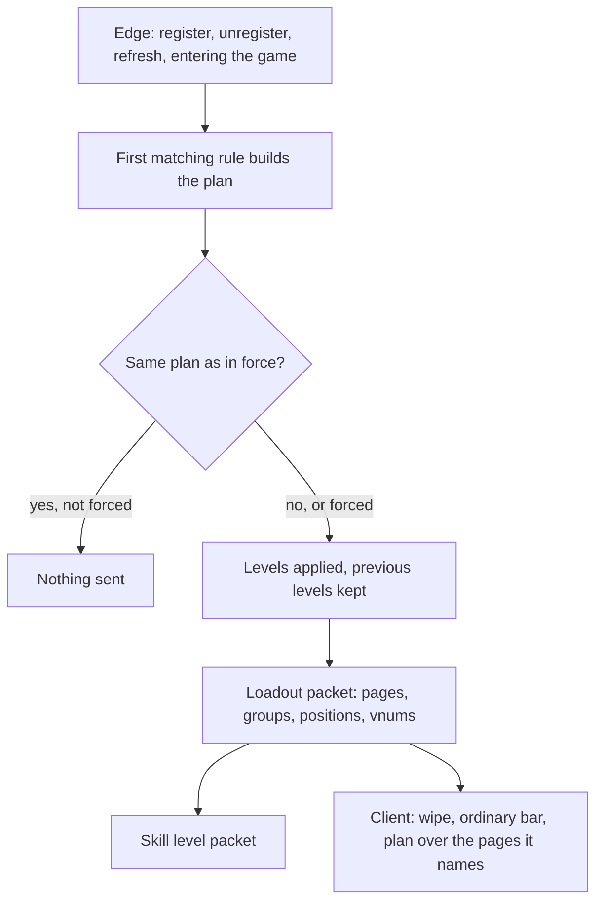

# Skill loadout policy reference

A skill loadout is a rule you register from Lua that decides which skills a character holds and in which cell of the skill window each one sits. It is a guard that says which characters the rule owns and a builder function that returns a plan: the pages it speaks for, and the skills on them with a position and a level. You reach for it when a mode needs a bar no ordinary character could have: an arena where everybody holds the same one skill at level 40, a test session with any skill on any page, a trial with a fixed kit.

The loadout policy is the heir of the inherited engine's job and skill group table, the literal answer to "which skills does this character hold". That table is still the default; a loadout overrides it while it is in force. For why it is sampled at edges and not asked on every cast, and how it relates to the use policy and the skill policy, see [Loadout, use and skill policies](/foundations/skills/policies).

## Quick start

`trial_kit.forge` gives every character on map 1 one skill, skill 31 at level 40, in the first cell of the active page. Every other page keeps the ordinary bar and every other map is left alone.

```forge
forge trial_kit begin
    environment game begin
        local TRIAL_MAP = 1

        local handle = forge.sys.game.skill_loadout.register(
            "trial_kit",
            function(ch)
                return ch:get_map_index() == TRIAL_MAP
            end,
            function(ch)
                return {
                    pages = { { id = "ACTIVE", layout = "flat" } },
                    skills = { { page = "ACTIVE", slot = 1, vnum = 31, level = 40 } },
                }
            end)

        forge.sys.log(0, "registered, handle " .. handle)
        return { handle = handle }
    end
end
```

Add the file to the compiler list, compile, restart the game cores. Every character online is rebuilt at once, and a character that enters the game later is rebuilt on entry. A character on map 1 sees only skill 31 on the active page, castable at level 40. The support, horse and specialization pages are the ordinary ones. Leaving the map does not take the plan away by itself, see [When the plan is rebuilt](#when-the-plan-is-rebuilt).

## Files and setup

A loadout has no file of its own and no config key. It lives in whatever forge, quest or referee registers it, and it exists only in the Lua state of a game core.

- `forge.sys.game.skill_loadout` exists on game cores only. A rule registered on the core that hosts one map does not apply to a map hosted elsewhere.
- Compile and register the file as for any forge, see [Forge API reference](/docs/core/luna-forge). Forges are not reloaded: after a change, restart the game cores.
- Registrations are not saved. After a restart only the loadouts that register again exist.
- A registration lands in one of two places: a forge environment body or a `when boot` handler (a rule that holds for the whole life of the core), or a function the engine calls at the start and the end of something, which registers on one side and unregisters on the other. The arena minigame registers its loadout when a match is set up and unregisters it when the match ends.
- The helper functions `next_free`, `grant_next`, `grant_default` and the tables `PAGES` and `PAGE_DEFAULTS` come from the content library `Locale/italy/libs/forge_extensions/game/skill_loadout.lua`, not from the engine. They exist wherever that library is loaded; see [Helpers from the content library](#helpers-from-the-content-library).
- The skill window of the client has to know the page names. Pages are fixed by the client script `root/uicharacter.py` (`SKILL_PAGE_GEOMETRY`), not by the server.

The shipped content registers it in two places:

| Loadout | Registered | Unregistered |
| --- | --- | --- |
| `ballemup:<arena id>`, one skill at ACTIVE position 1 for the characters of an arena | when the match is set up | when the match ends |
| `trait_test`, any plan a tester asked for | once, when the test forge loads | never |

## API

### `forge.sys.game.skill_loadout`

| Name | Signature | Returns | Context | What it does |
| --- | --- | --- | --- | --- |
| `register` | `register(name, guard, builder)` | `number` handle, greater than 0 | game core, outside any guard or builder | Appends a loadout rule to the end of the list and rebuilds every character online. |
| `unregister` | `unregister(handle)` | `boolean` | game core, outside any guard or builder | Removes the rule and rebuilds every character online. `true` when found, `false` for an unknown handle. |
| `refresh` | `refresh(ch)` | `boolean` | game core | Re-runs the rules for one character and pushes the difference. `true` when the plan changed. |
| `has` | `has(ch)` | `boolean` | game core | Whether a plan is in force on this character. |
| `plan` | `plan(preset)` | `PLAN` table | game core | Builds a plan procedurally. With a preset it returns a deep copy of it; without, an empty plan. |

Parameters of `register`:

| Parameter | Type | Meaning |
| --- | --- | --- |
| `name` | `string` | Cosmetic. It appears in the log lines of this rule and is never compared: duplicates are two rules. |
| `guard` | `fun(ch): boolean` | "Does this rule own this character?" Required. `true` makes the rule the loadout of `ch`. |
| `builder` | `fun(ch): PLAN` | Called when the guard returned `true`. Returns the plan as a plain table. Required. |

Scope is the guard. A map rule guards on `ch:get_map_index()`, a rule for an arena on `ch:get_pvp_arena()`, a rule for one character on `ch:get_player_id()`. There is no priority parameter and no replace-by-name. A `guard` or `builder` that is not a function stops the call with `skill_loadout.register: guard is not callable` or `skill_loadout.register: builder is not callable`, before anything is registered. Inside a forge environment body that error fails the forge load, and then the game core does not start.

Handles start at 1 and grow by one per registration. They are never reused. Both callables stay alive until `unregister`, so closures and upvalues work. The handle is the only way to remove a rule. The Lua `register` never returns 0: the engine returns 0 only when a guard or builder is empty, and Lua has already refused those.

`plan(preset)` returns a table with two extra methods, `page` and `grant`. Both return the plan itself, so calls chain.

| Method | Signature | What it does |
| --- | --- | --- |
| `PLAN:page` | `page(id, opts)` | Appends a page to `pages`. `opts` is `{ layout = "flat" or "tabbed", groups = GROUP[] }`, copied. |
| `PLAN:grant` | `grant(page, slot, vnum, level)` | Appends a skill to `skills`. |

`register` takes a plain table as well. `plan()` is for assembling a bar in a loop or tweaking a preset per character.

### The ctx: what the callables receive

| Callable | Arguments | Notes |
| --- | --- | --- |
| `guard` | `ch` | The character being rebuilt. Players only: the engine never rebuilds a mob's loadout. |
| `builder` | `ch` | The same character. There is no table of context fields, only the character; anything more is read from it. |

### The plan

What the builder returns. Both fields are optional: a table with neither is an empty plan, which means "no loadout" and puts the character back.

| Field | Type | Meaning |
| --- | --- | --- |
| `pages` | `PAGE[]` | The pages this plan speaks for. |
| `skills` | `SKILL[]` | The skills the character holds, each at a position on a page. |

A plan speaks for the pages it names. A page is named when it is in `pages` or when a skill in `skills` has it as `page`. A named page is replaced whole by the client: its cells are emptied and only the plan's skills are put back. A page the plan never mentions keeps the ordinary bar, layout and levels alike.

`PAGE`:

| Field | Type | Default | Meaning |
| --- | --- | --- | --- |
| `id` | `string` | none, required | `"ACTIVE"`, `"SPEC"`, `"SUPPORT"` or `"HORSE"`. An empty id refuses the whole plan. |
| `layout` | `string` | `"flat"` | `"flat"` or `"tabbed"`. Anything other than `"tabbed"` is flat. |
| `groups` | `GROUP[]` | none | The tabs. Sent only when the page is tabbed; ignored otherwise. |

`GROUP`, one tab of a tabbed page:

| Field | Type | Default | Meaning |
| --- | --- | --- | --- |
| `label` | `string` | empty | The text shown on the tab. |
| `gate_slot` | `number` | 0 | The position whose skill, when it has a level, makes the tab appear. |
| `slots` | `number[]` | none | The positions the tab windows onto. |

`SKILL`:

| Field | Type | Default | Meaning |
| --- | --- | --- | --- |
| `page` | `string` | none, required | The page id. An empty page refuses the whole plan. |
| `slot` | `number` | 0 | A 1-based position on the page, not an interface slot. Two pages may both have a position 1. |
| `vnum` | `number` | 0 | The skill. Vnum 0 refuses the whole plan. |
| `level` | `number` | 0 | 0 to 40. The stock client casts a skill only from level 1 up; the server clamps anything above 40 to 40. |

Page capacities, as positions that exist on the page:

| Page | Positions | Notes |
| --- | --- | --- |
| `ACTIVE` | 6 | |
| `HORSE` | 6 | |
| `SUPPORT` | 12 | |
| `SPEC` | 12 | Four tabs of three. A page declared flat draws only the first three. |

The server does not check capacity. A position past what the page draws is applied (the level is written) and never shown, and a position of 0 or past 12 for `SPEC` is logged by the client and skipped. Stay inside the table above.

### Helpers from the content library

These are Lua functions and tables of the content library, not engine functions. They make a builder shorter and keep it from counting positions by hand.

| Name | Signature | What it does |
| --- | --- | --- |
| `PAGES` | table | Positions per page, `flat` and `tabbed`. A mirror of the client geometry. |
| `PAGE_DEFAULTS` | table | The ordinary `SUPPORT` and `HORSE` vnums, cell for cell. `0` is a cell left empty. |
| `next_free` | `next_free(plan, page)` | The lowest unused position on `page`, or `nil` when the page is unknown or full. |
| `PLAN:grant_next` | `grant_next(page, vnum, level)` | Grants at the first free position, declaring the page flat when it was not declared. Returns the plan, or `nil` and a log line when the page is full. |
| `PLAN:grant_default` | `grant_default(page, ch, opts)` | Lays the ordinary `SUPPORT` or `HORSE` bar onto the page. `opts.level` fixes the level, otherwise each skill keeps the level the character holds; `opts.vnums` replaces the canned list. |

`PAGES` is a mirror, not a second authority: it only keeps a builder from writing a bar the player cannot see. Keep it in step with the client geometry.

### C++ registration

Engine code registers on the same list through the singleton `CSkillLoadout`. The guard is a plain function, and the builder fills a plan struct instead of returning a table.

| Call | Signature | Returns |
| --- | --- | --- |
| `Register` | `Register(std::string name, GuardFn guard, BuilderFn builder)` | `handle_t` (`uint64_t`), `INVALID_HANDLE` (0) when the guard or the builder is empty |
| `Unregister` | `Unregister(handle_t)` | `bool`, `false` for an unknown handle |
| `Refresh` | `Refresh(LPCHARACTER ch, bool bForce = false)` | `bool`, `true` when the plan changed. `bForce` sends even when nothing moved. |

Types of a native registrant:

| Type | Definition |
| --- | --- |
| `GuardFn` | `std::function<bool(CHARACTER*)>` |
| `BuilderFn` | `std::function<bool(CHARACTER*, SLoadoutPlan&)>`, returns `false` when it could not build |
| `handle_t` | `uint64_t` |

A null guard or builder is refused with `skill_loadout [<name>]: needs both a guard and a builder` in syserr. Unlike the use policy, a null guard does not mean every character: both are required. The plan is filled through the structs `SLoadoutPlan` (`vecPages`, `vecSkills`), `SLoadoutPage`, `SLoadoutGroup` and `SLoadoutSkill`. The two that carry the fields of the tables above:

```cpp
struct SLoadoutSkill
{
    std::string strPage;
    uint16_t    unSlot  = 0;
    uint32_t    unVnum  = 0;
    uint8_t     bLevel  = 0;
};
```

```cpp
struct SLoadoutGroup
{
    std::string     strLabel;
    uint16_t        unGateSlot = 0;
    std::vector<uint16_t>   vecSlots;
};
```

`SLoadoutPage` has `strId`, `bTabbed` and `vecGroups`. The page and vnum checks of the Lua side (an empty id, vnum 0) are made when a Lua table is read into these structs; a C++ builder fills the structs directly and is not checked. Native and Lua registrations share one list, and the registration order is the resolution order.

Who registers through each door:

| Door | Registrants that ship |
| --- | --- |
| `CSkillLoadout::Register` (C++) | |
| `forge.sys.game.skill_loadout.register` (Lua) | the arena minigame loadout, the test forge |

No native registrant ships: the C++ door exists and nothing in the engine uses it. The Lua binding is the only caller of `Register`; the simulator never registers and only clears the list between probes.

## Behaviour

### Resolution

On every rebuild of a character the engine walks the list in registration order and calls each guard. The first guard that returns `true` owns the character: its builder is called and the walk stops. Later rules are never asked. A character is under one loadout or none, because two plans fighting over one position has no meaning a player could read. If no guard fires, the plan is empty and the character has no loadout.

The engine compares the new plan with the one in force, field by field: pages, groups and skills in order. Nothing is applied or sent when they are equal. A plan that differs is applied to the server state and pushed to the client.

### When the plan is rebuilt

| Edge | Who is rebuilt |
| --- | --- |
| `register` | every character online |
| `unregister` | every character online, not only the holders: dropping the rule is what puts their real skills back |
| `refresh(ch)` | that character |
| The character enters the game phase | that character, forced: the plan is sent even if unchanged |

Only players are rebuilt. A change of map does not rebuild a loadout, unlike the skill policy. A guard that reads the map index, a flag, a level or an affect is therefore only re-read at one of the edges above. When the state your guard or builder reads moves, call `forge.sys.game.skill_loadout.refresh(ch)` on the next line.

The entry edge is forced because the client drops its loadout with the rest of the phase when it changes; a plan that is unchanged on the server still has to be resent. It is also what builds the plan for the first time for a character that has only just been loaded.

### Where the loadout is consulted on the server

A loadout is two separable things. The server has no concept of a slot: skill levels are indexed by vnum, and the cast packet carries a vnum. So:

| Part | Lives | What it is |
| --- | --- | --- |
| The levels | server | Real state of the live character. What the cast checks answer from. |
| The slots | client | Presentation, shipped to the client. A forged slot map buys a wrong icon and nothing else. |

Applying a plan writes each `level` onto the live character through the skill level setter, clamped to 40, and recomputes the character's points. The previous level of every vnum the plan touches is kept, on the first touch only: a second plan does not overwrite the restore point with a level the loadout itself wrote. A skill the old plan raised and the new plan does not name is put back to its kept level. Dropping the plan, by `unregister` or by a guard that stops matching, restores every kept level and clears the plan.

While a plan is in force the engine lifts the skill group membership rule and the specialization membership rule for that character, in both the cast check and the check for which skills a character may learn. Without a loadout a character may cast only the class skills of the group they chose, and only the specializations they hold. A virtual character has the same exemption; a loadout adds it to a real one. The rest of the cast checks are untouched, and the [skill use policy](/docs/building-blocks/skill-use-policy) still runs after them.

A failure is closed: a builder that raises, returns a non-table, or returns a plan with a page without an id or a skill with vnum 0 or an empty page produces an empty plan, and the character keeps the real skills. The refused plan is logged to syserr:

```text
skill_loadout [<name>]: builder failed for pid <player id>
```

A builder that fails does not hand the character to the next rule: the first matching guard owns it, plan or not. A guard that raises or returns anything but a boolean counts as `false`, and the next rule is tried. Both log per call, so a typo shows up as a flood.

Registration and removal write no log line of their own. An unknown handle to `unregister` returns `false` and logs nothing.

### Where the loadout is consulted on the client



Every change is sent as two packets in a fixed order: the loadout first, the skill levels second. The loadout packet carries pages, groups and, for each skill, its page, position and vnum. It carries no level. The client resolves a level by looking its vnum up in its slot table and drops it when there is no slot, so the slots must arrive first. A level packet before the slot map would be thrown away for every skill the loadout added.

On receipt the client:

1. Wipes its whole skill slot data.
2. Lays the ordinary bar down, from its static table, for every page.
3. Calls the install routine of the character window, which empties every page the plan names and writes the plan's skills into it. A page is named when it is declared or holds a skill.

The install routine resolves a position to a slot index in the one place that knows the window: `ACTIVE` starts at slot 1, `HORSE` at 9, `SUPPORT` at 101 and `SPEC` at 220. A page id it does not know is logged as `InstallSkillLoadout: no page named <page>` and a position outside the page as `InstallSkillLoadout: page <page> has no slot <position> (vnum <vnum>)`; the rest of the plan is still installed. The same install runs again when the skill group of the character changes, so the plan is not lost on the way.

With nothing registered a character has no plan, the client runs its static table unchanged, and nothing goes on the wire. A tabbed page shows a tab when the skill at its `gate_slot` position has a level. A flat page draws no tabs: a character that holds passives from two specializations at once has no current one, so such a page declares itself flat.

### What stays in the engine

- The ordinary bar. The group and job table is the default whenever no loadout is in force, and the client static table is laid down first on every change.
- Which positions a page has. They are fixed in the client window script, and `PAGES` only mirrors them.
- The cast checks other than group and specialization membership: owner authority, dead and stunned, riding, rod and pick, weapon limitation, safe zone.
- Persistence. A loadout does not save anything of its own, see [Pitfalls](#a-loadout-on-a-real-character-writes-what-it-grants-when-the-character-is-saved).

## Examples

### One skill on one map

The quick start in its general form. Use it for a trial map where everyone holds one skill. The other pages are left alone because the plan never names them.

```forge
forge trial_one_skill begin
    environment game begin
        local TRIAL_MAP = 1

        return {
            handle = forge.sys.game.skill_loadout.register(
                "trial_one_skill",
                function(ch) return ch:get_map_index() == TRIAL_MAP end,
                function(ch)
                    return {
                        pages = { { id = "ACTIVE", layout = "flat" } },
                        skills = { { page = "ACTIVE", slot = 1, vnum = 31, level = 40 } },
                    }
                end)
        }
    end
end
```

### A shared preset with per-character additions

The preset is a constant shared by every character. `plan` copies it, so the builder can add to the copy without growing anyone else's bar.

```forge
forge preset_kit begin
    environment game begin
        local KIT = {
            pages = { { id = "ACTIVE", layout = "flat" } },
            skills = { { page = "ACTIVE", slot = 1, vnum = 31, level = 40 } },
        }
        local KIT_MAP = 1

        return {
            handle = forge.sys.game.skill_loadout.register(
                "preset_kit",
                function(ch) return ch:get_map_index() == KIT_MAP end,
                function(ch)
                    local p = forge.sys.game.skill_loadout.plan(KIT)
                    p:grant("ACTIVE", 2, 106, 40)
                    if ch:get_level() >= 100 then
                        p:page("SPEC", { layout = "flat" })
                        p:grant("SPEC", 1, 230, 40)
                    end
                    return p
                end)
        }
    end
end
```

The level check is read when the plan is rebuilt, not when the character levels up. Call `refresh(ch)` after a level change if the bar must follow it, see [Pitfalls](#a-guard-or-builder-reads-something-that-has-no-edge).

### A tabbed specialization page

A tabbed page names its tabs. The first tab appears when position 1 holds a skill with a level, the second when position 4 does. The vnums are the example's own.

```forge
forge tabbed_spec begin
    environment game begin
        local SPEC_MAP = 1

        return {
            handle = forge.sys.game.skill_loadout.register(
                "tabbed_spec",
                function(ch) return ch:get_map_index() == SPEC_MAP end,
                function(ch)
                    return {
                        pages = {
                            {
                                id = "SPEC",
                                layout = "tabbed",
                                groups = {
                                    { label = "First", gate_slot = 1, slots = { 1, 2, 3 } },
                                    { label = "Second", gate_slot = 4, slots = { 4, 5, 6 } },
                                },
                            },
                        },
                        skills = {
                            { page = "SPEC", slot = 1, vnum = 230, level = 40 },
                            { page = "SPEC", slot = 4, vnum = 179, level = 40 },
                        },
                    }
                end)
        }
    end
end
```

### An extra skill group for one job

A warrior that chose the first skill group keeps its six ordinary actives and also gets the six skills of the second group, on a tabbed `SPEC` page. `ACTIVE` holds only six positions, so the extra group cannot sit next to the ordinary one there. The ordinary actives have to be restated: a page the plan names is replaced whole, and no helper restates `ACTIVE`, because it differs per job and skill group. The levels are read off the character, so the bar keeps what the player trained.

```forge
forge warrior_both_groups begin
    environment game begin
        local WARRIOR = 0
        local OWN_GROUP = { 1, 2, 3, 4, 5, 6 }
        local EXTRA_GROUP = { 16, 17, 18, 19, 20, 21 }

        return {
            handle = forge.sys.game.skill_loadout.register(
                "warrior_both_groups",
                function(ch)
                    return ch:get_job() == WARRIOR and ch:get_skill_group() == 1
                end,
                function(ch)
                    local p = forge.sys.game.skill_loadout.plan()
                    p:page("ACTIVE", { layout = "flat" })
                    for slot, vnum in ipairs(OWN_GROUP) do
                        p:grant("ACTIVE", slot, vnum, ch:get_skill_level(vnum))
                    end
                    p:page("SPEC", {
                        layout = "tabbed",
                        groups = {
                            { label = "Mental", gate_slot = 1, slots = { 1, 2, 3 } },
                            { label = "Mental II", gate_slot = 4, slots = { 4, 5, 6 } },
                        },
                    })
                    for slot, vnum in ipairs(EXTRA_GROUP) do
                        p:grant("SPEC", slot, vnum, 40)
                    end
                    return p
                end)
        }
    end
end
```

Membership rules are lifted while the plan is in force, so the second group is castable. The plan lasts for as long as the rule is registered: levels written for the extra group are kept by a save, see the pitfalls.

### A loadout tied to a match

Register when the match is set up and unregister when it ends. Unregistering rebuilds every character, which is what puts their skills back. Keep the handle and refuse to register while you hold one.

```forge
forge match_loadout begin
    environment game begin
        local Match = {}
        Match.__index = Match

        function Match:new(map_index)
            return setmetatable({ map_index = map_index, handle = nil }, Match)
        end

        function Match:start()
            if self.handle ~= nil then
                return false
            end
            local map_index = self.map_index
            self.handle = forge.sys.game.skill_loadout.register(
                "match:" .. map_index,
                function(ch) return ch:get_map_index() == map_index end,
                function(ch)
                    return {
                        pages = { { id = "ACTIVE", layout = "flat" } },
                        skills = { { page = "ACTIVE", slot = 1, vnum = 31, level = 40 } },
                    }
                end)
            return true
        end

        function Match:finish()
            if self.handle == nil then
                return false
            end
            local removed = forge.sys.game.skill_loadout.unregister(self.handle)
            self.handle = nil
            return removed
        end

        return { Match = Match }
    end
end
```

Pair it with a virtual map when the match grants things a character could not hold, see the pitfalls.

## Pitfalls

**A guard or builder reads something that has no edge.** The plan is cached on the character, and nothing re-asks until `register`, `unregister`, `refresh` or entering the game. A guard on the map index, a quest flag or a level is stale after a move on the same core. Call `refresh(ch)` on the line after the state moves.

**A loadout on a real character writes what it grants when the character is saved.** The levels are applied to the live character and a save writes the live levels; the restore map is in memory only and nothing in the save path reads it. Pair a loadout with a virtual map, where the virtualization layer never saves the character, so nothing it grants is written back.

**The builder rolls a random number.** The builder is re-run on every edge, and a reconnect has to rebuild the same plan or the bar reshuffles under the player. Seed anything random from a match id or a flag, never `math.random`.

**The builder returns pairs-ordered skills.** The plan is compared in order to decide whether anything moved. A builder that walks a table with `pairs` gets an undefined order, so the rebuild looks like a change every time and the packets are sent again for nothing. Sort before you grant.

**A builder appends to a shared preset.** A preset is one table returned for every character, and an append grows one player's bar onto everybody else's. Copy it with `plan(preset)`.

**One bad entry drops the whole plan.** A page without an id, a skill with vnum 0 or a skill without a page makes the builder fail: the character keeps the real skills and syserr says `skill_loadout [<name>]: builder failed for pid <id>`. There is no half-loaded bar.

**A guard that reads the job or the skill group.** Choosing a skill group does not rebuild the loadout, so a guard on `ch:get_skill_group()` still answers for the old group until an edge. Call `refresh(ch)` on the line after the choice.

**A position past what the page draws.** The server applies the level and the client shows nothing, so the skill is held and invisible. `SPEC` flat draws three positions, tabbed twelve; `ACTIVE` and `HORSE` six; `SUPPORT` twelve. `grant_next` stops at the capacity and logs `skill_loadout: no free cell on page <page>, vnum <vnum> not granted`.

**A level of 0 grants a cell, not a skill.** The stock client refuses to cast a skill whose level is 0 and tells the player it is not learned yet. The server's cast checks never read the level, so the refusal lives in the client only, and a cast that does arrive runs at level 0. A tab whose `gate_slot` skill has level 0 does not appear.

**A page the plan names is replaced whole.** Naming `SPEC` to add one skill empties the rest of `SPEC`. To keep the ordinary `SUPPORT` or `HORSE` bar, do not name it; to name it anyway, restate it with `grant_default`.

**The first matching rule owns the character, builder failure included.** A second rule that would have matched is not tried when the first one's builder fails, and a character cannot hold two loadouts. Make the guards exclusive.

**A rule registered on one core does not hold on another.** Registrations are per core process. A map hosted on another core is judged by the loadouts of that core.

**Calling `register` or `unregister` from inside a guard or a builder.** Both rebuild every character online while a rebuild is running. Register from a load, an event or a command.

**A per-match loadout that is never unregistered keeps matching.** A guard that captures a match stays on the list, with its closure, until the core stops, and its builder keeps being asked on every edge. Unregister it with the thing it judges.

## See also

- [Loadout, use and skill policies](/foundations/skills/policies): why the use policy is asked on every cast and the loadout is sampled at edges, and what is still in the engine.
- [Skill use policy reference](/docs/building-blocks/skill-use-policy): the deny-only gate that runs after the group rule the loadout lifts.
- [Policies](/foundations/policies/): the shared shape of every guard and registry.
- [Item use policy reference](/docs/building-blocks/item-use-policy): the same pattern for items.
- [Forge API reference](/docs/core/luna-forge): file layout, environments and load order.
