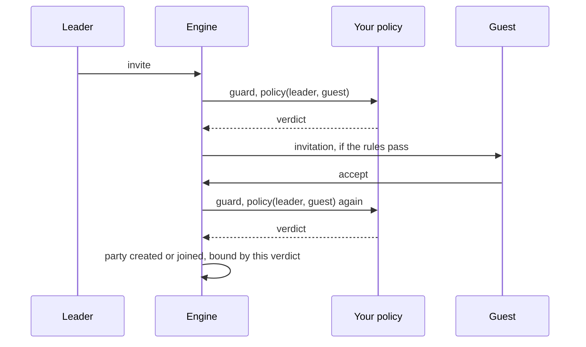

# Party join policy reference

A party join policy is a rule you register from Lua that decides how strict a party admission is for one pair of players: the leader and the guest. It is a guard that says which pairs the rule owns, and a verdict table that says how many members fit, whether the empires must match, how far apart the levels may be, or that the admission is refused outright. You reach for it when a map or an event needs its own teams: three players of any empire, no level limit, a party that lives only on that map.

A policy sits on top of the stock rules. It changes the parameters of the checks that exist and can refuse more, but a handful of engine rules stay beyond its reach (see "Rules a policy cannot lift"). The companion `forge.sys.game.activity_lock` is documented at the end of the API section.

## Quick start

`event_teams.forge` lets the players on one map form parties of three, from any empire, at any level difference. Everyone else is judged by the stock rules.

```forge
forge event_teams begin
    environment game begin
        local EVENT_MAP = 1

        local handle = forge.sys.game.party_join_policy.register(
            "event_teams",
            function(leader, guest)
                return leader:get_map_index() == EVENT_MAP
                    and guest:get_map_index() == EVENT_MAP
            end,
            function(leader, guest)
                return {
                    max_members = 3,
                    same_empire = false,
                    level_window = 0,
                }
            end)

        forge.sys.log(0, "registered, handle " .. handle)
        return { handle = handle }
    end
end
```

Add the file to the compiler list, compile, restart the game cores. The syslog shows `[OK] party_join_policy [event_teams]: handle=<n>`. A level 10 player of one empire can now invite a level 120 player of another, as long as both stand on map 1 and the party has fewer than three members.

## Files and setup

A policy has no file of its own and no config key. It lives in whatever forge registers it, and it exists only in the Lua state of a game core.

- `forge.sys.game.party_join_policy` exists on game cores only. A policy registered on one core does not apply on another. A map hosted elsewhere is judged by the policies of its own core.
- Compile and register the file as for any forge, see [Forge API reference](/docs/core/luna-forge). Forges are not reloaded: after a change, restart the game cores.
- The list is not saved. After a restart only the policies that register again exist.
- Register from the forge environment body at load, or from code that runs at the start of an event. The only shipped registration is the battle royale instance setup in `Locale/italy/system/battle_royale/battle_royale.forge`, which registers when an instance is created.
- A refusing policy can carry a `locale_key`. The client looks the key up in its locale, so the text must exist in the client locale files. The two keys battle royale uses are in `Client-Files/locale/locale/universal/locale_game.txt`.

## API

### `forge.sys.game.party_join_policy`

| Name | Signature | Returns | Context | What it does |
| --- | --- | --- | --- | --- |
| `register` | `register(name, guard, policy)` | `number` handle, greater than 0 | game core | Appends a policy to the end of the list. |
| `unregister` | `unregister(handle)` | `boolean` | game core | Removes the policy. `true` when found, `false` for an unknown handle. |
| `ERROR` | table of the party admission codes | | any | The codes of the admission check, see below. |

`register` parameters:

| Parameter | Type | Meaning |
| --- | --- | --- |
| `name` | `string` | Shown in the log lines and errors of this policy. Never compared: duplicates are allowed and they are two policies. |
| `guard` | `fun(leader, guest): boolean` | "Is this pair mine?" Called for every admission step that reaches this policy. |
| `policy` | `fun(leader, guest): table` | "What are the rules for this pair?" Called only when `guard` returned `true`. Returns the verdict table. |

Handles start at 1 and grow by one per registration. They are never reused. There is no priority parameter and no replace-by-name. A `guard` or `policy` that is not a function stops the call with `party_join_policy.register: guard is not callable` or `party_join_policy.register: policy is not callable`, before anything is registered. Inside a forge environment body that error fails the forge load. Do not register or unregister from inside a guard or policy: the list is being walked at that moment.

### The verdict table

Every key is optional. A missing key takes the stock value, so `{}` means "the stock rules for this pair".

| Key | Type | Missing | Effect |
| --- | --- | --- | --- |
| `allowed` | `boolean` | `true` | `false` refuses the admission. Checked before every stock rule, so the player is told the policy's reason and not a stock one. |
| `locale_key` | `string` | empty | Sent to the refused player as a text over the character when `allowed` is `false`. The client looks it up in its locale. |
| `max_members` | `number` | 8 | The admission is refused when the party already has this many members. A leader without a party counts as 1. `0` or more than 8 becomes 8. |
| `same_empire` | `boolean` | `true` | `false` skips the same-empire rule. |
| `level_window` | `number` | 30 | The two levels may differ by at most this much. `0` means no level limit. |
| `bind_to_map` | `boolean` | `false` | `true`: a party this admission creates lives on this core and the leader's map only. It is never sent to the database or to other cores, a member sees it only on that map, and it is deleted with the map. |
| `guild_group` | `boolean` | `true` | `false`: a party this admission creates is never promoted to a guild group, so its members never get the guild party bonuses. |

A key is read only when it is present and has the right type. A key of the wrong type keeps its default, silently. The generated Lua stub lists only `max_members`, `same_empire` and `level_window`, so editor completion does not offer the other four. They all work.

`bind_to_map` and `guild_group` are read once, when an admission creates the party. They are stored on the party. The other five keys are resolved again on every admission and are not stored.

### The error codes

`forge.sys.game.party_join_policy.ERROR` holds the codes the admission check produces: `PERR_NONE`, `PERR_SERVER`, `PERR_DUNGEON`, `PERR_OBSERVER`, `PERR_LVBOUNDARY`, `PERR_LOWLEVEL`, `PERR_HILEVEL`, `PERR_ALREADYJOIN`, `PERR_PARTYISFULL`, `PERR_POLICY`, `PERR_DIFFEMPIRE`, `PERR_PVP_ARENA`, `PERR_ENEMY`.

No live Lua function returns them. They exist for the simulator, whose party join call returns one of these codes so that a test can assert the outcome of a rule. `PERR_LOWLEVEL`, `PERR_HILEVEL` and `PERR_PVP_ARENA` are never produced by the admission check: the level rule always reports `PERR_LVBOUNDARY`.

### The C++ registration

Engine code registers on the same list through the policy singleton. The handle is kept for `Unregister` in the owner's teardown.

| Call | Signature | Returns |
| --- | --- | --- |
| `Register` | `Register(std::string name, GuardFn guard, PolicyFn policy)` | `handle_t` (`uint64_t`), `INVALID_HANDLE` (0) when `policy` is empty |
| `Unregister` | `Unregister(handle_t)` | `bool`, `false` for an unknown handle |
| `Resolve` | `Resolve(CHARACTER* leader, CHARACTER* guest) const` | `PartyJoinVerdict` |

`GuardFn` is `std::function<bool(CHARACTER*, CHARACTER*)>` and `PolicyFn` is `std::function<PartyJoinVerdict(CHARACTER*, CHARACTER*)>`. A C++ guard may be empty, and an empty guard matches every pair. A Lua guard is required. The verdict is the struct below, and its defaults are the stock rules:

```cpp
struct PartyJoinVerdict
{
    static constexpr uint8_t kStockMaxMembers = 8;

    bool        allowed = true;     // false refuses the admission with strLocaleKey
    std::string strLocaleKey;
    uint8_t     max_members = kStockMaxMembers; // clamped to [1, PARTY_MAX_MEMBER]
    bool        same_empire = true;
    uint8_t     level_window = 30;  // 0 = no level limit
    bool        bind_to_map = false;    // a party this admission creates is bound to the leader's map
    bool        guild_group = true;     // false: a party this admission creates is never promoted to a guild group
};
```

Who registers through each door:

| Door | Registrants that ship |
| --- | --- |
| `CPartyJoinPolicy::Register` (C++) | |
| `forge.sys.game.party_join_policy.register` (Lua) | Battle royale |

No native registrant ships: the C++ door exists and nothing in the engine uses it. The Lua binding is the only caller of `Register`.

### `forge.sys.game.activity_lock`

The activity lock is a set of player ids kept by the game core process. It is the companion of this policy because modes that restrict who may group usually also restrict what a player may do next, and the lock is the shared flag for "this player is committed to an activity".

| Name | Signature | Returns | What it does |
| --- | --- | --- | --- |
| `set` | `set(pid, locked)` | nothing | Inserts the player id when `locked` is `true`, removes it when `false`. |
| `is_set` | `is_set(pid)` | `boolean` | `true` only for an explicit lock set through `set`. |
| `clear` | `clear()` | nothing | Drops every explicit lock on this core. |

The character method `is_locked_in_activity()` is the check the engine and scripts use. It returns `true` when any of three things holds: the player id is in the lock set, the character is on the team roster of a guild war, or the character is a duelist of a PvP arena. `is_set` sees only the first.

The lock is keyed by player id and lives in the core process. It survives a reconnect to the same core and is not shared between cores.

What a lock blocks:

- creating a lobby, and applying to one, which includes the party finder (the popup says the player is in an activity);
- a duel request ("You are already participating to another activity.");
- the `/pvp` command, switching the PK mode to free, messenger authorization, opening the safebox and allowing emotions;
- the pet model, which is forced to the spirit, and the target HP gauge;
- in the shipped scripts: the arena lobby processor, the match observer, and battle royale participation and watching.

**The activity lock does not block party admission.** The party commands refuse on the PvP arena, not on the lock. A locked player can invite and be invited. To keep a locked player out of a party, refuse in your policy.

## Behaviour

### Where the engine asks

The engine resolves the policy once per admission step, at five places:

| Step | Leader and guest | What is checked |
| --- | --- | --- |
| A player asks to join a party (`/party_request`) | the leader of the target's party, the asker | all rules |
| The leader accepts the request | the leader, the asker | all rules |
| The leader invites | the inviter, the invitee | all rules |
| The invitee answers yes | the inviter, the invitee | all rules except the empire rule |
| A player applies through the party finder | the lobby owner, the applicant | empire and level only |

An invite runs the guard and the policy twice, at the invite and at the accept. A request does the same. The answer at the second step is the one that counts. Both run synchronously on the game thread, inside the packet or command handler. Return at once and do not yield.



### Resolution

The engine walks the policies in registration order and takes the first whose guard returns `true`. That policy owns the pair. There is no priority and no fall-through: once a guard matched, no later registration is asked, even if the policy returned `{}`. When no guard matches, the stock verdict applies.

```cpp
PartyJoinVerdict CPartyJoinPolicy::Resolve(CHARACTER* leader, CHARACTER* guest) const
{
    for (const Policy& policy : m_policies)
    {
        if (policy.guard && !policy.guard(leader, guest))
            continue;

        PartyJoinVerdict verdict = policy.policy(leader, guest);
        // max_members sizes per-party arrays, so it never exceeds the engine bound.
        if (verdict.max_members == 0 || verdict.max_members > PARTY_MAX_MEMBER)
            verdict.max_members = PARTY_MAX_MEMBER;
        return verdict;
    }

    return PartyJoinVerdict{};
}
```

### Failure direction

- `guard` must return a Lua boolean. A Lua error, nothing, or any other type counts as `false`: the policy does not match. This fails closed for the policy, because the pair falls to the next policy or to the stock rules.
- `policy` must return a table. A Lua error or a non-table gives the stock verdict for this admission. It does not fall through to the next registration.

Every failing call logs to syserr, so a broken policy floods the log:

```text
Bridge::ValidateProcessorInvocation lua error: <Lua error message>
Bridge::ValidateProcessorInvocation wrong return: expected [boolean], got [nil]
Bridge::ValidateProcessorInvocation wrong return: expected [boolean], got nothing
[party_join_policy <name> guard] lua callback error
[party_join_policy <name>] lua callback error
```

Registration and removal are logged to syslog; an unknown handle goes to syserr:

```text
[OK] party_join_policy [<name>]: handle=<n>
[OK] party_join_policy [<name>]: dropped handle=<n>
party_join_policy: unknown handle=<n>
```

### The order of checks

After the policy answers, the engine judges the admission in this order. The first rule that fails refuses, so a refusing policy outranks every stock rule.

```cpp
CHARACTER::PartyJoinErrCode CHARACTER::IsPartyJoinableCondition(const LPCHARACTER pchLeader, const LPCHARACTER pchGuest,
    const PartyJoinVerdict& kVerdict)
{
    // A refusing policy outranks every stock rule, so the player is told the policy's reason.
    if(!kVerdict.allowed)
        return PERR_POLICY;

    if(kVerdict.same_empire && pchLeader->GetEmpire() != pchGuest->GetEmpire())
        return PERR_DIFFEMPIRE;

    return IsPartyJoinableMutableCondition(pchLeader, pchGuest, kVerdict);
}

static bool __party_can_join_by_level(LPCHARACTER leader, LPCHARACTER quest, uint8_t level_window)
{
    return level_window == 0 || abs(leader->GetLevel() - quest->GetLevel()) <= level_window;
}

CHARACTER::PartyJoinErrCode CHARACTER::IsPartyJoinableMutableCondition(
    const LPCHARACTER pchLeader, const LPCHARACTER pchGuest, const PartyJoinVerdict& kVerdict)
{
    if(!CPartyManager::instance().IsEnablePCParty())
        return PERR_SERVER;
    else if(!kVerdict.allowed)
        return PERR_POLICY;
    else if(pchLeader->GetDungeon())
        return PERR_DUNGEON;
    else if(pchGuest->IsObserverMode())
        return PERR_OBSERVER;
    else if(!__party_can_join_by_level(pchLeader, pchGuest, kVerdict.level_window))
        return PERR_LVBOUNDARY;
    else if(pchGuest->GetParty())
        return PERR_ALREADYJOIN;
    // A leader without a party is a party of one: a cap of 1 refuses the first invite.
    else if((pchLeader->GetParty() ? pchLeader->GetParty()->GetMemberCount() : 1) >= kVerdict.max_members)
        return PERR_PARTYISFULL;

    // PvP session gate. Either side touching a session forces same-session
    // + allied — mixed (one in/one out) or same-session-enemy deny even in
    // pre-engage (attacks_enabled=false).
    {
        const auto& tm = CPvPTeamManager::instance();
        auto leader_sid = tm.GetSession(pchLeader->GetPlayerID());
        auto guest_sid  = tm.GetSession(pchGuest->GetPlayerID());
        if (leader_sid || guest_sid) {
            if (leader_sid != guest_sid)            return PERR_ENEMY;
            if (!tm.AreAllied(pchLeader, pchGuest)) return PERR_ENEMY;
        }
    }

    return PERR_NONE;
}
```

### Rules a policy cannot lift

- The player party switch is off: `PERR_SERVER`.
- The leader is in a dungeon: `PERR_DUNGEON`.
- The guest is in observer mode: `PERR_OBSERVER`.
- The guest is already in a party: `PERR_ALREADYJOIN`.
- The party holds 8 members. `max_members` cannot go above 8.
- The team session gate runs after the policy. When either side is in a team session, both must be in the same session and their teams must be allied, otherwise the admission gets `PERR_ENEMY`. A policy that admits with every rule lifted is still refused here. The [team manager](/docs/building-blocks) owns that rule.

Some refusals run before the policy is consulted, in the command and packet handlers:

- A player in a PvP arena cannot invite (`You can't use this in the arena.`) and cannot send or accept a party request (`You can't while in a PvP Arena.`). These test the PvP arena, not the activity lock.
- A caller who is already in a party cannot send a party request.
- The party settings block requests and invites for players who turned them off.
- Only the party leader may invite. A member who is not the leader is refused, at the invite and again at the accept.

### What the player sees

A stock refusal prints a chat line to the inviter, for example "You cannot form a Party with players from another Kingdom.", "You can only invite players within -30 ~ +30 level.", "You cannot invite more players into your Party." or "You cannot invite an enemy.". A policy refusal prints nothing in chat. The engine sends the `locale_key` as a text tail over the character, and the client shows the text it finds for the key. When an invitee accepts, the policy refusal is shown to both players; when a leader accepts a join request, only to the asker.

A refusal because of a cross-empire request at the accept step of a join request is silent: the request is denied with no message.

### bind_to_map and guild_group

Both keys act when the admission creates the party. That happens at one place: the invitee accepts an invite from a leader who has no party yet. The request path never creates a party. A request to a leader without a party gets "The player is not in this Party.". A party created any other way uses the stock verdict, so it is never bound and stays eligible for guild group promotion.

A bound party keeps all its state on the core. Create, join, quit, level and guild updates are not sent to the database. When a member logs in off the bound map, the party is not shown to them and they keep their place to come back to. The party is deleted with its private map.

## Examples

### Three-player teams on an event map

The engine's own example: a policy that owns every admission whose leader stands on the event map, and removes the policy again.

```lua
local EVENT_MAP = 1

local handle = forge.sys.game.party_join_policy.register(
    "event:party",
    function(leader, guest)
        return leader:get_map_index() == EVENT_MAP
    end,
    function(leader, guest)
        return {
            max_members = 3,
            same_empire = false,
            level_window = 0,
        }
    end)

forge.sys.game.party_join_policy.unregister(handle)
```

### Refuse with a message the player can read

`allowed = false` with a `locale_key` refuses the admission and tells the player why. The key must exist in the client locale.

```lua
local LOCKED_MAP = 1

local handle = forge.sys.game.party_join_policy.register(
    "locked_teams",
    function(leader, guest)
        return leader:get_map_index() == LOCKED_MAP
    end,
    function(leader, guest)
        return { allowed = false, locale_key = "MY_TEAMS_LOCKED" }
    end)

forge.sys.log(0, "registered, handle " .. handle)
```

### Battle royale: teams made of the match's players

The shipped registration, as an excerpt. The guard matches when both players are on maps of the same match. The policy refuses once the match leaves preparation, refuses a party that brings in someone from outside, and otherwise sets the team size, lifts the empire and level rules, binds the party to the map and keeps it out of guild groups.

```lua
local party_policy = forge.sys.game.party_join_policy
instance.party_policy_handle = party_policy.register(
    "battle_royale",
    function(leader, guest)
        local match = instance.match_by_map[leader:get_map_index()]
        return match ~= nil and match == instance.match_by_map[guest:get_map_index()]
    end,
    function(leader)
        local match = instance.match_by_map[leader:get_map_index()]
        if match.phase ~= Match.PHASE.PREPARATION then
            return { allowed = false, locale_key = "BATTLE_ROYALE_TEAMS_LOCKED" }
        end
        -- a team is made of this match's players only: a party brought in from outside stays outside
        for _, pid in ipairs(leader:get_party_member_pids()) do
            if match:player_record(pid) == nil then
                return { allowed = false, locale_key = "BATTLE_ROYALE_PARTY_OUTSIDE" }
            end
        end
        return { max_members = match.team_size, same_empire = false, level_window = 0, bind_to_map = true,
            guild_group = false }
    end)
assert(instance.party_policy_handle > 0, "battle_royale: party policy registration failed")
```

The policy uses only `leader`, and the guard returns an explicit boolean. An invite sent in preparation and accepted after the match started is refused, because the policy runs again at the accept.

### Lock a player at the moment of commitment

The activity lock keeps a player out of the other activities that read it. Check it, lock at the moment the player commits, and release on every way out.

```lua
local function admit(ch)
    local pid = ch:get_player_id()
    if ch:is_locked_in_activity() then
        return false
    end
    forge.sys.game.activity_lock.set(pid, true)
    return true
end

local function release(ch)
    forge.sys.game.activity_lock.set(ch:get_player_id(), false)
end
```

Battle royale follows this pattern: it checks `is_locked_in_activity()` when a player requests to join, sets the lock on the request, and sets it to `false` when the admission fails.

## Pitfalls

**The party finder ignores most of the verdict.** An application through the party finder reads only `same_empire` and `level_window`. `allowed`, `locale_key`, `max_members`, `bind_to_map` and `guild_group` are ignored, so a policy with `allowed = false` does not stop an application. The guard runs with the lobby owner as leader and the applicant as guest. When the owner is on another core, no policy runs and the stock verdict applies. The finder builds its party without the admission check, so no dungeon, observer or session gate applies, no bind happens and the party may become a guild group. To keep finder groups out of a mode, lock its players with `activity_lock`: the finder refuses to create a lobby or apply to one for a locked player.

**A direct invite is refused after the guard matched, but the policy was not what refused it.** The arena, the dungeon, the observer mode, the existing party and the team session are checked outside the verdict. See "Rules a policy cannot lift" before you debug your policy.

**`max_members = 0` means 8, not nobody.** The smallest useful cap is 1, which refuses even the first invite of a leader without a party. `max_members = n` admits until the party has n members.

**The cap holds per admission, not per party.** The verdict is not stored on the party. When the guard stops matching, for example the leader leaves the map, the next admission gets the stock 8. The same goes for the empire and level rules. Only `bind_to_map` and `guild_group` are stored.

**The guard runs twice per invite, and the second answer counts.** A mode that changes its state between the invite and the accept refuses the accept. That is what battle royale relies on.

**The empire is checked at the invite, not at the accept.** The accept step skips the empire rule. A policy that changes `same_empire` between the two steps has no effect on the second.

**The level message always says 30.** A refusal by the level rule prints "within -30 ~ +30 level" whatever `level_window` is. For a custom message, refuse with `allowed = false` and a `locale_key`.

**A cross-empire request refusal is silent.** When a leader accepts a request from another empire and `same_empire` is `true`, the player gets no message, only a denied request.

**A guard that returns a table, nil or nothing never matches.** The log says `expected [boolean], got [table]` (or `[nil]`, or `got nothing`) on every admission. Return a real boolean: `return match ~= nil and ...`.

**A policy that returns nothing does not pass to the next registration.** It logs an error and applies the stock rules for that pair. Return `{}` for "stock rules here", and keep guards disjoint, since the first matching guard owns the pair.

**A wrong-typed field is ignored without a log line.** `same_empire = 0` is a number, so the key keeps its default `true`. Use real booleans and numbers.

**An unknown `locale_key` shows raw.** The client logs `received unregistered locale_key for infotail: [KEY]` and shows the key. Add the text to the client locale file first.

**`activity_lock.clear()` drops every lock on the core.** There is no owner per caller, so it removes the locks other systems set. Release your own players with `set(pid, false)`.

**You expect the lock to keep a player out of a party.** It does not. Party commands refuse on the PvP arena, and the admission check never reads the lock.

**You test with the error codes in live Lua.** Live scripts never receive `ERROR` values. They are for simulator tests.

**You expect to reload a forge and keep the policies in sync.** Forges are not reloaded. Restart the game cores, and keep one handle per registration.

## See also

- [Forge API reference](/docs/core/luna-forge): file layout, environments and load order.
- [Building blocks](/docs/building-blocks): the other policies that follow the guard and verdict pattern, and the team manager that owns the session gate.
- [Battle arbiter reference](/docs/building-blocks/battle-arbiter): the same guard and verdict shape for attacks.
- [The bridge](/foundations/luna/bridge): how Lua callbacks cross into the engine, and why a wrong return type is logged and falls to a safe default.
