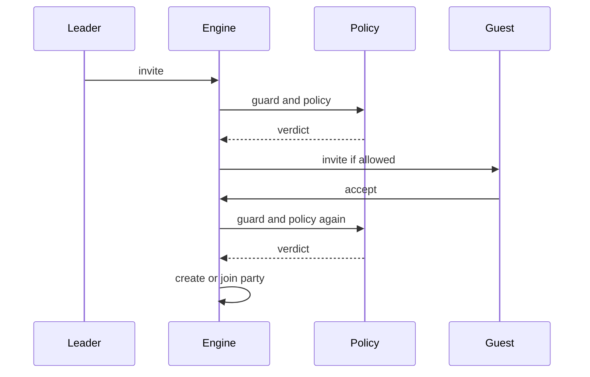

# Party join policy: behaviour

The [party join policy API](/docs/building-blocks/party-join-policy) resolves a verdict at each admission step. See the [Policies glossary](/docs/building-blocks#policies-glossary) for session and activity lock terminology.

## Admission steps

| Step | Leader and guest | Checks |
| --- | --- | --- |
| `/party_request` | target party leader, asker | all rules |
| Leader accepts request | leader, asker | all rules |
| Leader invites | inviter, invitee | all rules |
| Invitee accepts | inviter, invitee | all except empire |
| Party finder application | lobby owner, applicant | empire and level only |

An invite or request resolves twice. The second verdict governs the second step. Callbacks run synchronously; return without yielding.

The engine asks the policy again when the invitee accepts.

## Resolution and failure

Policies are walked in registration order within one core. Across forges, registration follows forge load order, which is not guaranteed. The first matching guard owns the pair, even when its policy returns `{}`; if none matches, stock defaults apply. Do not register or unregister while a callback is running.

| Failure | Result |
| --- | --- |
| Guard errors or returns anything other than a boolean | Logs an error and tries the next policy or stock defaults. |
| Policy errors or returns a non-table | Logs an error and uses stock defaults; no later policy is tried. |
| Verdict field has the wrong type | Silently uses that field's default. |
| Unknown unregister handle | Returns `false` and logs to syserr, the server error log. |

Callback errors cross the [bridge](/foundations/luna/bridge), which connects Luna's Lua runtime to the engine, and appear in syserr. Registration and removal are logged to syslog.

## Checks and hard refusals

For a full admission the engine checks `allowed`, empire, the party switch, `allowed` again, leader dungeon, guest observer mode, level, existing guest party, capacity, and the team session gate, in that order. At invite acceptance it skips the empire check. The first failing check decides the result.

| Refusal a policy cannot lift | Code or condition |
| --- | --- |
| Player parties disabled | `PERR_SERVER` |
| Leader in a dungeon | `PERR_DUNGEON` |
| Guest in observer mode | `PERR_OBSERVER` |
| Guest already in a party | `PERR_ALREADYJOIN` |
| Party at the engine limit | `PERR_PARTYISFULL`; maximum 8 members |
| Either player in a team session | Both must be in the same session and allied, or `PERR_ENEMY`; see [team manager](/docs/building-blocks/team-manager). |

Command handlers also refuse requests and invites based on player settings, leadership, or an existing party. Party commands are refused in the PvP arena (the native arena object, rebuilt from the mainline arena manager). These checks can run before the policy.

A policy refusal sends `locale_key` as text over the character. Invite acceptance shows it to both players; request acceptance shows it to the asker. Stock refusals use chat, except a cross-empire refusal when accepting a request is silent.

## Party and lock lifetime

`bind_to_map` and `guild_group` apply only when an invitee accepts an invite from a leader without a party. Requests do not create parties. A bound party stays on its core; its updates are not sent to the database, it is hidden from members outside the bound map, and it is deleted with the private map.

Explicit activity locks are keyed by player ID, survive reconnect to the same core, and are not shared between cores. `is_locked_in_activity()` also recognizes a guild war team roster and a PvP arena duelist; `is_set` sees only explicit locks. A duel is a player-versus-player contest; see the [glossary](/docs/building-blocks#policies-glossary).

A lock blocks lobby creation and applications, duel requests, `/pvp`, switching PK mode (player-killing mode) to free, messenger authorization, safebox opening, and allowing emotions. It also forces the pet model to spirit and affects the target HP gauge. It does not block party admission; use a policy for that.

## Pitfalls

**The party finder accepts a refused pair.** It reads only `same_empire` and `level_window`; the other verdict fields and normal admission gates do not apply. If the owner is on another core, it uses stock defaults. Lock players to prevent lobby creation and applications.

**A cap disappears after the leader leaves the map.** `max_members`, empire, and level rules are resolved per admission, not stored. Keep the guard matched wherever the cap must apply.

**A cap of zero lets eight players join.** `max_members = 0` defaults to 8. Use `1` to refuse even the first guest.

**The level refusal message says 30 for a different window.** The stock message is fixed. Refuse with `allowed = false` and a client `locale_key` for custom text.

**The client displays the locale key itself.** The key is missing from the client locale. Add its text before using it.

**A lock belonging to another system disappears.** `activity_lock.clear()` removes every explicit lock on the core. Release individual players with `set(pid, false)`.

Next: [Party join policy examples](/docs/building-blocks/party-join-policy/examples).
