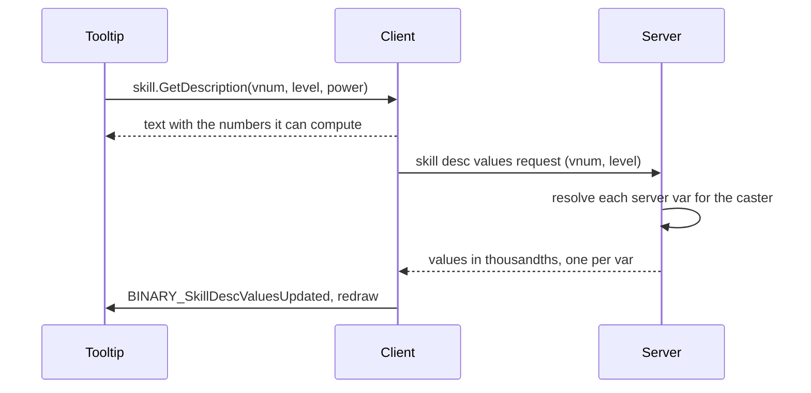

# Skill descriptions reference

A skill tooltip shows numbers that the server computes. A description keeps the words and the numbers apart: the words are a locale file, the numbers are named references into the skill's own config. You reach for this page when you add a skill, change a formula a tooltip quotes, or translate a sentence.

Why it is split this way, and what it replaced, is in [Skill descriptions that cannot drift](/foundations/skills/descriptions). The skill file itself is in [Skill file reference](/docs/building-blocks/skill-file); the formulas inside every `...Poly` key are in [One formula, two evaluators](/foundations/skills/formulas).

## Quick start

Skill 34 needs two files. The numbers go in the config, under `desc:`:

```yaml
desc:
  vars:
    invtime:  { ref: node.hide.durationPoly }
    bonusdmg: { value: 25 }
```

The words go in the client sentence file `skill_desc/34.ucskilldesc.yaml`:

```yaml
name: Camuffamento
description: |-
  Arte dell'ombra.

  Ti rende |cFF03C5FEInvisibile|r per |cFFC7D610$invtime|r secondi.
  Il tuo indicatore sarà occultato sulla minimappa.
  I tuoi effetti (come i luccichii) diverranno anch'essi invisibili.
  Le abilità che prevedono un miglioramento se invisibili vedranno il danno aumentare del |cFF2DFE03$bonusdmg%|r.
  L'abilità può essere attivata in corsa.
```

Hover the skill: `$invtime` prints the number the server computes from `durationPoly` at the skill's level, `$bonusdmg%` prints 25 followed by a percent sign. Hold SHIFT and each number that comes from a formula is followed by `(= formula)`.

## Files and setup

| File | Side | What it holds |
| --- | --- | --- |
| `Locale/conf/skill/<vnum>.ucskill.yaml` | server and client | `desc.vars`: the numbers. The server builds the skill from it and the client reads the same file, copied into the client locale skill folder. |
| `skill_desc/<vnum>.ucskilldesc.yaml` | client locale | `name`, `description` and optional `policies:` sentences. |
| `skill_desc/policies.ucskilldesc.yaml` | client locale | One `name:` label per policy id, for the configuration switcher. |
| `Locale/conf/skill/policies.yaml` | server and client | Declares which policy ids exist. A skill naming an undeclared policy is a client log line. |
| `locale_game.txt` | client locale | `SKILLVAR_<NAME>` words for formula names, `EXTEND_TOOLTIP`, `SKILL_POLICY_SWITCH`, `SKILL_POLICY_BASE`. |

Nothing is compiled or generated. The sentence directory lives under the client `locale/universal/` folder, next to the skill config copy. The vnum is the file name: the client looks for `<vnum>.ucskilldesc.yaml` for every vnum from 1 to 1000 and skips the ones that are missing.

A description file needs its config. The client loads all configs first, then all descriptions, and a description whose vnum has no config is refused. If either load finds nothing, locale loading fails.

## The sentence file

Only these keys are read. Everything else in the file is ignored.

| Key | Type | Meaning |
| --- | --- | --- |
| `name` | string | The skill name the player sees. The config's own `name` is for logs. An empty value keeps the config's name. |
| `description` | string | The sentence. Use a block scalar (`|-`) so lines keep their breaks. An empty value leaves the skill with no text. |
| `policies.<id>.name` | string | Name for that policy variant. Absent: the base name. |
| `policies.<id>.description` | string | Sentence for that variant. Absent: the base sentence, whose `$names` re-resolve against the variant's own config. |

### Tokens in the sentence

| Token | Meaning |
| --- | --- |
| `$name` | Replaced by the value of `desc.vars.name`. `name` starts with a letter or `_` and continues with letters, digits and `_`. |
| `|cAARRGGBB` ... `|r` | The client's colour markup: alpha, red, green, blue as hex, then the text, then reset. The text engine renders it. Shipped sentences use only these two. |

Nothing else is substituted. `%` and every other character pass through, so `$bonusdmg%` is the number followed by a percent sign.

Substitution is a text replace of `$` plus each declared name, longest name first. With `$val` and `$value` both declared, `$value` is replaced before `$val`, so neither leaves a stub behind. Keep a name from being a prefix of a word you write after it: with a var `cost`, the text `$costs` prints the cost followed by an `s`.

### Policy labels

`policies.ucskilldesc.yaml` is a map from policy id to a map with `name`:

```yaml
arena:
  name: In arena

# Ball-Em-Up
ballemup:
  name: Ball-Em-Up
ballemup_r1:
  name: Ball-Em-Up (Gittata +1)
```

The label is what the switcher row shows. The base configuration is labelled by the locale key `SKILL_POLICY_BASE`.

## The desc.vars keys

`desc.vars` is a map from a var name to a body. A body has one source, `ref` or `value`, and three optional shapers.

```yaml
desc:
  vars:
    <name>:
      ref:      node.bolt.amountPoly    # a poly IN THIS FILE
      value:    '25'                    # or a stated number. Never both.
      with:     { victim_is_self: 1 }   # pin what the client cannot know
      delta_at: { victim_calc_missing_hp: 1000 }
      as:       (0-value)/10            # reshape what the ref resolved to
```

| Key | Value | Meaning |
| --- | --- | --- |
| `ref` | a path | The poly whose number the var prints. The server and the client resolve it with the same grammar. |
| `value` | a plain number | A stated number. Parsed as a poly and refused if it reads any name. |
| `with` | map of name to number | Pins a name the poly reads to a constant, for both the number and the formula text. |
| `delta_at` | map of name to number | Evaluates the ref with the name at N and at 0 and prints the difference. |
| `as` | a poly | Reshapes the result. `value` is the var's own ref result, and a sibling var is read by its name. |

Rules for each key:

- **`ref` or `value`, exactly one.** `with` needs a `ref` to pin into. A var with `value` takes no `with` and no `delta_at`.
- **`ref` paths** are `node.<id>.<field>`, `node.<id>.nodes.<child>.<field>`, `node.<id>.traits.<trait>.formulas.<name>`, `resolve.bound.targets`, `resolve.bound.hitsPerTarget` and skill-level fields such as `cooldownPoly`. Segments after the node id are the YAML keys verbatim, so a field added to a node type is referenceable the same day. A node is addressed by its `id:`, never by position. The path must end on a scalar.
- **`with`** must name something the poly reads. One ref can serve two sentences: skill 150 pins `victim_point_MAX_HP` to 0 for the flat heal and to 100 for the percent heal.
- **`delta_at`** must name something the poly reads, and the same name cannot also be pinned. N is the unit the sentence is about ("per 1000 missing HP"). The result is truncated to a whole number, so pick N that makes the rate whole. It is a rate only while the poly is linear in that name.
- **`as`** is evaluated once, after every ref is resolved. It cannot read another `as` result and cannot name its own var. A falling quantity is negative, so a sentence that says "drops by" uses `as: '-value'` or `as: '0-value'`.

Skill 188 uses `with` and `delta_at` on the same ref, so one sentence can say "a base amount plus a percent of the damage stored":

```yaml
desc:
  vars:
    val:        { ref: node.dmg.amountPoly }
    debufftime: { ref: node.mark.delayStartPoly }
    extrabase:  { ref: node.payback.amountPoly, with: { node.mark.marked_damage: 0 } }
    extrapct:   { ref: node.payback.amountPoly, delta_at: { node.mark.marked_damage: 100 } }
```

### Names a description may read

A `ref` points at a poly, and that poly reads names. Which side can answer each name decides whether the var needs a pin.

| Name | Client | Server | Needs a pin |
| --- | --- | --- | --- |
| `skill_level`, `skill_k`, `skill_power`, `skill_spec` | yes | yes | no |
| `calc_missing_hp`, `calc_missing_sp`, `calc_precision_rate`, `calc_raw_phys_att`, `calc_raw_magic_att`, `calc_raw_adaptive_att`, `calc_total_adaptive_att` | yes | yes | no |
| `point_<NAME>` for every character point | yes | yes | no |
| `quest_flag.<flag>` | no | yes | no: the var is answered over the wire (below). Pin it to a number to keep it local. |
| `subject_level`, `subject_member_count`, `subject_gold`, `subject_flag.<flag>` | no | yes | yes |
| `calc_horse_level`, `calc_hp_without_defensor`, `calc_def_penetration` | no | yes | yes |
| `is_mental`, `is_archer`, `is_assassin` | no | yes | yes |
| `victim_is_self`, `victim_calc_*`, `victim_point_<NAME>` | no | yes | yes |
| `node.*`, `self.*`, `use.*` (live state of one cast, such as `use.victims` or `node.mark.marked_damage`) | no | cast only | yes |
| anything else | no | no | yes |

A pin or a `delta_at` entry answers the name for both sides. A name nobody resolves reads 0 on both sides, so only a pin or `delta_at` makes it legal. Skill 183 pins `use.victims` to 1 three times so that "per enemy hit" becomes a number.

A trait formula is addressed by `node.<id>.traits.<trait>.formulas.<name>`. The trait's `constants:` are substituted in first, so the formula reads in the skill's terms. Skill 64 is the one trait ref in content:

```yaml
desc:
  vars:
    dmgreduction: { ref: node.buff_reduction.traits.terror.formulas.reduction_pct }
```

The trait says `power` is the skill's `skill_power` and `reduction_pct: 5+power/40`, so the var holds `5+(skill_power)/40`. A trait formula that reads a per-hit name such as `dam` or `hp_pct` needs a `with:` pin for it. The trait side is in the [traits reference](/docs/building-blocks/traits).

## How the client receives a description

The server never renders a description. It validates `desc.vars` at boot and answers one request. Everything the player reads is rendered by the client, from the config it loaded.



The request in the second step is sent only when the skill has at least one server-resolved var.

### Python surface

| Call | Returns | What it does |
| --- | --- | --- |
| `skill.GetDescription(vnum, level, power[, mode])` | string | The sentence with every `$name` replaced. `power` is a float, the efficiency the tooltip shows. Raises an exception when the skill is unknown. Sends the values request on every call when the skill has server vars. |
| `skill.HasFormulas(vnum)` | 1 or 0 | 1 when some var has an `as:` or a poly that reads a name. The tooltip shows its "more information" hint only then. |
| `skill.GetSkillName(vnum)` | string | The name from the sentence file. |
| `skill.GetPolicyCount(vnum)` | int | Configurations the skill can be read in, the base counted: 1 plus its declared variants. |
| `skill.GetPolicyInfo(vnum, index)` | (id, label) | Index 0 is the base, with empty strings. Raises an exception past the end. |
| `skill.GetActivePolicyIndex(vnum)` | int | The index of the configuration the character fights under, the first active policy in server order. 0 when none. |
| `skill.SetPreviewPolicy(vnum, index)` / `skill.ClearPreviewPolicy()` | none | Reads one configuration by index regardless of the active one, until cleared. |

Modes, passed as the optional fourth argument of `skill.GetDescription`:

| Constant | `$name` becomes |
| --- | --- |
| `skill.DESC_PLAIN` (default) | the number |
| `skill.DESC_EXPANDED` | the number, then `(= formula)` |
| `skill.DESC_SYMBOLIC` | the formula alone |

`DESC_SYMBOLIC` is exported, but no shipped script passes it.

In expanded mode the `(= formula)` part is added only when the poly reads at least one name, and never for a `delta_at` var, whose expansion would be the two readings and a subtraction. A pinned name prints its number. `point_<NAME>` becomes the marker `{p:<pointType>}`, `quest_flag.<flag>` becomes `{s:<flag>}`, any other name becomes `{s:<name>}`, and `*` is spelled ` x `. The tooltip turns the markers into words with `LocalizeSkillFormula`: a point uses its fake-point display name, and `{s:<name>}` reads `SKILLVAR_<NAME>` from `locale_game.txt`, uppercased with dots turned into underscores. A name with no locale line renders as itself.

The tooltip shows plain by default and expanded while SHIFT is held. With more than one configuration, SHIFT+TAB over the open tooltip walks them.

### Rendering order

For one call the client does this:

1. Evaluates every var's poly with its pins applied. A `delta_at` var is evaluated at N and at 0 and subtracted.
2. Evaluates every `as:` once, with `value` bound to the var's own result and each sibling bound to its step 1 result.
3. Replaces the names, longest first. Each number is printed through a signed whole-number conversion: it is truncated toward zero, not rounded, and a negative value keeps its sign.

### Numbers only the server holds

A var is server-resolved when its poly reads a `quest_flag.<flag>` that `with:` does not pin. The server and the client decide this by the same prefix rule. The client cannot evaluate the flag, which moves while the client runs and sends no notice.

For such a skill:

- The client sends a request with the vnum and level on every draw. A cached answer is only a guess about the present.
- The server clamps the level to the skill's maximum, resolves through the caster's active policy, evaluates each server var as the caster with pins applied, and sends each value multiplied by 1000 as a 32-bit integer.
- The reply is positional. Both sides sort the vars by name and keep the server-resolved ones, so the Nth value belongs to the Nth such var. A reply whose count differs from what the client expects is dropped.
- Until the reply arrives, and after a dropped one, the poly is evaluated with the unread flags at 0.
- When a reply differs from what is held, the client calls `BINARY_SkillDescValuesUpdated` on the game window, which redraws the tooltip.

A flag is written `quest_flag.<quest>.<state>`, the same name the quest side uses, for example `quest_flag.ballemup.blood`. A damage skill whose hit grows with a flag needs no extra key, only a poly that reads it and a var that points there:

```yaml
# the damage node (id: dmg) carries
#   amountPoly: (10+60*skill_k)*(1+0.5*min(2,quest_flag.ballemup.blood))
desc:
  vars:
    val: { ref: node.dmg.amountPoly }
```

The sentence says `$val` as usual. `val` is server-resolved, so the tooltip first shows the flag at 0 and redraws when the reply comes. Under SHIFT the formula shows the flag through `SKILLVAR_BALLEMUP_BLOOD` in `locale_game.txt`.

Only skill 78 uses it today, in its Ball-Em-Up variants, where `interval`, `targets`, `cost` and `chain` read quest flags.

### Variants

A skill's `policies:` entries build one variant config each. The sentence for a variant is the base sentence unless `policies.<id>.description` replaces it, and its `$names` re-resolve against the variant's own config. Skill 34's arena variant changes only `node.hide.durationPoly`, and the base sentence prints the arena number.

A variant that adds a var patches `desc.vars.<name>` into the config. Skill 78's Ball-Em-Up variants add `chain`:

```yaml
desc.vars.chain: { ref: node.chain.maxTarget }
```

and their sentence file block reads `$chain`. Skill 78 shares one block between its six variants with a YAML anchor:

```yaml
policies:
  ballemup: &bmu_desc
    description: |-
      Evoca uno spirito di fuoco che scaglia sfere contro i nemici intorno a te.

      Ogni |cFFC7D610$interval|r secondi lancia |cFF00CB8D$targets|r sfere, ognuna verso un nemico diverso.
      Ogni sfera infligge |cFFF501F6$val|r danni magici e colpisce a catena fino a |cFF00CB8D$chain|r nemici.
      Consuma continuamente |cFF2DFE03$cost MP|r per restare attiva.

      Gli augment della modalità potenziano la sfera round dopo round.
  ballemup_r1: *bmu_desc
  ballemup_r2: *bmu_desc
  ballemup_r3: *bmu_desc
  ballemup_r4: *bmu_desc
  ballemup_r5: *bmu_desc
```

The tooltip opens on the active configuration, so it never opens on a variant the caster is not using. The policy side is in [Skill policies](/foundations/skills/policies).

## Errors

### Server, at boot

Every failure below logs `Skill[<vnum>] <name>: desc var '<var>' <tail>` and fails that skill. A skill, or any of its policy variants, that fails makes the skill table fail to load. At boot that stops the game core. On a reload the failure is only logged and the previous table stays live.

| Rule broken | Tail |
| --- | --- |
| `ref:` and `value:` both | `declares both ref: and value:` |
| neither | `declares neither ref: nor value:` |
| `with:` without a ref | `pins with: without a ref: to pin it into` |
| `value:` is not a plain number | `value '<v>' is not a plain number` |
| the ref does not end on a scalar | `reference '<r>' does not resolve to a value` |
| the scalar is not a poly | `reference '<r>' is not a poly: '<p>'` |
| a name no vocabulary resolves | `reads '<n>', which no vocabulary resolves -- pin it with` followed by `with:` in backticks |
| a server-only name, unpinned, var not server-resolved | `reads '<n>', which the client cannot resolve, with no` followed by `with:` in backticks and `pin` |
| a pin the poly never reads | `pins '<n>', which '<ref>' does not read` |
| a `delta_at:` the poly never reads | `takes a rate per '<n>', which '<ref>' does not read` |
| pinned and rated | `both pins and takes a rate per '<n>'` |
| an `as:` that does not parse | `as '<e>' does not parse` |
| an `as:` naming its own var | `as '<e>' names itself;` followed by the hint that `value` is what the ref resolved to |
| an `as:` reading an unknown var | `as reads '<n>', which this skill does not resolve` |

A server-resolved var is exempt from the server-only refusal, because the answer arrives over the wire. It is never exempt from the unknown-name refusal: a name no vocabulary resolves reads 0 on both sides.

### Client, in the log

These are logged, not fatal, except where noted. Read the client log after editing a sentence.

| Message | Cause |
| --- | --- |
| `CPythonSkill: skill <vnum> (<where>) description reads $<name>, which desc.vars does not declare` | A `$name` with no var. The player sees the literal `$name`. `<where>` is `base` or the policy id. |
| `CPythonSkill: skill <vnum> (<where>) declares desc var '<name>', which the description never reads` | A var no sentence reads. It is computed and thrown away, and a server var also costs a round trip per tooltip. |
| `CPythonSkill: skill <vnum> has a description but no config` | A sentence file whose vnum has no config. The file is skipped. |
| `CPythonSkill: skill <vnum> desc var '<var>' reference '<ref>' does not resolve` | The client could not resolve a `ref`. The var is dropped. |
| `CPythonSkill: skill <vnum> names policy '<id>', which policies.yaml does not declare` | A `policies:` entry with an undeclared id. No variant is built. |
| `CPythonSkill: policy '<id>' has no label in <file>` | A declared policy missing from the label file. The switcher shows the id. |
| `CPythonSkill: <n> policies are declared but <file> is missing, so the configuration switcher will show ids` | The label file is missing. |
| `CPythonSkill: server activated policy '<id>', which this client does not know` | The server runs a policy this client has no config for. It is skipped. |
| `CPythonSkill::SetServerDescValues - skill <vnum> expected <n> values, got <m>` | Client and server read different config versions. The values are dropped. |
| `CPythonSkill::RegisterSkillDescs - <file>: <yaml error>` | A sentence file that is not valid YAML. |

A client with no sentence file and no config for a vnum shows nothing for it. A failure to load any config, or any description file, fails locale loading.

## C++ registration

| Registry | Native registrants today | Lua door |
| --- | --- | --- |
| Skill description | None. The renderer is client C++ and the tooltip is Python; nothing registers into it. | None. |

There is no registry to add to. A new formula name appears in a sentence through the `SKILLVAR_<NAME>` locale line, and a new `ref` path needs no code because path segments are YAML keys.

## Examples

### Print a falling number as a drop

Skill 394 drains health. The poly is negative, so `drainhp` reads it through `as`, and `perhit` pins the live-cast name `node.gather.hits` to one victim through `delta_at`:

```yaml
desc:
  vars:
    # every one of these is a query -- the client resolves them symbolically against `with:`
    drainhp:   { ref: node.drain.amountPoly, as: '0-value' }
    gathered:  { ref: node.gather.collect.search.take }
    throbdmg:  { ref: node.throb.amountPoly }
    # `node.gather.hits` is live per cast, so the tooltip pins it at one victim: the sentence
    # says "per victim gathered" rather than a number that depends on who is standing there
    perhit:    { ref: node.siphon.amountPoly, delta_at: { node.gather.hits: 1 } }
```

N is 1, so the rate is already whole.

### Convert per-mille to percent

Skill 93 stores the burn chance in per-mille. The sentence prints percent:

```yaml
desc:
  vars:
    val:     { ref: node.dmg.amountPoly }
    firepct: { ref: node.burn.successPctPoly, as: 'value/10' }
    firedmg: { ref: node.burn.amountPoly }
    targets: { ref: resolve.bound.targets }
```

### One ref, two readings

Skill 150 prints a flat heal and a percent-of-max-HP heal from the same node by pinning the victim's max HP, and reads one var from another:

```yaml
desc:
  vars:
    healflat: { ref: node.heal.amountPoly, with: { victim_point_MAX_HP: 0 } }
    healpct:  { ref: node.heal.amountPoly, with: { victim_point_MAX_HP: 100 }, as: 'value-healflat' }
    resist:   { ref: node.light_skill.amountPoly }
```

### Number per live-cast name

Skill 183's buffs scale with how many enemies one cast caught. There is no victim set when a tooltip draws, so each var pins `use.victims`:

```yaml
desc:
  vars:
    damage:        { ref: node.dmg.amountPoly }
    abibuff:       { ref: node.buff_skilldef.amountPoly, with: { use.victims: 1 } }
    medibuff:      { ref: node.buff_normaldef.amountPoly, with: { use.victims: 1 } }
    healvalue:     { ref: node.heal.amountPoly, with: { use.victims: 1 } }
    bufftime:      { ref: node.buff_skilldef.durationPoly }
    pulledtargets: { ref: resolve.bound.targets }
    targets:       { ref: resolve.bound.targets }
```

`pulledtargets` and `targets` are the same ref under two names because the sentence quotes the number twice. A var the sentence does not read is flagged, so each must appear in the sentence.

## Pitfalls

**The tooltip prints the text `$name`.** The sentence reads a name `desc.vars` does not declare, usually a typo. Nothing stops the game: the client logs `description reads $<name>, which desc.vars does not declare`. Fix the spelling or declare the var.

**A number prints 0 and nothing complains.** The ref reads a name the client cannot answer and the var is not pinned, or a `delta_at` unit is too fine and the truncated result is 0. The first is refused at boot, so it shows up as a server error. The second needs a larger N, for example 1000 instead of 1.

**"Drops by X" prints a negative number or 0.** A falling quantity is negative. Add `as: '0-value'` or `as: '-value'`.

**The server refuses to boot over a description.** Any bad var in any of the skill configs, or in any policy variant, stops the game core. The log line names the skill and the var; fix that one line.

**A pinned name is rejected.** `with:` and `delta_at:` must name something the ref's poly reads, and one name cannot be both. Check the spelling against the poly, after trait constants are substituted.

**A variant's sentence never shows.** The client skips a `policies.<id>` block for a variant that was not built, and logs nothing. The id must be declared in `policies.yaml`, and the skill's config must have a `policies:` entry for it. Skill 33's sentence file carries an `arena:` block reading `$poisdrop` that no config backs: it is dead text.

**A `value:` goes out of date.** It is the one key that restates a number, for values that live in a Lua handler or in C++. Nothing checks it against the script; keeping it true is yours.

**A tooltip never refreshes a server number.** A reply whose count differs from the client's expectation is dropped, which means client and server hold different config versions. The tooltip stays on the flags-at-zero reading until both are updated.

**An `as:` sees the wrong value.** It reads the first pass only, so it cannot read another `as:` result, and `value` is the var's own ref result, not a name you declared. Name a sibling to read the sibling's first-pass number.

## See also

- [Skill descriptions that cannot drift](/foundations/skills/descriptions): the limit this closed and its history.
- [Skill file reference](/docs/building-blocks/skill-file): the `desc:` block among the config's keys.
- [One formula, two evaluators](/foundations/skills/formulas): polys and the name vocabulary.
- [Skill policies](/foundations/skills/policies): how a variant is merged into a config.
- [Traits reference](/docs/building-blocks/traits): `formulas:` and `constants:` that a description can read.
