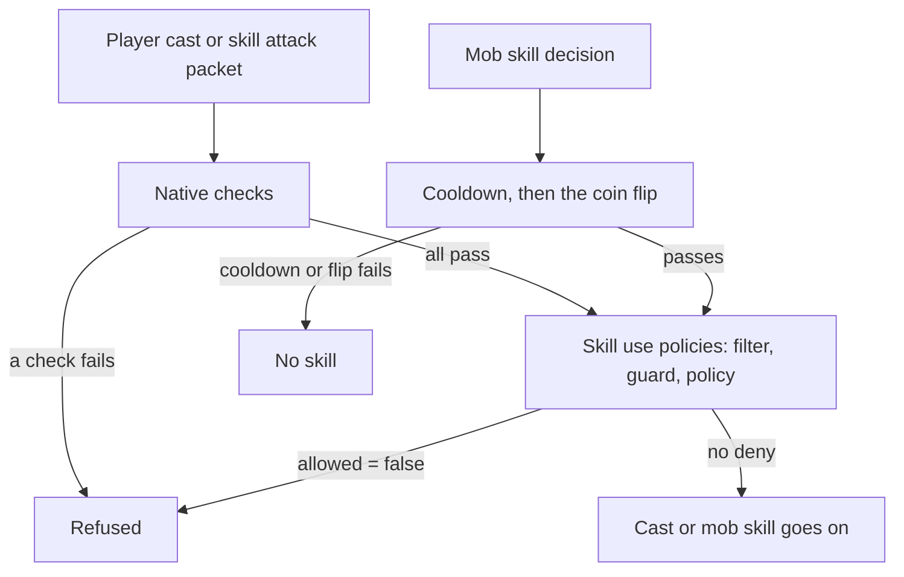

# Skill use policy reference

A skill use policy is a rule you register from Lua that can forbid a skill cast. It is a guard that says which characters the rule is about, an optional list of skill vnums it concerns, and a policy function that returns a verdict table. You reach for it when a map, an arena or an event needs its own limit on what may be cast: no teleport on this map, no rage trigger until the charge is full, guild skills only in a war.

A policy only adds refusals. It runs after every native check of the cast has passed and cannot lift any of them, see [What stays in the engine](#what-stays-in-the-engine). For how the three skill registries relate and why only this one is asked on every cast, see [Loadout, use and skill policies](/foundations/skills/policies).

## Quick start

`trial_map_skills.forge` forbids skills 1, 2 and 3 on one map and tells the player why. Every other skill and every other map is left alone.

```forge
forge trial_map_skills begin
    environment game begin
        local TRIAL_MAP = 1

        local handle = forge.sys.game.skill_use_policy.register(
            "trial_map_skills",
            function(ch)
                return ch:get_map_index() == TRIAL_MAP
            end,
            function(ch, vnum)
                return { allowed = false, locale_key = "CANNOT_SKILL_NOT_ALLOWED" }
            end,
            { 1, 2, 3 })

        forge.sys.log(0, "registered, handle " .. handle)
        return { handle = handle }
    end
end
```

Add the file to the compiler list, compile, restart the game cores. The syslog shows `[OK] skill_use_policy [trial_map_skills]: handle=<n>`. A player on map 1 who casts skill 1, 2 or 3 sees the text of `CANNOT_SKILL_NOT_ALLOWED` over the character and the cast does not happen. `<n>` is how many skill use policies registered before this one, plus one.

## Files and setup

A policy has no file of its own and no config key. It lives in whatever forge, quest or referee registers it, and it exists only in the Lua state of a game core.

- `forge.sys.game.skill_use_policy` exists on game cores only. A rule registered on the core that hosts one map does not apply to a map hosted elsewhere.
- Compile and register the file as for any forge, see [Forge API reference](/docs/core/luna-forge). Forges are not reloaded: after a change, restart the game cores.
- Registrations are not saved. After a restart only the policies that register again exist.
- A registration lands in one of two places: a forge environment body or a `when boot` handler (a rule that holds for the whole life of the core), or a function the engine calls at the start and the end of something, which registers on one side and unregisters on the other.
- A refusal can carry a `locale_key`. The client looks the key up as a name in its locale, so the text must exist in the client locale file `locale_game.txt` under that name. A key the client does not know is shown as the key itself and logged as an unregistered locale key.

The shipped content registers in both places:

| Policy | Registered | Unregistered |
| --- | --- | --- |
| `guild_skills:war_only`, the guild skills 151 to 157 | in the guild war forge, in a `when boot` handler | never |
| `rage:charge`, the rage trigger skill | in the rage forge, at load | never |

## API

### `forge.sys.game.skill_use_policy`

| Name | Signature | Returns | Context | What it does |
| --- | --- | --- | --- | --- |
| `register` | `register(name, guard, policy, vnums)` | `number` handle, greater than 0 | game core, outside any guard or policy | Appends a policy to the end of the list. |
| `unregister` | `unregister(handle)` | `boolean` | game core, outside any guard or policy | Removes the policy. `true` when found, `false` for an unknown handle. |

Parameters of `register`:

| Parameter | Type | Meaning |
| --- | --- | --- |
| `name` | `string` | Shown in the log lines of this policy. Never compared: duplicates are allowed and they are two policies. |
| `guard` | `fun(ch): boolean` | "Does this policy apply to this character?" Required. Called after the vnum filter, before `policy`. |
| `policy` | `fun(ch, vnum): table` | Called only when `vnums` names the skill (or is missing) and `guard` returned `true`. Returns a verdict table. |
| `vnums` | `number[]`, optional | The skills this rule concerns. A missing list or an empty table `{}` means every skill. |

`vnums` is the last parameter because it is the optional one; leave it out and the rule concerns every skill.

Scope is the guard. A map rule guards on `ch:get_map_index()`, a rule for one character on `ch:get_player_id()`, a rule for everyone returns `true`. There is no priority parameter and no replace-by-name. A `guard` or `policy` that is not a function stops the call with `skill_use_policy.register: guard is not callable` or `skill_use_policy.register: policy is not callable`, before anything is registered. Inside a forge environment body that error fails the forge load, and then the game core does not start. `register` never returns 0 from Lua.

Handles start at 1 and grow by one per registration. They are never reused. Both callables stay alive until `unregister`, so closures and upvalues work.

### The ctx: what the callables receive

| Callable | Arguments | Notes |
| --- | --- | --- |
| `guard` | `ch` | The character the cast is being checked for: the performer. It can be a player or a mob, see [Where the engine asks](#where-the-engine-asks). |
| `policy` | `ch, vnum` | `ch` as above. `vnum` is the skill vnum being checked: the skill vnum of the skill file for a player cast, and the skill vnum of the mob's skill entry for a mob decision. |

There is no table of context fields: both callables receive the character and, for the policy, the vnum, and nothing else. Anything more is read from `ch`.

### The verdict

Returned by the `policy`.

| Field | Type | Missing | Meaning |
| --- | --- | --- | --- |
| `allowed` | `boolean` | `true` | `false` forbids the cast. Anything else, including a missing field, allows it. |
| `locale_key` | `string` | empty | The text shown over the character who tried to cast, when the verdict forbids. Missing or empty means a silent refusal. Never shown on an allowed verdict. |

A field that is missing or has the wrong type keeps its default. So these all allow: `{}`, `{ allowed = nil }`, `{ allowed = 0 }`, `{ allowed = "no" }`. Only the boolean `false` forbids.

### C++ registration

Engine code registers on the same list through the singleton `CSkillUsePolicy`. The guard and the policy are plain functions, and the verdict is a struct, not a table.

| Call | Signature | Returns |
| --- | --- | --- |
| `Register` | `Register(std::string name, std::vector<uint32_t> vecVnums, GuardFn guard, SkillUseFn policy)` | `handle_t` (`uint64_t`), `INVALID_HANDLE` (0) when `policy` is empty |
| `Unregister` | `Unregister(handle_t)` | `bool`, `false` for an unknown handle |
| `Resolve` | `Resolve(CHARACTER* ch, uint32_t unVnum) const` | `std::optional<SkillUseVerdict>`: empty when no policy matched, a denying verdict, or a default allowing one |

An empty `vecVnums` means every skill, and an empty `guard` means every character. A Lua guard, by contrast, is required. A null policy is refused with `skill_use_policy [<name>]: needs a policy` in syserr. The types a native registrant uses:

```cpp
using GuardFn    = std::function<bool(CHARACTER*)>;
using SkillUseFn = std::function<SkillUseVerdict(CHARACTER*, uint32_t)>;
using handle_t   = uint64_t;
```

```cpp
struct SkillUseVerdict
{
    bool        allowed = true;
    std::string strLocaleKey;   // info_tail'd by the caster on deny; "" => silent
};
```

The decoding rules above apply to Lua verdicts only; a C++ policy returns its struct directly. Native and Lua registrations share one list, and the registration order is the resolution order.

Who registers through each door:

| Door | Registrants that ship |
| --- | --- |
| `CSkillUsePolicy::Register` (C++) | |
| `forge.sys.game.skill_use_policy.register` (Lua) | the guild war rule on 151 to 157, the rage charge rule |

No native registrant ships: the C++ door exists and nothing in the engine uses it. The Lua binding is the only caller of `Register` outside the simulator, which registers through a test hook.

## Behaviour

### Resolution

The engine walks the list in registration order. For every policy it first tests the vnum filter: when `vnums` is not empty and does not name the skill, the policy is skipped and its guard is never called. Then it calls the guard; when the guard returns `true` it calls the policy. The first verdict with `allowed = false` ends the walk and the cast is refused. Policies after it are not called. If no policy matched, the engine behaves as if the list were empty and the cast stays allowed. A policy can never answer "yes, over the others": there is no allow that beats a deny.

The vnum filter is a filter, not a scope. It exists because this is asked on every cast and every mob skill decision: it is a comparison against a handful of numbers, while the guard may be a call into Lua. A rule about seven skills names them and the other 393 never reach its guard. A rule with no list calls its guard on every one of them.

### Failure direction

What goes wrong in your own code fails in a fixed direction, and the direction depends on where it goes wrong:

| What fails | Result |
| --- | --- |
| The guard raises an error or returns anything but a boolean | The policy is skipped for that call. Its refusal never applies. |
| The policy raises an error | Allowed. |
| The policy returns anything but a table, or nothing | Allowed. |

A bug never forbids a cast. Every failing call logs to syserr:

```text
Bridge::ValidateProcessorInvocation lua error: <Lua error message>
Bridge::ValidateProcessorInvocation wrong return: expected [table], got [nil]
Bridge::ValidateProcessorInvocation wrong return: expected [boolean], got nothing
[skill_use_policy <name>] lua callback error
[skill_use_policy <name> guard] lua callback error
```

Registration and removal are logged to syslog; an unknown handle goes to syserr:

```text
[OK] skill_use_policy [<name>]: handle=<n>
[OK] skill_use_policy [<name>]: dropped handle=<n>
skill_use_policy: unknown handle=<n>
```

### Where the engine asks

The guard and the policy run synchronously on the core's main thread. Return at once and do not yield.



| Place | Asked | What a refusal does |
| --- | --- | --- |
| A player starts a cast | after every native check has passed | The cast does not happen, the client cooldown of the skill is reset, and `locale_key` is shown over the character. |
| A player's attack packet that carries a skill | same check, before the attack is processed | The packet is dropped and `locale_key` is shown. |
| The game master command that maxes all skills | once per vnum, 400 times in a row | Nothing is shown. The refused skills are skipped. |
| A mob decides to use a skill | after the cooldown check and after the coin flip | The mob does not use that skill this time and the loop moves on to its next skill. `locale_key` is ignored. |
| The land deployment order and `ch:can_use_mob_skill(idx)` from Lua | same mob decision | Returns `false`. |

The mob order matters. The coin flip draws a random number for every mob skill whose cooldown is over, and the simulator records its expected results against that draw sequence, so the policy is consulted only after the draw. A policy cannot change how many numbers the draw consumes.

The check is a predicate and is also asked speculatively: the game master command above asks it for every vnum. That is why the verdict carries a key and the engine decides whether to show it. A policy that sends its own chat or info message spams.

The guard receives the mob as `ch` for a mob skill decision. A rule meant for players guards with `ch:is_pc()` or lists the player skill vnums in `vnums`.

### What stays in the engine

The policy is additive. The native checks run first, and a cast that fails one never reaches the registry, so `{ allowed = true }` cannot override them. To allow what they forbid, the engine branch has to change.

| Native check | Refuses |
| --- | --- |
| Dead or stunned | any cast by a dead or stunned character |
| The subject may cast | a guild, empire or other owner-kind skill the caster has no authority over, see [Owners](/foundations/skills/owners) |
| Skill group | a class skill that does not belong to the job and skill group of the character; lifted for a virtual character and for a character with a loadout in force |
| Riding | horse skills when not riding or when the horse cannot use them yet, and the horse frontal skill below horse grade 4. Nothing else is refused for being mounted: a class skill cast on a mount passes, so a "no skills while mounted" rule is yours to write, see [Examples](#no-skill-while-mounted) |
| Fishing rod or pick | class, specialization and horse skills with a rod or pick in hand |
| `weaponLimitation` | a skill that names its weapons, cast without a weapon or with another type |
| Safe zone | an attack skill cast inside a no-PK area |

Three paths pass the native checks at once and still reach the policy: the sub skills 121, 122, 124 and 126 to 130, the horse summon, and every cast whose subject is not the character (empire and guild skills). The checks that are about the performer's own body are skipped for a cast the performer does not own. A policy sees all of them.

## Examples

### Skills off on one map, with the reason

The quick start in its general form: a vnum list, a map guard, a locale key. Use it for an arena or an event map where a few skills break the rules of the mode.

```forge
forge arena_no_teleport begin
    environment game begin
        local ARENA_MAP = 1
        local BLOCKED = { 5, 6, 7 }

        return {
            handle = forge.sys.game.skill_use_policy.register(
                "arena_no_teleport",
                function(ch) return ch:get_map_index() == ARENA_MAP end,
                function() return { allowed = false, locale_key = "CANNOT_SKILL_NOT_ALLOWED" } end,
                BLOCKED)
        }
    end
end
```

### No skill while mounted

The engine does not refuse class skills for a rider, so the rule is a policy. No vnum list, so it judges every cast; the guard is two cheap calls, and the mob decision is excluded by `is_pc()`.

```forge
forge no_mounted_skills begin
    environment game begin
        return {
            handle = forge.sys.game.skill_use_policy.register(
                "no_mounted_skills",
                function(ch) return ch:is_pc() and ch:is_riding() end,
                function() return { allowed = false, locale_key = "CANNOT_SKILL_NOT_ALLOWED" } end)
        }
    end
end
```

Horse skills are cast mounted by design and this rule refuses them too; to spare them, list the class skill vnums in `vnums` instead.

### A mob skill that never fires on one map

A policy with no `locale_key` and a guard that names mobs. The mob skill decision ignores the key anyway; leaving it out keeps the intent clear.

```forge
forge calm_boss_map begin
    environment game begin
        local BOSS_MAP = 1

        return {
            handle = forge.sys.game.skill_use_policy.register(
                "calm_boss_map",
                function(ch)
                    return not ch:is_pc() and ch:get_map_index() == BOSS_MAP
                end,
                function() return { allowed = false } end,
                { 1 })
        }
    end
end
```

### A rule tied to a match

Register when the match is set up and unregister when it ends. Keep the handle and refuse to register while you hold one. This rule has no vnum list, so it checks every cast of the characters on the match map, and the guard is the only thing standing between a character and a Lua call: keep it to a compare.

```forge
forge match_skills begin
    environment game begin
        local Match = {}
        Match.__index = Match

        function Match:new(map_index)
            return setmetatable({ map_index = map_index, handle = nil }, Match)
        end

        function Match:start()
            if self.handle ~= nil then
                return false
            end
            local map_index = self.map_index
            self.handle = forge.sys.game.skill_use_policy.register(
                "match:" .. map_index,
                function(ch)
                    return ch:get_map_index() == map_index
                end,
                function(ch, vnum)
                    return { allowed = false, locale_key = "CANNOT_SKILL_NOT_ALLOWED" }
                end)
            return true
        end

        function Match:finish()
            if self.handle == nil then
                return false
            end
            local removed = forge.sys.game.skill_use_policy.unregister(self.handle)
            self.handle = nil
            return removed
        end

        return { Match = Match }
    end
end
```

### A skill that needs a condition

The shipped rage rule, in the form you would write it for your own skill: one vnum in the list, a guard that is always true, and two reasons.

```forge
forge charge_gate begin
    environment game begin
        local GATED_SKILL = 100

        return {
            handle = forge.sys.game.skill_use_policy.register(
                "charge_gate",
                function() return true end,
                function(ch, vnum)
                    if ch:get_quest_flag("charge_gate.charge") < 100 then
                        return { allowed = false, locale_key = "CANNOT_SKILL_NOT_ALLOWED" }
                    end
                    return { allowed = true }
                end,
                { GATED_SKILL })
        }
    end
end
```

## Pitfalls

**A rule with no vnum list calls Lua on every cast.** An empty or missing `vnums` means every skill, and the guard and the policy run on every cast and every mob skill decision of every matching character. List the skills the rule concerns, and keep guards to a table lookup or a compare.

**`vnums = {}` is not "no skills".** An empty table is the same as no list: every skill. To make a rule that matches nothing, do not register it.

**A rule meant for players also judges mobs.** The mob skill decision goes through the same list and passes the mob as `ch`. A rule without a player guard or a vnum list that fits only player skills can silence a mob. Guard with `ch:is_pc()`.

**The war-only rule on 151 to 157 still catches the empire skills 154 to 157.** The shipped rule `guild_skills:war_only` names 151 to 157, and skills 154, 155, 156 and 157 are empire skills today. An empire skill from 154 to 157 is refused with `CANNOT_SKILL_ONLY_IN_WAR` whenever the caster is not on a guild war map. Skills 150 and 158 are not in the list and are unaffected. If you register a rule on a vnum range, check the owner of every skill in it.

**A refused skill shows nothing.** Without a `locale_key` the player sees no text, only a cast that does not happen. Give the refusal a key. Mobs never show it, so a mob rule needs none.

**The key must exist in the client.** The client looks `locale_key` up by name in its locale. A name that is not there is shown as the key and logged. Add the text to the client locale file before you ship the rule.

**Sending your own message from the policy.** The check is asked speculatively, by the game master command and by probes, so a message sent from inside it spams. Return the key and let the cast path show it.

**A broken policy permits, a broken guard disables its own rule.** A policy that raises or returns a non-table allows. A guard that raises or returns a non-boolean (a vnum, `1`, an object) is skipped on every call. Both log per call, so a typo shows up in syserr as a flood with your policy name in it. Test with syserr open.

**You cannot allow what the engine forbids.** The mount rules, the weapon limitation, the skill group and the owner authority are refused before your verdict could matter. `{ allowed = true }` is the default, not an override.

**A second `register` adds a second policy.** Names are not compared. If you overwrite the stored handle, the first policy is lost for good and only a core restart removes it.

**Calling `register` or `unregister` from inside a guard or a policy.** The list is walked while they run, and nothing protects that walk. Register from a load, an event or a command.

**A per-match rule that is never unregistered keeps matching.** A guard that captures a match stays on the list, with its closure, until the core stops. Unregister it with the thing it judges.

**A rule registered on one core does not hold on another.** Registrations are per core process. A map hosted on another core is judged by the policies of that core.

## See also

- [Loadout, use and skill policies](/foundations/skills/policies): why this registry is asked on every cast and the other two are sampled, and the whole life of the war-only rule.
- [Policies](/foundations/policies/): the shared shape of every guard and verdict registry.
- [Item use policy reference](/docs/building-blocks/item-use-policy): the same pattern for items.
- [Battle arbiter reference](/docs/building-blocks/battle-arbiter): the same guard and registry pattern for attacks.
- [Forge API reference](/docs/core/luna-forge): file layout, environments and load order.
