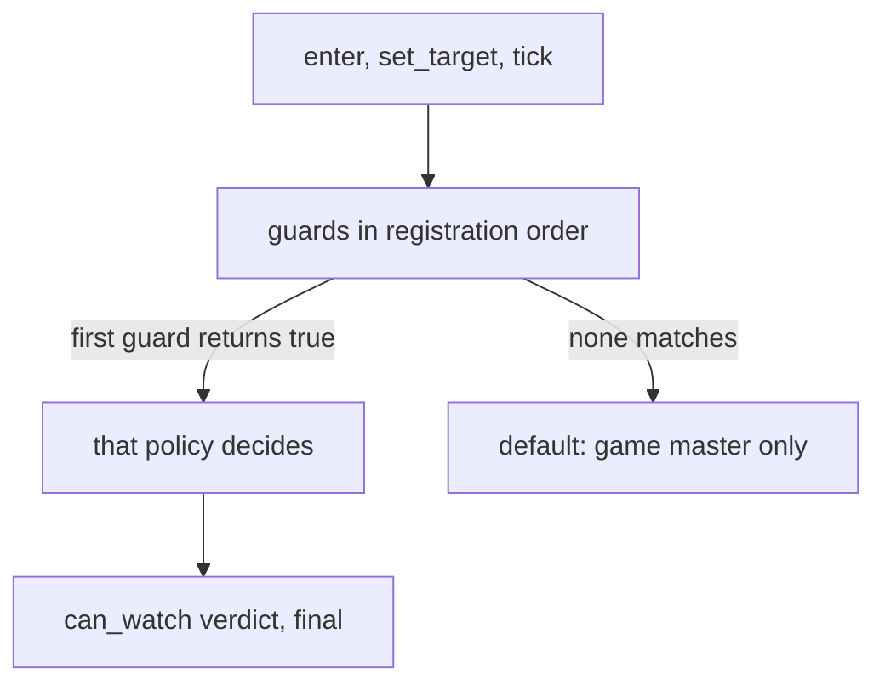

# Spectator policy and spectator manager reference

Spectating is two pieces. The spectator manager, `forge.sys.game.spectator`, puts a player into a hidden, immune state and moves the camera: a free camera, or a camera locked on another player that you cycle through. The spectator policy, `forge.sys.game.spectator_policy`, is the rule you register from Lua that says who may watch, whom, in what order the targets cycle, and what happens when the viewer leaves. You reach for them when an event, a match or a ceremony needs onlookers. The manager does nothing useful without a policy, and a policy does nothing until something calls `enter`. The forge file layout is in the [Forge API reference](/docs/core/luna-forge). How the server talks to the client around it is in [the bridge](/foundations/luna/bridge).

## Quick start

`watch_room.forge` lets any player on one map take a free camera, with no targets to lock on. A viewer who leaves is sent back to the place they came from.

```forge
forge watch_room begin
    environment game begin
        local policy = forge.sys.game.spectator_policy
        local ROOM_MAP = 1

        local handle = policy.register(
            "watch_room",
            function(viewer, target)
                return viewer:get_map_index() == ROOM_MAP
                    and (target == nil or target:get_map_index() == ROOM_MAP)
            end,
            function(viewer, target)
                return { allowed = target == nil }
            end,
            function(viewer)
                return {}
            end,
            function(viewer)
                viewer:exit_to_saved_location()
            end)

        forge.sys.log(0, "registered, handle " .. handle)
        return { handle = handle }
    end
end
```

Add the file to the compiler list, compile, restart the game cores. A game master standing on map 1 types `/spectate free`: the body disappears, the camera detaches and moves with W, A, S and D. A player of any level can send `/observer_exit` (the client's "exit observer" button does) and returns to the saved location. From a script, the same entry is `forge.sys.game.spectator.enter(ch, { mode = forge.sys.game.spectator.MODE.FREE })`.

## Files and setup

A policy has no file of its own and no config key. It lives in whatever forge or quest registers it, and exists only in the Lua state of a game core.

- `forge.sys.game.spectator` and `forge.sys.game.spectator_policy` exist on game cores only, in the forge game environment.
- Compile and register the file as for any forge, see [Forge API reference](/docs/core/luna-forge). Forges are not reloaded: after a change, restart the game cores.
- The policy list is not saved. After a restart only the policies that register again exist.
- Viewer state is not saved either. It is kept in memory per player id and forgotten when the character is destroyed, with no packet.
- Nothing calls `enter` for you. A player is spectating only after your script, a game master command or native code asked for it.

With nothing registered, or when no registered guard matches, the default applies: a game master (level above player) may watch, an ordinary player is refused. The default target list is every connected player on the viewer's map except the viewer and anyone already in observer mode, sorted by player id, and it is empty for players who are not game masters. It is not filtered by `can_watch`. This is not the same as the verdict of a policy that matched: see the pitfalls.

## The spectator manager API

### `forge.sys.game.spectator`

| Name | Signature | Returns | What it does |
| --- | --- | --- | --- |
| `enter` | `enter(ch, options)` | `boolean` | Starts spectating. `false` is a refusal. |
| `set_target` | `set_target(ch, target_pid)` | `boolean` | Sets the target by player id. In locked mode it also moves the camera. |
| `set_mode` | `set_mode(ch, mode)` | `boolean` | Switches between `MODE.FREE` and `MODE.LOCKED`. `MODE.NONE` returns `false`: use `leave`. |
| `leave` | `leave(ch, restore_here)` | nothing | Ends spectating. `restore_here` is a boolean, see below. |
| `invalidate` | `invalidate(target_pid)` | nothing | Marks every viewer locked on that player id: the next manager tick asks the policy again. |
| `is_spectating` | `is_spectating(ch)` | `boolean` | Whether the character has a spectator state. |
| `get_target` | `get_target(ch)` | `number` | The player id of the locked target, or 0. |
| `MODE` | table with `NONE`, `FREE`, `LOCKED` | | The values 0, 1 and 2. |

All calls are synchronous and run on the game thread. Targets are player ids, never VIDs: use `target:get_player_id()`.

`enter` options:

| Field | Type | Meaning |
| --- | --- | --- |
| `mode` | `number` | `MODE.FREE` or `MODE.LOCKED`. A missing `mode` is `MODE.NONE` and `enter` refuses. |
| `target_pid` | `number?` | Player id of the target. Required for `MODE.LOCKED`. |
| `x`, `y` | `number?` | World coordinates where a free camera starts. Both or neither: only one of them makes `enter` return `false`. Without them the free camera starts at the body. |

`enter` refuses, returning `false`, when:

1. the character is missing, has no connection, is not a player, or has no player id, or the mode is neither free nor locked;
2. the mode is locked and `target_pid` is not an online player;
3. a target was given and is not natively valid (see below), which refuses before the policy is asked and with no chat line, or the policy refuses (see "How the policy is asked"). A refusal that carries a `locale_key` is sent to the viewer as an info chat line;
4. the free start point cannot be placed on the map: it is clamped into the map rectangle, then moved to the nearest walkable cell, and a failure refuses.

A `target_pid` that is an online player is passed to the policy as the target even in free mode, though a free viewer stores no target. If the body stands on a cell nobody can walk on, `enter` first moves it to the nearest walkable one, and refuses when that fails. On success the character stops, becomes hidden and immune (observer mode), the camera anchors on the target in locked mode or on the start point in free mode, and the client is told. Calling `enter` for a player who is already spectating replaces their state.

`set_target` returns `false` when the character is not spectating, the target is not online, or the policy refuses (with the chat line). In locked mode the camera jumps to the target. In free mode it only stores the target, so that a following `set_mode(ch, MODE.LOCKED)` uses it. `set_mode` to locked with no valid stored target cycles forward to the first allowed one, and when there is none it reverts to free and returns `false`. `set_mode` to free drops the target and keeps the last camera position.

`leave(ch, restore_here)`:

| `restore_here` | Result |
| --- | --- |
| `true` | The body becomes visible where it stands. |
| `false` | The body stays hidden and immune, for a warp that follows at once. |

The second argument is required. Always write it.

### `forge.sys.game.spectator_policy`

| Name | Signature | Returns | What it does |
| --- | --- | --- | --- |
| `register` | `register(name, guard, can_watch, targets, on_leave)` | `number` handle, greater than 0 | Appends a policy to the end of the list. `on_leave` is optional. |
| `unregister` | `unregister(handle)` | `boolean` | Removes the policy. `true` when found, `false` for an unknown handle. |

`register` parameters:

| Parameter | Type | Meaning |
| --- | --- | --- |
| `name` | `string` | Shown in log lines and errors. Never compared: duplicates are two policies. |
| `guard` | `fun(viewer, target): boolean` | "Is this viewer mine?" `target` may be `nil`. |
| `can_watch` | `fun(viewer, target): table` | "May this viewer watch this target?" Returns a verdict table. `target` may be `nil`. |
| `targets` | `fun(viewer): table` | The cycle order. An array of character objects or player ids. |
| `on_leave` | `fun(viewer)` | Optional. Takes over the whole exit when the viewer leaves with `/observer_exit`. |

The verdict table has two fields: `allowed` (`boolean`, true to allow) and `locale_key` (`string`, a message for the viewer). A field that is missing or of the wrong type keeps its default, and the default of `allowed` is `false`. A verdict of `{}` refuses.

A `guard`, `can_watch` or `targets` that is not a function, or an `on_leave` that is given and is not one, stops the call with `spectator_policy.register: <slot> is not callable`, where `<slot>` is the parameter name. Inside a forge environment body that error fails the forge load. Handles grow by one per registration and are never reused.

## The C++ registration

Engine code registers on the same list through the policy singleton. The signature mirrors the Lua one, with plain functions, and the handle is kept for `Unregister` in the owner's destructor.

```cpp
using GuardFn = std::function<bool(CHARACTER*, CHARACTER*)>;
using WatchFn = std::function<SpectatorVerdict(CHARACTER*, CHARACTER*)>;
using TargetsFn = std::function<std::vector<uint32_t>(CHARACTER*)>;
using LeaveFn = std::function<void(CHARACTER*)>;
using handle_t = uint64_t;
```

```cpp
handle_t Register(std::string name, GuardFn guard, WatchFn watch, TargetsFn targets,
    LeaveFn on_leave = {});
```

A C++ `targets` returns player ids only. A C++ payload returns its value directly, so the failure rules for Lua callbacks below do not apply to it. A C++ registration with no `guard` matches every viewer, and one with an empty `watch` or `targets` is refused with a handle of 0 and a log line. Lua cannot do either.

Three native registrants ship, each per instance of the thing it serves: registered when the instance is created, unregistered in its destructor.

| Owner | Name | Guard | `can_watch` | `targets` | `on_leave` |
| --- | --- | --- | --- | --- | --- |
| The PvP arena | `pvp_arena` | the viewer is in this arena | free camera, or a target who is a duelist | all duelists of all teams, sorted | removes the viewer from the arena, then warps to the saved location |
| The guild war map | `guild_war` | the viewer is on this war map | free camera, or a target on the war roster | roster members present, sorted | clears the war map, then warps to the saved location |
| The wedding map | `wedding` | the viewer is on this wedding map | free camera only | none | clears the wedding map, then warps to the saved location |

The wedding registration, as engine code writes it:

```cpp
m_spectatorPolicyHandle = CSpectatorPolicy::instance().Register(
    "wedding",
    [this](CHARACTER* viewer, CHARACTER*) {
        return viewer && viewer->GetWeddingMap() == this;
    },
    [](CHARACTER*, CHARACTER* target) {
        SpectatorVerdict verdict;
        verdict.allowed = target == nullptr;
        return verdict;
    },
    [](CHARACTER*) { return std::vector<uint32_t>{}; },
    [this](CHARACTER* viewer) {
        if(viewer && viewer->GetWeddingMap() == this)
        {
            viewer->SetWeddingMap(NULL);
            viewer->ExitToSavedLocation();
        }
    });
```

Where they put viewers: arena observers enter free at the arena's observer point, war observers free at the war's observer position, wedding guests under level 10 free at their own position. When the arena or the war ends, the owner leaves each viewer with `leave(ch, false)` and warps them out. A wedding guest leaving the map is left with `leave(ch, false)` and no warp of its own.

One Lua policy ships: battle royale, registered once in its forge environment body at load and never unregistered. Its guard is scoped to the match map. The native registrations append whenever an arena, war or wedding is created, so they interleave in time with Lua registrations on the one list. All shipped guards are scoped to an instance or a match map, so none overlap.

## How the policy is asked

There is one list and no priority field. For a viewer and a target, the first policy whose guard returns `true` answers; a policy with no guard answers for everybody. The same first-match walk is done for three separate questions:

| Question | Callback | `target` passed |
| --- | --- | --- |
| May this viewer watch this target? | `can_watch` | the target, or `nil` for a free camera |
| Whom may this viewer cycle through? | `targets` | the guard is asked with `nil` |
| What happens on exit? | `on_leave` | the guard is asked with `nil` |



- A matching policy's refusal is final. There is no fall-through to a later policy and no game master override. The default applies only where nothing matches.
- The `targets` list is then filtered by the engine. An entry is dropped when the character is not found, is not a player, has no connection, is the viewer, is in observer mode, is on another map, or when `can_watch(viewer, target)` returns `allowed` false. Duplicates are removed. Order is kept and it is the cycle order.
- A `targets` entry that is neither a character object nor a number is skipped. A non-table return or an error gives an empty list.
- A cycle costs one guard pass, one `targets` call and one `can_watch` call per candidate, plus the re-check when the target is set.
- With an empty target list the manager tick turns a locked viewer into a free one at the last camera position. A client target verb on an empty list does nothing.

### Failure direction

| Callback | A Lua error or a wrong return counts as |
| --- | --- |
| `guard` | `false`: the policy does not match. Anything but a boolean, including `nil` or no return, is the same. |
| `can_watch` | a refusal. An error or a non-table is the default verdict. |
| `targets` | an empty list |
| `on_leave` | logged, and nothing else runs |

The log lines carry the policy name:

Each failure logs one of the first four lines, then the last one. Its context is `spectator_policy <name>` plus ` guard`, ` targets` or ` on_leave`; `can_watch` has no suffix.

```text
Bridge::ValidateProcessorInvocation lua error: <Lua error message>
Bridge::ValidateProcessorInvocation wrong return: expected [boolean], got [nil]
Bridge::ValidateProcessorInvocation wrong return: expected [boolean], got nothing
[spectator_policy <name> guard] lua callback error
```

`on_leave` must return nothing. Any return value is logged as `wrong return: expected [nil]`, although the body has already run.

Callbacks run synchronously on the game thread, inside whatever asked: a script call, a game master command, a client packet, the manager tick or `/observer_exit`. Do not yield. They may call back into the manager (`leave`, `enter`, `invalidate`).

## Behaviour

### Free and locked modes

| Mode | Camera | Client controls |
| --- | --- | --- |
| `FREE` | A point you move: the client sends the camera position as you press W, A, S and D. Clamped to the map. | mode verb, camera point |
| `LOCKED` | The target's position, followed each tick. | mode verb, previous and next target |

The body of a spectator is hidden and immune and stays where it was. Move packets from a spectator are ignored, and the visible set of the viewer follows the camera, not the body.

### The tick and the target checks

The manager ticks once per main loop iteration. For each viewer it:

- forgets the state when the viewer is gone;
- applies a pending camera point;
- for a locked viewer, checks the target. A target that is not natively valid is replaced at once. Otherwise, when the viewer was marked by `invalidate` or 2000 ms have passed since the last check, the policy is asked again with `can_watch(viewer, target)` (no chat line), and the viewer moves to the next target on a refusal;
- moves the camera onto the target.

The next target is the next entry of the `targets` list, wrapping around. If the current target is not on the list, "next" starts at the first entry and "previous" at the last. When nothing is left the viewer becomes free at the last camera position, not at the body.

A target is natively valid when it exists, is not the viewer, is a player with a connection, is not in observer mode and is on the viewer's map. Death is not checked.

### Client verbs

The client sends a mode verb, a target verb with a direction, and a camera point. Mode and target verbs share one 250 ms rate limit and an early verb is dropped, not queued. Camera points are accepted in free mode only, at most one per 250 ms, clamped. An early point is kept and applied at the next tick.

### The client view centre

The server moves the view anchor and tells the client its state: mode, target, camera position and, when the target is online, the target's VID and position. The client renders around the camera, not around the hidden body: in locked mode the world centre is the target's position, or the last server position if that actor is not loaded; in free mode it is a client-side free camera, moved with W, A, S and D, Shift for double speed, clamped to the terrain. Visibility checks measure from the world centre. The client keeps its own character hidden.

The client Python hook is `BINARY_SpectatorState(mode, targetVID, targetPID, targetX, targetY, anchorX, anchorY)`.

| Python call | Purpose |
| --- | --- |
| `net.SendSpectatorModePacket(mode)` | Asks for free or locked. |
| `net.SendSpectatorTargetPacket(direction)` | Asks for the next (1) or previous (-1) target. |
| `player.IsSpectating()` | Whether the client is in a spectator state. |
| `player.GetSpectatorMode()` | The current mode. |
| `player.GetSpectatorTarget()` | The target's VID. |
| `player.SPECTATOR_MODE_NONE`, `player.SPECTATOR_MODE_FREE`, `player.SPECTATOR_MODE_LOCKED` | The mode values. |

```python
def __Previous(self):
    net.SendSpectatorTargetPacket(-1)

def __Next(self):
    net.SendSpectatorTargetPacket(1)

def __Follow(self):
    net.SendSpectatorModePacket(player.SPECTATOR_MODE_LOCKED)

def __Free(self):
    net.SendSpectatorModePacket(player.SPECTATOR_MODE_FREE)
```

The standard "exit observer" game button sends `/observer_exit`, and it toggles on a mode other than none.

### Leaving

`/observer_exit` is a command every player can send. It leaves with `restore_here` false, so the body is still hidden, and then asks the policy for `on_leave`. When the matching policy has an `on_leave`, it owns the exit: the engine does not warp. When no policy matches, or the matching one has no `on_leave`, the engine warps the player to the saved location.

Inside `on_leave` the state is already erased, so `is_spectating(viewer)` is `false`. The body is still hidden and immune, so `on_leave` must finish the exit: warp the viewer, or call `leave(viewer, true)`.

Game masters have `/spectate <name>`, `/spectate free` and `/spectate off`, level high wizard. `off` leaves with `restore_here` true and never runs `on_leave`. A name enters locked on that player, or retargets a viewer who is already spectating. `/observer` is an alias. A game master on a map where a policy guard matches is subject to that policy.

## Examples

### A match registers its rule

Battle royale registers once at load. Its guard finds the match by the viewer's map and accepts a nil target. `can_watch` delegates to the match, `targets` to the match's roster, and `on_leave` to the match's exit.

```lua
local spectator_policy = forge.sys.game.spectator_policy
instance.spectator_policy_handle = spectator_policy.register(
    "battle_royale",
    function(viewer, target)
        local match = instance.match_by_map[viewer:get_map_index()]
        return match ~= nil and (target == nil or target:get_map_index() == match.map_index)
    end,
    function(viewer, target)
        local match = instance.match_by_map[viewer:get_map_index()]
        return { allowed = match ~= nil and match:can_watch(viewer, target) }
    end,
    function(viewer)
        local match = instance.match_by_map[viewer:get_map_index()]
        return match and match:spectator_targets(viewer) or {}
    end,
    function(viewer)
        instance:on_spectator_leave(viewer)
    end)
assert(instance.spectator_policy_handle > 0, "battle_royale: spectator policy registration failed")
```

The wrapper function around `on_leave` has no `return`, so the call returns nothing.

### Put an eliminated player into locked mode

The rule the match uses for `can_watch`:

```lua
function Match:can_watch(viewer, target)
    local pid = viewer:get_player_id()
    local participant = self:player_record(pid) ~= nil
    if participant then
        if not self.eliminated_by_pid[pid] or self.left_by_pid[pid] then return false end
    elseif self.manager.watching_by_pid[pid] ~= self then
        return false
    end
    if target == nil then return true end
    local target_pid = target:get_player_id()
    if not self:is_living_player(target_pid) then return false end
    if participant and self:has_living_teammate(pid) then
        return self.team_of[pid] == self.team_of[target_pid]
    end
    return true
end
```

Entering locked mode on the first allowed target:

```lua
function Match:spectator_targets(viewer)
    local targets = {}
    for _, player in ipairs(self.roster) do
        local target = CM.find_by_pid(player.pid)
        if target ~= nil and self:can_watch(viewer, target) then targets[#targets + 1] = target end
    end
    return targets
end

function Match:enter_spectator(ch)
    local targets = self:spectator_targets(ch)
    if #targets == 0 then return false end
    return forge.sys.game.spectator.enter(ch, {
        mode = forge.sys.game.spectator.MODE.LOCKED,
        target_pid = targets[1]:get_player_id(),
    })
end
```

The match calls `invalidate(pid)` for the eliminated player first, so every viewer locked on that player moves on, and then `enter_spectator` for the player themselves.

### Leave and warp out

A match leaves a watcher and a player in the same function. Both branches leave with the body still hidden and warp at once, and a player who leaves also calls `invalidate` so that viewers locked on them move on:

```lua
function Match:leave(ch)
    local pid = ch:get_player_id()
    if self.manager.watching_by_pid[pid] == self then
        forge.sys.game.spectator.leave(ch, false)
        ch:exit_to_saved_location()
        self.manager:release_watcher(pid)
        return true
    end
    if self.phase == Match.PHASE.PREPARATION or self.phase == Match.PHASE.PICK then
        -- the exit itself withdraws the player (on_player_gone)
        ch:exit_to_saved_location()
        return true
    end
    if not self.eliminated_by_pid[pid] and self.phase ~= Match.PHASE.ENDED then self:eliminate_player(pid, true) end
    self.left_by_pid[pid] = true
    forge.sys.game.spectator.invalidate(pid)
    forge.sys.game.spectator.leave(ch, false)
    ch:exit_to_saved_location()
    self.manager:release_player(pid)
    return true
end
```

## Pitfalls

**`enter` with `MODE.LOCKED` returns `false` and nothing is logged.** The target was passed as a VID, or under another field name. The manager reads `target_pid`, finds 0 and refuses. Pass `target_pid = target:get_player_id()`, and a player id to `set_target` too.

**The player stays invisible after `leave`.** `leave(ch)` without the second argument counts as `restore_here` false, which keeps the body hidden and immune. Pass `true` to restore in place, or pass `false` and warp at once.

**The guard errors, or the policy silently loses the target list.** Guards are also called with `target == nil`: for the `targets` question, for `on_leave`, and for a free `enter`. `target:get_map_index() == X` errors and counts as `false`. `target ~= nil and ...` returns `false` for the nil call, and the target list and the exit fall to a later policy or to the game master default. Handle `nil` explicitly: `return match ~= nil and (target == nil or target:get_map_index() == match.map_index)`. `can_watch` gets `nil` too, and the answer is "may this viewer spectate at all".

**A policy with a guard that always returns `true` answers for every viewer.** It answers ahead of every later registration, game masters included. From Lua this is a guard such as `function() return true end`; from C++ it is a registration with no guard. Scope every guard to your own map, match or instance.

**A game master is refused on your map.** First match is final. Once your guard matches, `can_watch` decides, for game masters too. The game master default applies only where no guard matches.

**`can_watch` returns `{}` and everyone is refused.** `allowed` defaults to `false`, and an error or a missing table refuses. The spectator policy fails closed, the opposite of the item use and skill use policies. Return `{ allowed = true }` for what you allow.

**A viewer keeps watching a dead target.** The manager does not check death. The target stays watched until the 2000 ms re-check or an `invalidate`. Reject dead targets in `can_watch` and call `invalidate(pid)` on death, elimination, logout and warp.

**`on_leave` leaves the player hidden where they stood.** When a policy has an `on_leave`, the engine does not warp. If `on_leave` errors or does nothing, the player is no longer spectating but is still hidden and immune. Always end it with a warp or `leave(viewer, true)`, and do not `return` the result of a helper: a returned value is logged as `wrong return: expected [nil]`.

**The cycle list is shorter than your `targets`.** Entries that fail `can_watch`, are in observer mode, or are on another map are dropped without a log line. An empty list makes the next tick turn a locked viewer free.

**`set_mode(ch, MODE.NONE)` does nothing.** It returns `false`. Use `leave`.

**A second "next" within 250 ms does nothing.** Client verbs inside the rate limit are dropped, not queued.

**`set_observer_mode` no longer exists in Lua.** Only `is_observer_mode` is bound: the raw flag, true for a spectator and also after `leave(ch, false)`. Entering and leaving the state goes through the manager.

**"Observer" elsewhere is not spectating.** The raid observer list is a UI subscription. The match browser forge warps a player into an arena or war and the native policy then takes over. The compact scoreboard and the lobby and queue forges use the word for their own lists. None of these go through the manager.

**A rule registered on one core does not hold on another, and forges are not reloaded.** Registrations are per core process. Restart the game cores after a change.

## See also

- [Forge API reference](/docs/core/luna-forge): file layout, environments and load order.
- [Battle arbiter reference](/docs/building-blocks/battle-arbiter): the other registry with the same register and unregister pattern and a fail-closed guard.
- [The bridge](/foundations/luna/bridge): how Lua callbacks cross into the engine, and why a wrong return type is logged and falls to a safe default.
