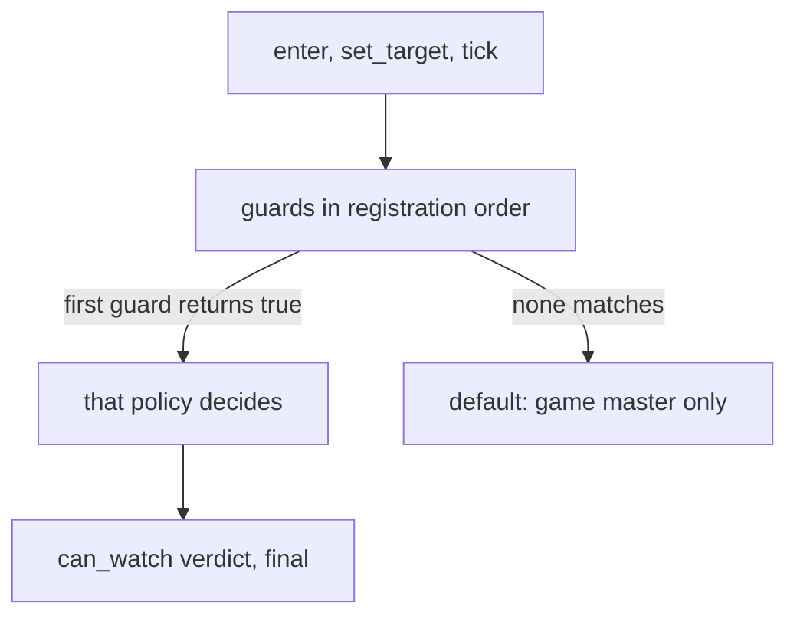

# Spectator policy: behaviour

The [spectator API](/docs/building-blocks/spectator) selects a policy separately for each question and maintains each viewer's camera on the game core.

## Policy selection

The first guard that returns `true` answers the question. Registration order is the order within one core; across forges it follows forge load order, which is not guaranteed. A matching refusal is final, including for game masters.

| Question | Callback | Guard target |
| --- | --- | --- |
| May the viewer watch? | `can_watch` | Target, or `nil` for free camera |
| Which targets can be cycled? | `targets` | `nil` |
| What happens on exit? | `on_leave` | `nil` |

When no guard matches, only game masters may watch. Their default target list contains connected players on the same map, excluding the viewer and observers, sorted by player ID; ordinary players get an empty list. This default list is not filtered by `can_watch`.

The policy result depends on the first matching guard:

The PvP arena (the native arena object, rebuilt from the mainline arena manager) registers `pvp_arena` per instance and unregisters it on destruction. Its guard selects viewers in that arena; it allows free camera or a duelist target, returns sorted duelists from all teams, and removes and warps an exiting viewer to the saved location. When the arena ends, it leaves viewers hidden and warps them out.

## Camera and targets

| Mode | Camera | Controls |
| --- | --- | --- |
| `FREE` | A movable point clamped to the map. | W, A, S, D; Shift doubles speed. |
| `LOCKED` | The target's position, followed each tick. | Previous and next target. |

The body remains hidden and immune. Spectator movement packets are ignored, and visibility follows the camera. The client renders around its free camera or the locked target, using the last server position if the target actor is not loaded.

The manager filters `targets` entries that are missing, disconnected, not players, the viewer, observers, on another map, or refused by `can_watch`. It removes duplicates and preserves order. Entries that are neither character objects nor numbers are skipped. Each cycle rechecks candidates and checks the selected target again.

Each tick applies a pending camera point and checks a locked target. Native validity requires an online connected player on the viewer's map, other than the viewer and not in observer mode; death is not checked. The policy is rechecked after `invalidate` or 2000 ms. A failed check cycles to the next target; an empty list switches to free at the last camera position. If the current target is absent from the list, next starts at the first entry and previous at the last.

Mode and target client verbs share a 250 ms limit; early verbs are dropped. Free camera points are accepted at most once per 250 ms, clamped to the map, and an early point is applied at the next tick.

## Exit and lifetime

`/observer_exit` calls `leave(ch, false)` and selects `on_leave` with a nil target. A matching callback owns the exit; otherwise the engine warps the viewer to the saved location. The state is already erased when the callback runs, but the body is still hidden and immune. Warp the viewer or call `leave(viewer, true)`.

`/spectate off` restores the body in place without calling `on_leave`. A named target enters locked mode or retargets an existing viewer. Registrations exist only in the registering core and must be registered again after a restart. Viewer state is forgotten when the character is destroyed, without a packet.

## Callback failures

| Callback | Lua error or wrong return |
| --- | --- |
| `guard` | Does not match; only a boolean is accepted. |
| `can_watch` | Refuses; an error or non-table gives the default verdict. |
| `targets` | Returns an empty list. |
| `on_leave` | Logs the error and performs no fallback. It must return nothing. |

Callbacks run synchronously on the game thread through the [bridge](/foundations/luna/bridge), which invokes Lua from the engine. Do not yield. A callback can call the manager, including `leave`, `enter`, or `invalidate`. Errors include the policy name; a value returned from `on_leave` is logged as `wrong return: expected [nil]`.

## Pitfalls

**Locked entry returns `false`.** The target must be an online player ID in `target_pid`, not a VID. Use `target:get_player_id()`.

**A viewer stays invisible after leaving.** `leave(ch, false)` keeps the body hidden and immune. Pass `true` to restore in place, or warp immediately after passing `false`.

**Target cycling or exit selects another policy.** Guards are called with `target == nil` for those questions. Handle nil explicitly in both `guard` and `can_watch`.

**A game master is refused.** The first matching policy decides for every viewer. Scope the guard to your room or match and return `{ allowed = true }` for permitted viewers.

**A dead target remains watched.** Native validity does not test death. Refuse dead targets in `can_watch` and call `invalidate(pid)` when their eligibility changes.

**An exiting player remains hidden.** An `on_leave` callback takes over the exit even if it errors. Finish with a warp or `leave(viewer, true)`, and return nothing.

**A second target verb does nothing.** Verbs inside 250 ms are dropped. Wait before sending another.

**`set_mode(ch, MODE.NONE)` returns `false`.** Use `leave` to end spectating. `is_observer_mode` reads the raw flag, which can remain true after `leave(ch, false)`; spectator state is checked with `is_spectating`.

Next: [Spectator examples](/docs/building-blocks/spectator/examples).
