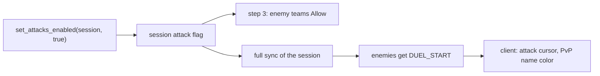

# Team manager reference

The [battle arbiter](/docs/building-blocks/battle-arbiter) and the team manager answer different halves of one question. The arbiter decides the server's verdict: a rule you register, asked for every attacker and victim pair, that says `Allow`, `Deny` or `Pass`. It never tells the client anything. The team manager is state, not a rule: sessions, teams, allies and members. From that state it drives what the client shows (who gets the attack cursor, the name color, the target), when attacks are enabled, and its other server roles: step 3 of the attack check, the buff alliance source, the party gate and team chat. You reach for it when a match, an arena or an event needs two or more teams that fight each other and see it on screen. To build the verdict side, follow [Write a battle arbiter rule](/tutorials/battle-arbiter-rule). The forge file layout is in the [Forge API reference](/docs/core/luna-forge).

## Quick start

`skirmish.forge` opens one session on the map the GM stands on, puts two players on two enemy teams, and starts the fight on a second command. Until `/skirmish go` the two players see each other as allies and cannot hit each other.

```forge
forge skirmish begin
    environment game begin
        local PVP = forge.sys.game.pvp_team_manager
        local state = { session = 0 }

        local cmd = forge.sys.game.cmd
        cmd.register_router("skirmish", cmd.new_router(nil, {
            open = cmd.new_implementor_route("/skirmish open <pid> <pid>", { "number", "number" },
                function(ch, pid_a, pid_b)
                    if state.session ~= 0 then
                        ch:chat_packet(forge.sys.game.CHAT_TYPE.INFO, "A skirmish is already open")
                        return
                    end
                    local session = PVP.create_session(ch:get_map_index(), "SKIRMISH")
                    PVP.add_team(session, 1)
                    PVP.add_team(session, 2)
                    local ok = PVP.add_member(session, 1, pid_a) and PVP.add_member(session, 2, pid_b)
                    if not ok then
                        PVP.close_session(session)
                        ch:chat_packet(forge.sys.game.CHAT_TYPE.INFO, "Could not add both players")
                        return
                    end
                    state.session = session
                    ch:chat_packet(forge.sys.game.CHAT_TYPE.INFO, "Skirmish open, session " .. session)
                end),
            go = cmd.new_implementor_route("/skirmish go", {},
                function(ch)
                    if state.session == 0 then
                        ch:chat_packet(forge.sys.game.CHAT_TYPE.INFO, "Nothing open")
                        return
                    end
                    PVP.set_attacks_enabled(state.session, true)
                end),
            close = cmd.new_implementor_route("/skirmish close", {},
                function(ch)
                    if state.session ~= 0 then
                        PVP.close_session(state.session)
                        state.session = 0
                    end
                end),
        }))

        forge.sys.log(0, "loaded")
        return state
    end
end
```

Add the file to the compiler list, compile, restart the game cores. After `/skirmish open <pid> <pid>` the syslog shows `[OK] CPvPTeamManager::CreateSession : id=<n> map=<map> kind=SKIRMISH`. The two players get no attack cursor on each other. After `/skirmish go` they get it, and they can hit each other. `/skirmish close` clears everything the session put on their screens.

## Files and setup

A session has no file of its own and no config key. It lives in the memory of the game core that created it, and it exists only until `close_session` or a core restart.

- `forge.sys.game.pvp_team_manager` exists on game cores only, on the same table as `battle_arbiter_registry`. Forge environment code and quests reach it. Registrations and sessions are per core: `is_member` on another core is `false`.
- Compile and register the file as for any forge, see the [Forge API reference](/docs/core/luna-forge). Forges are not reloaded: after a change, restart the game cores.
- `map_index` binds the session to one map. Every broadcast, the buff alliance and the party alliance skip members who are not on that map.
- `kind` is a category string. It is sent to the client with the team list, and the client uses it to label team chat. The label comes from the locale key `TEAM_CATEGORY_<KIND in upper case>` in `Client-Files/locale/locale/universal/locale_game.txt`; with no key the player sees the raw kind. Keys exist for `ARENA`, `EMPIRE_WAR`, `GUILD_WAR`, `DUNGEON` and `RAID`. A new kind needs its own line there, and a kind longer than 31 characters is cut.
- Ids: session ids are `uint32` and start at 1 on each core, team ids are `uint16` and chosen by you, player ids are `uint32`.
- No function raises a Lua error of its own. Failures return `false` and some log to syserr.

## API

### `forge.sys.game.pvp_team_manager`

Every function runs synchronously on the core's main thread and returns at once. None yields, and there are no callbacks.

| Name | Signature | Returns | What it does |
| --- | --- | --- | --- |
| `create_session` | `create_session(map_index, kind)` | `number` session id, greater than 0 | Opens a session with no teams and attacks disabled. |
| `close_session` | `close_session(session_id)` | `boolean` | Clears the client picture of every member on the bound map and erases the session. `false` for an unknown id. |
| `add_team` | `add_team(session_id, team_id, initial_allies)` | `boolean` | Adds a team. `initial_allies` is an optional array of team ids. `false` for an unknown session or a team id already in use. |
| `remove_team` | `remove_team(session_id, team_id)` | `boolean` | Clears the picture of the team's members on the bound map, drops the team and every ally link to it. See the trap on members left behind. |
| `add_ally` | `add_ally(session_id, team_a, team_b)` | `boolean` | Makes two teams allies, both ways, and sends the affected pairs the "cannot attack" key. `true` and nothing done when `a == b` or already allied. `false` for an unknown session or team. |
| `remove_ally` | `remove_ally(session_id, team_a, team_b)` | `boolean` | Mirror of `add_ally`. Affected pairs get the "enemy" key. |
| `set_allies` | `set_allies(session_id, team_id, allies)` | `boolean` | Replaces a team's ally set. Compares with the previous set and updates only the pairs that changed. `allies` is required. |
| `are_allied` | `are_allied(session_id, team_a, team_b)` | `boolean` | `false` for an unknown session. In a known session, `true` when `a == b`, even for a team that does not exist; otherwise "is `b` in the ally set of `a`", which is `false` for an unknown team `a`. |
| `add_member` | `add_member(session_id, team_id, pid)` | `boolean` | Puts a player id on a team. Works for offline players. `true` and nothing done if the player is already in this session. `false` for an unknown session or team, or if the player is in another session on this core. |
| `remove_member` | `remove_member(session_id, pid)` | `boolean` | Takes the player out. When the player is on the bound map, clears the picture of that player against every other member on that map first. `false` if the session is unknown or the player is not in it. |
| `is_member` | `is_member(pid)` | `boolean` | Is the player id in any session on this core. |
| `set_attacks_enabled` | `set_attacks_enabled(session_id, enabled)` | nothing | The attack switch. A changed value is stored and the whole session is re-sent. The same value or an unknown session does nothing. |
| `broadcast_session` | `broadcast_session(session_id)` | nothing | Re-sends the full picture to every member on the bound map, as if each had just connected. |

Parameters: `session_id` is the number from `create_session`. `team_id` is a number of your choice. `pid` is a player id, `ch:get_player_id()` for a character. `enabled` is a boolean.

A team is always allied with itself, and a team id is never listed in its own ally set. Alliances are symmetric: the calls that change them change both teams.

What Lua cannot do: ask a session's verdict, ask which session or team a player id is in, and list a team's allies. `is_member` and `are_allied` are the only reads, so a script that needs "which team is this player on" keeps its own table from player id to team.

### Sessions opened in C++

Engine code uses the same manager through its singleton. A session opened in C++ has no Lua getter for its id, so a script cannot reach it by `session_id`. The owner exposes only the switch:

| Method | Effect |
| --- | --- |
| `LPARENA:set_attacks_enabled(enabled)` | Flips the arena's session switch, if the arena has a session. |
| `LPGWARMAP:set_attacks_enabled(enabled)` | Flips the war map's session switch, and sets the war's pre-engage state to the opposite. |

## The C++ registration

C++ owners drive a session with the same calls as Lua, on `CPvPTeamManager::instance()`. They keep the session id in a member and close it in their teardown. The manager has no registration list of its own: unlike the arbiter, it is asked directly.

| Call | Signature | Returns |
| --- | --- | --- |
| `CreateSession` | `CreateSession(int32_t map_index, std::string kind)` | `session_id_t` (`uint32_t`) |
| `CloseSession` | `CloseSession(session_id_t)` | `bool` |
| `AddTeam` | `AddTeam(session_id_t, team_id_t, std::set<team_id_t> initial_allies = {})` | `bool` |
| `RemoveTeam` | `RemoveTeam(session_id_t, team_id_t)` | `bool` |
| `AddAlly`, `RemoveAlly` | `(session_id_t, team_id_t a, team_id_t b)` | `bool` |
| `SetAllies` | `SetAllies(session_id_t, team_id_t, std::set<team_id_t>)` | `bool` |
| `AddMember` | `AddMember(session_id_t, team_id_t, uint32_t pid)` | `bool` |
| `RemoveMember` | `RemoveMember(session_id_t, uint32_t pid)` | `bool` |
| `SetAttacksEnabled` | `SetAttacksEnabled(session_id_t, bool)` | `void` |
| `BroadcastSession` | `BroadcastSession(session_id_t)` | `void` |
| `IsMember` | `IsMember(uint32_t pid)` | `bool` |
| `GetSession`, `GetTeam` | `GetSession(uint32_t pid)`, `GetTeam(session_id_t, uint32_t pid)` | `std::optional` |
| `AreAllied` | `(session_id_t, team_id_t, team_id_t)` or `(LPCHARACTER, LPCHARACTER)` | `bool` |
| `GetAllies` | `GetAllies(session_id_t, team_id_t)` | `std::set<team_id_t>` |
| `ResolveTeamChatTarget` | `ResolveTeamChatTarget(uint32_t pid)` | `std::optional<TeamChatTarget>` |
| `CanAttack` | `CanAttack(LPCHARACTER att, LPCHARACTER vic)` | `BattleVerdict` |
| `OnPlayerConnect`, `OnPlayerDisconnect` | `(LPCHARACTER)` | `void` |

`team_id_t` is `uint16_t` and `INVALID_SESSION` is 0. The query half (`GetSession`, `GetTeam`, `GetAllies`, `CanAttack`, the character form of `AreAllied`, `ResolveTeamChatTarget`) is C++ only. The arena opens its session like this, one team per arena team and every duelist added:

```cpp
m_session_id = CPvPTeamManager::instance().CreateSession(m_dwMapIndex, "ARENA");
for (const auto& [team_index, team_data] : m_teams) {
    CPvPTeamManager::instance().AddTeam(m_session_id,
        static_cast<uint16_t>(team_index));
    for (const auto& duelist : team_data.duelists) {
        CPvPTeamManager::instance().AddMember(m_session_id,
            static_cast<uint16_t>(team_index), duelist.pid);
    }
}
```

Who opens a session, and who uses an arbiter, in the shipped content:

| Content | Session | Arbiter |
| --- | --- | --- |
| Arena (C++) | Opened with kind `ARENA`, one team per arena team. The switch is on at engage, and the referee flips it with `arena:set_attacks_enabled` for an intermission. Closed when the players are warped out. | none |
| Guild war (C++) | Opened with kind `GUILD_WAR` when the war map is created, teams 0 and 1 from the two rosters. The switch is on at once. When the referee sets `pre_engage_gate` it stays off until the pre-engage timer ends, then the engine turns it on; no shipped script calls `war:set_attacks_enabled`. Closed when the war map is destroyed. | One per war, from the Lua referee |
| Battle royale (Lua) | Opened with kind `BATTLE_ROYALE`, one team per party of eligible players. Switch off at creation, on when play starts, off at match end. Closed at teardown. | One, at forge load; it denies outside PLAYING and ENDED |
| EvE classic | none | One per event |
| Land deployment (C++) | none | `land_deployment` |
| Domain | none: it has its own attack branch and its own duel broadcasts | none |

Battle royale is the only Lua owner of a session. Of the 13 Lua functions, shipped content calls `create_session`, `add_team`, `add_member`, `set_attacks_enabled` and `close_session`. A C++ door exists for everything else (`add_ally`, `remove_ally`, `set_allies`, `remove_member`, `remove_team`) and nothing ships through it: treat those paths as untested by shipped content.

## Behaviour

### Step 3 of the attack check

After the arbiters, if every one passed, the attack check asks the session manager. It looks only at player pairs. The verdict, in order:

| Pair | Verdict |
| --- | --- |
| Either side is not a player | `Pass`: mobs, pets and summons on a session map follow the ordinary rules and any arbiter |
| Neither player is in a session | `Pass` |
| Exactly one player is in a session | `Deny`, on any map |
| The two are in different sessions | `Deny`, on any map |
| Same session, either player off the bound map | `Pass` |
| Same session, same team or allied teams | `Deny` |
| Same session, enemy teams, attacks disabled | `Deny` |
| Same session, enemy teams, attacks enabled | `Allow` |

A session `Allow` beats the later steps: same party, the empire no-attack flag, PK mode, same empire. A session `Deny` beats a duel and every PK mode. The absolute refusals (dead, observer, pet, mount, safe zone, stunned attacker) still win, and any arbiter `Allow` or `Deny` is decided before the session is asked. The full order is in [the dispatch order](/docs/building-blocks/battle-arbiter#the-dispatch-order).

A session member is locked: while a player is in a session, every pair with a non-member is refused on every map of that core, not only on the bound map.

Killer mode: for same-empire player pairs, a session `Allow` means the attacker is not flagged as a killer. A session `Deny` changes nothing there.

### What the client shows

The server never sends the client a verdict. It sends one small packet per pair of players, with a status:

| Status | Name in the packet | Meaning for that pair |
| --- | --- | --- |
| 0 | `DUEL_NONE` | Remove the key for this pair |
| 1 | `DUEL_CANNOTATTACK` | Visually allied |
| 2 | `DUEL_START` | Enemy |

The client keeps one key per pair. When it holds any key, it decides attackability between two players from the keys alone and never falls to its own PK mode, empire or guild rules. So, for a session member's client:

| Other player | Key | Client |
| --- | --- | --- |
| Enemy team, attacks enabled | `DUEL_START` | Attack cursor, attackable by click, auto-target and area skills, PvP name color |
| Own team, allied team, or any enemy while attacks are disabled | `DUEL_CANNOTATTACK` | No cursor, normal name color, enemy skills refused, ally-only buffs targetable |
| Anyone with no key: outsiders, players removed from the session | none | Not attackable, normal name color |

The third row is the client's copy of the server's "exactly one in a session is denied". An outsider's client holds no keys and applies its ordinary rules to members: a player of another empire still looks like a target to them, and the server refuses.

Every duel packet makes the client drop the player's current target, close the target board and refresh every player's name color. Keys are cleared when the client leaves the game phase, so every warp starts with none.

When packets go out:

| Moment | What is sent |
| --- | --- |
| A member enters a map: login and every warp | The team list, then `DUEL_CANNOTATTACK` to allies and `DUEL_START` to enemies, both directions, for every member on the bound map |
| `add_member` for a player on this core and on the map | The same full sync |
| `set_attacks_enabled` with a changed value, `broadcast_session` | The full sync for every member on the bound map |
| A member disconnects or warps away | `DUEL_NONE` for that player to every other member. Membership stays |
| `add_ally`, `remove_ally`, `set_allies` | Only the pairs that changed |
| `remove_member`, `remove_team`, `close_session` | `DUEL_NONE` and an empty team list, members on the bound map only |

A packet to a character that is still loading is skipped, and a two-way send that starts at such a character sends nothing to the other side either. The character's own connect sync covers it.

The full sync is where the attack switch reaches the client. While attacks are disabled, enemies are sent as `DUEL_CANNOTATTACK`, so the cursor is hidden during a warm-up or an intermission.

### One switch, two effects

`set_attacks_enabled` is the only call that moves the server verdict and the client cursor together. It stores the flag that step 3 reads, then re-sends every pair.



Nothing else does this. Registering or unregistering an arbiter does not re-send keys, and an arbiter `Allow` is decided before step 3, so it overrides a closed switch. If an arbiter and a session share a pair, make the arbiter answer `Pass` for session pairs or check the same phase.

### Arbiter, session, or both

| | Battle arbiter | Team session |
| --- | --- | --- |
| Kind | A rule: guard and verdict callbacks, any pair, mobs included | State: teams, allies and a switch, player pairs only |
| Place in the attack check | Step 2 | Step 3 |
| Client | Never told: the cursor and the swing stay | Keys drive cursor, name color and targeting |
| Buffs | `Deny` is not an alliance | Allied teams buff each other across empires |
| Party and team chat | No effect | The party gate and team chat |
| Lifetime | Until `unregister` or a core restart | Until `close_session` or a core restart; survives a member's logout |

What each combination shows on screen:

- Arbiter only (EvE classic): the arbiter denies before the fight is engaged, but no keys exist, so players of other empires keep the attack cursor and swing at nothing.
- Session only (arena): the cursor and the verdict agree in every phase.
- Both, the arbiter denies (battle royale): before play the arbiter denies and the switch is off, so server and client agree. The arbiter is the hard rule; the session supplies teams, cursor, buffs and chat.
- Both, the arbiter allows (guild war): the referee's verdict allows two players of different war teams, with no pre-engage check, and it is asked before step 3. While a war's pre-engage gate holds the switch off, clients show no cursor but the server accepts a hit between the teams.

The domain is on neither system. It has its own attack branch and its own duel broadcasts, which land in the same client key map, so a domain fight changes cursors too.

### Buffs

The session is the alliance source for player buffs. For a caster and a target:

- a caster that is not a player buffs only targets that are not players, and a player cannot buff a non-player;
- two players on the bound map, in the same session, on the same team or on allied teams, can buff each other, across empires;
- otherwise, if either is a session member, they cannot, on any map, for as long as the membership lasts;
- otherwise an attackable pair cannot, and anyone else can only when they are of the same empire.

### The party gate

A party invitation between two players is refused with `PERR_ENEMY`, shown as `<Party> You cannot invite an enemy.`, when either of them is in a session and they are not in the same session, or they are in the same session but not allied. This check comes after the party join policy and cannot be overridden by it. Because the allied test needs both players on the bound map, two allied members invite each other only there.

`add_member` also protects the other direction: if the joiner is in a party with a member of this session who is on a non-allied team, the joiner is removed from the party.

### Team chat

A team chat message from a player in no session is dropped without a word. Otherwise it goes to the sender and to every member of the sender's own team on the bound map, labeled by the session kind. Allied teams do not share team chat.

## Examples

### A session from parties, with warm-up, play and end

Battle royale builds its teams from the parties of the players who entered the match. It closes the session on any failure so a half-built session never stays open.

```lua
function Match:freeze_teams()
    local eligible = {}
    for _, player in ipairs(self.roster) do eligible[player.pid] = true end

    local session_id = PVP.create_session(self.map_index, "BATTLE_ROYALE")
    if session_id == 0 then return false end
    local assigned = {}
    local team_id = 0
    for _, player in ipairs(self.roster) do
        if not assigned[player.pid] then
            local ch = CM.find_by_pid(player.pid)
            local leader = player.pid
            local members = { player.pid }
            if ch ~= nil and ch:get_map_index() == self.map_index then
                leader, members = self:party_team(ch, eligible)
            end
            team_id = team_id + 1
            if not PVP.add_team(session_id, team_id) then
                PVP.close_session(session_id)
                return false
            end
            self.teams[team_id] = { leader = leader, members = members, out = false, placement = nil }
            for _, pid in ipairs(members) do
                if not PVP.add_member(session_id, team_id, pid) then
                    PVP.close_session(session_id)
                    return false
                end
                assigned[pid] = true
                self.team_of[pid] = team_id
            end
        end
    end
    PVP.set_attacks_enabled(session_id, false)
    self.session_id = session_id
    return true
end
```

The switch goes on with `PVP.set_attacks_enabled(self.session_id, true)` when play starts and off again when the match ends. The match keeps its own `team_of` table, because a script cannot ask the session which team a player is on. Teardown:

```lua
if self.session_id ~= 0 then
    PVP.close_session(self.session_id)
    self.session_id = 0
end
```

### An intermission through the arena

The arena's session is not reachable from Lua, so the referee uses the arena's own switch. Between rounds it turns attacks off, which hides the cursor and denies every pair, and turns them on when the next round starts.

```lua
arena:set_attacks_enabled(false)
```

```lua
arena:set_attacks_enabled(true)
```

### A mid-match alliance

Three teams, 1 and 2 allied against 3. Every team is added before any alliance is declared, and the alliance is made with `add_ally`, which also re-sends the two teams' pairs. No shipped content does this; the order is what the traps below require.

```lua
local PVP = forge.sys.game.pvp_team_manager

local function open_three_teams(map_index)
    local session = PVP.create_session(map_index, "SKIRMISH")
    PVP.add_team(session, 1)
    PVP.add_team(session, 2)
    PVP.add_team(session, 3)
    PVP.add_ally(session, 1, 2)
    return session
end

local function betray(session)
    PVP.remove_ally(session, 1, 2)
    PVP.broadcast_session(session)
end
```

`broadcast_session` in `betray` is deliberate: see the trap on alliance changes during a warm-up.

## Pitfalls

**Nobody can hit anybody and the session looks right.** Attacks are off after `create_session`. Every other member shows as visually allied and step 3 denies every pair. Call `set_attacks_enabled(session, true)` when play starts. Calling it with `false` right after creation does nothing.

**A player who left the map still cannot hit or be hit by anyone.** Membership outlasts the map and the login. The "one in, one out" rule comes before the map rule, so such a player is refused against every outsider on every map of that core, cannot give or receive player buffs, and cannot join a party with outsiders until `remove_member` or `close_session`. Disconnecting keeps membership on purpose, so a player who comes back gets the picture again. Call `remove_member` when a player leaves for good.

**An alliance is one-sided.** `add_team(session, 1, { 2 })` before team 2 exists stores 2 in the ally set of team 1 and skips the reverse link. After `add_team(session, 2)`, `are_allied(session, 1, 2)` is `true` and `are_allied(session, 2, 1)` is `false`. Step 3 then denies 1 hitting 2 and allows 2 hitting 1. `set_allies` with an id that is not a team does the same. Add every team first, then call `add_ally` or `set_allies` with existing ids only.

**`remove_team` leaves its players half in.** The team and the players' session index are erased, but the session's own player-to-team table keeps them. The next full sync sends those players the enemy key again, with a cursor the server refuses. It also sends `DUEL_START` to every pair of the team before it sends `DUEL_NONE`. Call `remove_member` for each member first, then `remove_team`.

**Removing an ally gives a cursor that the server refuses.** `remove_ally` and the removed half of `set_allies` send `DUEL_START` whatever the switch says. During a warm-up the new enemies get the cursor while step 3 denies. Call `broadcast_session(session)` after alliance changes made while attacks are off.

**You changed a rule and the cursor did not follow.** Only `set_attacks_enabled` and `broadcast_session` re-send keys. An arbiter, a PK mode or a duel change does not. An arbiter `Allow` also overrides a closed switch: give the arbiter the same phase check, or have it answer `Pass` for session pairs.

**Targets vanish for everyone.** Every duel packet drops the receiver's target and closes the target board. Toggling the switch or calling `broadcast_session` in the middle of a fight de-targets every member on the map. Toggle at phase changes, not in loops, and prefer `add_ally` and the other pair calls for small changes.

**`add_member` returns `false` for a player who is in another session.** A player is in one session per core. Check syserr for `CPvPTeamManager::AddMember : pid=<p> already in session=<a>, refusing add to session=<b>`. To move a player between teams, `remove_member` first, then `add_member`.

**The session does nothing on a core that does not own it.** `is_member` is `false` on every other core, and nothing is saved across a restart. Open the session on the core that hosts the map.

**Mobs ignore the session.** A non-player is never in a session and `CanAttack` passes every pair that has one. Mobs, pets and summons on the map follow the ordinary rules and any arbiter. Players cannot buff them and they cannot buff players.

**Team chat shows `BATTLE_ROYALE` or another raw kind.** The client found no `TEAM_CATEGORY_<KIND>` line. Add it to `locale_game.txt`. Team chat only reaches the sender's own team, so allies do not see it.

**Nothing shows on the bound map and allies cannot buff.** The session is bound to a different `map_index`. Broadcasts, the buff alliance and the party alliance skip members who are not on that map.

**You expect `are_allied` to answer both ways.** It reads one direction. Alliance calls keep the sets symmetric, so it is the same answer unless an ally was named before its team existed.

## See also

- [Battle arbiter reference](/docs/building-blocks/battle-arbiter): the server's verdict, the dispatch order and killer mode.
- [Write a battle arbiter rule](/tutorials/battle-arbiter-rule): a rule built and broken on purpose.
- [Forge API reference](/docs/core/luna-forge): file layout, environments and load order.
