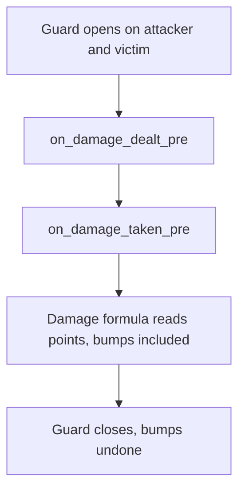

# Traits reference

A trait is behaviour that a character carries while an affect is up. The affect is the gate: whatever adds the affect switches the trait on, and whatever removes the last affect of that type switches it off. In between, the trait receives hooks (a damage is about to be dealt, a tick passed, a heal arrives), keeps per-character counters, cooldowns and state, and can change a number the engine is computing.

You reach for a trait when a bonus has a condition ("while below half health"), a counter ("after ten hits"), or a place in the damage formula that a plain affect point cannot express. A flat bonus with no condition stays an [affect](/docs/building-blocks/affects) on a point. The sibling policies are the [battle arbiter](/docs/building-blocks/battle-arbiter) and the [death manager](/docs/building-blocks/death-manager). The forge file layout is in the [Forge API reference](/docs/core/luna-forge).

A trait definition carries no gate and no numbers. Both belong to a binding of the definition to an affect type, so one definition can be gated by several affects with different numbers. `define` with a `gate` is shorthand for "define, then bind once".

## Quick start

This module, loaded by a forge, defines a trait that adds 15 to `ATTBONUS_HUMAN` on a melee basic attack while the holder is under half health. `start_fury` raises the gate for ten minutes.

```lua
affect.add_name_definition("EXAMPLE_FURY", 3900)
affect.add_no_save(affect.name_map.EXAMPLE_FURY)

forge.sys.game.traits["define"]{
    id   = "example_fury",
    gate = { affect = affect.name_map.EXAMPLE_FURY },
    hooks = {
        on_damage_dealt_pre = function(ch, victim, dam_type, ctx)
            if dam_type ~= forge.sys.game.DAMAGE_TYPE.NORMAL then return end
            if ch:get_hp_pct() < 50 then
                ctx.bump_point(point.ATTBONUS_HUMAN, 15)
            end
        end,
    },
}

local function start_fury(ch)
    ch:add_affect(affect.name_map.EXAMPLE_FURY, point.NONE, 0, 0, 600, 0, true)
end

local function stop_fury(ch)
    ch:remove_affect(affect.name_map.EXAMPLE_FURY)
end
```

After `start_fury(ch)`, every melee auto attack of `ch` that starts below 50 percent health is computed with `ATTBONUS_HUMAN` 15 higher, and the bonus is gone again when the hit has been computed. Ten minutes later the affect expires and the trait deactivates. `ATTBONUS_HUMAN` is a percentage and counts only when the victim is a player or a monster flagged human. Against other monsters bump the matching point (`ATTBONUS_ANIMAL`, `ATTBONUS_UNDEAD`, `ATTBONUS_DEVIL`, `ATTBONUS_ORC`, `ATTBONUS_MILGYO`, `ATTBONUS_FIRE`), or read `victim` in the hook and choose the point from it. Pick an affect id nobody else uses; the affect id ranges are listed in the [affects reference](/docs/building-blocks/affects#type-ids).

## Files and setup

| What | Where | Notes |
| --- | --- | --- |
| Lua API | `forge.sys.game.traits` | Works at the top level of a forge `environment game` block and in modules a forge loads. Generated stub: `forge.sys.game.traits.lua` in the quest `meta` folder. |
| Definitions | Lua, boot time | `define` runs once per id. Defs are never removed. |
| Skill binding | `traits:` on a skill node in the skill config folder | See [Binding a trait](#binding-a-trait). |
| Colocated trait | `traits/<id>.lua` next to the skill files | Loaded by the skill loader when no other source defines the id. |
| Native traits | C++, registered at static initialisation | See [C++ registration](#c-registration). |

Forges are not reloaded. Defining the same id a second time in one process fails with `duplicate id`, and the first definition and its hooks stay. After a change, restart the game cores.

`forge.sys.game.traits.stack_changed(ctx, n)` is a pure-Lua helper that ships beside the engine functions. It returns true when `n` differs from the last value it saw on this ctx and remembers `n` in `ctx.state.applied_stacks`. Use it as an idempotency gate in hot hooks so that identical stack values do not re-send an affect or a chat line.

## API

Every per-character function takes a trait **name** (the `id` of the def) and resolves it to this character's binding in this order: the active binding of that def, else any node of that def, else the def's first binding. If the character has no trait data at all, the call is a no-op that returns 0, `false` or nothing.

| Function | Signature | Returns | What it does |
| --- | --- | --- | --- |
| `define` | `define(def)` | dense def id (`> 0`), or `0` on failure | Registers a def. With `gate`, it also binds at once, with no formulas. Logs `[OK] [traits] define [id] id=.. affect_gate=.. binding=.. hook_mask=0x..`. Errors are under [define errors](#define-errors). |
| `bind` | `bind(trait_id, affect_type, formulas?)` | binding id, or `0` | Gates a trait on an affect with this binding's formulas. Each formula string is analysed; a bad one logs `[traits] bind [id]: cannot analyze formula [name]: 'expr'` and is kept empty. An unknown trait id returns `0` with no log line. Binding the same (trait, affect) pair again returns the same id with the formulas replaced. |
| `unbind` | `unbind(binding_id)` | nothing | Takes the binding out of the affect index. Characters already holding it keep working until their gate closes. Binding the same pair again re-indexes it. |
| `prime_constants` | `prime_constants(ch, binding_id, values)` | nothing | Gives the character's node the constants of the binding. Only string keys with number values are kept, the rest are skipped silently. It replaces the node's whole constants map. |
| `is_active` | `is_active(ch, trait_id)` | `boolean` | The gate is open and the trait is not disabled. |
| `counter` | `counter(ch, trait_id, name)` | number | The counter value, `0` for an unknown counter, trait or character. |
| `add_counter` | `add_counter(ch, trait_id, name, delta)` | number | Adds `delta` and returns the new value. `delta` is an unsigned 64-bit value: do not use it to decrement, use `set_counter`. |
| `set_counter` | `set_counter(ch, trait_id, name, value)` | nothing | Overwrites a counter. |
| `reset_counters` | `reset_counters(ch, trait_id)` | nothing | Zeroes every counter, keeps the state. |
| `reset_state` | `reset_state(ch, trait_id)` | nothing | Only if active. Cancels schedules, clears cooldowns, zeroes counters, gives a fresh `ctx.state` and runs `on_activate` again. Constants are kept. |
| `set_cooldown` | `set_cooldown(ch, trait_id, name, seconds)` | nothing | Starts or restarts a named cooldown. The deadline is whole seconds, rounded up. |
| `cooldown_remaining` | `cooldown_remaining(ch, trait_id, name)` | number | Seconds left, `0` if expired or never set. |
| `is_on_cooldown` | `is_on_cooldown(ch, trait_id, name)` | `boolean` | `cooldown_remaining > 0`. |
| `clear_cooldown` | `clear_cooldown(ch, trait_id, name)` | nothing | Drops a cooldown at once. |
| `schedule` | `schedule(ch, trait_id, name, seconds)` | nothing | A one-shot delayed callback to `on_scheduled(ch, name, ctx)`. A pending schedule of the same name is cancelled first. The minimum delay is one pulse. |
| `cancel_scheduled` | `cancel_scheduled(ch, trait_id, name)` | nothing | No-op if none is pending. |
| `is_scheduled` | `is_scheduled(ch, trait_id, name)` | `boolean` | A schedule with this name is pending. |
| `disable` | `disable(ch, trait_id)` | nothing | Only if active. Hooks and auto-accumulation stop. State, counters and the affect stay. |
| `enable` | `enable(ch, trait_id)` | nothing | Resumes a disabled trait. |
| `is_disabled` | `is_disabled(ch, trait_id)` | `boolean` | |
| `disable_all` | `disable_all(ch)` | nothing | Disables every active trait on the character. |
| `enable_all` | `enable_all(ch)` | nothing | Enables every disabled trait on the character. |

### The definition table

| Field | Type | Meaning |
| --- | --- | --- |
| `id` | string, required | The name every other call uses. |
| `gate` | `{ affect = <affect type> }`, optional | Binds to this affect immediately. Without it, the trait stays unbound until a skill node or `bind` binds it. |
| `stage` | integer, default `0` | Order among traits that share one formula position, ascending. See [Stage ordering](#stage-ordering). |
| `counters` | list, optional | A plain string is a manual counter. `{ name = "dealt", accumulate = "DAMAGE_DEALT_POST" }` also fills itself. |
| `keep_state_on_deactivate` | boolean, default `false` | Keep `ctx.state` when the gate closes. |
| `hooks` | table, optional | The behaviour. Each hook you declare subscribes the trait to its trigger. A def with no hooks and no accumulating counters is never dispatched. |

A misspelled hook name is not an error. Only the 24 known names are read.

### Counters that fill themselves

An `accumulate` counter is bumped inside the engine with no Lua call, so it is free even on the damage path. What a counter gains per trigger is fixed by the trigger, not inferred from the value:

| Trigger | Gain per event |
| --- | --- |
| `DAMAGE_DEALT_POST`, `DAMAGE_TAKEN_POST` | the `dam` of the post hook, never below 0 (see [the post hooks](#hooks)) |
| `HEAL_DONE`, `HEAL_TAKEN` | the heal amount, never below 0 |
| `KILL`, `DIED`, `TICK_1HZ`, `SKILL_CAST`, `DEBUFF_GIVEN`, `DEBUFF_TAKEN`, `BUFF_GIVEN`, `BUFF_TAKEN` | 1 |

The other trigger names are accepted by the parser and never count, see [trap 8](#pitfalls). An unknown `accumulate` string logs an error and the counter is added as manual-only.

### Define errors

`define` returns `0` after the first four. The two counter errors log and go on defining.

| Log line | Cause |
| --- | --- |
| `[traits] define: missing id` | The table has no `id`. |
| `[traits] define: duplicate id [{}]` | The id is already defined in this process. |
| `[traits] define [{}]: a native trait already owns this id` | A C++ trait registered the id. |
| `[traits] define [{}]: gate is present but gate.affect is 0` | For example `affect.name_map.X` is `nil`. |
| `[traits] define [{}]: unknown accumulate [{}]` | The counter exists, manual only. |
| `[traits] define [{}]: counter without name` | That counter is skipped. |

## Hooks

Each hook you declare adds its trigger bit to the trait's mask. `on_activate`, `on_deactivate` and `on_scheduled` add no bit. In every signature `ch` is the character the trait is attached to and `ctx` is that character's ctx for this binding. Where a character may be absent, the argument is `nil`.

| Hook | Arguments | Fires when |
| --- | --- | --- |
| `on_activate` | `(ch, ctx)` | The gate goes from closed to open. Counters are already zeroed and constants already primed. |
| `on_deactivate` | `(ch, ctx)` | The gate closes, and again when the character object is destroyed. In the destruction case the ctx functions do nothing, `ch` is still valid. |
| `on_scheduled` | `(ch, name, ctx)` | A `schedule` deadline elapsed. |
| `on_damage_dealt_pre` | `(ch, victim, dam_type, ctx)` | Before the damage formula reads the attacker's points. Bump points here. |
| `on_damage_taken_pre` | `(ch, attacker, dam_type, ctx)` | The victim side of the same moment. `attacker` can be `nil`. |
| `on_damage_dealt_post` | `(ch, victim, dam, dam_type, ctx)` | After the hit. `dam` is the amount the damage formula handed to the victim, before the victim-side transforms and the critical and pierce adjustments that follow, so it is not the health the victim lost. Observe only. |
| `on_damage_taken_post` | `(ch, attacker, dam, dam_type, ctx)` | The same for the victim. `attacker` can be `nil`. |
| `on_damage_taken_raw` | `(ch, attacker, dam, dam_type, ctx)` | Transform, before defense. |
| `on_damage_taken_final` | `(ch, attacker, dam, dam_type, ctx)` | Transform, after the damage amplifiers. |
| `on_damage_dealt_final` | `(ch, victim, dam, dam_type, ctx)` | Attacker-side transform at the same point, before the victim's final transforms. |
| `on_hit_resolved` | `(ch, attacker, dam, dam_type, damage_flag, ctx)` | The resolved hit, with the critical and pierce bits in `damage_flag`. Observe only, but `ctx.end_self()` is valid here: a shield breaks in this hook. |
| `on_attack` | `(ch, ctx)` | `ch` threw an attack motion, any attack, hit or not. |
| `on_target_scan` | `(ch, finder, ctx)` returns `boolean` | `finder` is acquiring a target. Return `true` to hide `ch` from it. |
| `on_kill` | `(ch, victim, ctx)` | `ch` landed the killing blow. |
| `on_died` | `(ch, attacker, ctx)` | `ch` died. `attacker` can be `nil`. |
| `on_tick` | `(ch, ctx)` | Once a second while the gate is open. Declaring it enrols the character in the global one-second walk. |
| `on_skill_cast` | `(ch, skill_vnum, ctx)` | `ch` cast a skill that passed the validity checks, before the cooldown and cost checks, so a cast refused for cooldown or cost still fires it. Filter on `skill_vnum`. |
| `on_debuff_given` | `(ch, target, affect_type, ctx)` | `ch` landed a bad affect on `target`. |
| `on_debuff_taken` | `(ch, attacker, affect_type, ctx)` | The counterpart. `attacker` can be `nil` for quest or environment debuffs. |
| `on_buff_given` | `(ch, target, affect_type, ctx)` | `ch` applied a good affect to `target`. |
| `on_buff_taken` | `(ch, source, affect_type, ctx)` | `ch` received one. `source` can be `nil`. |
| `on_heal_done` | `(ch, target, amount, ctx)` | `ch` delivered a skill heal. Regeneration and potions have no healer and fire nothing here. |
| `on_heal_taken_pre` | `(ch, healer, amount, source, ctx)` | Transform, before a received heal lands. `source` is a `forge.sys.game.HEAL_SOURCE`, documented with the `forge.sys.game` namespace. |
| `on_heal_taken` | `(ch, healer, amount, ctx)` | `ch` gained health by any route. `healer` is always `nil`. |

`dam_type` is a `forge.sys.game.DAMAGE_TYPE` value. In a transform hook, `dam` is only a convenience copy: read and write `ctx.damage`.

The transform hooks run for every hit the victim takes, damage-over-time ticks and reflected damage included, while the two pre hooks run only at the three bump sites. Filter on `dam_type` (`POISON`, `BLEEDING`) when a reduction must not touch ticks. The `dam` of the post hooks is the amount handed to the victim, so a reduction written in a transform hook does not show in it.

Every Lua hook is called through a protected call. An error logs `[traits] <hook> [<trait id>]: <lua error>` and the engine carries on. `on_scheduled` adds `name=[<name>]` before the colon, and an `on_deactivate` that fails at character destruction is logged as `[traits] ~CCharTraits on_deactivate [<trait id>]: <lua error>`. A transform hook that errors leaves the damage or the heal unchanged. An `on_target_scan` that errors leaves the owner visible.

### Where the engine fires them

| Hook | Fired from |
| --- | --- |
| Gate open | Adding any affect whose type has a binding. |
| Gate close | Removing the last affect of that type, by expiry or by removal. |
| `on_damage_dealt_pre`, `on_damage_taken_pre` | The three bump sites, see [The bump point API](#the-bump-point-api). |
| `on_damage_taken_raw` | The damage resolver, before defense. |
| `on_damage_dealt_final`, then `on_damage_taken_final` | The damage resolver, after the amplifiers. |
| `on_hit_resolved` | The damage resolver, once the hit and its flags are final. |
| `on_attack` | The attack motion of a character. |
| `on_target_scan` | Target acquisition. |
| `on_kill`, `on_died` | The death handling of the victim. |
| `on_skill_cast` | The skill cast path. |
| `on_heal_done` | The skill heal. |
| `on_heal_taken` | Every change of the health point. |
| `on_heal_taken_pre` | Regeneration, potions, steal-HP, hit and kill recovery, and skill heals. Only the skill heal passes a non-nil `healer`. |

## The ctx

A ctx is built once per activation, per character and binding. Two skills that gate the same trait give a character two independent ctxs, with their own counters, cooldowns, state and numbers. A ctx kept beyond the character's life turns every function into a no-op, and the cached ctx is dropped on every activation, deactivation and `reset_state`.

### Fields

| Field | Hooks | Meaning |
| --- | --- | --- |
| `ctx.state` | all | Per-character and binding Lua scratch table. It lives until `on_deactivate`, or across gate flips with `keep_state_on_deactivate`. |
| `ctx.damage` | `on_damage_taken_raw`, `on_damage_taken_final`, `on_damage_dealt_final` | Pre-filled with the damage and read back when the hook returns. The value is rounded and clamped at 0. A non-number, or a field left untouched, leaves the damage alone. |
| `ctx.skill_vnum` | the same three transform hooks | Read-only. The skill that dealt the hit; `0` for a basic attack, a damage-over-time tick or a reflect. A cast with no performer still names its skill. |
| `ctx.amount` | `on_heal_taken_pre` | Pre-filled with the incoming heal, read back the same way as `ctx.damage`. |

### Functions

| Function | Meaning |
| --- | --- |
| `ctx.counter(name)`, `ctx.add_counter(name, delta)`, `ctx.set_counter(name, value)`, `ctx.reset_counters()` | The counter functions above, for this binding. `add_counter` returns the new value. |
| `ctx.bump_point(point, delta)` | Adds `delta` to a point of `ch`, the holder, for the rest of the damage formula. Meant for the two pre hooks only, see [below](#the-bump-point-api). |
| `ctx.set_cooldown`, `ctx.cooldown_remaining`, `ctx.is_on_cooldown`, `ctx.clear_cooldown` | The cooldown functions, for this binding. |
| `ctx.schedule`, `ctx.cancel_scheduled`, `ctx.is_scheduled` | The schedule functions. The framework owns the event and cancels it on deactivate and on character destruction. |
| `ctx.since_activation()` | Seconds since the gate opened. |
| `ctx.is_active()` | True inside hooks except during teardown. |
| `ctx.formula(name, fallback, vars?)` | Evaluates a named formula of this binding. See [Formulas and constants](#formulas-and-constants). |
| `ctx.constant(name, fallback)` | A number the binding froze when the affect landed. |
| `ctx.gate_value()` | The gating affect's own value. If several affects of that type are up, the first counts. |
| `ctx.end_self()` | Removes the affect that gates this trait, so the normal expiry path deactivates it. A trait never removes its own affect by hand. |

### Formulas and constants

A binding carries named formulas (strings in the formula language of the skill files) and the character's node carries constants (numbers). `ctx.formula(name, fallback, vars?)` evaluates one formula as follows:

1. All variables are cleared.
2. The node's constants are set by name.
3. `amount` is set to the gate value.
4. The names in `vars` are set.

`dam` is not special on this path. A formula that names `dam` gets it only when you pass `dam = ...` in `vars`. A name nobody supplies logs once per binding and formula, `[traits] formula [{}] on binding {} references [{}], which neither the gate's constants nor the call site supply - using the fallback`, and the call returns the fallback. A binding with no such formula, or an empty one, returns the fallback silently, so always pass a working default.

A constant is a number the binder resolved in its own vocabulary and froze when the affect landed, for example a caster's skill level. Anything you can read at hook time is a variable: pass it in `vars`, or a frozen value is used forever.

## The bump point API

A bump changes a point of a character for the length of one damage computation and is undone by the engine afterwards. It is how a trait says "this hit is computed as if the attacker had 15 more `ATTBONUS_HUMAN`" without a branch in the damage formula.

`ctx.bump_point(point, delta)` adds to a point of the holder and is accepted only while a guard is alive on that character. A guard wraps exactly three sites, and the two pre hooks run inside it:

| Site | `dam_type` the hooks receive |
| --- | --- |
| The melee basic attack | `NORMAL` |
| The arrow or ranged shot of a bow, or a basic attack of a magic weapon | `NORMAL_RANGE`, or `NORMAL_MAGIC` for the magic weapon |
| A skill `DAMAGE` node | The node's own declared damage type |

At each site both sides are guarded, attacker and victim, and `on_damage_dealt_pre` and `on_damage_taken_pre` fire inside the guard. The refusal is a check on whether a guard is open, not on which hook is calling. Outside every site (`on_tick`, for one) a bump is refused and logs `[traits] bump_point outside a damage-pre guard (point=.., delta=..) ignored`. But the victim's damage resolver also runs inside the guard of the melee, shot and skill sites, so a bump from `on_damage_taken_final` or a post hook there is accepted, and lives until the site ends, long after the hook. Treat the two pre hooks as the only legal place. To change damage from another hook, write `ctx.damage` in a transform hook.

A skill node with a splash evaluates its amount once and reuses it for every victim. An attacker-side bump that depends on `victim` would carry the first victim's answer to the rest, so gate such a bump on `dam_type` and leave splash skills out.



Bumps compose additively. Each call is an independent entry, applied at once, and entries on the same point sum: +40 from one trait and -20 from another both land and both unwind. Two traits on the same character that bump `ATTBONUS_HUMAN` add up.

Nested guards revert in the right order. This is the engine code for the guard that every site uses:

```cpp
size_t CCharTraits::BumpGuardEnter()
{
    ++m_bumpDepth;
    return m_bumpScratch.size();   // mark = current top
}

void CCharTraits::BumpGuardLeave(size_t mark)
{
    // Revert only this frame's entries (everything above the mark), LIFO,
    // so a nested guard on the same character can't clobber an outer frame's
    // still-pending bumps.
    while (m_bumpScratch.size() > mark) {
        const auto& e = m_bumpScratch.back();
        m_owner->ApplyPointBump(e.first, -e.second);
        m_bumpScratch.pop_back();
    }
    if (m_bumpDepth > 0) --m_bumpDepth;
}
```

You never revert by hand. The guard reverts on every exit, including a throw. Splash, chain and proc damage that nests inside another hit therefore cannot wipe the outer hit's pending bumps.

What sees a bump: everything that reads a point through the normal point getter, which includes the damage formula. What does not: the limit-clamped getter. The skill formula vocabulary reads five points that way, `MOV_SPEED`, `CRITICAL_PCT`, `ATT_SPEED`, `CASTING_SPEED` and `IQ`, so a bump on those does not reach a skill formula that reads `point_<name>`, see [trap 3](#pitfalls).

Gate your bump on `dam_type`. The three physical deliveries all read `POINT_TOTAL_PHYS_ATT`, so one ungated bump on it applies to melee, shot and skill alike. That is right when the text says "plus 15 damage versus players" and wrong when you meant the melee auto only.

## Stage ordering

Several traits can sit on the same number. `stage` orders them.

- Declared as `stage` on a Lua def (default `0`) or `TRAIT_STAGE(n)` on a native one (default `0`).
- It applies only at the formula positions: `on_damage_taken_raw`, `on_damage_taken_final`, `on_damage_dealt_final`, `on_heal_taken_pre`, `on_hit_resolved`, `on_attack` and `on_target_scan`. Native and Lua traits interleave there in one ascending chain, whichever backend they use. Within one stage, nodes run in the order they were created on this character.
- It does not apply at the pre and post damage hooks, kill, died, tick, skill cast, buff and debuff, heal done and heal taken. There every native trait runs first, then every Lua trait, each in node order, and `stage` is ignored.
- Each transform stage receives the output of the previous one.
- `on_target_scan` stops at the first trait that hides the owner.

The shipped chain on `on_damage_taken_final`, in this order:

| Stage | Trait | Backend |
| --- | --- | --- |
| 0 | `hosin_ward` | native |
| 10 | `mana_shield` | native |
| 20 | `guard_ward` | native |
| 30 | `thorns` | Lua |
| 40 | `guild_bulwark`, `stellar_ward` | Lua |

`stellar_ward` sits after `thorns` because nothing downstream may soak what is already zero.

A hook that attaches a new trait in the middle of a dispatch does not see it dispatched in that round.

## Formula positions

The formula positions are the places inside the damage, heal, attack and targeting code where a trait can read or change the number the engine is computing. Lua reaches every one of them. The only position a trait can reach from C++ alone is the point limit.

| Position | Lua hook | C++ macro | Reads | Can change |
| --- | --- | --- | --- | --- |
| Damage intent, attacker | `on_damage_dealt_pre` | `TRAIT_ON_DAMAGE_DEALT_PRE` | `dam_type` | points, through `ctx.bump_point` |
| Damage intent, victim | `on_damage_taken_pre` | `TRAIT_ON_DAMAGE_TAKEN_PRE` | `dam_type` | points, through `ctx.bump_point` |
| Before defense | `on_damage_taken_raw` | `TRAIT_ON_DAMAGE_TAKEN_RAW` | `ctx.damage`, `ctx.skill_vnum` | `ctx.damage` |
| After amplifiers, attacker | `on_damage_dealt_final` | `TRAIT_ON_DAMAGE_DEALT_FINAL` | `ctx.damage`, `ctx.skill_vnum` | `ctx.damage` |
| After amplifiers, victim | `on_damage_taken_final` | `TRAIT_ON_DAMAGE_TAKEN_FINAL` | `ctx.damage`, `ctx.skill_vnum` | `ctx.damage` |
| Resolved hit | `on_hit_resolved` | `TRAIT_ON_HIT_RESOLVED` | `dam`, `damage_flag` | nothing; may `ctx.end_self()` |
| Attack motion | `on_attack` | `TRAIT_ON_ATTACK` | nothing | nothing; may `ctx.end_self()` |
| Targeting | `on_target_scan` | `TRAIT_BLOCKS_TARGETING` | `finder` | the return value hides the owner |
| Heal received | `on_heal_taken_pre` | `TRAIT_ON_HEAL_TAKEN_PRE` | `amount`, `source` | `ctx.amount` |
| Point limit | none | `TRAIT_POINT_LIMIT` | the point | the cap, C++ only |

`damage_flag` carries the `stats::DAMAGE_*` bits (`DAMAGE_PENETRATE` is `1<<4`, `DAMAGE_CRITICAL` is `1<<5`). No Lua enum exists for them, so use the numeric bits.

Each formula position costs a Lua crossing per hit, so the trigger mask matters most here. When a point bump is enough, the pre hooks are cheaper and revert-guarded.

## Binding a trait

Four doors open a gate. All of them end in the same C++ binding call.

| Door | How | Constants |
| --- | --- | --- |
| `define` with `gate` | Defines and binds in one step, with no formulas. Every mode trait in the shipped content uses it. | none |
| `bind`, `prime_constants`, then the affect | A forge or quest as a full client. | `prime_constants` before the affect lands |
| `traits:` on a skill node | The skill loader binds at table load. | The skill primes them where the caster's numbers are live |
| `counters:` on a skill node | Binds the native `skill_ledger` trait with the spec as its formulas. | none |

### From a skill node

`traits:` goes on any skill node that raises an affect (an `AFFECT` node, a `TICKER`, an auto-shoot). It must be a list of `{ id, constants?, formulas?, params? }`. The gate is the affect that node raises: its `affect`, or the skill vnum when it names none. This is the beginning of the guild blessing node:

```yaml
- type: AFFECT
  id: bless_ward
  traits:
  - id: guild_bulwark
    constants: { power: skill_level }
    formulas:  { soak_pct: power*5 }
  point: PHYSICAL_RESISTANCE
```

A native trait is bound with only its id, `- id: dash`. `params:` names must end in `_point`, `_column` or `_affect`; they resolve to that enum's integer and are folded into the formulas. A constant that reads a name outside the skill formula vocabulary is a load error. Load errors:

| Message | Cause |
| --- | --- |
| `'trait:' is not a thing -- declare` followed by `traits:` with a `- id:` entry | The singular key. |
| `'traits' must be a list of { id: ... } entries` and `'traits' entry without an 'id'` | A map instead of a list, or an entry with no `id`. |
| `constants/formulas/params declared outside a 'traits' entry` | The keys sit beside the list. |
| `skill {} declares trait [{}] on affect {}, which resolves to no native, Lua or colocated trait` | Reported after boot, when forges have defined their traits. |
| `colocated trait [path] load error: ...` and `colocated trait [path] does not define [id]` | The `traits/<id>.lua` file next to the skill files failed or defines something else. |

Constants are primed by the skill just before the affect lands, because activation runs inside the affect add and knows only the holder. A party buff would otherwise scale off the recipient instead of the caster.

The skill loader binds at table load, and forges that boot later define the content traits, so the pass runs again once boot is complete. For a name nothing knows it loads `traits/<id>.lua` from the skill folder.

Every binding on an affect type activates together. The skill loader refuses a policy variant that restates traits without its own affect.

### From a forge, with `bind`

A forge that is its own client binds, primes and applies. Order matters: prime after any removal, as in this example.

```lua
local traits = forge.sys.game.traits

traits["define"]{
    id = "example_soak",
    hooks = {
        on_damage_taken_final = function(ch, attacker, dam, dam_type, ctx)
            local pct = ctx.formula("soak_pct", 0, { dam = ctx.damage })
            ctx.damage = ctx.damage - math.floor(ctx.damage * math.min(pct, 100) / 100)
        end,
    },
}

affect.add_name_definition("EXAMPLE_SOAK", 3901)
affect.add_no_save(affect.name_map.EXAMPLE_SOAK)

local binding = traits.bind("example_soak", affect.name_map.EXAMPLE_SOAK,
    { soak_pct = "power*5" })

local function apply_soak(ch, power)
    if binding == 0 then return false end
    ch:remove_affect(affect.name_map.EXAMPLE_SOAK)
    traits.prime_constants(ch, binding, { power = power })
    ch:add_affect(affect.name_map.EXAMPLE_SOAK, point.NONE, 0, 0, 600, 0, true)
    return true
end
```

### The battle tower

`tower.yaml` binds nothing. The tower defines each of its traits in its forge with `define` and a `gate`, exactly as above:

```lua
forge.sys.game.traits["define"]{
    id = "tower_bolstering",
    gate = { affect = AFF_BOLSTERING },
    hooks = {
        on_died = function(ch, attacker, ctx) manager:bolster_around(ch) end,
    },
}
```

The yaml is the data that decides when the gate opens and what numbers the trait reads. The floor draw picks which modifiers a floor has from the weights in the yaml. For a floor with `bolstering`, the forge adds the gate affect to each monster. When a gated monster dies, `on_died` runs and the manager reads `params:` from the yaml at hook time (`dmg_pct`, `max_stacks`, `duration_s`, `radius`). The `trait:` key on a yaml entry is a label for the person who reads the file. Nothing reads it, so renaming it changes nothing. Traits that read their numbers from config work the same way, for example `tower_thrifty`, which reads its heal percentage inside `on_heal_taken_pre`.

## C++ registration

Registry-style systems are open from C++ and from Lua, and the trait framework is both. A trait written in C++ is a stateless singleton: a class that derives from `INativeTrait` and declares its hooks with macros. Each macro defines the override and its trigger bit together, so a hook cannot be declared and forgotten in the mask.

| | C++ | Lua |
| --- | --- | --- |
| Define | `class X : public INativeTrait { TRAIT_ID("x") TRAIT_ON_*... };` then `REGISTER_NATIVE_TRAIT(X);` | `forge.sys.game.traits.define{ id, gate?, stage?, counters?, keep_state_on_deactivate?, hooks }` |
| When | static initialisation, before anything boots | boot of the defining forge or script |
| Bind | `CCharTraitsManager::instance().BindTrait(id, affect, formulas, &created)` | `traits.bind(id, affect, formulas)`, or `define{ gate = ... }` |
| Unbind | `UnbindTrait(binding_id)` | `traits.unbind(binding_id)` |
| Constants | `ch->Traits().PrimeConstants(binding, map)` | `traits.prime_constants(ch, binding, values)` |
| State | the framework's per-character node only, through `ctx.pkTraits`; no `ctx.state` table | `ctx.state`, plus the same counters, cooldowns and schedules |
| Counters | `TRAIT_COUNTERS(...)`, manual only | strings, or `{ name, accumulate }` |
| Bump | `ctx.pkTraits->BumpScratchPush(point, delta)` | `ctx.bump_point(point, delta)` |
| Formula positions | all, plus the point limit | all except the point limit |
| Shipped | 10 native traits | more than twenty definitions across modes and skills |

The 10 shipped native traits: `buff_def_erosion` and `attack_buff_erosion` (the pre hooks), `hosin_ward` (stage 0), `mana_shield` (stage 10) and `guard_ward` (stage 20) at the final position, `terror` (raw damage and targeting), `stealth` (attack), `dash` (point limit), `weapon_bound` (activate and tick) and `skill_ledger` (the post and event hooks, counters `c0` to `c7`).

Hook macros available to a native trait:

- identity: `TRAIT_ID`, `TRAIT_STAGE`, `TRAIT_COUNTERS`;
- lifecycle: `TRAIT_ON_ACTIVATE`, `TRAIT_ON_DEACTIVATE`, `TRAIT_ON_SCHEDULED`;
- formula positions: `TRAIT_ON_DAMAGE_TAKEN_RAW`, `TRAIT_ON_DAMAGE_TAKEN_FINAL`, `TRAIT_ON_DAMAGE_DEALT_FINAL`, `TRAIT_ON_HIT_RESOLVED`, `TRAIT_ON_ATTACK`, `TRAIT_BLOCKS_TARGETING`, `TRAIT_ON_HEAL_TAKEN_PRE`;
- the point limit: `TRAIT_POINT_LIMIT`;
- damage intent and outcome: `TRAIT_ON_DAMAGE_DEALT_PRE`, `TRAIT_ON_DAMAGE_DEALT_POST`, `TRAIT_ON_DAMAGE_TAKEN_PRE`, `TRAIT_ON_DAMAGE_TAKEN_POST`;
- events: `TRAIT_ON_KILL`, `TRAIT_ON_DIED`, `TRAIT_ON_TICK`, `TRAIT_ON_SKILL_CAST`, `TRAIT_ON_DEBUFF_GIVEN`, `TRAIT_ON_DEBUFF_TAKEN`, `TRAIT_ON_BUFF_GIVEN`, `TRAIT_ON_BUFF_TAKEN`, `TRAIT_ON_HEAL_DONE`, `TRAIT_ON_HEAL_TAKEN`.

The hooks are `const`: keep nothing in the class. Per-character state is the framework's node, reached through `ctx.pkTraits` and `ctx.bindingId`. The native context offers `ctx.Formula(name, fallback, {vars})`, `ctx.Constant`, `ctx.GateValue()` and `ctx.EndSelf()`. Unlike the Lua one, `ctx.Formula` binds `dam` itself, to the current `ctx.iDamage` inside a transform hook and to 0 elsewhere. A transform context carries `ctx.iDamage` (mutable), `ctx.iDamageType` and `ctx.wSkillVnum`.

The whole of the smallest native trait:

```cpp
// stealth — attacking gives the position away.
//
// The whole trait. Being hidden is NOT here: that is a property of the affect
// (the IS_UNTARGETABLE_AFFECT macro), read by target acquisition. This owns only
// the rule "throwing an attack ends it", which is behaviour with a condition and
// therefore has to live somewhere executable.
//
// EndSelf drops the gating affect, so nothing else has to remember to clear it —
// which is exactly what the engine used to do by hand inside CHARACTER::OnMove.
class StealthTrait : public INativeTrait
{
public:
    TRAIT_ID("stealth")

    TRAIT_ON_ATTACK { ctx.EndSelf(); }
};

REGISTER_NATIVE_TRAIT(StealthTrait);
```

The registration macro adds an instance to the native registry at static initialisation, so adding a trait never edits a central switch:

```cpp
#define REGISTER_NATIVE_TRAIT(CLASS)                                     \
    namespace {                                                          \
        struct CLASS##_Registrar {                                       \
            CLASS##_Registrar() {                                        \
                CNativeTraitRegistry::Instance().Add(new CLASS());        \
            }                                                            \
        };                                                               \
        static CLASS##_Registrar s_##CLASS##_registrar;                  \
    }
```

Registry errors: `native trait '{}' registered twice` (the duplicate is deleted) and `native trait '{}' subscribes to nothing - declare hooks with the TRAIT_ON_* macros`. A Lua `define` with a native id fails, see [define errors](#define-errors). A native trait becomes a definition the first time something binds it. At boot, after the skill links resolve, each one is logged as `[OK] [traits] native [id] stage=.. gates=[..] mask=0x.. hooks=[..]`, or `[traits] native [{}] is registered but nothing gates it`.

### BindTrait

`CCharTraitsManager::BindTrait(strId, affectType, formulas, pbCreated)` looks in the native registry first, then in the Lua definitions, and returns 0 if neither has the trait. It is idempotent on (trait, affect type) and replaces the formulas. `pbCreated` reports whether this call created the binding or reused one. A client that releases what it owns must record only the bindings it created, otherwise it can un-gate a binding another client made first. `UnbindTrait(bindingId)` takes the binding out of the affect index.

The only C++ client that ships is the skill loader. It unbinds what it created before every re-link. Nothing else in the engine calls `BindTrait`: the C++ door is open to a mode or an item system, and nothing ships through it.

### TRAIT_POINT_LIMIT

`TRAIT_POINT_LIMIT` is the one native-only position. It answers "what cap does this trait claim for this point" while the trait is active, `0` meaning no opinion. It raises a cap and never lowers one, and it raises only the upper limit. It has no ctx: the question is asked on every capped point read, which is far too hot a path for a script call, and a cap that needs the binding's numbers does not belong here. Several traits claiming the same point resolve to the highest claim, and `stage` plays no part.

There is no Lua hook, no `POINT_LIMIT` trigger name and no Lua dispatch for it. The only user is `dash`, bound from the skill file with `- id: dash`:

```cpp
class DashTrait : public INativeTrait
{
public:
    TRAIT_ID("dash")

    TRAIT_POINT_LIMIT
    {
        return dwPoint == POINT_MOV_SPEED ? 300 : 0;
    }
};

REGISTER_NATIVE_TRAIT(DashTrait);
```

## Behaviour

- **The affect is the lifetime.** The gate opens when an affect of a bound type is added and closes with the last affect of that type. There is no grant or revoke call by design.
- **Activation** sets the trait active and enabled, stamps the time, zeroes the counters, drops the cached ctx, creates `ctx.state` if absent, enrols the character in the one-second tick when the mask asks for it, then runs `on_activate`.
- **Deactivation** runs `on_deactivate` first, then cancels schedules, clears cooldowns, **clears constants**, zeroes counters, and drops `ctx.state` unless `keep_state_on_deactivate`. The character leaves the tick when no other active node ticks.
- **Character destruction** fires `on_deactivate` for active nodes with an inert ctx and cancels schedules.
- **Re-applying an affect that is already up** does not activate again. With the default `override`, `ch:add_affect` replaces the affect in place, so the gate stays open, the counters and state are kept, and only the duration is renewed.
- **At login** an affect added to a player before the player enters the game is queued, so the gate opens when the queue is flushed, not at the call.
- **Cost on the hot path.** A character carries a mask, the OR of the masks of its active, enabled traits. A character with an empty mask skips the whole dispatcher with one branch. Then each node's own active and disabled flags and its definition's mask are checked.
- **The tick.** One global event walks a snapshot of the characters that need a one-second hook.
- **`reset_state`** re-runs `on_activate` on a trait that is already active, with counters zeroed, state fresh and constants kept.

## Examples

### A conditional bonus with a bump

The [quick start](#quick-start) is the whole recipe. The shipped avatar augments bump without gating on `dam_type`, on purpose: their text reads "+15 damage vs players" for every delivery.

### Less damage taken while an affect is on

A transform at the final position, gated by an affect, that takes 30 percent off every hit except damage-over-time ticks:

```lua
affect.add_name_definition("EXAMPLE_WARD", 3902)
affect.add_no_save(affect.name_map.EXAMPLE_WARD)

local DAMAGE_TYPE = forge.sys.game.DAMAGE_TYPE

forge.sys.game.traits["define"]{
    id    = "example_ward",
    gate  = { affect = affect.name_map.EXAMPLE_WARD },
    stage = 50,
    hooks = {
        on_damage_taken_final = function(ch, attacker, dam, dam_type, ctx)
            if dam_type == DAMAGE_TYPE.POISON or dam_type == DAMAGE_TYPE.BLEEDING then return end
            ctx.damage = ctx.damage * 0.7
        end,
    },
}

local function raise_ward(ch)
    ch:add_affect(affect.name_map.EXAMPLE_WARD, point.NONE, 0, 0, 120, 0, true)
end
```

The value is rounded and clamped at 0, so `0.7` needs no `math.floor`. The final position is after the damage amplifiers; `on_damage_taken_raw` would act before defense and give a different number. Stage 50 runs after every shipped transform, so the ward reduces what the others left. Raising the ward again renews the duration and keeps the trait active. The pre hooks cannot do this job: they fire at the three bump sites only and carry no damage.

### Counters that fill themselves, drained on the tick

The rage system defines a counter per source of rage and empties them once a second:

```lua
forge.sys.game.traits["define"]{
    id = "rage_charge",
    gate = { affect = AFFECT_RAGE_CHARGE },
    counters = {
        { name = "dealt", accumulate = "DAMAGE_DEALT_POST" },
        { name = "taken", accumulate = "DAMAGE_TAKEN_POST" },
        { name = "healed", accumulate = "HEAL_DONE" },
    },
    hooks = {
        -- The quest flag is the only store: at login affects and quest flags arrive independently, so
        -- activation never writes it back, and `when login` resends it once the flags are in.
        on_activate = function(ch, ctx)
            send_charge(ch, ch:get_quest_flag(CHARGE_FLAG))
        end,
        on_tick = function(ch, ctx)
            local dealt = ctx.counter("dealt")
            local taken = ctx.counter("taken")
            local healed = ctx.counter("healed")
            if dealt == 0 and taken == 0 and healed == 0 then return end

            ctx.reset_counters()
            if ch:has_affect(AFFECT_RAGE) then return end

            local max_hp = ch:get_max_hp()
            if max_hp <= 0 then return end

            local gain = math.floor((dealt * WEIGHTS.dealt
                + taken * WEIGHTS.taken
                + healed * WEIGHTS.healed) * CHARGE_MAX / max_hp)
            gain = math.min(GAIN_MAX_PER_TICK, gain)
            if gain <= 0 then return end

            local before = clamp_charge(ch:get_quest_flag(CHARGE_FLAG))
            local after = math.min(CHARGE_MAX, before + gain)
            if after == before then return end

            ch:set_quest_flag(CHARGE_FLAG, after)
            if math.floor(before / 100) ~= math.floor(after / 100) or after == CHARGE_MAX then
                send_charge(ch, after)
            end
        end,
    },
}
```

The engine fills the three counters with no Lua call. The hook runs once a second and does the arithmetic. This excerpt uses names the rage forge defines around it (`send_charge`, `WEIGHTS`, `CHARGE_MAX`).

### A damage transform staged after the natives

The guild bulwark trait removes a share of every incoming hit and banks what it removed in two counters. It is bound from the skill file shown under [From a skill node](#from-a-skill-node), where `power` is frozen when the gate lands.

```lua
local traits = forge.sys.game.traits

traits["define"]{
    id    = "guild_bulwark",
    stage = 40,   -- after guard_ward (20) and thorns (30)

    hooks = {
        ---Transform: removes a flat share of the hit and banks what it removed.
        ---@param ch LPCHARACTER
        ---@param attacker LPCHARACTER
        ---@param dam integer
        ---@param dam_type integer
        ---@param ctx forge.sys.game.traits.CTX
        on_damage_taken_final = function(ch, attacker, dam, dam_type, ctx)
            local incoming = ctx.damage
            if incoming <= 0 then return end

            -- `attacker` is nil for a subject-owned hit, so nothing here may
            -- read it. The soak is the holder's own property either way.
            local pct = ctx.formula("soak_pct", 0, {
                dam    = incoming,
                hp_pct = ch:get_hp_pct(),
            })
            if pct <= 0 then return end
            if pct > 100 then pct = 100 end

            local soaked = math.floor(incoming * pct / 100)
            ctx.damage = incoming - soaked
            ctx.add_counter("bulwark_soaked", soaked)
            ctx.add_counter("bulwark_hits", 1)
        end,
    },

    counters = { "bulwark_soaked", "bulwark_hits" },
}
```

### Binding from a forge

The `bind`, `prime_constants`, affect sequence is the example under [From a forge, with `bind`](#from-a-forge-with-bind). It needs one more habit: the trait you bind may be defined later, see [trap 9](#pitfalls).

## Pitfalls

**A bump outside a pre hook does nothing.** `ctx.bump_point` from `on_tick` or `on_kill` logs `bump_point outside a damage-pre guard ... ignored` and has no effect, because nothing would ever revert it. From a transform or post hook it may instead be accepted, because the damage resolver runs inside the guard of the three sites, and then it outlives the hook until the site ends. Bump only in `on_damage_dealt_pre` or `on_damage_taken_pre`. To change damage elsewhere, write `ctx.damage` in a transform hook.

**An ungated pre bump hits all three deliveries.** The melee auto, the shot and every skill damage node fire the same pre hook, and the physical ones share `POINT_TOTAL_PHYS_ATT`. Compare `dam_type` with `forge.sys.game.DAMAGE_TYPE` unless you mean every delivery.

**A bump on five points does not reach a skill formula.** `MOV_SPEED`, `CRITICAL_PCT`, `ATT_SPEED`, `CASTING_SPEED` and `IQ` are read by skill formulas through the limit-clamped getter, which does not fold bumps in. The engine reads them that way for legacy reasons, and resolving everything the other way would drop every active bump, the erosion traits included. Bump them only for code that reads the normal getter.

**Constants vanish at relog.** Constants are frozen at the gate and are session-scoped, and deactivation clears them. An affect restored from the database at login goes through the normal add path, so the gate reopens with no constants: `ctx.constant` returns its fallback and a formula naming one logs the fallback line once. Put a durable number in the affect's value and read it with `ctx.gate_value()` (bound as `amount`), pass anything readable at hook time in `vars`, or gate a constants-using trait on a no-save affect. Skill affects are no-save, so skill gates are safe.

**Prime, then add, with nothing between.** `prime_constants` writes the node's constants and deactivation clears them. Removing the affect after priming wipes what you primed, and the re-applied gate runs without the numbers. The order is `remove_affect`, `prime_constants`, `add_affect`.

**`ctx.formula` does not see `dam` unless you pass it.** On the Lua path only the constants, `amount` and your `vars` are set. Write `ctx.formula("soak_pct", 0, { dam = incoming })`. The binding text "its constants, `amount`, `dam`" means `dam` as a variable the caller supplies.

**A misspelled hook name is ignored.** Only the 24 known names are read. A trait with `on_damage_deal_pre` loads, never fires, and its boot log line shows `hook_mask=0x0` or a mask without the bit you expect. Read that line after you add a hook.

**`accumulate` on a trigger that never counts.** `DAMAGE_DEALT_PRE`, `DAMAGE_TAKEN_PRE`, `DAMAGE_TAKEN_RAW`, `DAMAGE_TAKEN_FINAL`, `DAMAGE_DEALT_FINAL`, `HIT_RESOLVED`, `ATTACK`, `TARGET_SCAN`, `HEAL_TAKEN_PRE`, `ACTIVATE` and `DEACTIVATE` are accepted but the engine never feeds a counter from them. The counter stays at 0 with no log. Count in a hook with `ctx.add_counter`, or accumulate on a trigger from the table above.

**`bind` on an unknown id returns 0 with no log.** Check the return value. A trait that a skill's colocated file defines is loaded after quest boot, so a `bind` at boot is too early. Bind lazily, the first time you need it.

**Two clients binding the same pair share one binding.** Binding the same (trait, affect) pair twice gives one binding, and the later formulas replace the earlier ones. Every binding on an affect type opens together when the affect lands.

**`gate_value()` with two trait-bearing nodes on one affect.** It returns the first affect of that type, not necessarily the one of this node. The skill loader logs `[traits] skill {} has more than one trait-bearing node gated on affect {} - gate_value() is the first affect of that type, not necessarily this node's`. Give each node its own affect type.

**`on_deactivate` at character destruction gets an inert ctx.** `ch` is still valid, the ctx functions do nothing. Tear down through `ch`, not through the ctx.

**Do not wrap a ctx in a forge event closure.** Use `ctx.schedule`. The framework cancels its schedules on deactivation and destruction; your own event holding a ctx outlives both.

**`damage_flag` bits are not the `DAMAGE_*` of the character code.** They are the `stats::DAMAGE_*` bits: `DAMAGE_PENETRATE` is `1<<4` and `DAMAGE_CRITICAL` is `1<<5`. A different enum in the character code has `CRITICAL` at `1<<6`. There is no Lua enum for the flags yet.

**Stale `trait:` spelling in C++ comments.** Some comments in the native trait headers show `trait: stealth` on a skill node. The skill loader rejects it with `'trait:' is not a thing -- declare` and a hint to use `traits:`. The form that works is `traits: [ { id: stealth } ]`, or the list form shown under [From a skill node](#from-a-skill-node).

**A disabled trait re-enables on its next activation.** Opening a gate always clears the disabled flag. If the pause must hold, disable the trait again after the gate re-opens.

**Cooldowns are whole seconds, rounded up.** `set_cooldown(ch, id, "x", 0.2)` lasts one second.

## See also

- [Affects reference](/docs/building-blocks/affects): the gate of every trait.
- [Battle arbiter](/docs/building-blocks/battle-arbiter) and [death manager](/docs/building-blocks/death-manager): the other registries that follow the register-from-C++-and-Lua pattern.
- [Forge API reference](/docs/core/luna-forge): where forges and modules load from.
