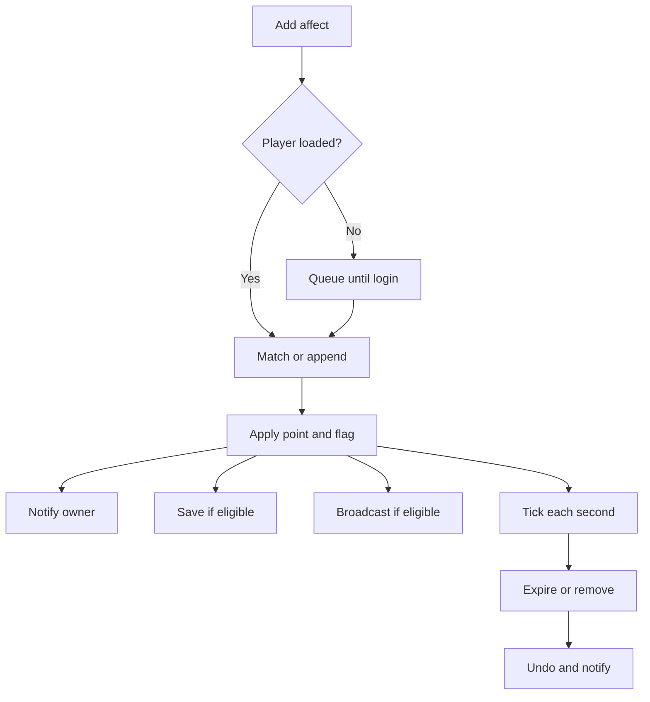

# Affect behavior

An affect applies a point change until it expires or is removed. This call replaces a matching record of type 700, or creates one if none matches.

```lua
ch:add_affect(700, point.MOV_SPEED, 20, 0, 600, 0, true)
```

## Life of an affect

The path below shows the main effects of an add and its eventual removal.



A loaded player's add searches for an override match, undoes the old points and tells the owner of the removal before rewriting a match. Otherwise it appends. The engine applies the points, updates the character if a flag or speed changed, broadcasts eligible types, notifies the owner, and saves eligible records. Infinite duration forces real-time off.

Every second, the engine charges cost and decrements duration. A positive cost charges SP, or HP when the `1 << 31` flag is set; the affect ends if the character cannot pay. Infinite duration and `IS_SPECIAL_BLOCK_CHAT_AFFECT` members do not count down. Premium types take remaining time from the premium table. When a type below 400 expires, its skill toggle turns off.

Removing an affect undoes its points, informs the owner and viewers, deletes its database row, and updates trait gates. Removing a type through `ch:remove_affect` removes every record of that type. A duration of 0 logs `Character::AddAffect lDuration == 0 type {}` and becomes 1 second, except for chat blocks, where it removes the block.

## Login, death, and persistence

Database records and script adds received before a player is fully loaded enter a queue. Database records enter first; the queue applies in order when the player enters the game. A query immediately after a queued add can return false. Active item affects are then restored, the tick starts, and living players have health and SP refilled. Broadcastable affects are sent to viewers already looking.

Real-time duration decreases by the time since logout at login; both kinds tick once per second online. A record that expired offline is still added: a negative remainder expires on its first tick, while exactly 0 becomes 1 second under the duration rule.

Death keeps no-clear types, skill tree affects, and privilege types; it removes the rest. Listing `AFFECT_QUEST_START_IDX` alone does not keep every quest affect: list each actual type. Leaving the game clears in-memory affects without deleting saved rows.

The database stores type, point, value, flag, duration, cost, and real-time status. Source VID has no column. A source-bearing affect can be written when added but is skipped on character save, so its old duration and no source can return at login. Make source-bearing types no-save. The supplied table key is player, type, point, and value; identical stacked records replace one row and return as one.

## Override and point identity

A record is identified by type and point, and by source when a nonzero source is requested.

| `override` | `match_exact` | Result |
| --- | --- | --- |
| `false` | Any | Always append; records stack. |
| `true` | `false` | Replace the first record of the type on any point; source 0 matches any source. This is the default for `affect.add_specify`, `affect.add_specify_vid`, and `ch:add_affect`. |
| `true` | `true` | Replace only a record on the exact point and, when nonzero, source. `ch:add_affect` exposes this option; `affect.add_specify_map` always uses it. |

An in-place replacement on a different point does not send viewers a removal for the old point. Use exact matching for separate points of a broadcast type, or explicitly remove before changing points.

## Broadcast and AFF channels

Broadcast is a state channel for players and monsters. Adds and removals reach the owner and viewers; the packet carries character, type, point, value, source, and absolute end time. Infinite duration uses end time 0. Flag, cost, and real-time status are not sent. State is not periodically resent.

The client keys records by type, point, and source, and counts records per type. The first attaches the type's particle and the last removal detaches it. A packet arriving before the character is retained until the character appears. A later viewer receives a replay of broadcastable records with end time computed from remaining duration. Virtual (avatar) characters are replayed like any other.

The AFF flag channel travels in character packets and drives its own particles and `chrmgr.HasAffectByVID`; it is independent of broadcast. See [client presentation](/docs/core/affects/client) and the [overview](/docs/core/affects/overview).
