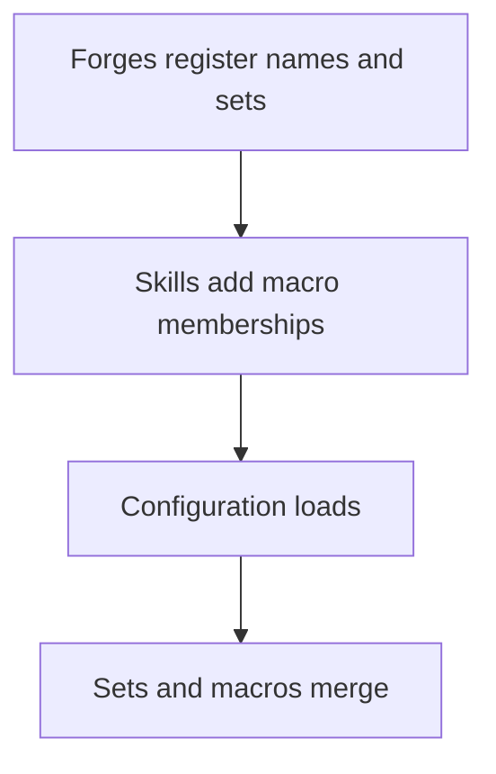

# Affect registration

Register names and rules before configuration refers to them. This top-level Lua registration makes a type visible to viewers and keeps it out of the database.

```lua
affect.add_name_definition("MY_BUFF", 700)
affect.add_no_save(affect.name_map.MY_BUFF)
affect.add_broadcastable(affect.name_map.MY_BUFF)
```

## Choose a type id

| Ids | Use |
| --- | --- |
| 1 to 399 | Skill vnums; a skill affect uses its skill vnum. |
| 400 to 698, and 999 | Engine types, including movement, damage, chat blocks, premium, land, blends, fishing, and item affects. |
| 699 to 998 | Free of engine names. |
| 1000 plus quest index | Quest affect; `AFFECT_QUEST_START_IDX` is 1000. |
| 10000 plus privilege id | Privilege affect, neither saved nor cleared on death. |

Choose a block in 699 to 998, or above 1000 plus the highest quest index you use and below 10000. Check `affect.name_map` and your own forges first. The type is the identity, so two systems using the same id collide silently. The built-in name table is not necessarily exhaustive.

## Configure type sets

In your locale base folder, `affect_config.yaml` accepts four optional top-level keys:

| Key | Meaning |
| --- | --- |
| `NO_SAVE_AFFECTS` | Do not save these types. |
| `NO_CLEAR_ON_DEATH_AFFECTS` | Keep them through death. |
| `BROADCASTABLE_AFFECTS` | Send them to viewers. |
| `macros` | Define named sets for lists and classification. |

A list or macro entry can be a numeric id, a registered name, another YAML macro, or a `range` with `from` and exactly one of `to_inclusive` and `to_exclusive`. Bounds may be names. A scalar resolves as a name first, then a macro. `NONE` resolves to 0, so it falls through to macro lookup and is rejected.

This configuration keeps the registered type through death and defines a small range.

```yaml
NO_CLEAR_ON_DEATH_AFFECTS:
  - MY_BUFF
macros:
  MY_TYPES:
    - range:
        from: 700
        to_inclusive: 702
```

A failed configuration load stops the game core at boot and logs `cannot load Affect Configuration: <file>`. The detailed log identifies the cause:

| Log text | Cause |
| --- | --- |
| `Error loading affect_config` | Invalid YAML or structure. |
| `Circular dependency detected in macros` | Macros include each other in a loop. |
| `Undefined identifier in macro` / `Undefined identifier in` a list | Unknown name, id, or macro. |
| `Invalid 'from'` or invalid upper bound | Unknown range bound. |
| `Range in macro` and `must have either 'to_inclusive' or 'to_exclusive'` | Missing upper bound, including in a list range. |
| `Invalid item in macro` / `Invalid item in affects list` | Entry is neither scalar nor range. |

## Macros the engine reads

| Macro | Purpose |
| --- | --- |
| `IS_SPECIAL_BLOCK_CHAT_AFFECT` | Special chat-block types do not tick down. The game needs this macro. |
| `IS_BLOCK_CHAT_AFFECT` | Includes `BLOCK_CHAT` and special blocks; duration 0 removes a block, and duration above 1 announces it. |
| `IS_ITEM_AFFECT` | Item types 671 to 691; used by configuration lists. |
| `IS_LAND_AFFECT` | Land bonus range; used by lists. |
| `IS_SKILL_AFFECT` | Skill range; used by lists. |
| `IS_MAP_CURSE` | Map curse types; used by lists. |
| `IS_GOOD_AFFECT` | Skill-applied buff classification for assist credit, announcements, and immunity. Lua adds do not consult it. |
| `IS_BAD_AFFECT` | Skill-applied debuff classification for assist credit and announcements. Lua adds do not consult it. |
| `IS_UNTARGETABLE_AFFECT` | Hides the holder from target acquisition and prevents attacks. |
| `IS_DISPELLABLE_AFFECT` | Types removed by `remove_good`. |
| `IS_CLEANSABLE_AFFECT` | Types removed by `remove_bad` in addition to poison and fire. |
| `IS_PARTY_BUFF_AFFECT` | Label populated by skills; no engine consumer. |
| `IS_DISPEL_CURSE_AFFECT` | Types retained by `ch:remove_bad_affect(false)`. |

Good and dispellable are separate classifications. Unknown macro names are accepted by registration and match nothing when queried; check spelling.

## Skill affect classes

An `AFFECT` node can add its type to macros. It uses `affectVnum`, or the skill vnum when that field is absent.

```yaml
per_use:
  - type: AFFECT
    id: my_buff
    affect_class:
      - IS_GOOD_AFFECT
      - IS_DISPELLABLE_AFFECT
    point: ATT_SPEED
    amountPoly: 2+14.5*skill_k
    durationPoly: '1800'
    collect:
      source: caster
```

Memberships only grow. A skill refresh adds memberships but does not remove earlier ones. A typo creates a separate macro.

## Item affects

`items_affect.yaml` maps affect items to types. The entry label is ignored.

| Field | Requirement | Meaning |
| --- | --- | --- |
| `vnum` | Required | Item vnum. |
| `affect` | Required | Numeric affect type. |
| `bonuses` | Optional, nullable | List of `type` apply names and `value` numbers. |
| `duration` | Required key, nullable | Duration in seconds. |
| `stackable` | Optional | Defaults to `false`. |

This entry gives a blend one bonus.

```yaml
MY_BLEND:
  vnum: 50821
  affect: 671
  bonuses:
    - type: MAX_HP
      value: 3000
  duration: 600
```

At creation, the item stores the type in socket 0 and, except for the permanent subtype, the duration in socket 2; 0 there means infinite. Using it removes its own affects, then switches it off if socket 5 is 1. Otherwise, unless stackable, it switches off other active items of the same type and adds one affect per bonus, with item id as flag and no override. Active items restore missing affects at login, so item types belong in the no-save set. No bonuses means no affect is added by this entry. Invalid YAML or a missing `duration` key raises an exception while loading game tables.

## Native registration and load order

The C++ registration interface supplies the same operations as Lua:

| Operation | C++ registration | Lua equivalent |
| --- | --- | --- |
| Name a type | `AddAffectStringDefinitions(name, value)` | `affect.add_name_definition` |
| Exclude from saves | `AddNoSaveAffect(int)` | `affect.add_no_save` |
| Keep through death | `AddNoClearOnDeathAffect(int)` | `affect.add_no_clear_on_death` |
| Broadcast | `AddBroadcastableAffect(int)` | `affect.add_broadcastable` |
| Add macro member | `AddToMacro(name, int)` | `affect.add_to_macro` |
| Load configuration | `Load(file)` | None |
| Query sets | `IsNoSaveAffect`, `IsNoClearOnDeathAffect`, `IsBroadcastableAffect`, `IsInMacro`, `GetMacroSet`, `FromString` | `affect.is_in_macro` queries macros. |

Built-in names populate the initial name table; the skill loader adds `affect_class` memberships. The diagram shows when YAML can resolve Lua names.



Configuration adds to existing sets. YAML macros resolve other YAML macros, and lists copy those YAML members. Members added by Lua or skills join the live macro but do not propagate into already flattened lists or including macros. Register no-save, no-clear, and broadcast behavior directly or list the type in YAML. See the [Lua API](/docs/core/affects/lua-api) and [overview](/docs/core/affects/overview).
